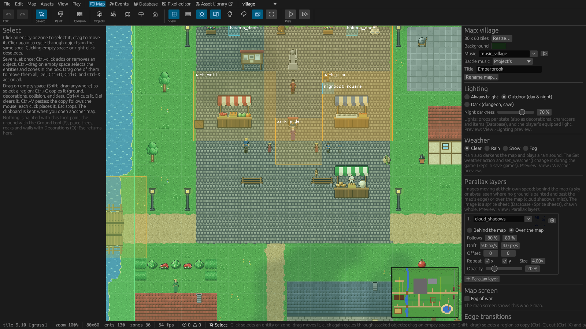

# 2. The editor



## The window

The editor is one window of **tabs** that can be arranged: drag a tab by its title to another
place, or to an edge of another tab to split the room between them. From top to bottom:

- **The menu bar**: *File* (save all, close the project), *Edit* (undo, redo, rename), *Defs* (a
  new definition, duplicate, delete), *Packs* (share and install packs), *Meta* (tags, folders,
  favourites, notes), *Map* (open, new, resize, the events graph, close), *Find* (go to anything,
  find usages), *Check* (check the project), *Assets* (reload art and scripts, clean up unused
  files), *Agent* (the AI agent server) and **Play** (from the title screen, on this map, again).
  Every entry is also in the **command palette** (**Ctrl+Shift+P**): type a few letters of what
  you want to do.
- **The Project browser** on the left: everything in the game in fixed groups, the same place for
  the same kind of thing. *Game* holds the game's own pages (the Overview, Game, Hero & party,
  Rules, World, Look & feel, Title & menus, Sound, Languages, Scripts & plugins, Asset library,
  Generate art, AI agents, Publishing); *World* the World view, the maps, structures, ground
  materials and scatter sets; then *Objects*, *Characters*, *Items*, *Rules*, *Story* and *Art &
  sound* with their kinds and how many there are. A click opens it as a tab, *+ New* beside a
  kind makes one. The filter at the top keeps what fits.
- **The documents** in the middle: the **Overview** (the checklist to a playable game, the guided
  tours, what is in the project, another project), a map, a definition with its form and its
  workshop, a script, a settings page, the World view, the Play tab, the Help tab, each as a tab.
- **Problems** and **History** below (see [Finding things](#finding-things) and [Saving and
  undo](#saving-and-undo)).
- **The status bar** says what was done last, whether everything is saved, how many errors and
  warnings the last check found, and the frames a second.

**F1** opens the manual in the Help tab at the part about the tab in front; with the pointer on a
field's label it explains that field.

### A map's tab

A map's tab shows it **isometric**, as the game does: the ground as diamonds, everything standing
upright at its feet. Its bar holds the **tools**, what is shown (the grid, zone areas, blocked
tiles, the light at an hour, the weather), the zoom
and **Events graph** ([Events › The Events graph](07-events.md#the-events-graph)). On the right the
**Outliner** lists what is on the map (characters, objects, items, scenery, zones; searched) and
the **Inspector** under it shows what is selected, or the map itself when nothing is. The active
tool's choices are on the left.

| Key | Tool |
|---|---|
| V | **Select** (the default): select, move and copy things; Alt+drag selects a region of tiles |
| P | **Terrain**: paint the ground with materials (brush, line, rectangle, fill; [ and ] change the size) |
| N | **Place**: characters, objects, items, scenery, structures and scatter sets, picked on the left |
| B | **Build**: walls along tile edges, rooms, houses and roofs ([Maps › Building walls, rooms and houses](03-maps.md#building-walls-rooms-and-houses)) |
| Z | **Zones**: spawn points, portals, transitions, trigger areas, spawners… |
| C | **Collision**: make tiles solid or walkable |

| Input | Action |
|---|---|
| Mouse wheel | Zoom |
| Middle-drag, Space+drag, arrow keys | Move the view (the arrow keys move along the screen) |
| R | Turn the selected thing, or the one about to be placed, a quarter |
| Right-click | A menu at that tile (play from here, paste here, what is selected); with Terrain: pick the material under the pointer |
| G / Home | Toggle the grid / the whole map in view |
| Ctrl+C / Ctrl+X / Ctrl+V | Copy / cut what is selected / paste it under the pointer ([Maps › Copying, cutting and pasting regions](03-maps.md#copying-cutting-and-pasting-regions)) |
| Ctrl+D / Delete | Duplicate / delete what is selected (a region: empties it) |
| Esc | Stop placing or building; else let go of the selection; else back to the Select tool |

Every map remembers where you were looking.

### Keys of the whole window

| Key | Action |
|---|---|
| Ctrl+S | Save everything: maps, definitions, settings, scripts, painted pictures, translations |
| Ctrl+Z / Ctrl+Y (or Ctrl+Shift+Z) | Undo / redo |
| Ctrl+N | *New…*: a new definition or map, picked from what can be made |
| Ctrl+P | **Go to anything** ([Finding things](#finding-things)) |
| Ctrl+Shift+P | The command palette |
| F5 | Play from the title screen, in the Play tab |
| F6 | Play on the map in front, where its view looks |
| F1 | The manual, at the part for what is in front |

## Saving and undo

**Ctrl+S** (*File › Save all*) saves everything. A map's tab says *changed* and its title gets a
`*` while it has unsaved changes; the status bar says *unsaved changes* while anything does.
Undoing back to what was saved makes it clean again.

**One history** holds every change, to maps and definitions alike: a stroke of paint, a thing
placed, a structure, a pasted region, a field of a form, a definition made, renamed or deleted,
a setting, and what an AI agent did. **Ctrl+Z** and **Ctrl+Y** step through it, in whatever tab
is in front; the **History** tab lists the steps by name, newest first. What you type into one
field is one step (until you move to another field). A text field you are typing in keeps Ctrl+Z
for its own text, and a picture being painted has its own undo while the pointer is over it.
Renaming a definition renames it in the maps and scripts too; undoing renames it back.

Closing the editor, closing the project or opening another one with changes that aren't saved
asks first: **Save and go on**, **Don't save** (what isn't saved is lost; the files stay as they
were) or **Stay**.

## Finding things

**Go to anything** (**Ctrl+P**, *Find › Go to anything*) opens a search box at the top of the
window. It finds maps, definitions of every kind (by id and name), script functions, the named
characters and objects and the zones of every map, and the lines of dialogs and choices. Letters
only need to come in order (`hpot` finds *health_potion*); exact ids and names come first. Arrow
keys and **Enter** (or a click) go there: a map opens, a definition opens in its tab, a function
opens in its script at its line, a character or zone is selected on its map, a dialog line
selects whoever says it. **Esc** closes the box.

**Where something is used**: a definition's tab lists it under **Used by** (the placed copies and
spawners on every map, the events that name it, other definitions, script lines, the settings),
each a link (*Find usages* in its header gives the same list as text, as scripts and AI agents
get it). Look there before deleting or changing a definition.

**Problems** (the tab below the documents; *Check › Check the project*, or **Check the project**
in the tab or on the Overview) lists what is broken in the project, grouped by where it is:

- **errors** (something is missing or can't work): definitions that refer to ids that don't
  exist or whose picture or sound file is missing; placed things whose definition is gone, events
  and loot naming unknown ids or script functions that don't exist, portals and transitions to
  missing maps, spawns or zones, spawners of unknown characters; unknown ids and compile errors
  in scripts; entries a map or definitions file had to leave out when it was loaded (they are lost
  when the file is saved again);
- **warnings** (probably not what you meant): maps no portal, transition, map edge, event or
  script leads to from the start map, quests without stages, script functions defined twice,
  untranslated texts and leftover translations per language, and what *Publishing* checks before
  an export (the start spawn, the player character, languages without a file).

A click on the place goes there: a definition opens, a thing or zone is selected on its map, a
script opens at the line. Some entries have their fix beside them: something that doesn't exist
can be **Created**, **taken from the library** when the asset library has it, or replaced
everywhere by **another** one that exists (*Use another…*); *No player character is set* and a
start map that doesn't exist offer the ones to **choose** from (*Choose one…*). After a fix the
project is checked again. The status bar shows the counts of the last check.

## Play-testing

The game runs in the **Play** tab, drawn by the engine as players see it: **F5** starts it from the
title screen, **F6** on the map in front where its view looks; the map's right-click menu starts
it on that tile. Everything is saved first (the game reads the project's files). Its bar:
*Restart* (as it was started, from the title screen, on the start map), *Pause* and *Step*, the
*Speed* (a quarter to four times), *Inspect* (a click on a character, prop or item opens it
instead of playing; Alt+click does it any time), *State* (the running game's flags, variables,
quests, party and bag, seen and changed), *Test setup…* and *Own window* (the same start in the
game's own window, as players run it: for the last check).

### Test-play from here


**Right-click on the map** (with the Select tool) for a menu at that tile:

- **Play from here**: a new game on this tile.
- **Play from here with the test setup**: on this tile with what the test setup says, to test a
  late scene without playing up to it.
- **Test setup…** opens the window (also in the Play tab's bar).

The **test setup** holds the hero's **level** and **class**, **items** (into the bag), **flags**,
**variables**, **quests** at a stage (or done), the **time** (hour and day; off = the project's
start hour) and the **party**: placed characters by name, on any map, who join as companions.
Every change in the window is kept at once (*Forget it* empties it); the Play tab's *State* panel
also keeps what a running game holds as the setup (*Keep as the test setup*). It is kept per
project in the editor's settings (not in the project). The editor writes it as
a save game (in its own settings folder, not the project's `saves/`) and starts the game with
it, so the map's *Map enter* triggers don't run, as when a game is loaded.

Play-tests run in developer mode:

- **Scripts reload live**: saving a script in the editor reloads it in the running game within
  half a second. A script with an error keeps the previous version running and shows the error.
- **F4 opens the developer console** (with the Play tab in front): give items, set flags and
  variables, jump in time, teleport, call script functions and run any line of script. See
  [Scripting › The developer console](08-scripting.md#trying-scripts-while-the-game-runs).
- **F3** shows the debug overlay (collision, zones, map edges, hitboxes).
- *Play-tests start in* (the *Languages* page) starts them in another language.

Exported games never have the console.

## Files and folders

Another project is made or opened under **Another project** at the end of the Overview (*Close
this project* there leads back to the start): *A new game* (its name, where it is kept, with the
basics from the asset library or empty), *Open a project* by where it is (*Browse…* for a project
file, *A folder…* for a project's folder) and the projects worked on lately. Fields that name a
file (a sheet's picture, a sound, a material's texture, a font) have a *Browse…* button; a file
from outside the project is copied into the project's `sprites/`, `materials/`, `sounds/` or
`fonts/` folder.

A project is one file, `<name>.r2dproject` (see [Getting started › Projects are one
file](01-getting-started.md#projects-are-one-file)). The Overview shows where it is. While it is
open the editor works on a copy of its files, laid out like this. You rarely need to touch them directly; the editor writes them, and the project file follows
within two seconds.

```
project.ron           the game's name, start map and spawn, pixel scale, player character and settings
defs/                 the definitions: items, props, characters, materials, scatter sets, sprite
                      sheets, sounds, fonts, quests, spells, recipes, achievements,
                      structures (text files)
maps/<name>.map       the maps
scripts/*.rhai        the scripts (all files share one namespace)
sprites/, materials/  the images (tilesets/: pictures of tiles from before 0.21, used as sheets)
sounds/               WAV and Ogg Vorbis files
fonts/                TTF / OTF fonts and their licence texts
lang/<code>.ron       translations
saves/                save games of play-tests (never exported)
```

All text files are plain RON. To keep a project in version control as files, develop it as a
folder: with the environment variable `RUSTPG2D_FOLDER_PROJECTS=1` the editor opens project
folders as they are instead of converting them (that is how the example game is kept in
R(ust)PG2D's own repository).

**Repository mode** (for working on R(ust)PG2D itself): the editor started with a checkout of the
R(ust)PG2D repository as its current folder (e.g. `cargo run -p rustpg2d-studio` in the
repository) opens the repository's `example_project/` directly, as a folder, and uses the starter
library (`crates/editor/assets/starter_library/`) as its asset library: *Send to library*, the
Library tab and the agent server's `library_send` change the repository's files. A project given
on the command line opens instead of the example; `RUSTPG2D_LIBRARY` still picks another library,
and `RUSTPG2D_REPO=0` turns the mode off. The starter library isn't filled from a starter set in
this mode (it is the starter set), so assets deleted there stay deleted; after changing it, run
`cargo run -p rustpg2d-editor-core --example starter_history`. Releases publish it as
`rustpg2d-starter-library-X.Y.Z.r2dlib` (`cargo xtask-dist` writes it, or
`cargo run -p xtask --features dist -- starter-pack DIR` alone).

### Cleaning up unused files

Models, pictures and sounds you add and never use make the project bigger. **Assets › Clean up
unused files** lists what the project has but doesn't use:

- **3D models, sprite sheets, sounds, ground materials and fonts** whose id nothing names: no map,
  character, item, prop, race, quest, cut-scene or other definition, no project setting, and no
  script or plugin file (an id that appears anywhere in a script's text counts as used, also inside
  a longer string). A used model's rig template and a used material's footstep sound count as
  used. So do the bodies the character creator offers, pieces (hair, outfits) that fit a used
  body, the mannequin and *Emotions* sheets.
- **Stray files** in `sprites/`, `models/`, `sounds/`, `materials/`, `fonts/` and `tilesets/` that
  no definition points to (pictures, models, sounds and fonts only: a folder's credits stay).

The project is saved first. Each entry shows its size; everything is ticked at first. **Delete the
ticked** deletes them (a definition goes with its files, unless something used shares them);
**Keep all** deletes nothing. Everything deleted is copied first into a folder beside the project,
`<name>-backup-cleanup` (then `-2`, `-3`…), with the definition files as they were; copy files back
from there to undo. The history is emptied of the definitions' steps (they would bring a deleted
definition back without its files).

When you **close the project or the editor**, or open another project, the same window opens by
itself first if the project has unused assets you haven't kept, with *Before you go: this project
has files nothing uses* on top: *Delete the ticked*, *Keep all* or the window's close button, and
the editor goes on (it looks at the project as it is saved: changes left with *Don't save* aren't
written). What you keep (unticked, or *Keep all*) is remembered for the project: it isn't offered
when it closes again, and comes unticked in the window from the Assets menu. Rig templates
(`rig_…` models) are editor tools: they are never offered for deletion.

Exported games leave unused assets out whether or not you clean up (see
[Publishing](14-publishing.md#what-you-get)).

### Files changed outside the editor

The editor watches the project's files (in a project file's working copy). When something else
changes them (another program, an AI agent, a `git pull` in a folder project), it reads them again
by itself if you have no unsaved changes there, also on a map that is open; otherwise a bar at the
top asks: *Take the files' version* or *Keep mine*.

### Files the editor can only read in part

A definition entry or a map object that can't be read (a typo from editing a file by hand, or
something written by a newer version) is left out instead of stopping the whole project from
loading. The Problems tab lists which entry it was, and the file is backed up next to itself
(`items.ron.bak`, `village.map.bak`) before the editor could save it without that entry. The game
logs the same and runs with the rest. Fix the entry in the backup or the original and reload.
