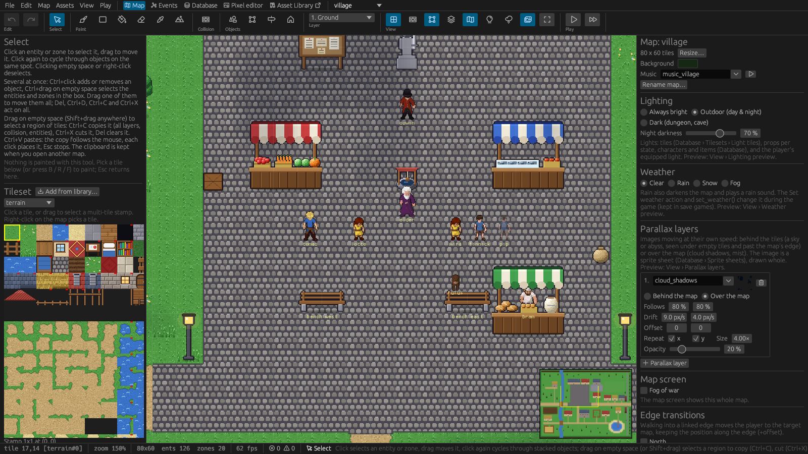

# 2. The editor



## The window

From top to bottom:

- **The menu bar** groups commands by task: *File* (projects, save all, export, import, quit),
  *Edit* (undo, redo, copy, cut, paste), *Map* (new, open, save, fit), *Assets* (new asset, add from
  library, import a package, the Asset Library window, save and reload definitions), *View* (grid,
  overlays, previews) and *Play*.
- **The mode tabs** next to it switch the main area: **Map** (painting and placing),
  **Events** (the map's triggers as a graph, see [Events](07-events.md#the-events-graph)),
  **Database** (all definitions, see [The Database](05-database.md)), **Pixel editor** (see
  [Art and sound](10-art-and-sound.md#the-pixel-editor)) and **Asset Library**, which opens the
  library in its own window (see [The asset library](11-asset-library.md)). The **map dropdown**
  shows the open map and switches to another one.
- **The ribbon** holds the tools as icon buttons in groups: *Edit* (undo, redo) · *Select* ·
  *Paint* (brush, rectangle, fill, erase, pick, terrain) · *Collision* · *Objects* (entities,
  zones, transitions, structures) · *Layer* · *View* (grid, collision overlay, zones, dim other
  layers, minimap, lighting preview, weather preview, fit) · *Play*. Hovering a button shows its
  name, its shortcut and a one-line how-to.
- **The left panel** shows the active tool's options (the tileset palette, the entity or structure
  palette, terrains) with the map's **Layers** underneath.
- **The map** in the middle, with a **minimap** in the corner.
- **The right panel** is the **inspector**: the selected entity's or zone's settings, or the map's
  own settings when nothing is selected.
- **The status bar** shows the tile under the mouse, the zoom, the map's size and counts, and the
  active tool's how-to.

## Tools and shortcuts

| Key | Tool |
|---|---|
| V | **Select** (the default): select, move and copy things |
| B | **Brush**: paint the selected tile or stamp |
| R | **Rectangle**: fill a rectangle; Shift+drag erases one |
| F | **Fill**: flood-fill an area of equal tiles |
| E | **Erase** |
| I | **Pick**: take the tile under the mouse into the brush |
| A | **Terrain**: auto-tiling paths, ponds, floors |
| C | **Collision**: make tiles solid or walkable |
| N | **Entities**: place props, characters and items |
| Z | **Zones**: draw spawn points, portals, trigger areas, spawners |
| T | **Transition**: link two maps with a two-way exit |
| H | **Structures**: place multi-tile assets |

| Input | Action |
|---|---|
| Mouse wheel, middle-drag, Space+drag, arrow keys | Zoom and pan |
| Right-click (tile tools) | Pick the tile under the cursor |
| 1–9 | Select a layer |
| G / Home | Toggle the grid / fit the map into the view |
| Ctrl+Z / Ctrl+Y | Undo / redo (in the Database mode: definition changes) |
| Ctrl+S | Save the map and the definitions |
| Ctrl+C / Ctrl+X / Ctrl+V | Copy / cut the selected region or entity / paste |
| Ctrl+D / Del | Duplicate / delete the selected entity or zone; Del on a region clears it |
| Esc | Deselect; stop placing or pasting; otherwise back to the Select tool |
| Ctrl+P | Quick search: maps, definitions, script functions, named characters, zones, dialog lines ([Finding things](#finding-things)) |
| Ctrl+M | Go to a map (searchable) |
| Ctrl+PgUp / Ctrl+PgDn | Previous / next map |
| F5 | Play-test from the camera position (or from the selected spawn point) |
| F6 | Play-test from the project's start |

Every map remembers where you were looking when you switch away and back.

## Saving and undo

**Ctrl+S** saves the open map and the definitions; *File › Save all* saves everything. A dot next
to the map's name (•), *defs •* or *• edited* in the pixel editor marks unsaved changes; undoing
back to the saved state makes them clean again.

Every edit on a map is one undo step (Ctrl+Z, Ctrl+Y), including placing a structure, pasting a
region and changes made by an AI agent. Renaming a definition saves at once, because it rewrites
every file that refers to it.

**Definitions have their own undo.** In the Database mode Ctrl+Z / Ctrl+Y, the **Undo** / **Redo**
buttons in its toolbar and *Edit › Undo (definitions)* step through the changes to definitions and
project settings: form edits, *+ New*, *Duplicate*, *Delete*, characters made in the character
builder and definitions an AI agent wrote. What you type into one field is one step (until you
pause for a moment or move to another field). Undoing a **rename** renames back, in the maps and
scripts too. A text field you are typing in keeps its own Ctrl+Z for its text. The last 100 steps
are kept until you open another project or the definition files are changed by another program.

## Finding things

**Quick search** (**Ctrl+P**, or *Edit › Quick search…*) opens a search box at the top of the
editor. It finds maps, definitions of every kind (by id and name), script functions, the named
characters and objects and the zones of every map, and the lines of dialogs and choices in
triggers. Letters only need to come in order (`hpot` finds *health_potion*, `shrine awa` finds
`shrine_awakening()`); exact ids and names come first. Arrow keys and **Enter** (or a click) go
there: a map opens, a definition opens in the Database, a function opens in the script editor at
its line, a character or zone is selected and centred on its map, a dialog line selects whoever
says it. **Esc** closes the box.

**Find usages** lists every place a definition is used: the **Usages** button above the
Database list, or right-click a name in the list › *Find usages*. The *Usages* window shows the
placed copies and spawners on every map, the triggers that name it (on maps, zones, objects and
definitions), other definitions that use it (shops, loot, recipes, equipment), script lines and
the project settings; click one to go there, *Refresh* after changes. Use it before deleting or
changing a definition.

**Problems** (*Edit › Problems…*, or click the error and warning counts in the status bar) lists
everything broken in the project in one window:

- **errors** (something is missing or can't work): definitions that refer to ids that don't exist
  or whose image or sound file is missing, characters without a body; placed objects whose
  definition is gone, triggers and loot naming unknown ids or script functions that don't exist,
  portals and transitions to missing maps, spawns or zones, spawners of unknown characters;
  unknown ids and compile errors in scripts; entries a map or definitions file had to leave out
  when it was loaded (they are lost when the file is saved again);
- **warnings** (probably not what you meant): maps no portal, transition, map edge, trigger or
  script leads to from the start map, quests without stages, script functions defined twice,
  untranslated texts and leftover translations per language, and the project check of *Export
  game* (start spawn, player character, languages without a file).

The buttons at the top show or hide errors and warnings, the list next to them picks one area
(project, definitions, maps, scripts, translations). Click an entry to go there: a definition opens
in the Database, an object or zone is selected and centred on its map, a script opens at the line.
The list is checked again whenever something is saved (in the editor, by an AI agent, or a file
that changed on disk) and with *Refresh*.

*File › New project*, *Open project* and *Close project* first ask to save or discard unsaved map,
definition and pixel-editor changes; *Cancel* keeps everything as it is.

## Play-testing

**F5** starts the game from where the camera looks (or from the selected spawn point), **F6** from
the project's start. Play-tests skip the title screen and the character creator and use the
default player name. Close the game window to return to the editor.

Play-tests run in developer mode:

- **Scripts reload live**: saving a script in the editor reloads it in the running game within
  half a second. A script with an error keeps the previous version running and shows the error.
- **F4 opens the developer console**: give items, set flags and variables, jump in time, teleport,
  call script functions and run any line of script. See
  [Scripting › The developer console](08-scripting.md#trying-scripts-while-the-game-runs).
- **F3** shows the debug overlay (collision, zones, map edges, hitboxes).
- *Play-test in* (*Database › Project › Languages*) starts play-tests in another language.

Exported games never have the console.

## Files and folders

*File › New project…* and *Open project…* use your desktop's file dialogs. Fields that take an
image or a sound have a *Browse…* button; a file from outside the project is copied into the
project's `tilesets/`, `sprites/` or `sounds/` folder.

A project folder looks like this. You rarely need to touch the files directly; the editor writes
them.

```
project.ron           the game's name, start map and spawn, pixel scale, player character and settings
defs/                 the definitions: items, props, characters, tilesets, sprite sheets, sounds,
                      quests, skills, spells, recipes, achievements, structures (text files)
maps/<name>.map       the maps
scripts/*.rhai        the scripts (all files share one namespace)
tilesets/, sprites/   the images
sounds/               WAV and Ogg Vorbis files
lang/<code>.ron       translations
saves/                save games of play-tests (never exported)
```

All text files are plain RON and can be kept in version control.

### Files changed outside the editor

The editor watches the project's files. When something else changes them (another program, an AI
agent, a `git pull`), it reloads them by itself if you have no unsaved edits to them; otherwise a
banner asks whether to *Reload* or *Keep mine*.

### Files the editor can only read in part

A definition entry or a map object that can't be read (a typo from editing a file by hand, or
something written by a newer version) is left out instead of stopping the whole project from
loading. A banner at the top says which entry it was, and the file is backed up next to itself
(`items.ron.bak`, `village.map.bak`) before the editor could save it without that entry. The game
logs the same and runs with the rest. Fix the entry in the backup or the original and reload.
