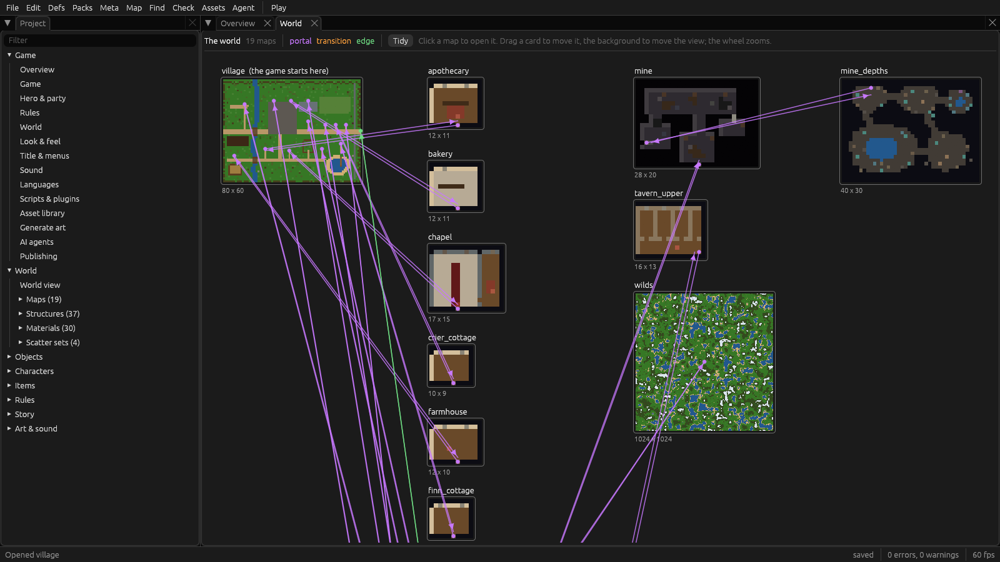
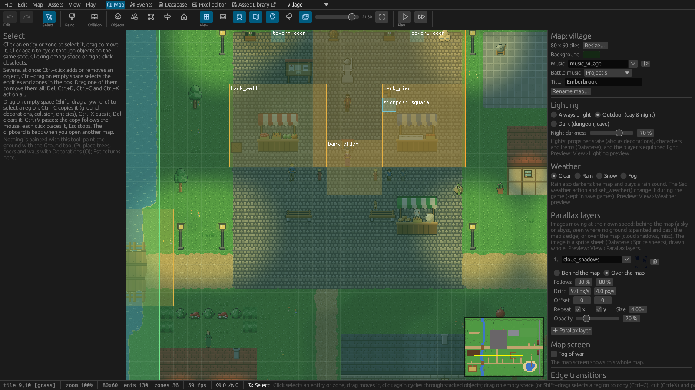

# 3. Maps

A map is one area of the game world: a village, a house's inside, a forest, a dungeon level, up to
1024 × 1024 tiles of 32 × 32 pixels large. Its ground is **painted** with materials (grass, a road,
a pond), trees, rocks, walls and buildings stand on it as **scenery**, and objects (props that do
something, characters, items) and zones are placed on it. The tile grid remains for what needs whole squares:
collision overrides, route planning, zones and positions in events and scripts.

## Creating and switching maps

- **A new map**: *New…* (**Ctrl+N**) › *Map*, or **+ New map** under *World › Maps* in the Project
  browser: a name (letters, digits, `_` and `-`), a size in tiles (40 x 30 to start with) and the
  ground it starts with. It opens in a tab of its own.
- **Opening one**: a click in the Project browser (*World › Maps*), **Go to anything** (Ctrl+P), a
  card of the **World view** (every map and the ways between them), or a link anywhere that names
  it. Each open map is a tab; several can be side by side.
- With nothing selected, the Inspector shows the map itself: its **Size** (*Resize* keeps the top
  left where it is; one step, undone as one) and its settings: the **Title** (the name players see
  on the map screen, at its exits and in the save list; empty = the map's name with a capital,
  e.g. *Tavern*), the **Background** colour shown outside the map and where no ground is painted,
  the light and weather, the map's **Music** (a looping sound; empty keeps whatever is playing),
  its **Battle music** (*Project's*: the one on the *Sound* page; *None*: the map's music plays on
  in fights; or a track of its own), what lies beyond its edges and its events. **Rename** a map
  with *Edit › Rename* (every reference in the project follows).

## Painted ground

The map's **painted ground** is a grid of 8 × 8 pixel cells (four per tile side), each holding a **material** ([Definitions › Materials](05-database.md#materials)): grass,
dirt, sand, water, cobblestone, snow… The game draws it with a shader that shapes where two
materials meet, so painted roads, shores and meadows have natural, uneven edges instead of tile
edges:

- **Crisp** materials (dirt, water, cobblestone) get a hard edge in steps of the art's pixels,
  made ragged by noise (*Raggedness*, *Edge pixel*);
- **Soft** materials (sand, snow, forest floor) fade into their neighbour;
- **Straight** materials (wooden floor, stone tiles, carpet, rug) follow the 8 px cells exactly,
  with straight lines and square corners; their rim is a border (the gold edge of the carpet);
- the material with the higher **priority** is drawn over the other where they meet (water over
  sand over grass), and a **rim** draws a fringe just outside a material's edge (the sandy band
  round the starter library's water);
- **moving** materials flow (*Flow*: the texture drifts, a river) or play **animation frames**
  (*Animation*: the example's rippling water, the starter library's lava, swamp water and
  waterfall pool), in the editor as in the game.

Painted ground **collides** by its cells: water stops walking exactly at its drawn edge (shots fly
over it: *Low*), a *Solid* material stops walking, shots and sight. Route planning (click-to-move,
characters) counts a tile as blocked when half its cells are. Collision painted on the
[Collision tool](#collision) wins over the ground (*walkable* frees a tile, *solid* blocks it).
Footsteps play the material's sound.

The starter library brings materials for grass, meadow, forest floor, dirt, farmland, sand, snow,
cobblestone, flagstones, stone tiles, wooden floor, carpet, rug, water, earth, cave floor and the
void, the animated **lava**, **swamp water** and **waterfall pool**, **mud**, natural **cave rock**,
**sandstone tiles**, and those its converted tile structures needed. A map uses at most 64 materials.

### The Terrain tool

**Terrain** (P) paints the ground. Its panel on the left lists the project's materials (searched)
and **Erase (no ground)**: click one, then paint on the map:

| Mode | Use |
|---|---|
| **Brush** | Click or drag a brush: **Round**, or **Square** for straight edges |
| **Line** | Drag from one end to the other: a road or a stream as wide as the brush |
| **Rectangle** | Drag from one corner to the other: a filled rectangle (a floor, a carpet, a field) |
| **Fill** | Click: the connected area of the same material (or of no ground) |

*Brush width* is in tiles; **[** and **]** change it. **On tiles** puts rectangle corners, the
square brush and line ends on the 32 px tile grid; off, they follow the 8 px cells. A rectangular
carpet: *Carpet*, *Rectangle*, drag over the floor. **Shift** erases (no ground: the background
shows), the **right button** takes the material under the pointer. Each stroke is one step of the
history.

AI agents paint the ground with `paint_ground` (circles, strokes, polygons) and `fill_ground`
([chapter 13](13-ai-agents.md)); editor scripts with `maptool terrain`, `mapground MATERIAL|erase
[brush|line|rect|fill] [WIDTH] [square] [snap]` and then `mapdrag` / `mapclick`
([Testing](17-testing.md)).

## Scenery

Trees, rocks, flowers, fences, walls and buildings stand on a map as **scenery**: props drawn as
pictures or models anywhere on the map (pixel positions, not tiles). A piece of scenery has its
prop's look, hitbox, solidity (*Low* included), light and *Ladder* flag, but no name, states,
events or interaction, so a map can hold tens of thousands of them (a 1024 × 1024 forest of 67 000
trees runs at full speed). A prop that does something (a door, a chest, a tree to chop) is placed
as an **object** instead ([Objects and zones](04-objects-and-zones.md)).

Each piece lies on a **layer**: *Flat* (on the ground, under everyone: rugs, puddles), *Sorted* (in
front of or behind characters by its feet: trees, rocks, walls, houses) or *Above* (over everyone:
treetops, roofs, arches); a prop that *lies flat on the ground* is *Flat* by itself.

**Place** (N) puts everything down: pick a prop, a character, an item, a structure or a scatter
set in its panel (searched, by kind), then click the map. What a prop is decides how it goes down:
a prop that only stands there becomes scenery, one that does something becomes an object. For
scenery the panel offers:

- **Layer**: *Its own* (the prop's), *Flat*, *Sorted* or *Above*;
- **Mirror at random**: each one placed is mirrored half of the time;
- **Facing · Turn** (or **R**) for props with a 3D model: the next ones a quarter further, their
  hitbox with them;
- a prop with a grid of its own (walls, fences: *Snap to*) is put down **in a row** by dragging;
- **Shift** places off the grid, where the pointer is.

A **scatter set** is brushed on: its props at random, keeping their spacing (*Forest*, *Rocks*,
*Wild plants*; [Definitions › Scatter sets](05-database.md#scatter-sets)); *Brush width* sets its size.
Each click or stroke is one step. Scenery is selected like anything else (a click, a box with the
Select tool) and deleted with **Delete**; *Make interactive* in its Inspector turns a piece into an
object (a name, events, states), *Make scenery* an object back into scenery. With *Blocked tiles*
on in the map's bar, solid things show what they block (red; yellow: low).

### Building walls, rooms and houses

The **Build** tool (**B**) puts up walls, rooms, houses and roofs by dragging, and doors and windows
by clicking. Its left panel picks the mode, the wall and the rest:

- **Walls**: drag, and the wall follows the mouse along the tile edges, round corners too (with
  **Shift**: a straight line from where the drag began). Thin walls and fences (the `*_thin`
  walls, *Fence section*) stand on the edges, north-to-south runs are the same wall turned a
  quarter (corners meet by themselves); thick walls (a town's stone wall, a hedge) fill the tiles
  the mouse passes. Pieces that stand there already are kept. **Right-click** a piece to take it
  away. The whole drag is one step.
- **Room**: drag the floor. It is painted with the chosen *Floor* material and gets its back walls
  (north and west), open to the viewer like the example's interiors, or with *Walls on all four
  sides* all four, a doorway left in the middle of the south wall. *With a roof* puts a roof over
  it (the *Roof* mode's kind and look).
- **House**: drag the footprint, pick a *Look* (any building prop) and the *Storeys* (1 to 3: each
  further one 48 px higher, with windows of its own). A new building prop is made in that look, as
  big as the rectangle (its door in the middle of the front, windows along the walls, a chimney
  when the look has one) and placed there; the prop's form changes its doors, windows and roof
  ([Definitions › Props](05-database.md#props)). **Drag a house against another one** (or
  start the drag inside it) and it becomes a **wing** of that one: as high and in its look, the two
  props are *joined* (*Joined to* in their forms), and where a ridge points into the other house its
  roof runs on until it meets that one's: an L- or T-shaped house under one roof. Each is still a
  prop of its own (its own hitbox, drawn in front of or behind characters by it); a placed house
  that others use as well gets a copy of its own first.
- **Roof**: a roof alone (building props with *Roof only*) over walls you built, in the chosen look
  and kind (gable, hip, shed, flat), as high as the tallest wall under or beside it (else the
  chosen wall). *Draw* says how: **Rectangle** (drag: a roof at once), **Paint** (paint its tiles
  by hand, any shape: an L, a T, a cross; a drag that starts on a marked tile clears, right-click
  clears one) or **Inside walls** (click inside a house of walls: its tiles and those of its
  walls are marked). **Build roof** (or Enter) cuts the marked tiles into rectangles, biggest
  first, and roofs them joined, each smaller part's ridge pointing into the bigger part it meets,
  so their roofs run into each other in valleys. It doesn't block the way; in play it fades out
  like anything else in front of the hero, so the hero stays visible inside.
- **Doors**: click a **house's wall** to put a door or window there (the house's own door and
  window pictures; a window clicked high on the wall sits that high: an upper floor's), or click a
  **wall piece** to put a *Door* (a door prop placed as an entity, so it opens in play), a *Window*
  piece (one of the wall props with a window) or a *Gap* (a doorway) in its place.
  **Right-click** a house's door or window, or a door put into a wall, to take it away (the wall
  piece comes back).

Each wall, floor, house, roof and door is one step of the history, the building props it made or
changed included. To keep what you built as a piece to place again, select it (a box with the Select
tool, or **Alt+drag** a region) and use **Save as structure** in the Inspector. Editor scripts:
`maptool build`, then `mapbuild walls [WALL] | room [WALL|-] [FLOOR|-] [all] [roof] | house
[LOOK|-] [STOREYS] | roof [LOOK|-] [gable|hip|shed|flat] [paint|fill] | doors door|window|gap
[PROP] | make | clear`, then `mapdrag X1 Y1 X2 Y2` or `mapclick X Y [right]` (tiles).

**Rooms** are drawn open to the viewer: a thin wall along the north and west sides of the floor,
nothing in front. The starter library's thin walls (*Grey stone wall (thin)*, *Plaster window
(thin)*… and their *thin, north to south* versions) stand on a tile's edge: the north wall's pieces
on the bottom edge of the tiles above the floor (a row along them), the west wall's on the right
edge of the tiles left of it (they snap to 8 px: place them at the tile's right edge). Fill the
tiles behind them with *Black void* (flat, solid). The example's interiors are built this way.
**Torches** hang on any wall: place *Wall Torch* as scenery on the floor tile in front of the
wall, close to it (it hangs at wall height with its back to the wall); **R** turns it to face east
for a west wall. It gives light, doesn't block the floor, and its *out* state is burnt out.
**Fences** work the same: *Fence section* runs east to west on a tile's bottom edge, and north to
south it is the same section turned a quarter (**R**, or what the **Build** tool's *Walls* lay along
a north-south edge). Every section carries a post at both ends, shared with its neighbour: runs end
on a post and corners need nothing more. A fence blocks the tile on its north or west side, so leave
a row and a column free inside an enclosure along its south and east fences. The library's *Fence,
vertical*, *Fenced flower garden*, *Animal pen* and *Graveyard* structures are built this way;
*Fence section (north to south)* is the older piece standing across a tile's middle.

AI agents place them with `place_objects`, `scatter` and `erase_objects` ([chapter 13](13-ai-agents.md)).

## Maps from older versions

This editor opens projects of R(ust)PG2D 0.35 and later. A project of an earlier version (tile maps
of 0.20 and before, 16 px tiles, the skill tree of 0.27) is refused with a message: open and save it
with R(ust)PG2D 0.35 first, which converts it once (tile maps become painted ground and scenery,
after a backup beside the project).

## Collision

What blocks movement comes from the painted ground (*Solid* and *Low* materials, by their cells)
and from solid scenery, objects and characters (by their hitboxes). The **Collision** tool (C)
overrides it per tile: the **left button** paints *force solid*, the **right button** *force
walkable* (a gap in a wall of scenery, a bridge over painted water), **Shift** goes back to the
ground's own rule. *Blocked tiles* in the map's bar shows it all over the map (red: blocked,
yellow: low, green: opened by hand).

### Low and high obstacles

Solid things come in two heights. **High** ones (walls, tree trunks, statues, market stalls) stop
walking, arrows, bolts and the sight of enemies. **Low** ones (fences, rocks, mushrooms, water,
tables, barrels, chairs) stop only walking: the player and the archers in the game shoot over them,
and enemies see across them. Which materials are low is set per material (its form's *Walking: Low*), which props are
low per prop (its form's *Low*, also for their
scenery); everything solid is high unless it is marked low. With *Blocked tiles* shown, low cells
and hitboxes are yellow, high ones red, and a tile painted *force solid* with the Collision tool
counts as high.

## Copying, cutting and pasting regions

With the **Select** tool, **Alt+drag** selects a rectangle of tiles (anywhere, also over things);
a yellow frame shows it, and the Inspector says how big it is and what stands in it.

- **Ctrl+C** (*Copy* in the Inspector) copies it with its ground: the painted ground, the scenery and
  the characters, objects and items whose feet stand in it, and the blocked tiles (zones are not
  copied).
- **Ctrl+X** (*Cut*) copies it and empties it; **Delete** (*Empty it*) only empties it.
- **Ctrl+V** puts it down with its north-west tile under the pointer (the map's right-click menu:
  *Paste here*), as one step of the history. A pasted region replaces the scenery in its rectangle,
  so trees don't stand in a pasted house. Pasted things keep their events; named ones get a free
  name (`guard` becomes `guard_2`). The pasted region is selected, ready to be pasted again.

The clipboard stays when you open another map, so regions move between maps. Things selected by a
click or a box are copied without the ground under them. The region's Inspector also has **Save as
structure**.

## Structures

Structures are ready-made pieces placed with one click: houses, wall and fence pieces, rooms,
ponds, groves, a plaza, a market row, and a piece of each landscape: a *Frozen pond* and a
*Snowy grove*, an *Oasis* and a *Desert ruin*, a *Cave chamber* and a *Crystal grotto*, a *Swamp
pool* and a dungeon's *Collapsed hall*. A structure paints ground, places scenery, sets collision
overrides (e.g. a walkable door) and places its objects (a shop's sign and barrel, a room's chest).
Tiles it marks *clear* lose the map's scenery first, so no tree stands in a room.

**Placing**: **Place** (N), *Structures* in its panel (searched, with their pictures). Pick one: its
outline follows the pointer, a click places it with its middle there. Each placement is one step.
Placed structures are ordinary ground, scenery and objects.

**Capturing your own**: select what should be in it (a box with the Select tool, or **Alt+drag** a
region of tiles), then **Save as structure** in the Inspector: a name, and *With the ground* (untick
it for things that should stand on any ground, a market stall, a camp). Its ground, the scenery and
things standing in it and its blocked tiles become the structure; with the ground, placing it
clears the area's scenery first.

**Editing a structure**: its tab (*World › Structures* in the Project browser; *New…* › Structure
for a new one) is the structure itself as a small map, drawn as in the game, with every tool of a
map but Zones: paint its ground, place and move things, build walls and roofs, set blocked tiles;
**R** turns. Its own tiles start at 1, 1; the tiles around them are room for what hangs over its
edge. What is done there is a step of the history like any change of a definition, and the
structure's pictures follow. The Inspector shows its size (*Resize*) and what is selected.

The example has 35 structures (pieces of nature and the buildings of the village); the starter
library adds town houses, a brick shop, a watchtower, city walls, fences, hedges, a plaza, a market,
a canal, a campsite and dungeon rooms, corridors and a prison cell. Their buildings are building
props (*Stone house*, *Thatched cottage*, *Timber-framed hall*, *Chapel*, the library's *Town house
(blue roof)*, *Brick shop* and *Stone watchtower*, with an invisible *Window glow* light behind each
lit window), the lookout tower the *Watchtower* model, the dungeon rooms standing walls with torches
hung on them, their trees the painted tree props.

## Map settings

Select nothing (Esc) and the Inspector shows the map's settings.

### Lighting

| Setting | Effect |
|---|---|
| **Always bright** | The default: no darkness. |
| **Outdoor (day & night)** | Bright by day, darker at night by the map's *Night darkness*, with warm dusk and dawn. The game shows the time of day. |
| **Dark (dungeon, cave)** | Constant darkness; at 100 % only light sources show anything. |

Light comes from props (per state, so a lamp can be lit or off; as scenery too), characters, items (a lantern in the hand, a torch on the ground), any placed entity, and
the player's equipped light. Each light has a radius in tiles, a colour, a strength and optionally a
flicker. A light lies on the ground around a point: by default north of a prop by two thirds of its
picture's height, a little north of a character's feet; *Its place (east, south)* (since 0.36) puts
it elsewhere, in pixels from the place of what carries it (a lantern on a post's arm, the hearth
at the back of a range). **Light** in the map's bar (with the hour beside it) shows darkness and
lights in the editor.

The clock itself is set on the *World* page (day length, the hour new games start at); see
[Gameplay › Time of day](09-gameplay.md#time-of-day).

### Weather

*Clear*, *Rain*, *Snow* or *Fog*, with a *Strength*. Rain falls in streaks with splashes, darkens
the map a little and plays a rain sound (players set its loudness with *Options › Sound › Ambience
volume*); snow drifts down; fog drifts over the map in soft clouds. Particles are drawn over the lit
scene, dimmer at night, with lamps showing through. **Weather** in the map's bar shows it in the
editor. The *Set weather* action and the scripts `set_weather` /
`set_map_weather` change it during the game; the change is kept in save games.

In the example, an eerie fog hangs over Whisperwood until the shrine is lit, and it rains in the
Wilds.

### Parallax layers

Images that move at their own speed: **behind the map** (a sky or an abyss, seen where no ground
is painted and past the map's edge) or **over the map** (cloud shadows, mist). Each layer
has a sprite sheet (drawn whole) and:

| Setting | Meaning |
|---|---|
| **Follows** x / y | 100 % moves with the ground, 0 % is fixed to the screen, in between looks far away |
| **Drift** | Pixels per second, for clouds that move by themselves |
| **Offset**, **Repeat** x / y, **Size**, **Opacity** | Placement, tiling, scale and transparency |

Their order in the list is the drawing order. The map's tab draws them as the game does. In the example,
cloud shadows drift over the Wilds and dark mist moves far below the mine's chasm.

### Map screen and fog of war

The in-game map screen (M) shows the whole map. Tick **Fog of war** and it only shows what the
player has explored: about six tiles around everywhere they have walked, with soft-edged fog over
the rest, and exits only once found. Explored areas are kept in the save game.

### Edge transitions and map triggers

*Edge transitions* let the player walk off a map's edge into the next map, and *map triggers* react
to the player arriving, waking up or the clock reaching an hour. See
[Objects and zones › Map transitions](04-objects-and-zones.md#map-transitions) and
[Events](07-events.md).

## Ladders

A prop with the **Ladder** flag (in the prop's form), placed as scenery, can be climbed by the
player: only up and down move, slower, and the hero is seen from behind and can't attack. Ladders
aren't solid, but other characters keep off them. A ladder's top can lead onto a platform or to
another map through a portal. The example's two watchtowers at the east gate are built this way
(roof and front rail over everyone, the lookout deck walkable, the braces solid; the library has them as the
structure *Lookout Tower*).

## Climbing, jumping and falling

Maps are flat, so height is built from three pieces (the SRD's movement rules):

- **Climbable walls and ropes:** a *Ladder* prop with an **Athletics DC** (in its form) is a
  wall the hero has to climb: stepping onto it rolls Athletics against the DC (on screen and in the
  roll log). A success climbs it like a ladder, at the ladder's slower speed; a failure finds no hold, and
  the hero can try again two seconds later. DC 0 is a plain ladder. The tiles under it need to be
  walkable (paint them *walkable* with the Collision tool when the wall is solid rock). The
  library has the **Rough rock wall** (DC 12) and the **Climbing rope** (no check).
- **Drops:** a *Drop* zone ([Objects and zones › Zones](04-objects-and-zones.md#zones)) over a
  pit or along a ledge's edge. Paint it dark (the *Abyss* material) and its tiles *walkable* with
  the Collision tool, so the player can step in. Walking in is a fall of the zone's height: 1d6
  bludgeoning per 10 ft (at most 20d6), prone for a moment, then the landing. That is a spawn on
  this map or another (a lower chamber, the level below), or with none the tile past the zone.
  Characters keep off drops, and the click-to-walk path goes round them.
- **Jumps:** running (Shift) at a drop, or walking 10 ft up to it, the hero leaps it when it is no
  wider than their Strength score in feet (half from standing): a hop over to the first free tile
  past it, or one beside it. A wider gap is a fall. A **click** (left or right) on the far side of a
  drop the hero can't walk round plans the jump too: the path runs three tiles straight at the gap
  and over it, then on to the clicked spot; a gap too wide for the hero is "Can't get there."
- **In fights** nobody steps into a drop, but walkers long-jump it as part of their move (the same
  distances, a run-up of two tiles walked straight at it this turn), and a fight ends when no foe
  can get at the party any more ([Gameplay › Fights](09-gameplay.md)).
- **Fliers** (a stat block with a fly speed: bats, birds, dragons) cross drops, water and other low
  obstacles in fights; walls and tall props still stop them.

The example's mine has both: the shaft in Grumbold's lair drops 20 ft into a small chamber whose
rough rock wall leads back up, and a 10-ft crack splits the corridor to the rats' nest (run to
jump it).
