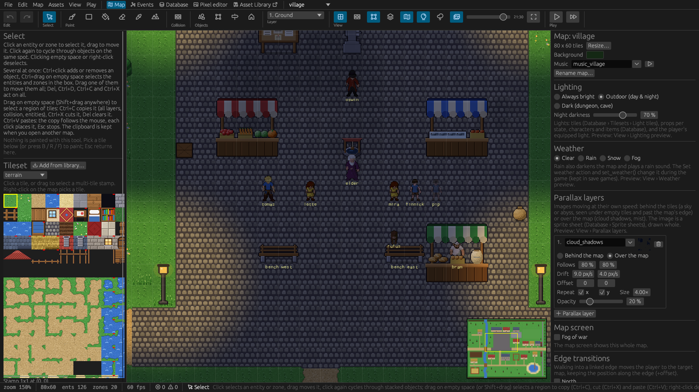

# 3. Maps

A map is one area of the game world: a village, a house's inside, a forest, a dungeon level. It is
a grid of 32 × 32 pixel tiles up to 1024 × 1024 tiles large, painted on layers, with entities
(props, characters, items) and zones placed on it.

## Creating and switching maps

- **Map › New map…** (or *+ New map…* in the map dropdown) asks for a name and a size. Map names may
  use letters, digits, `_` and `-`.
- The **map dropdown** in the top bar switches maps; **Ctrl+M** opens a searchable switcher;
  **Ctrl+PgUp / Ctrl+PgDn** step through the maps.
- With nothing selected, the inspector shows the map's settings: **Rename map…** (every reference
  in the project follows), **Resize…**, the **Background** colour shown outside the map and under
  empty tiles, and the map's **Music** (a looping sound; empty keeps whatever is playing).

## Tilesets and layers

A map is painted with tiles from **tilesets**: images cut into 32 × 32 pixel tiles. The *Tileset*
palette on the left shows one tileset at a time (the dropdown switches; *Add from library…* brings
another one from your asset library). Which tiles are solid, which are ladders, which glow and which
are animated is set per tileset in [*Database › Tilesets*](05-database.md#tilesets).

The **Layers** list under the palette holds the map's tile layers in drawing order. Each layer has a
checkbox to show or hide it, a name and an **overhead** flag: overhead layers are drawn above the
characters and never block movement (roofs, treetops, the top of a doorway). Layers can be moved up
and down, added (*+ Layer*) and deleted. The paint tools work on the **active layer**; keys **1–9**
select a layer, and *Dim inactive layers* in the ribbon fades the others while you paint.

A typical outdoor map uses a *Ground* layer (grass, paths, water), a *Detail* layer (walls, fences,
flowers) and an *Overhead* layer (roofs, treetops).

## Painting

| Tool | Use |
|---|---|
| **Brush** (B) | Click or drag to paint. Drag across several tiles in the palette to pick a **stamp** of tiles that is painted as a block. |
| **Rectangle** (R) | Drag to fill a rectangle with the tile or stamp; **Shift+drag** erases a rectangle. |
| **Fill** (F) | Flood-fills the area of equal tiles under the click. |
| **Erase** (E) | Empties tiles on the active layer. |
| **Pick** (I) | Takes the tile under the mouse into the brush; right-click does the same with every tile tool. |

Picking a tile in the palette switches to the Brush. The Select tool never paints.

## Terrains (auto-tiling)

Terrains paint paths, ponds, floors and fields whose edges fit by themselves.

1. Choose **Terrain** (A) and pick a terrain in the left panel, e.g. *Dirt path* or *Pond*.
2. Click or drag on the map. Every painted cell and its neighbours get the tile that matches which
   of their neighbours are the same terrain, so a path gets soft grass edges and a pond a shore.
3. **Shift+click** or drag erases: the cell gets the terrain's base tile (e.g. grass).
   **Right-click** picks the terrain under the cursor. Each stroke is one undo step.

Tiles painted this way are ordinary tiles; games need nothing special to show them.

### Defining a terrain

Terrains belong to a tileset: *Database › Tilesets › Terrains*. A terrain has:

- **16 tiles**, one per combination of its four side neighbours (north, east, south, west). The
  slots show yellow arms towards the neighbours that are the same terrain. Click a slot, then a
  tile in the grid below (the next slot follows), or use *Fill from a 4×4 block* when the tiles are
  drawn as a block in the slots' order.
- the **base tile** that erasing leaves (grass, stone floor).
- optionally **Corners (47 tiles)**: the terrain then also looks at its diagonal neighbours, so
  where a path bends or two paths meet, the grass gets a rounded inner corner. The slots become the
  47-tile ("blob") template, 7 × 7 in slot order, with yellow arms for the sides and blue ones for
  the corners; *Fill from template (7×7)* fills all 47 from a block drawn in that order. Empty slots
  fall back to the 16 tiles, so a half-filled set still paints.
- **joins**: other terrains whose cells count as its own for its edges. *Sand* joins *Shore* (the
  water lying on it), so sand shows no grass edge towards the water.

A preview shows a sample area while you edit. Each tile should belong to one terrain.

Every tileset of the starter library comes with 47-tile terrains: *terrain* (Dirt path, Pond, Sand,
Shore, Forest floor, Snowfield, Forest path, Stream, Flagstones, Rug, Cobblestone, Farmland, Meadow,
Carpet), *dungeon* (Earth, Chasm, Abyss), *desert* (Oasis, Hardpan), *mountains* (Snowfield, Mountain
path, Frozen lake) and *city* (Canal, Plaza). Water and chasm edges block movement.

Tiled's *Wang sets* come along when you import a Tiled map: a *mixed* set becomes a 47-tile
terrain, an *edge* set a 16-tile one ([Art and sound › Importing](10-art-and-sound.md#importing)).

## Collision

Whether a tile blocks movement comes first from its tileset (*Database › Tilesets*: solid tiles).
The **Collision** tool (C) overrides it per cell: **left-click** paints *force solid*,
**right-click** *force walkable*, **Shift+left** resets to the tileset's default. The *Collision*
button in the ribbon's View group shows the result as an overlay.

Props and characters have their own hitboxes and need no collision painting.

## Copying, cutting and pasting regions

With the **Select** tool, drag on empty space (or **Shift+drag** anywhere, also over entities) to
select a rectangle of tiles; a dashed outline shows it.

- **Ctrl+C** copies it: the tiles of all layers, the collision overrides and the entities standing
  in it (zones are not copied).
- **Ctrl+X** copies it and empties it; **Del** only empties it.
- **Ctrl+V** arms the copy: it follows the mouse as a transparent preview, and every click pastes it
  as one undo step, until Esc or right-click. A pasted copy replaces everything in its rectangle,
  so trees don't grow through a pasted house. Pasted entities keep their triggers; named ones get a
  free name (`guard` becomes `guard_2`).

The clipboard stays when you open another map, so regions move between maps. A selected entity can
be copied on its own too. The region's inspector has the same commands plus **Save as structure…**.

## Structures

Structures are multi-tile assets placed with one click: houses, wall and fence pieces, rooms,
ponds, groves, a plaza, a market row. A structure sets tiles on several layers, collision overrides
(e.g. a walkable door) and places its entities (a shop's sign and barrel, a room's chest). Empty
upper-layer cells inside it clear what the map had there, so no tree grows through a room.

**Placing**: choose **Structures** (H). The palette groups them by category with thumbnails (search
box, *Add from library…*). Pick one: a transparent preview follows the mouse, a click places it,
right-click or Esc stops. Each placement is one undo step. Placed structures are ordinary tiles and
entities; games need nothing new to show them.

**Capturing your own**: *New from map area…* in the Structures palette (or *Save as structure…* on
a selected region): drag a rectangle on the map, then give it an id, a name and a category. Untick
*Include the ground layer* for things that should stand on any ground. Its tiles, collision
overrides and the entities standing in it become the structure.

**The structure editor** (*Database › Structures*; new ones with *New asset… › Structure*, as an
empty grid or a copy of another one) has three columns:

- **Left**: the tools (*Tiles*: paint, erase = the map keeps its tile, clear map tile = placing
  removes the map's tile; *Collision*: solid, walkable, tileset default, keep the map's;
  *Objects*: place a prop) and the **layer stack** *Overhead*, *Detail*, *Ground* with checkboxes to
  show or hide them; click a layer to paint on it. Below: the size (*Resize*) and undo / redo.
- **Middle**: the grid. Click or drag to paint; right-click picks a cell's tile (or removes a prop).
- **Right**: the tileset (drag over tiles for a stamp), the collision legend, or the prop gallery.

The example has 34 structures (terrain pieces and the buildings of the village); the starter library
adds town houses, a brick shop, a watchtower, city walls, fences, hedges, a plaza, a market, a
canal, a campsite and dungeon rooms, corridors and a prison cell.

## Map settings

Select nothing (Esc) and the inspector shows the map's settings.

### Lighting

| Setting | Effect |
|---|---|
| **Always bright** | The default: no darkness. |
| **Outdoor (day & night)** | Bright by day, darker at night by the map's *Night darkness*, with warm dusk and dawn. The game shows the time of day. |
| **Dark (dungeon, cave)** | Constant darkness; at 100 % only light sources show anything. |

Light comes from tiles (*Database › Tilesets › Light tiles*), props (per state, so a lamp can be lit
or off), characters, items (a lantern in the hand, a torch on the ground), any placed entity, and
the player's equipped light. Each light has a radius in tiles, a colour, a strength and optionally a
flicker. **View › Lighting preview** (the bulb in the ribbon, with a time slider for outdoor maps)
shows darkness and lights in the editor.

The clock itself is set in *Database › Project* (day length, the hour new games start at); see
[Gameplay › Time of day](09-gameplay.md#time-of-day).

### Weather

*Clear*, *Rain*, *Snow* or *Fog*, with a *Strength*. Rain falls in streaks with splashes, darkens
the map a little and plays a rain sound (players set its loudness with *Options › Ambience
volume*); snow drifts down; fog drifts over the map in soft clouds. Particles are drawn over the lit
scene, dimmer at night, with lamps showing through. **View › Weather preview** (the cloud in the
ribbon) shows it in the editor. The *Set weather* action and the scripts `set_weather` /
`set_map_weather` change it during the game; the change is kept in save games.

In the example, an eerie fog hangs over Whisperwood until the shrine is lit, and it rains in the
Wilds.

### Parallax layers

Images that move at their own speed: **behind the map** (a sky or an abyss, seen under empty or
see-through tiles and past the map's edge) or **over the map** (cloud shadows, mist). Each layer
has a sprite sheet (drawn whole) and:

| Setting | Meaning |
|---|---|
| **Follows** x / y | 100 % moves with the ground, 0 % is fixed to the screen, in between looks far away |
| **Drift** | Pixels per second, for clouds that move by themselves |
| **Offset**, **Repeat** x / y, **Size**, **Opacity** | Placement, tiling, scale and transparency |

The arrows change the drawing order. **View › Parallax layers** previews them. In the example,
cloud shadows drift over the Wilds and dark mist moves far below the mine's chasm.

### Map screen and fog of war

The in-game map screen (M) shows the whole map. Tick **Fog of war** and it only shows what the
player has explored: about six tiles around everywhere they have walked, with soft-edged fog over
the rest, and exits only once found. Explored areas are kept in the save game.

### Edge transitions and map triggers

*Edge transitions* let the player walk off a map's edge into the next map, and *map triggers* react
to the player arriving, waking up or the clock reaching an hour. See
[Objects and zones › Map transitions](04-objects-and-zones.md#map-transitions) and
[Events](07-events.md).

## Special tiles

These are set per tileset in [*Database › Tilesets*](05-database.md#tilesets):

- **Animated tiles**: water, lava, waterfalls; an animation is a list of tiles shown in turn, in
  the game and in the editor.
- **Light tiles**: windows and lamps that glow at night (a bulb marks them).
- **Ladders**: the player climbs them; only up and down move, slower, and the hero is seen from
  behind and can't attack. Ladder tiles aren't solid, but other characters keep off them. A
  ladder's top can lead onto a platform drawn with tiles or to another map through a portal. The
  example's two watchtowers at the east gate are built this way (roof and front rail on the
  Overhead layer, the lookout deck walkable, the braces solid); the library has them as the
  structure *Lookout Tower*.
