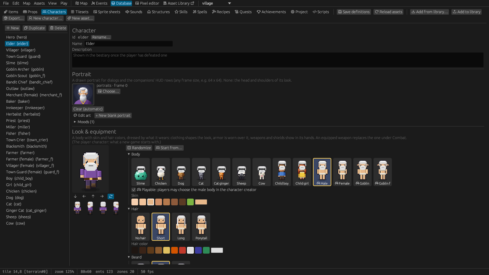
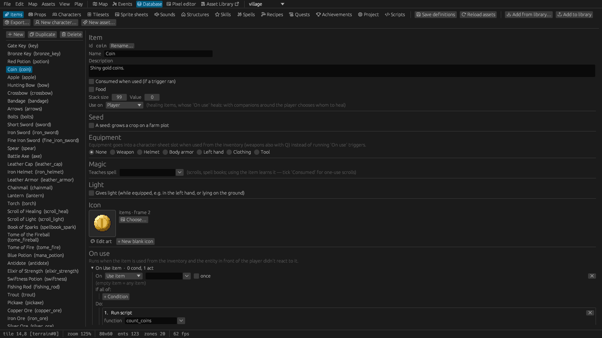

# 5. The Database

The **Database** tab holds every kind of thing in your game. A map places copies of them; the
Database says what they are.

## Working with definitions

The tabs along the top are *Items, Props, Characters, Tilesets, Sprite sheets, Sounds, Structures,
Skills, Spells, Recipes, Quests, Achievements, Project* and *Scripts*. Each asset tab has a list on
the left and the selected definition's form on the right.

- **+ New**, **Duplicate** and **Delete** manage the list, **Usages** lists every place the
  selected definition is used ([Finding things](02-the-editor.md#finding-things)); **New asset…** starts a wizard that also
  draws the art ([Art and sound](10-art-and-sound.md#new-assets)), **New character…** opens the
  character builder.
- Every definition has an **id** (used by the files, triggers and scripts) and a **name** (shown to
  players). **Rename…** next to the id changes the id everywhere: maps (also those not open),
  triggers, other definitions, the project settings and the scripts (only the exact arguments of
  script functions; changed script files keep a `.rhai.bak` backup). It saves at once.
- **Add from library…** copies assets from your asset library into the project; **Add to library**
  and **Export…** send the selected definition to the library or into a package
  ([The asset library](11-asset-library.md)).
- **Undo** / **Redo** (Ctrl+Z / Ctrl+Y) step back and forth through the changes to definitions,
  renames included ([The editor › Saving and undo](02-the-editor.md#saving-and-undo)).
- **Save definitions** (or Ctrl+S) writes the files; **Reload assets** reads images and sounds again
  after you changed them in another program.

### Choosing sprites

Item icons and prop states show a large preview and a **Choose…** button. The chooser lists every
sprite sheet as a thumbnail (with a search) and the chosen sheet's frames, as numbered thumbnails or
as the sheet's grid, where you drag over several cells for a big prop. Frames other definitions
already use are marked (hover shows by whom). Click to pick, double-click to pick and close.

**Edit art** opens the pixel editor under the form at the definition's sprite. **+ New blank icon**
(or *frame for this state*) finds an empty frame on the sheet, or adds a row of frames when the sheet
is full, assigns it and opens it for drawing.

## Items

| Section | Settings |
|---|---|
| **Basics** | Name, description, **Stack size** (how many fit in one inventory slot), **Value** (the default shop price), **Consumed when used**, **Food** (healing that the *Cooking* skill improves) |
| **Icon** | The inventory picture; **Held sprite**: how it looks in a character's hand (a sheet of kind *Held item*) |
| **Use on** | *Player* (the default), *Player or companion* (asks whom to heal when a companion is around) or *Companions* |
| **Equipment** | *None, Weapon, Helmet, Body armor, Left hand, Clothing* or *Tool* (below) |
| **Seed** | Makes it plantable on farm plots: growth stages with a sprite and hours each, and the harvest ([Farming](09-gameplay.md#farming)) |
| **Magic** | **Teaches spell**: using it teaches a spell (a scroll that is consumed, a book that isn't) |
| **Light** | Glows while equipped or while lying on the ground (lanterns, torches) |
| **On use** | Triggers that run when the player uses the item: heal, give something, run a script ([Events](07-events.md)) |

**Equipment kinds:**

- **Weapon**: melee (damage, cooldown, reach, swing arc, knockback) or ranged (projectile sprite,
  speed, range, ammo item). **Two-handed** weapons (spear, bow, crossbow) can't be used with a
  shield or a light. A weapon can apply a status effect **on hit**. **Critical hits**: the chance
  (5 % by default) that a hit of the player's with it is critical: double damage and a big yellow
  number (enemies don't hit critically).
- **Helmet**, **Body armor**: defense, a speed change (heavy armor slows), and an overlay sprite
  sheet drawn over the wearer.
- **Left hand**: shields (defense) or lights (a lantern, a torch: give the item a *Light*).
- **Clothing**: outfits shown on the body, with a **Female cut** sheet for female bodies.
- **Tool**: a *Tool kind* (`rod`, `pickaxe`, `hammer`, `hoe`…) for activities, gathering, fishing
  and crafting recipes. Held in the right hand while used.

## Props

| Section | Settings |
|---|---|
| **States** | Every prop has a list of named states, each with its own sprite and whether it blocks movement (an iron gate: *closed*, *open*, *destroyed*; a shrine: *dormant*, *glowing*). The first is the default. *+ Add state*, *Make default*, the arrows and ✖ organise them; renaming a state updates placed props and triggers. |
| **Size and hitbox** | *Size (cells)* for props made of several frames of their sheet (a 2 × 2 double gate, a 3 × 4 oak), and the collision box (e.g. only the trunk), so the player walks behind big crowns. |
| **Low** | While solid, the prop stops walking but not shots or sight (barrels, chairs, crates, fences). Solid props that aren't low stop arrows and bolts where their hitbox is (a tree at its trunk); see [Maps › Low and high obstacles](03-maps.md#low-and-high-obstacles). |
| **Lockable** | A default lock for every copy: the key item, whether the key is *used up* or *stays*, what happens when unlocked (disappear, or switch to a state such as *open*), the locked / unlocked messages, *Can be locked again with the key*, and a **Lockpicking** difficulty. A lock without a key item is a door that simply opens. |
| **Lootable container** | Slots, starting contents, *Opens only if* conditions with a locked message, and the state to switch to when first opened. Contents are saved. |
| **Furniture** | Makes it sittable or a bed ([Gameplay › Furniture](09-gameplay.md#furniture-sitting-and-sleeping)). |
| **Gathering** | Mined or picked with a tool ([Gathering and mining](09-gameplay.md#gathering-and-mining)). |
| **Farm plot** | Takes seeds ([Farming](09-gameplay.md#farming)). |
| **Light** | A light per state: a lamp lit in *lit* and dark in *off*. |
| **Triggers** | Triggers every copy of the prop runs ([Events](07-events.md)). |

The *Set prop state* action and `set_state(target, "name")` switch states during the game, the
*Prop state* condition checks them, and the current state is saved.

**Locks in the game**: interacting with a locked prop checks the inventory for the key, uses it up if
so set, and unlocks it: a chest then opens, a gate disappears or switches state. Locked props show a
padlock when the player is near. *Can be locked again* lets the player close and lock an opened gate
again while carrying the key (not while someone stands in it). The *Unlocked* and *Locked again*
events and the *Set locked* action react to and control locks. With the Lockpicking skill, players
can pick a lock instead ([Lockpicking](09-gameplay.md#lockpicking)).

## Characters

Characters have the most settings: look and equipment, behaviour, combat values, loot, a shop, a
portrait and moods. They have their own chapter: [Characters](06-characters.md).

## Tilesets

| Setting | Meaning |
|---|---|
| **Image** | The tileset picture (*Browse…* copies it into `tilesets/`), cut into 32 × 32 tiles |
| **Solid tiles** | Click tiles in the grid to make them block movement by default |
| **Light tiles** | Tiles that glow (windows, lamps): a list, or *Pick light tiles in the grid*. A bulb marks them |
| **Ladder tiles** | *Pick ladder tiles in the grid*; a green ladder icon marks them |
| **Low tiles** | *Pick low tiles in the grid*: solid tiles that stop walking but not shots or sight (fences, rocks, water, tables; [Maps › Low and high obstacles](03-maps.md#low-and-high-obstacles)). They are drawn yellow instead of red, with an arrow mark |
| **Animations** | Add an animation, then click tiles in the image to append its frames (water, lava, waterfalls) |
| **Terrains** | Auto-tiling terrains ([Maps › Terrains](03-maps.md#defining-a-terrain)) |

## Sprite sheets

A sprite sheet is an image divided into frames of one size. Characters, props, item icons, effects,
portraits and parallax images all come from sprite sheets.

| Setting | Meaning |
|---|---|
| **Image**, **Frame size** | The picture and the size of one frame (in image pixels) |
| **Scale** | 1× normally; 2× (3×, 4×) for high-resolution art: the frames are drawn at half (a third, a quarter) of their pixel size, so 64 × 96 frames fill a 32 × 48 place ([Art and sound › High-resolution sprites](10-art-and-sound.md#high-resolution-sprites)) |
| **Kind** | *Character body, Hair, Beard, Outfit, Armor, Held item, Emotions* or plain. The character builder offers sheets by kind; every animation of an *Emotions* sheet is an emotion shown over heads ([Events › Emotions over heads](07-events.md#emotions-over-heads)) |
| **Female body** | For bodies: outfits use their female cut on it |
| **Playable** | For bodies: players may choose it in the character creator |
| **Complete figure** | For bodies: clothes, hair and held items are painted in; nothing is drawn over it and it isn't recoloured |
| **Animations** | Named frame ranges (imported from Aseprite tags, or made here) for the *Effect* and *Fly* actions |
| **Used by** | Which items, props and characters use the sheet |

The pixel editor sits right below the form ([Art and sound](10-art-and-sound.md)).

## Sounds

Each sound has an id, a file (WAV or Ogg Vorbis, copied into `sounds/` by *Browse…*) and a volume.
*Play* and *Stop* preview it. Sounds are used by the *Play sound* and *Play music* actions, a map's
music, the game's built-in sounds (*Database › Project › Game sounds*) and scripts. See
[Art and sound › Sounds and music](10-art-and-sound.md#sounds-and-music).

## Quests

A quest has an id, a **title**, a **description** (shown in the journal), an **experience reward**
and **stages**, one objective each. Write `{name}` in a stage to show the value of variable `name`,
e.g. "Defeat slimes in Whisperwood ({pest_slimes}/5)".

Triggers drive quests with the **Quest** action (*start*, *advance to the next stage*, *set stage*,
*complete*, *fail*) and check them with the **Quest** condition (*not started*, *active*,
*completed*, *failed*, *active at stage*, *at stage or later*). The player gets a message for every
change and follows the progress in the journal (J). See [Events › A quest](07-events.md#a-quest).

## Skills, spells, recipes and achievements

These belong to the game systems they drive: [Skills and magic](09-gameplay.md#skills-and-magic),
[Crafting](09-gameplay.md#crafting-cooking-and-blacksmithing) and
[Achievements](09-gameplay.md#achievements).

## Project

*Database › Project* holds the game's own settings:

| Section | Settings |
|---|---|
| **Project** | Name; start map and start spawn; pixel scale; inventory slots; the clock's **day length** (real minutes per in-game day, default 24; 0 = time stands still) and the hour **new games start at** |
| **Player character** | The character definition the player is, and the **player portrait** |
| **Character creator** | Whether it's shown at a new game, the player character's sex (*Player chooses*, *Always male*, *Always female*), the default name, the playable bodies, skin colours, hair styles, hair colours and beards offered ([Characters › The player](06-characters.md#the-player-character-and-the-character-creator)) |
| **Dialog portraits** | Show the speaker's portrait in dialogs (on by default) |
| **Companions at 0 HP** | Knocked down until healed (default), get up after some seconds, or go home ([Companions](06-characters.md#companions)) |
| **Skills & magic** | Turn on skills and magic; starting skill points, max mana, mana regeneration |
| **Experience and levels** | XP for level 2, growth per level, highest level, and what each level adds (max HP, mana, skill points) |
| **Game sounds** | The sounds the game plays by itself: pickups, attacks, hits, dialogs, doors |
| **Languages** | The language the game is written in, translations, *Play-test in* ([Languages](12-languages.md)) |
