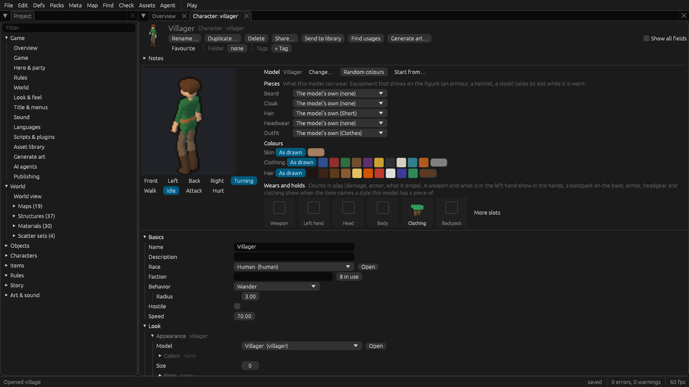
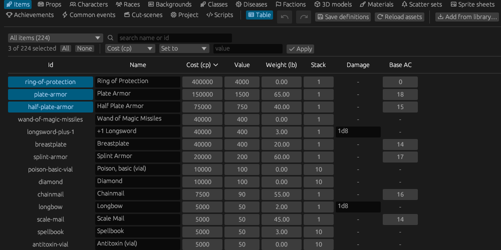
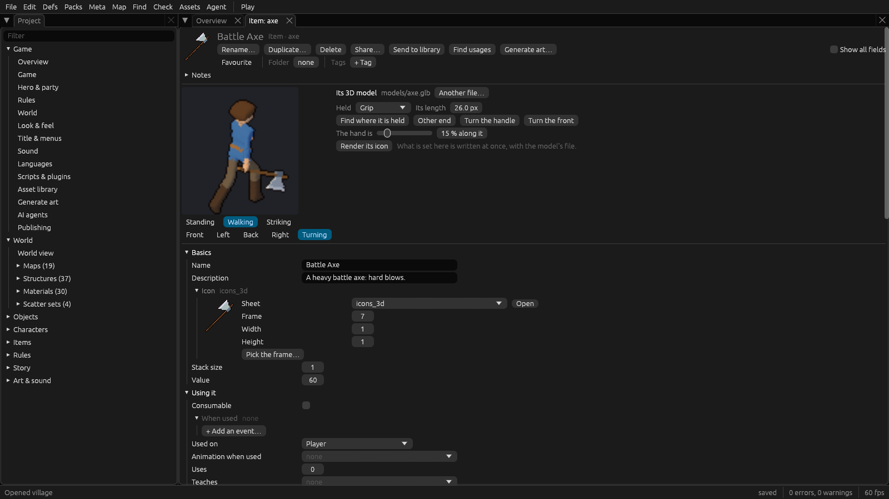
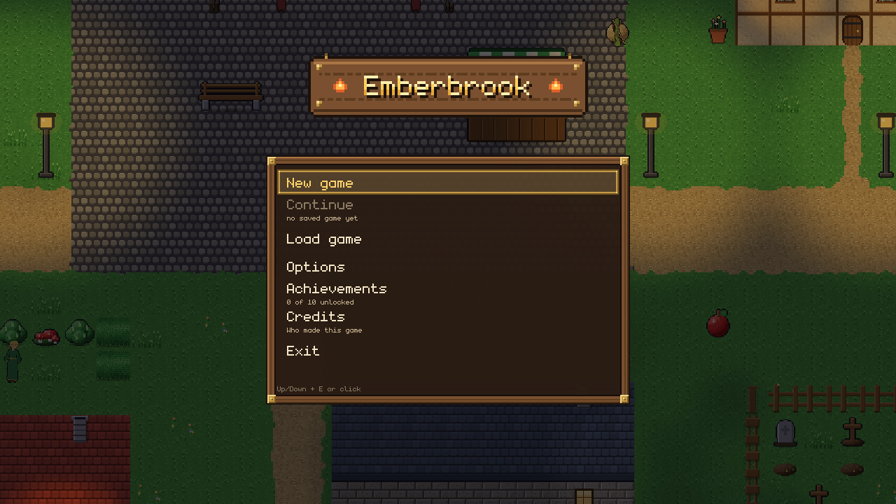
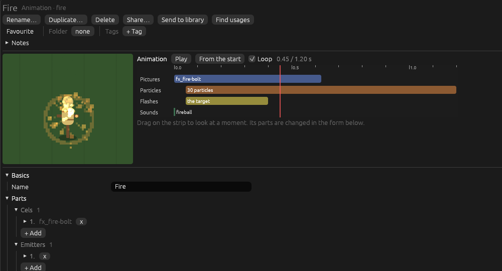

# 5. Definitions

Every kind of thing in your game is a **definition**: an item, a prop, a character, a sound, a
quest… A map places copies of them; the definition says what they are. They are listed in the
**Project browser** by what they are (*Objects*, *Characters*, *Items*, *Rules*, *Story*, *Art &
sound*, and under *World* the materials, scatter sets and structures), and each opens in a tab of
its own.

## Working with definitions

A definition's tab has a **header**: its picture, name, kind and id, and the buttons **Rename…**
(changes the id everywhere: maps, also those not open, events, other definitions, the settings and
the scripts, only the exact arguments of script functions; changed script files keep a
`.rhai.bak` backup), **Duplicate…**, **Delete** (refused while something uses it), **Share…** (as a
pack, [The asset library](11-asset-library.md)), **Send to library**, **Find usages** and, where
Meshy can draw it, **Generate art…** ([Art and sound](10-art-and-sound.md#generate-art-with-meshy)); then the
creator's own order: **Favourite**, a **Folder**, **Tags** (*+ Tag*) and **Notes**, kept in the
project for you (the game never reads them). After a project check, what is wrong with it is said
there too. **Used by** lists every place that names it, each a link.

Under the header, some kinds have a **workshop**: a prop's stage, a character's figure, a 3D
model's animations, an item in the hero's hand, an animation played, a sound, a sheet cut into
frames, a cut-scene's timeline, a visual script's canvas ([Art and sound](10-art-and-sound.md),
[Characters](06-characters.md)). Then the **form**:

- Its fields come in **sections** that fold; every field has a label, and its help on hover
  (**F1** with the pointer on the label, or *About this field* in the label's menu, opens it in the
  Help tab). *Show all fields* adds the ones for advanced use.
- A field the file leaves out shows its **default, dimmed**, so what was set stands out; *Back to
  the default* in a label's menu (right-click) sets it back.
- A field that names another definition is a **picker**: what it names (in red when it doesn't
  exist), a searchable list with pictures, *none*, **+ New…** (makes one and comes back) and
  **Open**. A field that names a file has **Browse…**; a flag, a variable, a script function, a
  faction or a prop's state is typed, with the ones **in use** listed beside it.
- Lists have *+ Add*, *Remove* and a menu to move or copy an entry; a list of events is an
  [event sheet](07-events.md).
- Every change is a step of the one history (Ctrl+Z), and is written with *Save all* (Ctrl+S).
  What is typed but isn't valid yet stays in the form with the reason, until it is.

**New ones**: **Ctrl+N**, *+ New* beside a kind in the Project browser, or *+ New…* in a picker,
opens **New…**: the kinds as the browser groups them, each with a sentence on what it is; a name
(the id is made from it); and how it starts: *blank*, *as a copy* of another (picked from a list
with pictures), *as one of the asset library* (it comes with what it needs: pictures, sounds,
models, script functions), or *from a file* (a `.glb` model, a `.png` picture, a sound, a font).

### A kind's tab

*Show all* beside a kind in the Project browser opens **everything of that kind** in a tab: **cards**
with pictures, a **list**, or a **table**. A filter (name, id, tag, folder), its **categories**
(items by the SRD's categories: weapons, armor, ammunition, gear, tools, magic items, *Other*; props
by what they do; characters by creature type; spells by level…), *Favourites*, tags to filter by,
**with problems** (after a project check) and **unused** (what nothing names). **Ctrl+click**
chooses several cards (a box per row in the list): the chosen are tagged, moved to a folder, made
favourites or deleted together.

### The table view

The **table** shows one row per definition and a column per field that fits in a cell (*Columns*
picks them; the first section's at first). Cells are changed in place with the forms' controls; a
click on a column's title **sorts** by it. **Chosen rows** (a click, Ctrl+click) are changed
together: a change in one of them is made in all of them, as one step.

### Choosing sprites

A field that holds a picture of a sprite sheet (an item's icon, a prop's state) shows the picture
beside it; **Pick the frame…** shows the sheet's frames to click. The sheet's own tab paints it
pixel by pixel ([Art and sound › The pixel editor](10-art-and-sound.md#the-pixel-editor)).

## Items

| Section | Settings |
|---|---|
| **Basics** | Name, description, **Stack size** (how many fit in one inventory slot), **Value** (the default shop price in the shop's currency), **Consumed when used**, **Food** (healing that the *Cooking* skill improves) |
| **SRD** | **SRD item**: which item of the SRD's equipment it is (`longsword`, `chain-mail`, `thieves-tools`, `component-pouch`): proficiency by the weapon's name, the tools rules. **Cost** in gp / sp / cp (what shops whose currency is a coin ask; 0 = its *Value* in the currency), **Weight** in lb (carrying limits come later), **Money**: a coin's worth (copper, silver, electrum, gold, platinum piece; *not money*) ([Gameplay › Equipment and money](09-gameplay.md#equipment-and-money)). **Uses**: how often it can be used, counted like charges (a healer's kit: 10; used up after the last; 0 = no count). **Silvered**: a silvered weapon or ammunition gets through resistances to nonmagical attacks "that aren't silvered" |
| **Icon** | The inventory picture |
| **Use on** | *Player* (the default), *Player or companion* (asks whom to heal when a companion is around) or *Companions* |
| **Magic item** | Rarity; **Attunement** (required, and *by* whom: class or race ids, `spellcaster`; empty = anyone); **Bonus** (+1 to +3: a weapon's or ammunition's attack and damage, armor's or a shield's AC); **Charges** and what comes back **at dawn** (dice such as `1d6+1`, `all`), *may crumble* (the last charge rolls a d20); **Spells cast from it** (spell, charges, slot level, *up to* a higher slot for one more charge per level, its own DC); **Effects while worn or held** (the class features' effects as RON: `Bonus(to: Ac, amount: 1)`, `AbilityScore(ability: Str, score: 21)`, `Resistance(types: ["fire"])`, `CheckAdvantage(skill: "stealth")`, `Darkvision(feet: 60)`, `Sense(sense: Truesight, feet: 120)`…); **Using it**: spell parts (healing, boons, conditions) and how long they last. Without any of them it is a story item ([Gameplay › Magic items](09-gameplay.md#magic-items)) |
| **Poison** | The SRD's poisons (since 0.32): a **Preset** fills the fields from the SRD's poisons (the basic vial, Assassin's Blood … Wyvern Poison); **Kind**: *Injury* and *Contact* poisons coat the weapon in hand (or the ammunition of a bow) when used, *Ingested* and *Inhaled* ones are given by the *Expose to poison* action; the **CON save**'s DC, its **damage** (poison) with *half on a success*; the conditions **on a failed save** and those **failed by 5 or more** (Drow Poison's sleep); how long **a coating lasts** (0 = until a hit delivers it) ([Gameplay › Poisons](09-gameplay.md#poisons)) |
| **Equipment** | *None, Weapon, Helmet, Body armor, Left hand, Clothing, Tool, Backpack* or *Worn item* (a ring, amulet, cloak, belt, boots, gloves or bracers: its slot in *Worn on*) (below) |
| **Seed** | Makes it plantable on farm plots: growth stages with a sprite and hours each, and the harvest ([Farming](09-gameplay.md#farming)) |
| **Magic** | **Teaches spell**: a spell scroll (consumed) or book: a wizard copies the spell, another caster whose class lists it casts it once from a scroll, nobody else can use it |
| **Furniture** | **Places prop**: using the item in one of the player's homes puts this prop on the free tile in front; picking the prop up gives the item back ([Homes and furniture](09-gameplay.md#homes-and-furniture)) |
| **Light** | Glows while equipped or while lying on the ground (lanterns, torches) |
| **3D model** | Weapons, left-hand items, tools and backpacks: the model 3D model characters hold or wear (below) |
| **Animations** | Weapons and left-hand items: the animations characters play attacking, standing, walking and blocking with it (`attack_2h`, `idle_bow`, `block_shield`…); empty = estimated from its kind, shown beside the field with how many models have each ([Characters › Weapon animations](06-characters.md#weapon-animations)). *Estimate animations* empties them again |
| **On use** | Triggers that run when the player uses the item: heal, give something, run a script ([Events](07-events.md)) |

**Equipment kinds:**

- **Weapon**: melee (damage, cooldown, reach, swing arc, knockback) or ranged (projectile sprite,
  speed, range, ammo item). The damage has a **damage type** (slashing, piercing, fire…:
  resistances halve it; untyped = none applies). The SRD's **Category** (*Simple*, *Martial*: the
  proficiency it needs) and **Properties** (finesse, versatile, light, heavy, two-handed, reach,
  thrown, ammunition, loading; hover each for what it does), the **Two-handed dice** of a versatile
  weapon and the **Thrown range** in feet of a thrown one. **Reach (tiles)** is the swing outside
  fights and how it is carried: above 1.4 tiles in both hands like a spear (the example's spear and
  quarterstaff); in fights a weapon reaches 5 ft, 10 ft with the *Reach* property. **Two-handed** weapons (bow, crossbow,
  greataxe) can't be used with a shield or a light. A weapon can apply a **condition on hit** (poisoned,
  prone…, with a saving throw and damage every round: [Gameplay › Conditions](09-gameplay.md#conditions-and-damage)). **Critical hits**: the chance
  (5 % by default) that a hit of the player's with it is critical: double damage and a big yellow
  number (enemies don't hit critically).
- **Helmet**, **Body armor**: the SRD's **Category** (*Clothing*: no armor class, *Light*,
  *Medium*, *Heavy*), its **Armor class** with the DEX it allows (*+ DEX*, *+ DEX (max 2)*, *no
  DEX*), the **STR needed** (below it the wearer is 10 ft slower), **Stealth** disadvantage, a
  speed change and **resistances**: damage types its wearer takes half damage from. Helmets are
  clothing (since 0.31: they gave defense before).
- **Left hand**: shields (category *Shield*: what they add to the armor class, +2 for the SRD's)
  or lights (a lantern, a torch: category *Clothing*, and give the item a *Light*).
- **Clothing**: outfits (speed).
- **Backpack**: goes into the Back slot and shows on the character's back (its 3D model, held *On
  the back*); **Extra inventory slots** = how many more slots the player's inventory has while it is
  worn (the example's backpacks: 6, 12, 24).

- **Tool**: a *Tool kind* (`rod`, `pickaxe`, `hammer`, `hoe`…) for activities, gathering, fishing
  and crafting recipes. Held in the right hand while used.

Worn items count in play and show only in a model's art. **Held items are drawn in the hands**
of characters: the weapon in the right hand, shields and lights in the left, bows in the left,
two-handed weapons in both, a tool in the right hand while it is used. An item is shown in the hand
as its **3D model** (below); an item without one is held but not shown (since 0.36: pictures in
the hand are gone, so every held thing looks the same).

**On the figure › Shown as** (clothing, armour, boots, gloves, cloaks and headgear, when the
project has pieces) names the
**style** a character's figure shows while it wears the item: an armour, a helmet, a cloak. Each
figure wears its own piece of that style ([Characters › Pieces](06-characters.md#pieces-hair-outfits-and-shown-equipment));
figures without one look as before.

The **item workshop** at the top of an item's tab gives it a 3D model (*From a file…*: a `.glb` of
the item alone, copied into `models/`) for characters made of 3D models ([Characters › 3D
models](06-characters.md#how-characters-look)). Choosing one sets everything from the item's kind and
the model's shape; then look at the hero holding it (seen from four sides or turning, standing,
walking or attacking with the item's animations) and correct it:

| Setting | What it does |
|---|---|
| **Held** | *On the back* (backpacks): on the upper back, against the back of the body, its top up and its front (pockets, a bedroll) facing away; *Estimate* puts the hold point at the middle of its flatter side. *Grip*: in the fist, the handle through it and the item's front (a blade's edge, an axe's head, a bow's back) where the knuckles point; swords, axes, tools, bows. Two-handed items lie along both fists when they are together, else in the right hand. *Upright*: held up, the handle pointing up whatever the arm does (torches, staffs). *Hang*: hanging from the hand by its top (lanterns, buckets). *Strap*: on the forearm, its face turned out and forward, its top up (shields). Changing it estimates the item again. |
| **Its length** | The whole model's length in world pixels (a character is about 40 tall: a sword 24, a spear 44). |
| **The hand is** | Where along its length the hand holds it, from the handle's end to the far end. |
| **Find where it is held** | Hold point, handle and front guessed from the shape again: along the model's length (also when it lies diagonally, like an icon) a thin stretch at one end is the handle (when both ends are thin, the shorter: a sword's grip rather than its blade), held 40 % along it; the front is where its head sticks out, else its wider side. By kind, bows are held upright at their middle, shields at the middle of their back, lanterns at their top. |
| **Turn the handle** | The handle runs along the model's next main direction (its length, width, thickness, both ways): press until it lies in the hand. |
| **Turn the front** | A quarter turn about the handle: the edge, the head or the shield's face points another way. |
| **Other end** | The other end is the handle. |
| **Render its icon** | Draws the model into a 32 x 32 inventory icon (on the `icons_3d` sheet) and makes it the item's icon: weapons and tools point up-right with their face to the viewer, shields and lanterns show their front. |

The form's *3D model* fields hold the values behind the buttons in the model's own coordinates: the
hold point, the direction from it toward the far end, and the front (`0 0 0`: the wider side
across the handle). Models made of plain-coloured materials without textures work too.

A hand's **grip axis** is the line a handle runs through the closed fist. Two-handed things run
along the line through both fists.

## Props

| Section | Settings |
|---|---|
| **States** | Every prop has a list of named states, each with its own sprite and whether it blocks movement (an iron gate: *closed*, *open*, *destroyed*; a shrine: *dormant*, *glowing*). The first is the default. *+ Add state*, *Make default*, the arrows and ✖ organise them; renaming a state updates placed props and triggers. |
| **3D model** | Per state: a 3D model shown instead of the picture (since 0.35). It is rendered from the isometric angle like the figures and cached; its origin is the middle of the hitbox on the ground, and the model's *Height* is its size in world pixels (a person is about 40, a cart 37). States without their own model show the default state's. A placed copy **turns** in quarters: *Facing* in the map's Inspector or **R** with it selected, and with the Place tool **R** (or *Turn*) before placing; its hitbox turns with it. It casts a shadow on the ground. Most of the starter library's furniture and village props are 3D models (`<prop>_3d`, states with their own look `<prop>_<state>_3d`): chests, chairs, beds, tables, shelves, racks, gates, stalls, the windmill, the bell tower and more. Things with flames (ovens, hearths, fireplaces, forges, braziers, campfires, candles, torches, lamps) are painted pictures with a picture per state (lit / out), like the trees and rocks; the walls and blocks, the buildings' walls, roofs, doors and windows show painted textures (`sprites/painted/painted_walls.png`). A prop shown as a model or a building has a picture rendered from it (`sprites/prop_pictures/<id>.png`, a frame per state): its icon in the editor's lists, and the size the game measures (how high a lamp's light sits, a bed's place). Editor script `propictures [PROP]` renders them again after a model changed. |
| **Drawn as a block** | Walls and counters: the prop is drawn as a box on its hitbox, this many world pixels high (since 0.35; a person is about 40), with its picture on the faces and the picture's top band on the top, so a row of pieces is one wall. Blocks in front of the hero are cut down to a stub in the game ([The view](09-gameplay.md#the-view)). |
| **Building** | *Built from walls and a roof* (since 0.35): a house, a hall, a barn built from its measurements, drawn as a 3D model the engine makes (no 3D modelling needed). The hitbox is its **footprint** (width east to west, depth north to south; a tile is 32 px, a person about 40 px tall); *Walls* sets their height to the eaves; the **roof** is *Gable* (two slopes, the walls rising to the ridge at both ends), *Hip* (four slopes), *Shed* (one slope, high at the north or west) or *Flat*, its ridge along the longer side or east-west / north-south, its *Pitch* (1 = 45 degrees) and *Overhang*. Pictures are tiled over it: *Walls*, *Roof* (its top towards the ridge), *Gables* (the walls' when empty), a *Base* band along the bottom (with a height) and the *Trim* along the roof's edges (the roof's, darker, when empty). The **plan** below shows the footprint from above, north up: pick *Window*, *Door* or *Chimney* and click on a wall (or inside, for a chimney) to add one there, like the last of its kind; right-click removes one. Each door and window has its wall, its place along it (from the west or north end), its size, its *sill* (0 = a door) and picture; each chimney its place, size and how far it rises above the roof. The preview beside the plan is the model as the game draws it (*Turn* shows it from the other sides); *Copy the look of…* takes walls, roof and pictures from another building. *Roof only* leaves the walls out: the roof alone at the walls' height, over a room of wall props (the Build tool's *Roof* mode makes these). *Joined to* lists the buildings it is joined to (the Build tool's *House* mode joins a house dragged against another): where a ridge points into the other building its roof runs on into that one's, and each hides what the other covers; the × unjoins them. Placed copies turn in quarters like props with a model, and the picture above stays the prop's icon. The starter library's and the example's houses and the chapel are buildings (their doors where the maps' portals are). A building can be about 600 px around (width plus depth). |
| **Size and hitbox** | *Size (cells)* for props made of several frames of their sheet (a 2 × 2 double gate, a 3 × 4 oak), and the collision box (e.g. only the trunk), so the player walks behind big crowns. |
| **Counter (a market stall)** | Using it (E, right-click) talks to whoever keeps it, from its front, across it: a merchant (a character with a shop) right beside it or up to two tiles straight in front of or behind it, or anyone standing in it. Its own triggers run only when nobody keeps it: the starter library's stalls (*Fish Stall*, *Bread Stall*, *Produce Stall*, *Market Stall*) have an *Interact* trigger with a dialog such as "No one is tending the fish stall right now." A prop that does nothing itself acts like a counter anyway. |
| **Casts a shadow** | For props drawn as pictures (since 0.35, on by default): the picture throws a shadow on the ground in the isometric view, as 3D props do. Off for glows and light-only props (the library's *Window glow*). |
| **Picture moved by** | For props drawn as pictures (since 0.36): pixels to the right and down that the picture is moved from standing with the middle of its lower edge on the prop's place (the middle of the hitbox's front edge). For a picture whose foot is elsewhere: a leaning tree, a sign hanging beside its post, room painted under a base. Its shadow moves with it. |
| **Lies flat on the ground** | Rugs, mats, puddles: drawn under everyone, like *Flat* scenery, instead of sorted with characters by its feet (a table placed on a rug stands on it). Picking it in the Decorations tool switches to the *Flat* layer; as furniture it may lie under other things ([Homes and furniture](09-gameplay.md#homes-and-furniture)). The starter library's rugs and carpet runners have it. |
| **Difficult terrain** / **Obscures** | In fights its tiles (as a decoration or placed) cost double movement (undergrowth, rubble) / are lightly obscured: fighters there are seen dimly and can hide (bushes, tall grass, reeds). See [Gameplay › Health and combat](09-gameplay.md#health-and-combat). |
| **Low** | While solid, the prop stops walking but not shots or sight (barrels, chairs, crates, fences). Solid props that aren't low stop arrows and bolts where their hitbox is (a tree at its trunk); see [Maps › Low and high obstacles](03-maps.md#low-and-high-obstacles). |
| **Door** | E opens it (its state named `open`, which doesn't block) and closes it (back to its first state). With a lock (*Lockable* or a placed door's own lock: its key, a lockpicking difficulty, *relock*) it stays shut until the key or a lockpick opens it; with the key, closing it locks it again. Villagers on their routes open unlocked doors, and locked ones whose key they carry (their inventory), and close them behind them ([Doors](09-gameplay.md#doors)). The starter library's *Door* (`room_door`) is one, for doorways in timber walls. |
| **Ladder** | Placed as a decoration, the player climbs where it stands (slower, facing up); characters keep off it. With an **Athletics DC** it is a climbable wall or rope: stepping onto it takes an Athletics check against it, a failure finds no hold for two seconds ([Maps › Climbing, jumping and falling](03-maps.md#climbing-jumping-and-falling)). |
| **Snap to** | Placed as a decoration it sits on a grid of 8, 16 or 32 pixels (walls, fences). |
| **Lockable** | A default lock for every copy: the key item, whether the key is *used up* or *stays*, what happens when unlocked (disappear, or switch to a state such as *open*), the locked / unlocked messages, *Can be locked again with the key*, and a **Lockpicking** difficulty. A lock without a key item is a door that simply opens. |
| **Object** | *Can be broken*: the SRD's object statistics (since 0.32). *Material* sets the armor class (cloth 11, glass 13, wood 15, stone 17, iron 19, mithral 21, adamantine 23), *Size* and *Resilient* the hit points (tiny 2 / 5, small 3 / 10, medium 4 / 18, large 5 / 27); *Armor class* and *Hit points* override them (0 = by the tables); a hit below the *Damage threshold* does nothing; *Force DC* lets a locked one be forced open with Strength (Athletics); *When broken* it disappears or takes a state (a door's *open*, a crate's *broken*). Objects ignore poison and psychic damage ([Gameplay › Objects](09-gameplay.md#objects)). |
| **Trap** | *Trapped*: the same fields as a [Trap zone](04-objects-and-zones.md#zones) (since 0.32), starting from the poison needle. It springs when the prop is used (E: opening, unlocking, sitting) unless the hero found and disarmed it first; found, E disarms it before anything else, and the next E uses the prop. The starter library's *Old Chest* (`chest_trapped`, a needle in its lock) and *Dart statue* (`dart_statue`, the look for a dart trap zone in front of it) ([Gameplay › Traps](09-gameplay.md#traps)). |
| **Lootable container** | Slots, starting contents, *Opens only if* conditions with a locked message, and the state to switch to when first opened. Contents are saved. |
| **Furniture** | Makes it sittable or a bed ([Gameplay › Furniture](09-gameplay.md#furniture-sitting-and-sleeping)). |
| **Gathering** | Mined or picked with a tool ([Gathering and mining](09-gameplay.md#gathering-and-mining)). |
| **Farm plot** | Takes seeds ([Farming](09-gameplay.md#farming)). |
| **Light** | A light per state: a lamp lit in *lit* and dark in *off*. |
| **Triggers** | Triggers every copy of the prop runs ([Events](07-events.md)). |

The *Set prop state* action and `set_state(target, "name")` switch states during the game, the
*Prop state* condition checks them, and the current state is saved.

**Locks in the game**: interacting with a locked prop checks the inventory for the key, uses it up if
so set, and unlocks it: a chest then opens, a gate disappears or switches state. Locked props show a
padlock when the player is near. *Can be locked again* lets the player close and lock an opened gate
again while carrying the key (not while someone stands in it). The *Unlocked* and *Locked again*
events and the *Set locked* action react to and control locks. A lock with a **Pick DC** can be
picked instead: a DEX (Thieves' Tools) check ([Lockpicking](09-gameplay.md#lockpicking)).
The starter library's **Locked Chest** is a chest with a DC 12 lock and no key.

## Characters

Characters have the most settings: look and equipment, behaviour, combat values, an SRD stat block, loot, a shop, a
portrait and moods. They have their own chapter: [Characters](06-characters.md).

## Races

Humans, goblins, elves…: each race's bodies, the looks the creator offers, what a player of the
race gets (max HP, speed, defense, proficiencies), its size, and its SRD 5.1 data (subrace,
ability increases, speed in feet, darkvision, languages, resistances, colours, traits, choices).
See [Characters › Races](06-characters.md#races).

## Backgrounds

What the hero did before the adventure: proficiencies, languages to choose, starting items and a
feature. The creator offers them on its *Background* step. See
[Characters › Backgrounds](06-characters.md#backgrounds).

## Classes

The SRD's twelve classes: hit die, saving throws, proficiencies, skills to choose, starting
equipment, **starting gold** (`5d4x10`: what a new hero gets instead of the equipment when the
project has a starter store), the **ability order** (where the creator places the standard array:
`int, con, dex…`), subclasses and their features by level. The creator offers them on its *Class*
step;
characters have one as party members. See [Characters › Classes](06-characters.md#classes).

## Diseases

The SRD's diseases (since 0.32; *Rules › Diseases* in the Project browser, `defs/diseases.ron`): the **save against
catching it** (ability and DC; 0 = caught without one), **symptoms after** dice of hours or days,
then what it does while the hero is sick: **exhaustion** levels (*rests don't lower it*),
**healing** (*only by magic*, *none from long rests*, *half from hit dice*), a **hit point maximum**
that drops by dice every 24 hours (at 0 the hero dies), failing **sight** (−1 to attacks and sight
checks, one worse every long rest, blinded at −5), a **condition while sick**, **a fit when hurt**
(a save at its current DC, else damage and a condition: Cackle Fever's laughter), and its course
**after each long rest**: *until cured*, *saves lower the DC* (by dice; at 0 it is over),
*saves move exhaustion* (a failure adds a level, a success takes one; below one it is over),
*worsens each rest*. The starter library has Cackle Fever, Sewer Plague, Sight Rot and the diseased
giant rat's Rat-Bite Fever. See [Gameplay › Diseases](09-gameplay.md#diseases).

## Factions

Who fights whom: the factions (an id and a name) and the **attitudes** between them, on the
**World** page of the game's settings. A race, a character definition or a placed character joins
one by its *Faction* field (a placed one's in the map's Inspector), which offers the factions in
use. See
[Characters › Factions](06-characters.md#factions).

## Materials

Ground materials painted on maps ([Maps › Painted ground](03-maps.md#painted-ground)).

| Setting | Meaning |
|---|---|
| **Texture** | A seamless picture under the project (up to 256 × 256 px, sizes in steps of 8), repeated over the ground |
| **Edge** | *Crisp*: a hard edge in steps of the art's pixels; *Soft*: a fade into the neighbour; *Straight*: exactly along the 8 px cells, square corners (floors, carpets, plazas; the converted tile materials) |
| **Raggedness** | How far noise moves the edge, 0–4 px (0 = smooth curves along the painted cells) |
| **Edge pixel** | The step size of a crisp edge (the texture's pixel size in world pixels: 1, 2 or 4) |
| **Priority** | Where two materials meet, the higher one is drawn over the other |
| **Rim** | A fringe of a colour and width drawn just outside the edge (sand round water); on a *Straight* material a border up to 4 px (the carpet's gold edge) |
| **Walking** | *Walkable*; *Solid* (blocks walking, shots and sight: cliffs, a void); *Low* (blocks walking only: water, a chasm) |
| **Footsteps** | The sound of each step on it |
| **Flow** | The texture drifts this many pixels per second (flowing water) |
| **Animation** | How many **frames** the texture holds side by side (each one seamless; together up to 256 × 256 px) and how many are shown **per second**: rippling water, bubbling lava. Works together with *Flow* |

**Painting the texture**: a material's tab has the pixel editor at its top (*Paint*), with the
texture as one seamless picture shown with part of itself again on every side: a stroke that leaves
it on one side comes back on the other, so the seams can be painted away where you see them; *Left* /
*Up* / *Down* / *Right* move a seam into the middle. An **animated** material shows one frame at a
time: the frame painted is picked above the canvas. Saved (*Save picture*, or Ctrl+S), the ground of
every open map shows it at once. A new material with its texture: *New…* › Ground material ›
*from a file* (a `.png`) ([Art and sound › The pixel editor](10-art-and-sound.md#the-pixel-editor)).

## Scatter sets

The props a scatter set brushes on at random with the Place tool ([Maps › Scenery](03-maps.md#scenery)):

| Setting | Meaning |
|---|---|
| **Props** | Prop ids and how often each comes (a weight: 2 comes twice as often as 1) |
| **Density** | Decorations per tile under the brush (0.05: a sparse wood, 0.5: flowers) |
| **Spacing** | The least distance between two of them, and from what is there already |
| **Layer** | *Flat*, *Sorted* or *Above* |
| **Mirror half of them** | Every other one at random is mirrored left to right |

The starter library brings *Forest* (oaks and pines), *Rocks* and *Wild plants*, and for other
landscapes *Snowy woods* and *Snow ground*, *Desert plants* and *Desert stones*, *Cave floor*,
*Swamp growth* and *Swamp water plants* (lily pads and reeds, for the water itself) and *Dungeon
debris*.

## Sprite sheets

A sprite sheet is an image divided into frames of one size. Characters, props, item icons, effects,
portraits and parallax images all come from sprite sheets.

| Setting | Meaning |
|---|---|
| **Image**, **Frame size** | The picture and the size of one frame (in image pixels) |
| **Scale** | 1× normally; 2× (3×, 4×) for high-resolution art: the frames are drawn at half (a third, a quarter) of their pixel size, so 64 × 96 frames fill a 32 × 48 place ([Art and sound › High-resolution sprites](10-art-and-sound.md#high-resolution-sprites)) |
| **Kind** | *Emotions* (every animation is an emotion shown over heads, [Events › Emotions over heads](07-events.md#emotions-over-heads)) or plain *Sprite* (characters are 3D models) |
| **Animations** | Named frame ranges (*+ Animation from this frame* at the top of the sheet's tab, or made here) for the *Effect* and *Fly* actions |
| **Used by** | Which items, props and characters use the sheet |

A sheet's tab paints it with *Paint* ([Art and sound](10-art-and-sound.md#the-pixel-editor)).

## Sounds

Each sound has an id, a file (WAV or Ogg Vorbis, copied into `sounds/` by *Browse…*) and a volume.
Its tab plays it (*Play*, *Loop*, *Stop*). **Caption**: what it sounds like (*Door creaks*, *Dog barks*; for music
the track's name), shown to players who turn on *Captions* (Options › Accessibility) while it plays,
translated like dialogs; empty for sounds that need none (footsteps, menu blips). Sounds are used by the *Play sound* and *Play music* actions, a map's
music, the game's built-in sounds (the *Sound* page) and scripts. See
[Art and sound › Sounds and music](10-art-and-sound.md#sounds-and-music).

## Fonts

Fonts the game can draw its texts with (TTF or OTF, copied into `fonts/` by *Browse…*). Without
one, the game uses its built-in pixel font, which has only Latin letters (with accents and
umlauts, Latin-1); a font of your own brings every script it has glyphs for: Cyrillic, Greek,
Japanese, Chinese, Korean. Choose which texts use which font on the *Look & feel* page.

| Field | Meaning |
|---|---|
| **File** | The font file, relative to the project |
| **Pixel size** | For a pixel font: the size its pixels are drawn for (its grid, e.g. 12). Texts are drawn at whole multiples of it, so they stay crisp; 0 = a smooth font, drawn at any size |
| **Scale** | How big it is drawn against the built-in font (1 = the size the game asks for). Raise it for a font that looks small, lower it for one that looks big; a pixel font then snaps to its grid |
| **Baseline** | Moves the letters down (+) or up (-) by a part of the text size, for a font that sits higher or lower than the built-in one |
| **Licence** | The font's licence text (a file in `fonts/`): exported games carry it with the font, as most font licences (the SIL Open Font License, for one) ask |
| **Credit** | Who made it and under which licence |

Below the form a sample shows the font with Latin, Cyrillic, Greek, Japanese, Chinese and Korean
text, and how many characters it has. The fonts the project uses also become fallbacks of the
editor's own font, so its forms show those scripts too. The project check (Problems) warns when a text of the game or of one of
its translations has characters no font of the project covers (players would see empty boxes).

## UI skins

A UI skin restyles the game's windows and menus, the dialog box, the HUD and the toasts without
code. Pick the one the game uses on the *Look & feel* page; without one the game has its
built-in dark blue look. The example uses the **Wood** skin, and the starter library adds **Stone**
and **Classic** (the built-in look as a skin, to copy and change).

Every part of a skin is optional: a part left empty keeps the built-in look, so a skin can change
just the text colours, or just the frames. **High contrast** (the players' *Options ›
Accessibility*) always shows the built-in high-contrast look instead.

**Pictures** are frames of a sprite sheet drawn as *nine-slices*: the four corners keep their size,
the edges and the middle stretch between them (or repeat, with *Repeat*), so one small picture
frames a window of any size. Each picture has a **Corner** (the corners' size in the picture's
pixels) and a **Pixel size** (screen pixels per picture pixel; whole numbers keep pixel art crisp,
2 = as the game's 16 px art is drawn).

| Picture | Where |
|---|---|
| **Window frame** | Every window and menu panel: inventory, character, skills, journal, shop, crafting, map, pause menu, options, minigames |
| **Dialog box** | The dialog and choice box (empty: the window frame) |
| **Name box** | A box for the speaker's name on the dialog box's top edge (empty: the name stays inside the box, as built in) |
| **HUD panel** | The panel with the hero's portrait and bars (empty: the window frame, or the built-in gold frame) |
| **Button**, **Button under the pointer** | Buttons, window tabs, close buttons; the second also marks the open tab |
| **Cursor** | The selected row of menus, lists and choices, and the selected inventory slot |
| **Toast** | The short messages at the top of the screen |
| **Around the HP / spell slot / experience bar** | Frames around the HUD's bars (the mana bar's parts draw the spell slots' pips) |

**Colours** replace the built-in ones where they are switched on: the panels' **background** and
**border** (for windows without a frame picture), the fills of buttons, the cursor and toasts, the
toast text, the texts (**Normal**, **Dim** for hints and descriptions, **Highlight** for the
selected row, **Disabled**, **Title** for window titles and the speaker's name, **Positive** and
**Negative** for good and bad news such as *enough coins* / *not enough*), and the HUD's
bars. **Colour names for dialogs** add names to the dialog colour codes ([Events › Message
codes](07-events.md#message-codes)): a skin that defines *ember* lets dialogs write
`{c:ember}…{/c}`, and a built-in name (*gold*, *red*…) can get another shade.

Play (F5) shows it on the game's own windows. The project check (Problems) warns about a picture
without a sprite sheet, a corner larger than half its picture, and a project skin that doesn't
exist.

## Title screen and menus

The **Title & menus** page designs the screen players see first (*Title*) and the menu Esc opens
(*Menu*). Without settings both are the built-in ones.

- **Background**: *A map* (empty = the start map) with the tile the **camera** looks at, the
  **hour** it shows (the clock stands still there) and **Drift** (the camera wanders slowly), or *A
  picture* (a sprite sheet drawn whole, covering the window).
- **Logo**: a sprite sheet drawn instead of the game's name, its middle at a place given as parts
  of the window (x 0.5, y 0.17 = centred, near the top) and a scale (pixel art: whole numbers).
- **Music**: empty = the background map's music. **Darken**: how much the background is darkened
  behind the menu (built in: 55 % over a map, 20 % over a picture).
- **Menu**: left, centre or right, on a panel or floating over the background.
- **Entries**: a list (empty = the built-in ones); move them up and down, remove them, and
  *+ Add* adds *New game*, *Continue*, *Load game*, *Options*, *Achievements* (shown only when the
  game has achievements), *Credits* and *Exit* (left out of web games) to the title screen;
  *Resume*, *Photo mode*, *Save game*, *Load game*, *Options*, *Achievements*, *Credits*, *Save and
  quit* and *Quit* to the pause menu. A **custom entry** has a label (translated like dialogs), a
  line under it, and the script function it runs. In the pause menu, the menu closes and the
  function runs as from an event (dialogs included). On the title screen, the title stays: what the
  function does at once (variables, sounds, a toast) happens, and anything that waits (a dialog, a
  cut-scene) runs once the game starts; *Scroll text* is the exception: it rolls over the title
  screen at once. The example's title screen has a custom *Credits* entry that runs
  `roll_credits()`, which rolls its credits up the screen with `scroll_text`.
- **Credits** (on the *Game* page): the text of the Credits page, which a menu with a *Credits* entry shows (scrolling
  with Up / Down or the wheel). It is translated like dialogs.
- **Uses SRD 5.1 content**: the game uses SRD races, backgrounds or stat blocks; the Credits page
  then ends with the SRD's attribution and `srd_attribution()` returns it (the example's
  `roll_credits` shows it through a `{credits_srd}` text variable). The project check asks for it
  when the project has SRD content ([The SRD 5.1 rules](19-srd-rules.md#the-licence-what-your-game-needs)).

**F5** plays the game from its real title screen. The project check (Problems) reports a missing map,
picture, logo, music or script function, a title screen without *New game*, and a *Credits* entry
without credits text.

## Quests

The quest editor describes a whole quest in one place: who gives it and when, what the giver says,
each step, and the rewards. The game plays it by itself: the giver needs no triggers. A summary
line at the top sums it up ("Given by Elder Rowan · after The Strange Lights · 3 steps · 25 Coin,
80 XP").

**Quest:** an id, a **title** and a **description** (shown in the journal).

**Giver and offer**

| Setting | Meaning |
|---|---|
| **Giver** | Who offers the quest when talked to: a placed character's name (just that one, e.g. `ida`) or a character definition (every character placed from it). Empty: Quest actions and `start_quest()` start it, as before |
| **shown as** | The giver's name in the quest's dialogs (empty: its character's name, which may be a generic one such as *Merchant*) |
| **Offered when** | Conditions (as in triggers) besides not being started yet. A **follow-up** quest has *Quest › completed* with the first one |
| **Offering it** | The giver's dialog boxes, the **question** with its two **answers** and what the giver says **after accepting** and **after declining** (the quest is offered again next time). Without a question the quest starts after the lines. `{player}`, `{sir\|madam}` and `{var}` work as in dialogs |

**Steps:** one card per step, in order. A step's text is its objective in the journal
(`{name}` shows variable `name`, e.g. "Defeat giant rats ({pest_rats}/5)"). It is **done when**:

| Done when | |
|---|---|
| **the player talks to…** | a character (a placed name or a definition; empty = the giver, e.g. "Return to Elder Rowan"): it says its lines (*shown as* its name), then the step is done. **Only when** takes conditions, e.g. *Has item* for a hand-in (take the item with a *Take item* action when the step is done); **until then, leads to** is where the marker points while they don't hold (what to fetch or make first: the cart with the flour, the oven), the character's place (*Leads to*) once they do |
| **the player reaches the marker target** | the player enters the zone, or interacts with the character or prop named under *Leads to* |
| **these conditions hold** | checked all the time: has an item, defeated so many, a variable or flag, another quest… |
| **triggers or scripts move it on** | the *Quest* action or `advance_quest()` and friends, as before |

Each step can also **lead to** a place: a map and the name of a placed character, prop or zone
there, for its **quest marker** ([Gameplay › Quest markers](09-gameplay.md#quest-markers); a talk
step's character gets one anyway when it is on the map). **The giver says meanwhile** is the
giver's line while the step is current. **When the step starts** and **When it is done** take
actions, as in triggers: *Run script* for anything a script does, *Give item*, *Set flag*, *Set
active*… After the last step the quest is completed.

**Quest objects**: placed items, props and characters that only exist for the quest (a map and
their name there), e.g. the raided cart and its flour sacks, or a lost locket. They are hidden
until the quest is started, then there once while it is active: taken items stay taken. One the
player never saw stays hidden once the quest is over. The project check reports an object that
isn't placed under that name.

**Rewards**, given when the quest is completed, whatever completes it: items with counts,
**experience** (with experience and levels on), and **also** any actions (an *Ability check* for
a haggle, like Tilda's in the example). The
starter library's script function `quest_thanks()` (*Run script*) makes the giver like the player
more: it runs with the giver as `self`, as do the steps' actions while the giver is on the map. The
journal shows the giver and the rewards.

A character offers its quests **after** its own *Interact* triggers (a first greeting, a shop's
welcome), not while it lies in bed; one with a quest to offer has a **!** over its head. The
character's *Used by* lists the quests it gives.

Triggers and scripts still drive quests too: the **Quest** action (*start*, *advance to the next
stage*, *set stage*, *complete*, *fail*), the **Quest** condition (*not started*, *active*,
*completed*, *failed*, *active at stage*, *at stage or later*) and the quest script functions. The
steps' actions and the rewards run whichever way a quest moves on. See
[Events › A quest](07-events.md#a-quest).

## Spells, recipes and achievements

A **spell** has a level (0 = a cantrip), school, casting time (action, bonus
action, reaction or minutes), range (self, touch, feet, sight), an **area** (sphere, cylinder, cube,
cone or line and its size), components, a duration in rounds with **concentration** and **ritual**,
the **classes** whose list has it, **story only** (only events and scripts cast it), its **parts**
(what it does, in order: a spell attack or a saving throw, then damage and healing by slot level as
`1:1d10,5:2d10` with `MOD` for the spellcasting modifier, temporary hit points, a condition, the
number of targets, a boon or bane, light, unlocking, *ends* conditions (the first of those ticked
the target has: Lesser Restoration, Protection from Poison), a script function `(caster, x, y, slot)`), its
**look** (a projectile, an impact effect sheet and its scale or an [animation](#animations), a sound) and an icon. Spells, recipes
and achievements belong to the game systems they drive: [Spellcasting](09-gameplay.md#spellcasting),
[Crafting](09-gameplay.md#crafting-cooking-and-blacksmithing) and
[Achievements](09-gameplay.md#achievements).

## Animations

An animation is what shows where something lands: a sword's hit, a spell's impact, a potion
drunk, a class action. An animation (`defs/animations.ron`) is built from four kinds of
parts, each at a moment in seconds from the start:

- **Cels:** frames of a sprite sheet (all, or first to last) at a speed, played once or more,
  with an offset from the point it plays at (the middle of the target's body), a size, a turn and
  an opacity. *Additive* adds its light to what is under it (fire, sparks). *Light* puts a light
  around it. *Moves to* makes it move, grow, turn and fade to other values over its time.
- **Particles:** an emitter sends a number of them at once or over a time, from a point or an
  area, in a direction with a spread, at a speed (some slower at random). Each lives a while,
  shrinking and changing colour, pulled down by gravity (negative: they rise like flames).
- **Flashes:** the target's figure shines in a colour, or the whole screen flashes (players can
  turn screen effects off).
- **Sounds** at their moments.

An animation's tab shows it at the top on a **stage**: a straw target dummy with the animation
played over it the way the game draws it, twice as big (the cels' frames, the particles, a
flash tinting the dummy or the whole stage). *Play*, *Pause*, *From the start* and *Loop*; beside
them a **strip of time** with a row for each kind of part (pictures, particles, flashes, sounds:
a bar for what lasts, a mark with its name for a sound); click or drag on it to look at a
moment. The sounds aren't played there. The parts are edited in the form below (each list with
*+ Add*); a change shows on the stage at once.

Where they play:

| Where | Field |
|---|---|
| A weapon's hits in turn-based fights, on the target | the weapon's *Hit animation* (item form) |
| A stat block attack's hits (monsters) | the attack's *Hit animation* (*on a hit*) |
| An item used (a potion), on whoever uses it | the item's *Use animation* |
| A spell's impact | the spell's *Look › impact*: an animation id in place of a sheet |
| A class action (Rage), on whom it is used | the class feature's action (`anim`; the agent server or the file) |
| Events and scripts | *Play effect* and `effect("id", x, y)` take an animation id in place of a sheet |

The starter library has **slash** (on the slashing weapons), **fire** (Fire Bolt), **ice** (Ray of
Frost), **heal** (Cure Wounds, the healing potions), **thunder** (Shocking Grasp) and **buff**
(Heroism, the potion of heroism, the barbarian's Rage). Animations are assets: they go to the
library and into packages with the sheets and sounds they use.

## Common events

A **common event** is a list of actions with a name, kept once and used in many places: a reward
routine, a shop greeting, a scene several characters start. Its form has the same action editor
as a trigger, and **Runs**:

- **Only when called**: the action *Call common event* (in any trigger, a quest's steps or
  rewards, another common event) runs its actions right there, as if they stood in that list, with
  the caller's *self* (so `self_name()` and `"self"` targets mean the caller); a script calls it
  with `call_common("id")`.
- **Parallel while flag**: while the flag is set, its actions run again and again beside play, in a
  queue of their own (put a *Wait* in it); clearing the flag stops it at once. For a clock that
  ticks, a rain dance, a bell every minute.
- **Autorun while flag**: while the flag is set, its actions run whenever no other event is
  running, and the player waits for them. Clear the flag in its actions to end it, or it starts
  again. For a scene that should begin as soon as something happened, wherever the player is.

Parallel and autorun events run on every map (not on the title screen) and start from the top
again after loading a game. Renaming a common event fixes every *Call common event*, and assets
sent to the library take the common events they call along. The example's quests share one:
`quest_reward` (the hero cheers, and the giver likes them more), called by the rewards of seven
quests.

## Cut-scenes

A cut-scene is made on a timeline: tracks for actors, the camera, dialogs, sound and the screen,
each with actions at moments in seconds. Its tab shows the timeline above its form; its map is
shown beside it with everyone where they are at the playhead, and *Play from here* plays it in
the Play tab from the playhead. [Events › Cut-scene
timelines](07-events.md#cut-scene-timelines) describes them. Cut-scenes belong to the project's
story: they aren't sent to the asset library.

## The game's settings

The game's own settings are pages under *Game* in the Project browser, each a tab: **Game** (its
name, start map and spawn, pixel scale, credits), **Hero & party** (the player's character and
portrait, the character creator, the bag, companions, levels), **Rules** (the SRD's options,
magic), **World** (the day's length, the hour new games start at, factions, the maps' titles),
**Look & feel** (the UI skin, fonts, dialog portraits, emotions, facings), **Title & menus** (the
title screen, the pause menu, the action bar), **Sound** (the game's own sounds, battle music),
**Languages** ([Languages](12-languages.md)), **Scripts & plugins** (hooks and plugins) and
**Publishing** ([Publishing](14-publishing.md)). What they hold:

| Setting | |
|---|---|
| **Project** | Name; start map and start spawn; pixel scale; inventory slots; the clock's **day length** (real minutes per in-game day, default 24; 0 = time stands still) and the hour **new games start at** |
| **Player character** | The character definition the player is, and the **player portrait** |
| **Character creator** | Whether it's shown at a new game, the player character's sex (*Player chooses*, *Always male*, *Always female*), the default name, the playable models and the default model per sex (the colour rows come from the models' colour features), the **ability score** methods (standard array, point buy, 4d6) and the **starter store** (a character whose shop stock a new hero buys gear from with the class's starting gold; the example's *Outfitter*) ([Characters › The player](06-characters.md#the-player-character-and-the-character-creator)) |
| **Dialog portraits** | Show the speaker's portrait in dialogs (on by default) |
| **Eight facings** | Characters walking diagonally are drawn turned diagonally (on by default); off, they show the four facings only (fewer poses to render) |
| **Character pose memory** | GPU memory for the rendered poses of 3D characters, 8 to 128 MB (default 32). When it is full, the poses drawn longest ago are rendered again when needed: raise it for many different characters on screen at once, lower it for small GPUs |
| **Companions at 0 HP** | Knocked down until healed (default), get up after some seconds, go home, or **dead**: fallen in a fight they stay dead, healing doesn't help, only Revivify (within a minute), Raise Dead (ten days) or Resurrection brings them back ([Companions](06-characters.md#companions)) |
| **Rules (SRD 5.1)** | The ability scores and proficiencies a new hero starts with (until the character creator sets them; *Standard array* = 15 14 13 12 10 8), and whether checks show a line on screen ([Gameplay › Rules](09-gameplay.md#rules-srd-51)); *Survival and travel*: *Food and water*, *Forced march* (both off by default) and *Carrying* (the carrying capacity or the variant encumbrance; [Gameplay › Survival and travel](09-gameplay.md#survival-and-travel)); *Camp item*: what *Make camp* needs in the bag (`bedroll`; empty = nothing) |
| **Magic** | *Spells tab for every hero* (else only casters and heroes who know spells see it); spells use slots since 0.30 |
| **Experience and levels** | On / off, the highest level (up to 20), **Hit points per level** (*Average*: the hit die's average, or *Rolled*: the die, each plus CON); the SRD's XP table is shown ([Gameplay › Experience and levels](09-gameplay.md#experience-and-levels)) |
| **Game sounds** | The sounds the game plays by itself: pickups, attacks, hits, dialogs, doors |
| **Script hooks** | Script functions the engine calls to change what it does: a hit's damage, healing, item use, experience, levels, prices, crafting, entering a map, a new game, saving, loading, opening menus, status effects; hook, function and priority ([Scripting › Script hooks](08-scripting.md#script-hooks)) |
| **Languages** | The language the game is written in, translations, *Play-test in* ([Languages](12-languages.md)) |
| **Title screen** | What players see first: the background (a map, with the tile the camera looks at, the hour and a slow drift, or a picture), a logo, the music, how dark the background gets, the menu's place, and its entries ([Title screen and menus](#title-screen-and-menus)) |
| **Pause menu** | The pause menu's place and entries |
| **Action bar** | The action bar's entries outside fights, in order (built in: Use, Cast, Class, Rest, Sneak, Party; custom entries run a script function; [Gameplay › The action bar](09-gameplay.md#the-action-bar)) |
| **Credits** | The text of the Credits page |
| **Look** | The **UI skin** of the game's windows, menus, dialog box and HUD; *Built in* = the dark blue look ([UI skins](#ui-skins)) |
| **Fonts** | Which font the **windows and menus**, the **dialogs** (and speech bubbles, captions), the **HUD** (bars, the action bar, toasts, clock, damage numbers) and the **title** (the game's name on the title screen) use; empty = the built-in font for windows, the windows' font for the others. **Fallbacks**: fonts tried in order for a character the role's font lacks, before the built-in font (a Japanese font for a Japanese translation) ([Fonts](#fonts)) |
