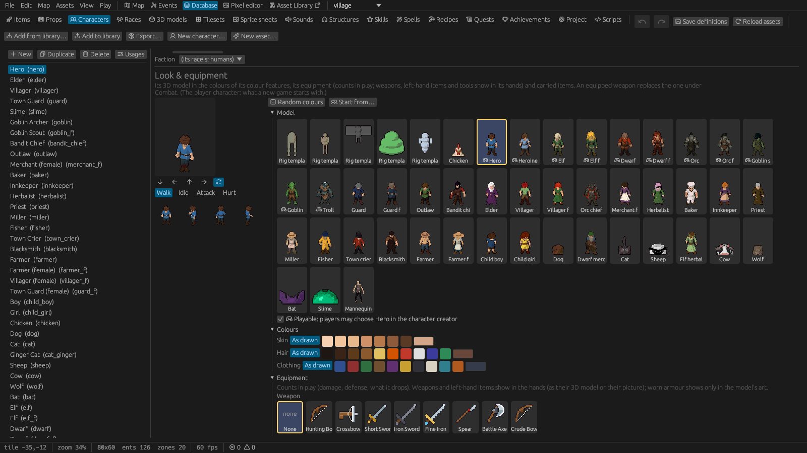
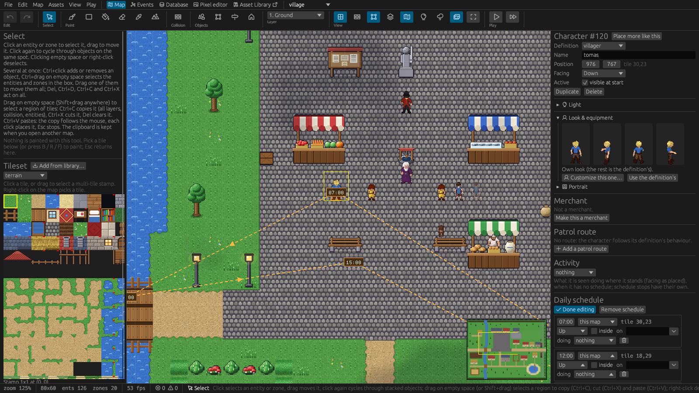
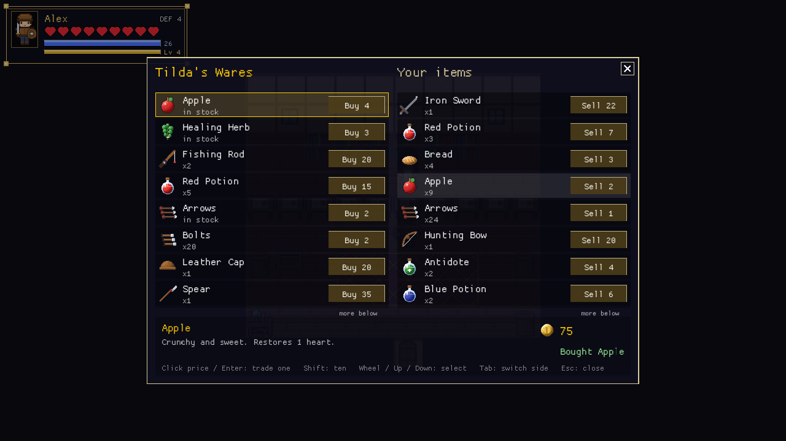
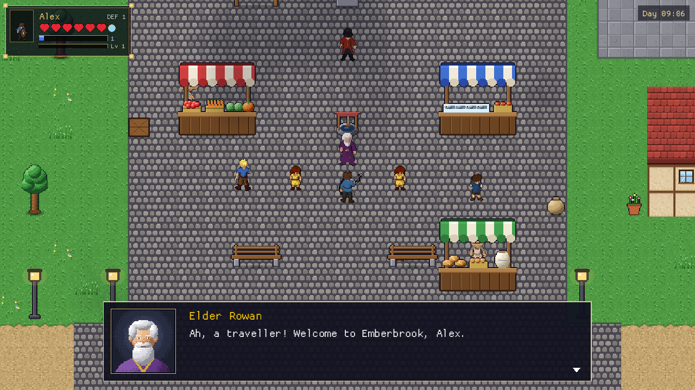

# 6. Characters

Villagers, merchants, guards, enemies, animals and the player are all **characters**: definitions
in *Database › Characters*, placed on maps with the Entities tool.

## How characters look

Every character is a **figure**: a complete picture of it, with its clothes and hair painted in,
on a sprite sheet of kind *Character figure* ([Art and sound › Character
figures](10-art-and-sound.md#sizes-and-layouts)). One sheet holds all of its animations: **walk**,
**idle** (breathing while it stands), **attack** (wind-up, swing, follow-through, recover) and
**hurt** (when hit), each facing down, left, right and up. The game plays them by itself: standing
characters breathe, enemies' wind-ups and swings and the player's swing show the attack frames, a
hit shows the hurt frame. A sheet without some of these rows shows the standing frame instead.

**Colour features**: parts of a figure that can take other colours, such as its skin, hair or
clothing (*Database › Sprite sheets › Colour features*). A feature is made of the art's own shades
of that part. A character that chooses a colour for it gets those shades replaced by the chosen
colour, each as much darker or lighter as it was, so light and shadow stay. Each feature lists the
colours it offers: the character creator's swatches. In the example the hero, the heroine, the
elves, the female dwarf and the villagers have skin, hair and (most) clothing features; the dwarf
has skin. Two placed villagers wear their own colours.

**Equipment** is real: a character's weapon, armor and clothing count in combat, and an enemy drops
them when defeated. **What it holds is drawn in its hands**: the weapon, the left-hand item (a
shield, a lantern, a torch), a tool while it works (the fisher's rod, the farmer's hoe) and a prop it
carries. This needs a figure with **hand marks**: per frame where each hand is and how it is turned
([Art and sound › Hands](10-art-and-sound.md#hands)). The starter figures of people have them and
are drawn with empty hands; armour and clothing show only in the art. How each item sits in a hand
is set in its *Held* section ([Database › Items](05-database.md#items)).

**Carrying props**: the *Carry prop* action and the scripts `carry(target, prop)` /
`stop_carrying(target)` / `player_carrying()` let the player or a character carry a prop (a crate, a
basket) in both hands. While carrying, the weapon and left-hand item aren't shown and the player
can't attack (*Put down what you carry first.*). What the player carries is saved.

## The character editor

*Database › Characters* shows the character editor under the form's first rows. On the left is a
**preview** that walks, breathes, attacks or flinches (*Walk*, *Idle*, *Attack*, *Hurt*; facing
buttons, *turn around*, and the four standing directions); on the right:

- **Figure**: cards of the project's figures; *Playable* lets players choose it in the creator;
- **Colours**: for each colour feature of the figure, *As drawn*, the feature's colours and any
  other colour;
- **Equipment**: weapon, left hand, head, body armor and clothing (they count in play);
- **Carried items**.

**Random colours** picks an offered colour for each feature. **Start from…** copies the figure and
colours of any character in the project or the asset library (a library character's sheets are
copied into the project first).

**Placed characters with their own look**: select one on the map; *Look & equipment* in the
inspector shows it. **Customize this one…** opens the character editor for that one character only
(*Apply*), and *Use the definition's* drops the changes. A whole village can share one *villager*
definition while every villager wears other colours.

## New characters

**New character…** (in the Characters tab, or *Assets › New asset… › Character*) asks for an id
and a name and where the figure comes from:

- **Existing figure**: one of the project's figures (or one added from the asset library), with
  the character editor to choose its colours and equipment;
- **Draw a new figure**: a new sheet in the character layout of a size (person, small person, big,
  huge, small animal, large animal, flying creature), blank or a copy of a figure of the same size
  to paint over (its colour features come along). *Create* adds the sheet and the character and
  opens the sheet in the sprite editor to draw;
- **Import**: an LPC character sheet (its walk, slash and hurt rows become walk, idle, attack and
  hurt) or an Aseprite export whose tags are named after the animations (`walk_down`,
  `idle_left`, `attack_right`, `hurt_up`…; see [Art and sound](10-art-and-sound.md)). Then choose
  the new figure under *Existing figure*;
- **Generate with AI**: opens [Generate art](10-art-and-sound.md#generate-art-with-meshy) for a
  character with this id; *Add to project* creates the character with a person's speed and hitbox.

Then mark the figure's colour features (*Database › Sprite sheets*) and set the character's
behaviour and combat values in the form.

## The character form

| Section | Settings |
|---|---|
| **Character** | Name; **Description** (shown in the bestiary once the player has defeated one); speed in pixels per second; hitbox |
| **Portrait** | A drawn portrait for dialogs and **Moods** ([below](#dialog-portraits-and-moods)) |
| **Look & equipment** | The character editor: figure, colours, equipment, carried items |
| **Behavior** | *Static*, *Wander* or *Chase foes* (below) |
| **Combat** | **Max HP** (0 = can't be defeated), **Damage**, **Defense**, **Hostile**, **Attack wind-up** (seconds before a swing or lunge; 0 = standard), an effect **On touch** (poison, slow…), an optional ranged attack for hostile characters |
| **Experience** | XP the player gets for defeating it |
| **Loot** | What it drops ([Objects and zones › Loot](04-objects-and-zones.md#loot)) |
| **Merchant** | Makes it a trader ([Merchants](#merchants)) |
| **As companion** | *Can't be given gear*, for animals and creatures |
| **Magic (companion)** | Mana and mana per second: a companion with mana learns and casts *Heal* and *Bolt* spells |
| **Light** | Carries a light (a lantern); placed characters can carry their own instead |
| **Default triggers** | Triggers every copy runs ([Events](07-events.md)) |

## Behaviour

| Behaviour | What the character does |
|---|---|
| **Static** | Stands where it was placed (unless it has a patrol route, a schedule or an activity). |
| **Wander** | Walks around its home spot. |
| **Chase foes** | Hunts the player and companions when hostile to the player, and characters of hostile factions ([Factions](#factions)). |

**Chase foes** characters notice the player within their **Sight** (tiles) in a clear line; behind
walls and trees only within half of it. They keep hunting for a few seconds after losing sight,
walking to where they last saw the player, and slide around obstacles. Per character:

- **Leash**: beyond that many tiles from home they give up and walk back, harmless on the way.
- **Flee below**: below that share of their HP they run away and stop attacking (group fighters
  run to an ally instead and come back after a short rest).
- **Keep distance**: shooters back off when the player comes closer.
- **Group** (*Fights as a group*, on by default): at most two group fighters close in on the
  player or a companion at a time, the others circle around and wait for their turn; they spread
  out instead of stacking. Turn it off for a lone brute that always attacks.
- **Alert** (tiles, default 6): on first seeing the player it alerts others of the same
  definition (or the same faction) this close; 0 alerts nobody.

An *HP below %* trigger lets a character react when it's hurt, e.g. a boss calling for help; scripts
read any character's HP with `hp_of(target)`. In the example, the goblin archers keep four tiles
away, flee once wounded and give up ten tiles from their camp, and the *Bandit Chief* calls two
outlaws at half his HP.

**Making way**: a friendly character standing in the player's way (a villager in a doorway, a guard
in a gate) steps aside when the player keeps walking into it for a moment, so no character can shut
the player in.

## Patrol routes

A patrolling character walks a route of waypoints.

1. Select a placed character and choose *Patrol route › Add a patrol route*.
2. Click tiles on the map to add waypoints. Drag a waypoint to move it, right-click removes it,
   Esc or *Done editing* finishes.
3. Choose *Loop* or *Back and forth*, the *Pause* at each point and an optional *Speed*.

The route is drawn with numbered points while the character is selected. In the game the character
finds its way around obstacles, waits briefly when talked to, and continues where it was after map
changes and loading. The **Patrol** action (start / stop, or a new route) and the scripts
`patrol(target)`, `patrol(target, [[x, y], …])` and `stop_patrol(target)` control it. A one-point
route means "walk there and stay".

## Daily schedules

A schedule makes a character live by the clock.

1. Select a placed character and choose *Daily schedule › Add a schedule*.
2. Click tiles on the map to add the places it goes to during the day. Drag a stop to move it,
   right-click removes it, Esc or *Done editing* finishes.
3. Give each stop a **time** (from then on the character goes there; type `7:30` or drag in quarter
   hours), optionally a **direction** to face, and:
   - **inside**: the character goes indoors here (e.g. at a door) and is out of sight until the next
     stop;
   - **map**: a stop on another map; the character walks to this map's door leading there, leaves,
     and turns up on that map as a visitor;
   - **on**: a piece of furniture by name; the character sits on the chair or bench, or lies in the
     bed;
   - **doing**: an activity at the stop (below).

The stops are drawn as a dashed loop with their times while the character is selected. In the game
the character walks to the stop of the hour and stays there (wandering around it if its behaviour is
*Wander*). Entering a map puts scheduled characters where the hour wants them; maps the player
isn't on aren't simulated.

The **Schedule** action and the scripts `stop_schedule(target)` / `follow_schedule(target)` pause and
resume a schedule. A character that is **hidden** (placed with *Active* off, or switched off with
*Set active*) stays hidden whatever its schedule says and doesn't visit other maps; once *Set
active* shows it, it goes straight to the stop of the hour. That's how a character can join the
village's life later, like Pip after he is cured. The **Time of day** condition gives night-time lines, and the **Pose** condition
(sitting, lying, at furniture, on its feet) lets a character say different things in bed. A sleeper
without a matching line just shows "… is asleep."

In the example, about twenty villagers of Emberbrook follow schedules: Bram the baker kneads at
dawn, sells at his stall, has an ale in the tavern in the evening and goes to bed; Tomas rests on a
bench in the afternoon and sleeps in the elder's guest bed at night.

## Activities

Characters can be seen **doing** something: *fishing, hoeing, hammering, chopping wood, mining,
sweeping* or *reading*, at a schedule stop or all day where they're placed (inspector › *Activity*),
with an optional tool in the hand. They stay at their spot, work in place with small effects (the
fishing line and bobber, soil specks, sparks on the anvil, wood chips, an open book whose pages
turn), and turn to the player for a few seconds when talked to. Activities are only for the look:
nothing is produced.

## Merchants

Tick **Merchant** in the character form to make every copy a trader:

- an optional **shop title**;
- the **currency** item (default `coin`);
- the **sell rate**: what the merchant pays for the player's items, in % of the price (0 = buys
  nothing);
- whether **talking opens the shop** (otherwise use the *Open shop* action, e.g. after a dialog
  choice, or `open_shop(target)`);
- the **stock**: items with a quantity (or *unlimited*) and a price (0 = the item's *Value*).

A placed character can *Customize stock & prices* or become a merchant on its own (*Make this a
merchant*). In the game, talking to a merchant runs its *Interact* triggers (a greeting) and then
opens the trade window. Items the player sells join the stock, and every merchant's stock is kept
in save games. The *Haggle* skill effect improves prices.

## Companions

The **Companion** action (or `follow(target)` in a script) makes a placed, friendly character follow
the player:

- Companions walk behind the player, find their way around obstacles, catch up after teleports and
  come along to every map.
- They fight hostile characters near the player with their weapon (melee or ranged) and are hunted
  and hurt like the player; they regain HP slowly when nothing hunts them.
- Talking to a companion runs its own triggers, e.g. a dialog with orders.
- **Orders** (G, gamepad LB, the *Companion order* action, `order(name, …)`): *Attack* (the default),
  *Defend* (only what hunts you or the companion), *Passive* (no fighting), *Stay here* (wait on the
  spot, back at the post after a fight) and *Follow me*.
- **Gear**: clicking a companion's row in the HUD, *Gear…* in the orders menu, or `open_companion`
  opens the companion window: its equipment, its bag and your inventory. Hand items over, equip
  them, take them back. Unless the definition says *Can't be given gear*.
- **Characters use what they carry**: companions, other friendly characters and enemies drink a
  healing potion when their health is critical, a cure when poisoned or burning, a buff in a fight.
  A bow you gave a companion shoots arrows from its bag.
- **Healing**: items and *Heal* spells set to *Use on: Player or companion* ask whom to heal; the
  *Heal character* action and `heal_npc(name, amount)` heal any character.
- **Magic**: a companion whose definition has mana (*Magic (companion)* in the character form)
  learns the spell of a scroll or spell book you hand it in the companion window (a scroll that
  is used up when read is used up; a book stays in its bag), or from the *Teach spell* action /
  `teach_spell`. It casts *Heal* on the most hurt of you, the companions near it and itself when
  someone is below half their HP (a knocked-down companion first: the heal gets it up), and *Bolt*
  spells at the enemy it fights. Mana regenerates; its HUD row shows a blue mana bar, and its window
  lists its mana and spells. Spells stay learned when it is dismissed. In the example the town
  guard has mana: give him Tilda's *Scroll of Healing* or the elder's spell book.
- **At 0 HP** a companion is **knocked down**: it lies where it fell, enemies leave it alone, and
  any heal gets it back up. Leaving the map with a downed companion asks whether to leave it behind
  (it then limps home). *Database › Project › Companions at 0 HP* can instead let it get up by
  itself after some seconds, or send it home at once.
- **Dismissed** (`stop_following`, or the action with *leaves*), a companion stays where it is on its
  own map or goes home from elsewhere.

Companions, their HP, items and orders are kept in save games. The player's attacks never hit
companions or other friendly characters. In the example, the town guard offers to come along once
you took on the elder's quest.

## Dialog portraits and moods

Dialog and choice boxes show the speaker's head and shoulders, drawn from their model as they're
dressed right now; nothing to set up. The speaker is found from the dialog's speaker name: `{player}`
is the hero, `{self}` the trigger's owner, otherwise a character on the map or any definition whose
name fits (letter case is ignored, and "Elder" fits "Elder Rowan"). Narration, signs and letters
have no portrait.

**Drawn portraits** replace the automatic one: *Portrait* in the character form (any frame size, e.g.
64 × 64; *New blank portrait* adds a frame on a `portraits` sheet and opens the pixel editor), a
placed character's own portrait in the inspector, and the player's (*Project › Player portrait*).

**Moods** are more portraits by name ("worried", "angry") in the character's *Moods* list. A single
line can use one (`say("Elder Rowan", "...", #{ mood: "worried" })`), or the **Set mood** action /
`mood(name, mood)` changes it until the event ends. *Database › Project › Dialog portraits* turns
portraits off.

## The player character and the character creator

The player is a character too: *Database › Project › Player character* names the definition, and
its look and equipment are what a new game starts with.

The **character creator** (*Database › Project › Character creator*, *Show the character creator…*)
lets players create their hero after *New game*: a **name** (with a default), **Male / Female** (or
fixed, if the project says *Always male* / *Always female*), a **race** when the project has several
playable races ([Races](#races)), a **body** (a figure) among the race's figures of that sex
(without races: the project's default figure for that sex and the other figures of that sex marked
*Playable*; the row shows only when there is a choice), and a **colour row for each colour feature**
of that figure that offers colours (*Skin*, *Hair*, *Clothing*…: *As drawn* or one of the
feature's colours). The example offers humans (the hero, the heroine), elves and dwarves with
skin, hair and clothing colours. An animated preview walks through all four directions. Name, sex,
figure and colours are kept in save games. Play-tests skip the creator and use the default name.

## Races

Races are definitions of their own (*Database › Races*): humans, goblins, elves, dwarves, orcs and
trolls in the example and the starter library, each with a male and a female figure (trolls one).
A race has:

- a **name** and **description** (the creator shows it under the preview);
- **bodies** (figures) for men and women. The creator offers the race's figures of the chosen sex
  with their colour features; without any, the project's *Character creation* figures;
- for **a player of this race**: extra **max HP** (negative: fewer), **speed** in percent,
  **defense**, and **starting skills**, skill levels a new game begins with. In the example a
  human starts with Haggling 1 and 2 more HP; a goblin with Scavenging 1, 2 fewer HP and 10 %
  more speed; an elf with Archery 1 (5 % faster, 1 HP less); a dwarf with Mining 1 and Smithing 1
  (3 more HP, +1 defense, 10 % slower); an orc with Swordsmanship 1 (2 more HP); a troll with
  Toughness 2 (6 more HP, +1 defense, 15 % slower, size 1.5);
- a **size**: characters whose body belongs to the race are drawn that much larger (or smaller)
  and get a hitbox to match (trolls 1.5);
- **Playable**: offered in the character creator. In the example humans, elves and dwarves are
  playable; goblins, orcs and trolls are races of the world's characters only (their player
  bonuses stay for projects that make them playable).

With more than one playable race, the creator starts with a **Race** row; changing it switches the
figures and their colour rows. The player's race is kept in the save game. The player character's own race
(*Race* in its form) is the one a game started without the creator has. Other characters name
their race in the same field (for scripts and [factions](#factions)). The **Player race** condition
and `player_race()` tell the player's race.

**Addressing the player**: in dialog, choice and quest texts, `{player}` becomes the player's name
and `{sir|madam}` the first word for a male player and the second for a female one (any pair works:
`{brother|sister}`). The **Player sex** condition and the scripts `player_name()`, `player_sex()`,
`is_female()`, `is_male()` and `text("…")` do the same in logic.

## Factions

Factions decide who fights whom. They are set up in *Database › Project › Factions*: a list of
factions (an id, fixed once added because triggers and scripts name it, and a name) and an
**attitude table** where every pair of factions is *hostile*, *neutral* (the default) or
*friendly*; click a cell to change it, the table reads both ways.

- A character belongs to its own **Faction** (*Database › Characters*), else to its race's
  (*Database › Races › Faction*). Characters without a faction stay out of it.
- **Characters of hostile factions fight each other**: chasers (*Chase foes*) notice foes within
  their sight like they notice the player, close in, swing, lunge and shoot at them; group fighters
  share the places around a foe and alert their own faction. Arrows of a shooter fly past its
  friends and the player when it isn't hostile to the player. Characters with 0 max HP (townsfolk)
  can't be attacked.
- **The player's standing** with each faction runs from -100 to 100. It starts at 100 with the
  player's own faction (their race's, else the player character's), 50 with factions friendly to
  it, 0 with neutral and -50 with hostile ones. At **-20 or below** the faction's characters attack
  the player. **Hostile** on a character makes it attack the player unless the player is a friend
  of its faction (standing 20 or more), so marked monsters stay dangerous to everyone else.
  Without factions in the project, *Hostile* alone decides, as before.
- The **Change standing** action and `change_standing(faction, amount)` raise or lower a standing
  (the faction's characters turn hostile or calm down at once); the **Faction standing** condition,
  `standing(faction)` and `player_faction()` read it. Standings are kept in the save game.
- *Edit › Problems* warns about characters and races naming a faction the project doesn't have.

In the example, humans, elves, dwarves, goblin tribes, orc clans, bandits, wild beasts and
monsters are factions. The villagers of Emberbrook are humans (their race's faction, the same as a
human player's). Humans are friendly with elves and dwarves and hostile to goblins, orcs, bandits,
beasts and monsters; elves are hostile to goblins and orcs too; goblins and orcs are friends. So
every playable race (human, elf, dwarf) is welcome in the village, and the town guards chase
goblins, orcs, bandits, beasts and monsters that come near their post. In the Wilds an elven
ranger and an orc patrol shoot and fight each other on sight. Dwarves are neutral to goblins and
orcs, but those are marked *Hostile* and attack anyone who isn't their friend. Bringing the elven
herbalist two wolf pelts (*Friend of the Elves*) raises the standing with the elves by 40.

## What characters carry

Characters have equipment and carried items too, set in the character editor for the definition or for one
placed character. They use their equipped weapon and their armor's defense in combat, use the items
they carry, and drop everything when defeated. The *Equip item*, *Unequip slot*, *Give item to
character* and *Take item from character* actions and the scripts `equip`, `unequip`,
`give_item_to` and `take_item_from` change what characters wear and carry during the game; the
changes are saved.
