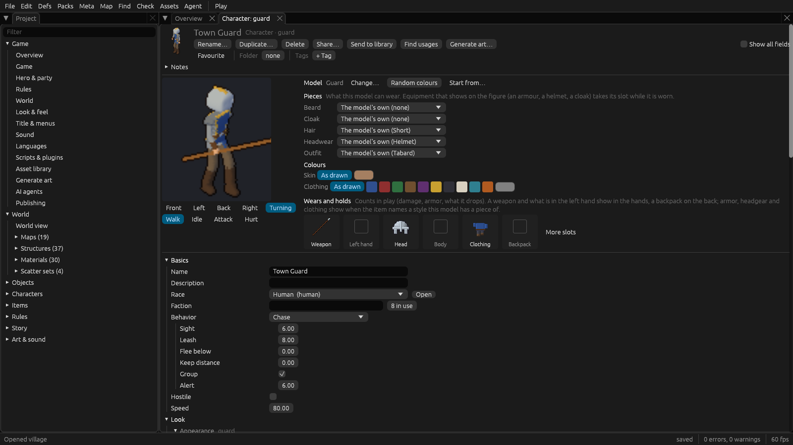
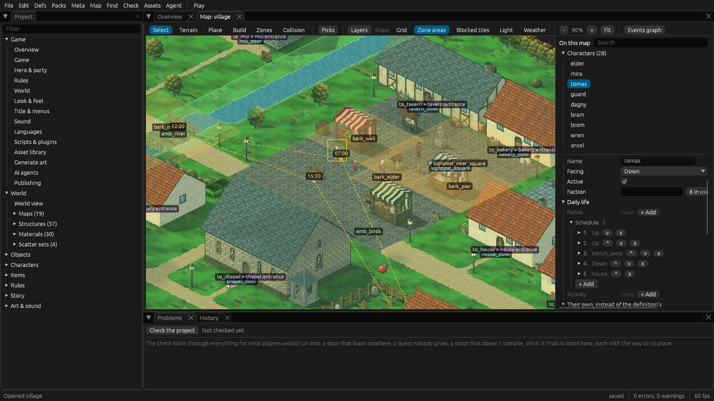
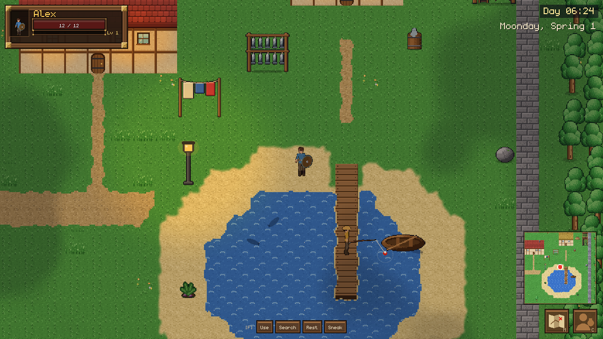
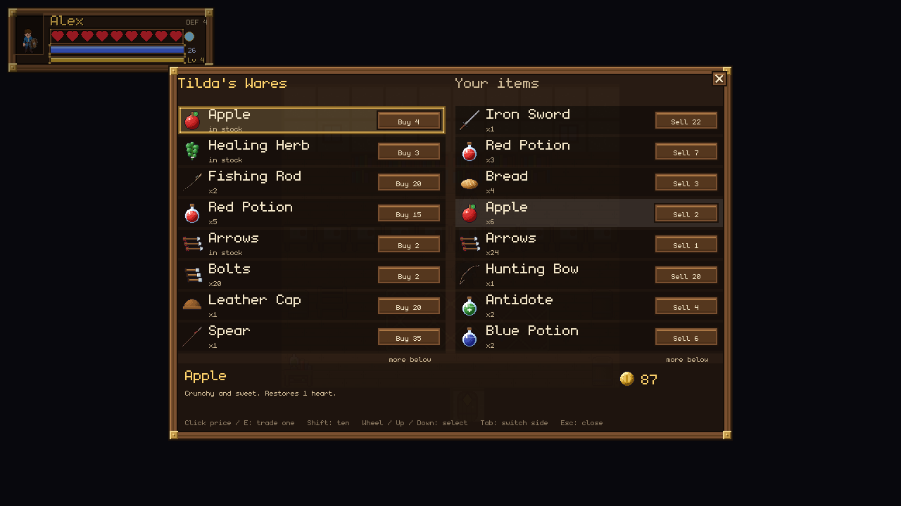
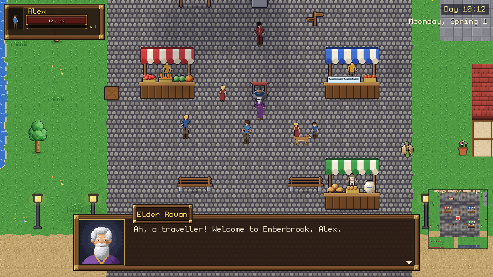
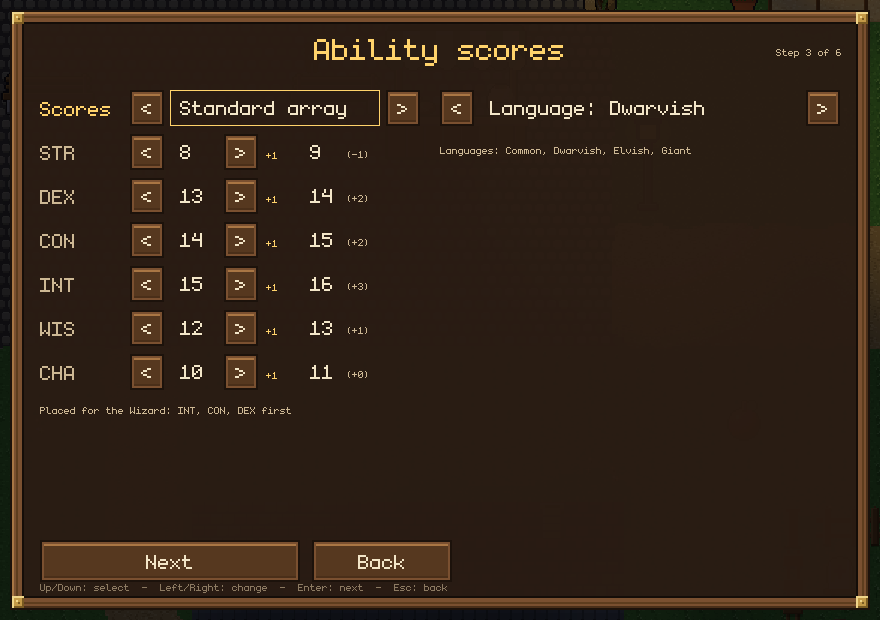

# 6. Characters

Villagers, merchants, guards, enemies, animals and the player are all **characters**: definitions
in *Database › Characters*, placed on maps with the Entities tool.

## How characters look

Every character is a **3D model** (*Database › 3D models*): a rigged model with its animation clips.
The game renders it with what it holds in the pixel look (a few light bands, a dark outline) and
draws it into the world as a picture, facing down, left, right or up; while it walks along a
diagonal it is drawn turned halfway between two of them (*Eight facings* in *Database › Project*,
on by default). It plays its clips by itself:
**walk**, **idle** (standing), its **attack**, **hurt** (when hit), **sit** and **sleep** on
furniture, the activities (`fish`, `farm`, `craft`, `chop`, `mine`, `sweep`, `read`) and **sneak**
(the player sneaking; without it the walk, slowed); a model without a clip for one of them plays idle (sitting and lying without a clip show the standing pose,
cropped or laid down). Dialog portraits show its head close up. A character without a model of its
own shows as the **mannequin** (a plain wooden figure; the engine has one built in).

The example's and the starter library's cast were modelled with Meshy from the hand-drawn figures
of earlier versions: 47 people and 9 animals, and 16 items' 3D models.

- *Database › 3D models › Import model…* takes a rigged `.glb` (Meshy, Blender, Mixamo…): it is
  copied into `models/` (made smaller: textures as the game uses them, clip files without their
  mesh) and its clips are matched to the animations by their names. *Clip files › Add…* uses the
  clips of more files of the same rig (Meshy writes animations as separate files).
- The form sets the **height** (standing, in world pixels: a person is about 40), the **clip each
  animation plays** (an animation without one plays idle) and its frames per second (12: drawn
  stepped like pixel animation), *Playable* / *Female* for the character creator, and shows a
  turning preview, the four facings and the portrait. Clips that stand turned are straightened by
  the body's direction, and walking stays in place.
- **Colour features** are parts of a model that can take other colours, such as its skin, hair or
  clothing. A feature is made of the shades of its texture (reduced to 32 colours when it loads)
  that belong to that part; a character that chooses a colour for it gets those shades replaced by
  the chosen colour, each as much darker or lighter as it was, so light and shadow stay. Each
  feature lists the colours it offers: the character creator's swatches. A **default colour**
  (*Set* beside *Default colour*) is the colour the part takes when a character chose none, and
  what the creator's first choice shows: for art whose own colours don't suit it. In the example the
  playable models and the villagers have skin, hair and clothing; two placed villagers wear their
  own colours.
- **Animals and creatures** without a skeleton of their own (Meshy rigs only people; a 3D creature
  from *Generate art* is unrigged) get a **rig template** in the model's form: *Template* picks a
  rigged model whose skeleton is stretched over this one and whose walk, idle, attack and hurt it
  plays. The starter library has five, made for it: **four legs** (wolves, dogs, boars, deer),
  **bird** (standing birds), **flyer** (bats, birds in flight), **blob** (slimes) and **floating**
  (ghosts, wisps). *Turn* makes the model face the front first (the down view shows its face). The
  side and front views show the fitted skeleton over the model: drag a joint (a dot) to where it
  belongs, a leg into its leg or the head into the head; *Mirror left and right* moves the other
  side's twin along, *Reset joints* starts over. The model keeps its own file; the fit is worked
  out when it loads.
- **Generate art** makes 3D characters, creatures and items' models with Meshy ([Art and sound ›
  Generate art](10-art-and-sound.md#generate-art-with-meshy)), and adds clips to a model.

### Weapon animations

What a character does with its hands depends on what it holds: a spear thrusts, a bow is drawn, a
shield is raised. **Items name animations** (*Database › Items › Animations*: what is played
*attacking*, *standing*, *walking* and *blocking* with it) and **models map the names to clips**
(the *Weapons* rows of the model's *Animations*). The standard names:

| Kind | Names |
|---|---|
| Attacks | `attack_1h` (slash), `attack_2h` (overhead blow), `attack_thrust` (spear), `attack_bow`, `attack_crossbow`, `attack_cast` (spell), `attack_unarmed` (a punch: bare hands) |
| Standing | `idle_1h` (a guard stance), `idle_2h`, `idle_bow`, `idle_spear` |
| Blocking | `block_shield`, `block_weapon` (a parry), `block_2h` |

An item's empty names are **estimated** from its kind: bows shoot (`attack_bow`, standing
`idle_bow`; crossbows `attack_crossbow`), long two-handed weapons thrust (`attack_thrust`,
`idle_spear`), other two-handed ones swing overhead (`attack_2h`, `idle_2h`), other weapons slash
(`attack_1h`, `idle_1h`, parrying with `block_weapon`), shields block (`block_shield`; a lantern or
torch in the left hand doesn't). The attack and walk come from the weapon, standing from the weapon
and else the left-hand item, blocking from the left-hand item and else the weapon. **Only in
combat**: out of it characters stand and walk relaxed (the plain `idle` and `walk`), and a one-handed
melee weapon with a 3D model hangs at the left hip; two-handed and ranged weapons, shields and tools
stay in the hands ([Gameplay › Health and combat](09-gameplay.md#health-and-combat)). A model without
the named clip plays its plain animation (`attack`, `idle`, `walk`), so items and models can be
added in any order.

Attacks and blocks have a **hit point** (*hit* beside the frames per second): where in the clip the
blow lands or the guard is up (0.42 when not set). An enemy winds up to it and swings from there;
the player's blow lands at once, so the wind-up is hurried and the hit point comes a quarter into
the strike; a raised shield holds the block clip at its hit point.

**Clips are shared between models**: *Shared clips › Copy clips* in a model's form (pick a model)
plays the other model's animations from its clip files, fitted to this model's bones when it loads
(same bone names, as all of Meshy's rigs have): the hand and shoulder angles and the body's
proportions are this model's own. Animations the model maps already keep their clips. *Generate art
› 3D model clips* buys more clips for a model from Meshy's animation library. In the example the
hero has nine weapon animations (`attack_2h`, `attack_thrust`, `attack_bow`, `attack_cast`,
`attack_unarmed`, `idle_1h`, `idle_2h`, `block_shield`, `block_weapon`), and every other
person of the example and the starter library shares them: a guard with a sword and shield stands in
a guard stance and raises the shield, an archer draws the bow; one-handed attacks use each model's
own slash.

**Equipment** is real: a character's weapon, armor and clothing count in combat, and an enemy drops
them when defeated. **What it holds is in its hands**: the weapon, the left-hand item (a shield, a
lantern, a torch), a tool while it works (the fisher's rod, the farmer's hoe) and a prop it carries,
each at the hand bone. Items with a **3D model** ([Database › Items](05-database.md#items)) are
held as that model by their hold style (in the fist with the handle across it, upright, hanging or
strapped to the forearm), others as their picture (*Held* section: hold point and orientation). Worn armour and clothing show only in the model's art.

**Carrying props**: the *Carry prop* action and the scripts `carry(target, prop)` /
`stop_carrying(target)` / `player_carrying()` let the player or a character carry a prop (a crate, a
basket) in both hands. While carrying, the weapon and left-hand item aren't shown and the player
can't attack (*Put down what you carry first.*). What the player carries is saved.

## The character editor

*Database › Characters* shows the character editor under the form's first rows. On the left is a
**preview** that walks, breathes, attacks or flinches (*Walk*, *Idle*, *Attack*, *Hurt*; facing
buttons, *turn around*, and the four standing directions); on the right:

- **Model**: cards of the project's 3D models; *Playable* lets players choose it in the creator;
- **Colours**: for each colour feature of the model, *As made*, the feature's colours and any
  other colour;
- **Equipment**: weapon, left hand, head, body armor and clothing (they count in play);
- **Carried items**.

**Random colours** picks an offered colour for each feature. **Start from…** copies the model and
colours of any character in the project or the asset library (a library character's model is
copied into the project first).

**Placed characters with their own look**: select one on the map; *Look & equipment* in the
inspector shows it. **Customize this one…** opens the character editor for that one character only
(*Apply*), and *Use the definition's* drops the changes. A whole village can share one *villager*
definition while every villager wears other colours.

## New characters

**New character…** (in the Characters tab, or *Assets › New asset… › Character*) asks for an id
and a name and where the model comes from:

- **Existing model**: one of the project's models (or one added from the asset library), with
  the character editor to choose its colours and equipment;
- **Import a model**: a rigged `.glb` (Meshy, Blender, Mixamo…), imported like *Database › 3D
  models › Import model…*; then choose it under *Existing model*;
- **Generate with AI**: opens [Generate art](10-art-and-sound.md#generate-art-with-meshy) for a
  3D character with this id (*a woman* picks the women's clips); *Add to project* creates the
  model and the character with a person's speed and hitbox.

Then set the character's behaviour and combat values in the form.

## The character form

| Section | Settings |
|---|---|
| **Character** | Name; **Description** (shown in the bestiary once the player has defeated one); speed in pixels per second; **Size** (in percent of its 3D model's height, times its race's size: the figure, what it holds and its hitbox; every placed character of the definition, and the player when it is the player character, gets it; the starter library's realistic hero and elves are 115 %); hitbox |
| **Portrait** | A drawn portrait for dialogs and **Moods** ([below](#dialog-portraits-and-moods)) |
| **Look & equipment** | The character editor: model, colours, equipment, carried items |
| **Behavior** | *Static*, *Wander* or *Chase foes* (below) |
| **Combat** | **Max HP** (0 = can't be defeated), **Damage**, **Defense**, **Hostile**, **Attack wind-up** (seconds before a swing or lunge; 0 = standard), a condition **On touch** (poisoned, prone…, with a saving throw and damage every round; it also comes with the hits of a weapon it holds), an optional ranged attack for hostile characters |
| **Experience** | XP the player gets for defeating it |
| **Stat block (SRD 5.1)** | What it is by the rules, from a template or by hand ([below](#stat-blocks)) |
| **Loot** | What it drops ([Objects and zones › Loot](04-objects-and-zones.md#loot)) |
| **Merchant** | Makes it a trader ([Merchants](#merchants)) |
| **As companion** | *Can't be given gear*, for animals and creatures |
| **Magic (companion)** | Mana and mana per second: a companion with mana learns and casts *Heal* and *Bolt* spells |
| **Light** | Carries a light (a lantern); placed characters can carry their own instead |
| **Default triggers** | Triggers every copy runs ([Events](07-events.md)) |

### Stat blocks

A character can have an **SRD stat block**: the six ability scores, **armor class**, **hit points**
and **hit dice** (`2d8+2`), **speed** and **darkvision** in feet, the saving throws and skills it is
proficient in, its **languages**, its **challenge** rating and the **XP** it is worth.

- **Template**: the SRD's 35 NPCs (acolyte, bandit, bandit captain, commoner, cultist, guard, knight,
  mage, noble, priest, scout, spy, thug, veteran, and the goblin, hobgoblin, orc, gnoll, kobold and
  the other humanoids). Choosing one fills in the whole block and sets the character's *Experience*
  to the template's XP; change any field afterwards.
- **Resistant to**, **Immune to**, **Vulnerable to**: damage types it takes half, no or double
  damage from (they work in real-time combat already: an assassin shrugs off half of the poison);
  **Can't get**: conditions it is immune to (a grimlock can't be blinded). Saving throws against
  conditions are rolled with its scores and proficiencies. *By hand* starts an empty one, *Remove stat
  block* takes it away.
- A **placed character** can have its own (the map's inspector, *Stat block (SRD 5.1)* › *Own stat
  block…*): the captain among the guards.
- Scripts read it (`npc_stat("Brom", "ac")`) and automated runs see it (`statblocks=`). Real-time
  combat uses its resistances and saving throws, and keeps using *Max HP*, *Damage* and *Defense*. The
  turn-based combat of 0.29 fights with it, and the monsters' stat blocks (beasts, undead, trolls)
  come with it.

In the example (and the starter library) villagers, traders and children are commoners, the town
guards guards, the elder a noble, the priest a priest, the elven ranger a scout, the outlaws
bandits, the bandit chief a bandit captain, Rook the deserter a veteran, and goblins and orcs their
SRD selves (the orc chief an orc with 30 HP, challenge 1).

## Behaviour

| Behaviour | What the character does |
|---|---|
| **Static** | Stands where it was placed (unless it has a patrol route, a schedule or an activity). |
| **Wander** | Walks around its home spot. |
| **Chase foes** | Hunts the player and companions when hostile to the player, and characters of hostile factions ([Factions](#factions)). |

**Chase foes** characters notice the player within their **Sight** (tiles) in a clear line; behind
walls and trees only within half of it. They keep hunting for a few seconds after losing sight,
walking to where they last saw the player, and slide around obstacles. Per character:

- **Leash**: beyond that many tiles from home they give up and walk back, harmless on the way.
- **Flee below**: below that share of their HP they run away and stop attacking (group fighters
  run to an ally instead and come back after a short rest).
- **Keep distance**: shooters back off when the player comes closer.
- **Group** (*Fights as a group*, on by default): at most two group fighters close in on the
  player or a companion at a time, the others circle around and wait for their turn; they spread
  out instead of stacking. Turn it off for a lone brute that always attacks.
- **Alert** (tiles, default 6): on first seeing the player it alerts others of the same
  definition (or the same faction) this close; 0 alerts nobody.

An *HP below %* trigger lets a character react when it's hurt, e.g. a boss calling for help; scripts
read any character's HP with `hp_of(target)`. In the example, the goblin archers keep four tiles
away, flee once wounded and give up ten tiles from their camp, and the *Bandit Chief* calls two
outlaws at half his HP: *Set active* makes them appear and *Rush to (fighters)* (`rush_to`) sends them
to him, around the trees, so they join the fight even when they can't see the player.

Out of sight, a hunting character (walking to where it last saw the player, where it was hit from
or where it was sent) finds its way around trees and walls.

**Making way**: a friendly character standing in the player's way (a villager in a doorway, a guard
in a gate) steps aside when the player keeps walking into it for a moment, so no character can shut
the player in.

## Patrol routes

A patrolling character walks a route of waypoints.

1. Select a placed character and choose *Patrol route › Add a patrol route*.
2. Click tiles on the map to add waypoints. Drag a waypoint to move it, right-click removes it,
   Esc or *Done editing* finishes.
3. Choose *Loop* or *Back and forth*, the *Pause* at each point and an optional *Speed*.

The route is drawn with numbered points while the character is selected. In the game the character
finds its way around obstacles, waits briefly when talked to, and continues where it was after map
changes and loading. The **Patrol** action (start / stop, or a new route) and the scripts
`patrol(target)`, `patrol(target, [[x, y], …])` and `stop_patrol(target)` control it. A one-point
route means "walk there and stay".

## Daily schedules

A schedule makes a character live by the clock.

1. Select a placed character and choose *Daily schedule › Add a schedule*.
2. Click tiles on the map to add the places it goes to during the day. Drag a stop to move it,
   right-click removes it, Esc or *Done editing* finishes.
3. Give each stop a **time** (from then on the character goes there; type `7:30` or drag in quarter
   hours), optionally a **direction** to face, and:
   - **inside**: the character goes indoors here (e.g. at a door) and is out of sight until the next
     stop;
   - **map**: a stop on another map; the character walks to this map's door leading there, leaves,
     and turns up on that map as a visitor;
   - **on**: a piece of furniture by name; the character sits on the chair or bench, or lies in the
     bed;
   - **doing**: an activity at the stop (below).

The stops are drawn as a dashed loop with their times while the character is selected. In the game
the character walks to the stop of the hour and stays there (wandering around it if its behaviour is
*Wander*). Entering a map puts scheduled characters where the hour wants them; maps the player
isn't on aren't simulated.

The **Schedule** action and the scripts `stop_schedule(target)` / `follow_schedule(target)` pause and
resume a schedule. A character that is **hidden** (placed with *Active* off, or switched off with
*Set active*) stays hidden whatever its schedule says and doesn't visit other maps; once *Set
active* shows it, it goes straight to the stop of the hour. That's how a character can join the
village's life later, like Pip after he is cured. The **Time of day** condition gives night-time lines, and the **Pose** condition
(sitting, lying, at furniture, on its feet) lets a character say different things in bed. A sleeper
without a matching line just shows "… is asleep."

In the example, about twenty villagers of Emberbrook follow schedules: Bram the baker kneads at
dawn, sells at his stall, has an ale in the tavern in the evening and goes to bed; Tomas rests on a
bench in the afternoon and sleeps in the elder's guest bed at night.

## Activities

Characters can be seen **doing** something: *fishing, hoeing, hammering, chopping wood, mining,
sweeping* or *reading*, at a schedule stop or all day where they're placed (inspector › *Activity*),
with an optional tool in the hand. They stay at their spot, work in place with small effects (the
fishing line and bobber, soil specks, sparks on the anvil, wood chips, an open book whose pages
turn), and turn to the player for a few seconds when talked to. Activities are only for the look:
nothing is produced.

## Merchants

Tick **Merchant** in the character form to make every copy a trader:

- an optional **shop title**;
- the **currency** item (default `coin`);
- the **sell rate**: what the merchant pays for the player's items, in % of the price (0 = buys
  nothing);
- whether **talking opens the shop** (otherwise use the *Open shop* action, e.g. after a dialog
  choice, or `open_shop(target)`);
- the **stock**: items with a quantity (or *unlimited*) and a price (0 = the item's *Value*).

A placed character can *Customize stock & prices* or become a merchant on its own (*Make this a
merchant*). In the game, talking to a merchant runs its *Interact* triggers (a greeting) and then
opens the trade window. Items the player sells join the stock, and every merchant's stock is kept
in save games. Prices can change with the *buy* and *sell* [script hooks](08-scripting.md#script-hooks)
(the example's friends' prices), and an *Ability check* (Persuasion) in a dialog makes a haggle.

## Companions

The **Companion** action (or `follow(target)` in a script) makes a placed, friendly character follow
the player:

- Companions walk behind the player, find their way around obstacles, catch up after teleports and
  come along to every map.
- They fight hostile characters near the player with their weapon (melee or ranged) and are hunted
  and hurt like the player; they regain HP slowly when nothing hunts them.
- Talking to a companion runs its own triggers, e.g. a dialog with orders.
- **Orders** (G, gamepad LB, the *Companion order* action, `order(name, …)`): *Attack* (the default),
  *Defend* (only what hunts you or the companion), *Passive* (no fighting), *Stay here* (wait on the
  spot, back at the post after a fight) and *Follow me*.
- **Gear**: clicking a companion's row in the HUD, *Gear…* in the orders menu, or `open_companion`
  opens the companion window: its equipment, its bag and your inventory. Hand items over, equip
  them, take them back. Unless the definition says *Can't be given gear*.
- **Characters use what they carry**: companions, other friendly characters and enemies drink a
  healing potion when their health is critical, a cure when poisoned or burning, a buff in a fight.
  A bow you gave a companion shoots arrows from its bag.
- **Healing**: items and *Heal* spells set to *Use on: Player or companion* ask whom to heal; the
  *Heal character* action and `heal_character(name, amount)` heal any character.
- **Magic**: a companion whose definition has mana (*Magic (companion)* in the character form)
  learns the spell of a scroll or spell book you hand it in the companion window (a scroll that
  is used up when read is used up; a book stays in its bag), or from the *Teach spell* action /
  `teach_spell`. It casts *Heal* on the most hurt of you, the companions near it and itself when
  someone is below half their HP (a knocked-down companion first: the heal gets it up), and *Bolt*
  spells at the enemy it fights. Mana regenerates; its HUD row shows a blue mana bar, and its window
  lists its mana and spells. Spells stay learned when it is dismissed. In the example the town
  guard has mana: give him Tilda's *Scroll of Healing* or the elder's spell book.
- **At 0 HP** a companion is **knocked down**: it lies where it fell, enemies leave it alone, and
  any heal gets it back up. Leaving the map with a downed companion asks whether to leave it behind
  (it then limps home). *Database › Project › Companions at 0 HP* can instead let it get up by
  itself after some seconds, or send it home at once.
- **Dismissed** (`stop_following`, or the action with *leaves*), a companion stays where it is on its
  own map or goes home from elsewhere.

Companions, their HP, items and orders are kept in save games. The player's attacks never hit
companions or other friendly characters. In the example, the town guard offers to come along once
you took on the elder's quest.

## Dialog portraits and moods

Dialog and choice boxes show the speaker's head and shoulders, drawn from their model as they're
dressed right now; nothing to set up. The speaker is found from the dialog's speaker name: `{player}`
is the hero, `{self}` the trigger's owner, otherwise a character on the map or any definition whose
name fits (letter case is ignored, and "Elder" fits "Elder Rowan"). Narration, signs and letters
have no portrait.

**Drawn portraits** replace the automatic one: *Portrait* in the character form (any frame size, e.g.
64 × 64; *New blank portrait* adds a frame on a `portraits` sheet and opens the pixel editor), a
placed character's own portrait in the inspector, and the player's (*Project › Player portrait*).

**Moods** are more portraits by name ("worried", "angry") in the character's *Moods* list. A single
line can use one (`say("Elder Rowan", "...", #{ mood: "worried" })`), or the **Set mood** action /
`mood(name, mood)` changes it until the event ends. *Database › Project › Dialog portraits* turns
portraits off.

## The player character and the character creator

The player is a character too: *Database › Project › Player character* names the definition, and
its look and equipment are what a new game starts with.

The **character creator** (*Database › Project › Character creator*, *Show the character creator…*)
lets players create their hero after *New game*: a **name** (with a default), **Male / Female** (or
fixed, if the project says *Always male* / *Always female*), a **race** when the project has several
playable races ([Races](#races)), a **look** (a model) among the race's models of that sex
(without races: the project's default model for that sex and the other models of that sex marked
*Playable*; the row shows only when there is a choice), and a **colour row for each colour feature**
of that model that offers colours (*Skin*, *Hair*, *Clothing*…: *As made*, the model's own
colours or the feature's default colour, *The race's* colour, or one of the feature's colours). An
animated preview walks through all four directions; under it the race's ability increases, size,
speed, darkvision and traits.

*Next* opens the second page (the SRD 5.1 rules; [Gameplay › Rules](09-gameplay.md#rules-srd-51)):

- **Scores**: the method the project allows (*Character creator › Ability scores*): the
  **standard array** (15 14 13 12 10 8: Left / Right on an ability swaps values with another),
  **point buy** (every score 8 to 15 for 27 points: 13 costs 5, 14 costs 7, 15 costs 9; the points
  left show beside the method) or **4d6** (each score the best three of four dice, rolled once;
  *Roll again*). Each ability shows its base, the race's increase, the total and its modifier.
  Without methods the scores are the project's *Rules*.
- A row per **racial choice**: the half-elf's two +1s and two skills, the dwarf's tool, the
  dragonborn's ancestry, the high elf's cantrip and language, the human's and half-elf's language.
  The selected choice's trait shows under the rows.
- **Background** (*Database › Backgrounds*, [Backgrounds](#backgrounds)) and its languages; its
  skills and feature show below.

*Start adventure* makes the hero: the scores with the race's increases (racial increases stop at
20), the project's, the race's, the chosen and the background's proficiencies, the languages and
resistances, the background's starting items. Name, sex, model, colours and all of it are kept in
save games. The example offers its nine races and three backgrounds with all three methods.
Play-tests skip the creator and use the default name and the project's *Rules*.

## Races

Races are definitions of their own (*Database › Races*). The example and the starter library have
the nine races of the **SRD 5.1** (dwarf, elf, halfling, human, dragonborn, gnome, half-elf,
half-orc, tiefling) with their four subraces (Hill Dwarf, High Elf, Lightfoot Halfling, Rock
Gnome), and goblins, orcs and trolls for the world's characters. A race has:

- a **name** and **description** (the creator shows it under the preview);
- **models** for men and women. The creator offers the race's models of the chosen sex with their
  colour features; without any, the project's playable models. The dragonborn man has a model of
  his own whose scales take the SRD's ten dragon colours (black, blue, brass, bronze, copper, gold,
  green, red, silver, white; bronze unless the player picks one) and whose clothes take the usual
  clothing colours. The SRD races without models of their own borrow the library's: halflings the
  hero / heroine and gnomes the dwarf models at size 0.75, dragonborn women and half-orcs the orc
  models, half-elves the elf models, tieflings the hero / heroine with a red skin (*Colours*);
- for **a player of this race**: extra **max HP** once (negative: fewer; the SRD's races add none),
  **HP per level** (the hill dwarf's *Dwarven Toughness*: +1), **speed** in percent (from 0.27 and
  older; the SRD's speed in feet replaces it) and **defense**, and **proficiencies**:
  SRD skills, tools, weapon and armor proficiencies and saving throws (`perception`,
  `smiths-tools`, `battleaxes`, `save:con`) the hero adds to the project's starting ones
  ([Gameplay › Rules](09-gameplay.md#rules-srd-51));
- a **size**: characters whose model belongs to the race are drawn that much larger (or smaller)
  and get a hitbox to match (trolls 1.5);
- **Playable**: offered in the character creator. A race with subraces is offered as its
  subraces (Hill Dwarf, not Dwarf); goblins, orcs and trolls are races of the world's characters
  only.

**SRD 5.1** (the race form's last section; the starter library's races come from the SRD by the
[import tool](11-asset-library.md#the-srd-51-data)):

- **Subrace of**: a subrace names its race. The game uses both: their ability increases add up,
  traits, languages and choices join, and the subrace takes the race's models, size, faction,
  speed and darkvision when it has none. A *Player race* condition for `dwarf` holds for a hill
  dwarf too.
- **Ability increases** (+2 CON for a dwarf), **speed** in feet (a hero walks at speed / 30: dwarves,
  halflings and gnomes, at 25 ft, are slower), the **size** category (Small / Medium) and
  **darkvision** (a hero with darkvision sees dark places as dim ones: night and caves are lifted
  towards a dim grey).
- **Languages** and **resistances** (damage types: a dwarf's poison, a tiefling's fire).
- **Colours**: the race's colours in the creator (a colour feature of its models and a colour).
- **Traits**: their names and rules text (the creator lists them; the character sheet shows them).
- **Choices** the hero makes in the creator: *+1* (to abilities: a half-elf's two), *Skill* (a
  half-elf's two), *Tool* (a dwarf's artisan's tools), *Language* (a human's, a half-elf's, a high
  elf's extra language), *Ancestry* (a dragonborn's dragon, which gives its damage resistance) and
  *Cantrip* (a high elf's; kept as a choice, `race_choice("high-elf-cantrip")`, until the SRD's
  spells arrive with 0.30), each with how many to pick and the options.

The player's race is kept in the save game, with what the creator made of it: scores,
proficiencies, languages, resistances and choices. The player character's own race (*Race* in its
form) is the one a game started without the creator has. Other characters name their race in the
same field (for scripts and [factions](#factions)). The **Player race** condition and
`player_race()` tell the player's race; `knows_language()`, `has_resistance()` and
`race_choice()` what came with it.

### Backgrounds

*Database › Backgrounds*: what the hero did before the adventure. The creator offers every
background on its second page. A background has proficiencies (skills and tools), a number of
**languages to choose**, **starting items** (given when the game starts) and a **feature** (its
name and rule in words). The SRD's **Acolyte** (Insight, Religion, two languages, *Shelter of the
Faithful*) comes from the import; the example and the starter library add two of their own:
**Farmhand** (Athletics, Animal Handling, Land Vehicles; a hoe and bread; *Harvest Hands*) and
**Wanderer** (Survival, Nature, one language; a fishing rod and a torch; *Wayfinder*). The
Acolyte starts with 15 coins. `background()` tells the hero's.

**Addressing the player**: in dialog, choice and quest texts, `{player}` becomes the player's name
and `{sir|madam}` the first word for a male player and the second for a female one (any pair works:
`{brother|sister}`). The **Player sex** condition and the scripts `player_name()`, `player_sex()`,
`is_female()`, `is_male()` and `text("…")` do the same in logic.

## Factions

Factions decide who fights whom. They are set up in *Database › Factions*: a list of
factions (an id, fixed once added because triggers and scripts name it, and a name) and an
**attitude table** where every pair of factions is *hostile*, *neutral* (the default) or
*friendly*; click a cell to change it, the table reads both ways.

- A character belongs to its own **Faction** (*Database › Characters*), else to its race's
  (*Database › Races › Faction*). Characters without a faction stay out of it. A **placed
  character** can have a faction of its own (*Faction* in the map's inspector): one goblin who
  trades with the humans, one guard in the bandits' pay. The **Members** list of *Database ›
  Factions* shows who belongs to each faction and adds or removes races and characters.
- **Characters of hostile factions fight each other**: chasers (*Chase foes*) notice foes within
  their sight like they notice the player, close in, swing, lunge and shoot at them; group fighters
  share the places around a foe and alert their own faction. Arrows of a shooter fly past its
  friends and the player when it isn't hostile to the player. Characters with 0 max HP (townsfolk)
  can't be attacked.
- **The player's standing** with each faction runs from -100 to 100. It starts at 100 with the
  player's own faction (their race's, else the player character's), 50 with factions friendly to
  it, 0 with neutral and -50 with hostile ones. At **-20 or below** the faction's characters attack
  the player. **Hostile** on a character makes it attack the player unless the player is a friend
  of its faction (standing 20 or more), so marked monsters stay dangerous to everyone else.
  Without factions in the project, *Hostile* alone decides, as before.
- The **Change standing** action and `change_standing(faction, amount)` raise or lower a standing
  (the faction's characters turn hostile or calm down at once); the **Faction standing** condition,
  `standing(faction)` and `player_faction()` read it. Standings are kept in the save game.
- **Changing sides in play:** the **Set faction** action and `set_faction(target, faction)` move a
  character on the map, or the player, into another faction (a deserter, a converted cultist, the
  player joining the thieves); an empty faction puts it back into its own. Who attacks whom changes
  at once, and the change is kept in the save game. A player who joins a faction counts it as
  their own: their standing with it starts at 100 and with the others from its attitudes, unless
  a standing was already changed. `faction_of(target)` reads a character's (or the player's)
  faction.
- *Edit › Problems* warns about characters, races and placed characters naming a faction the
  project doesn't have.

In the example, humans, elves, dwarves, goblin tribes, orc clans, bandits, wild beasts and
monsters are factions. The villagers of Emberbrook are humans (their race's faction, the same as a
human player's). Humans are friendly with elves and dwarves and hostile to goblins, orcs, bandits,
beasts and monsters; elves are hostile to goblins and orcs too; goblins and orcs are friends. So
every playable race (human, elf, dwarf) is welcome in the village, and the town guards chase
goblins, orcs, bandits, beasts and monsters that come near their post. In the Wilds an elven
ranger and an orc patrol shoot and fight each other on sight. Dwarves are neutral to goblins and
orcs, but those are marked *Hostile* and attack anyone who isn't their friend. Bringing the elven
herbalist two wolf pelts (*Friend of the Elves*) raises the standing with the elves by 40.

## What characters carry

Characters have equipment and carried items too, set in the character editor for the definition or for one
placed character. They use their equipped weapon and their armor's defense in combat, use the items
they carry, and drop everything when defeated. The *Equip item*, *Unequip slot*, *Give item to
character* and *Take item from character* actions and the scripts `equip`, `unequip`,
`give_item_to` and `take_item_from` change what characters wear and carry during the game; the
changes are saved.
