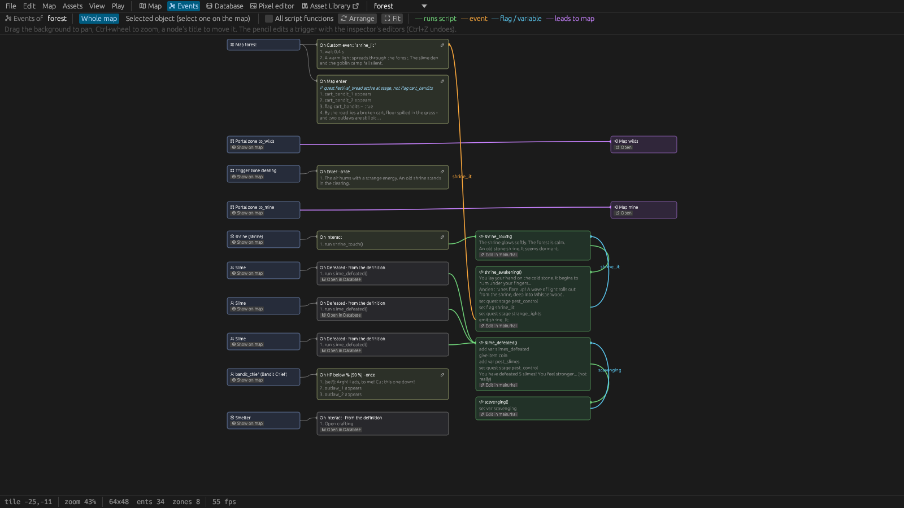

# 7. Events

Most of a game's logic needs no programming. It's made of **triggers**:

> **When** something happens (the event), **if** all conditions hold, **do** these actions.

A villager who talks when the player presses E, a door that opens with a key, a quest step when a
zone is entered, a reward when a boss is defeated: all triggers. When the editor's actions aren't
enough, a trigger runs a script ([Scripting](08-scripting.md)).

## Where triggers live

Triggers belong to an **owner**, and each owner receives only some events:

| Triggers of | Events they can react to |
|---|---|
| a **map** (map settings, nothing selected) | *Map enter*, *Woke up*, *Time reached*, *Custom event* |
| a **zone** (trigger area) | *Enter*, *Leave*, *Interact*, *Custom event* |
| a **character** (placed, or its definition) | *Interact*, *Use item*, *Defeat*, *HP below %*, *Custom event* |
| a **prop** (placed, or its definition) | *Interact*, *Use item*, *Unlocked*, *Locked*, *Woke up* (beds), *Custom event* |
| an **item lying on a map** | *Interact*, *Use item*, *Custom event* |
| an **item definition's** *On use* | *Use item* |

The editor offers only the events that can reach a trigger where it is. A placed entity runs its
definition's triggers first, then its own. Edit them in the inspector (placed entities, zones, the
map) or in the Database (definitions).

### The events

| Event | When it happens |
|---|---|
| **Interact** | The player presses E at the entity (in front of them), or inside the zone. Picking up an item lying on the map happens by itself on Interact. |
| **Enter** / **Leave** | The player walks into / out of a trigger zone. |
| **Use item** | The player uses an item (or a particular one) on the entity in front of them. If nothing reacts, the item's own *On use* triggers run. |
| **Map enter** | The player arrives on the map. Not when a save game is loaded: loading resumes the game. |
| **Custom event** | An *Emit event* action or `emit("name")` with that name. It reaches the map, all zones and all active entities on the map. |
| **Defeat** | The character's HP reached 0. |
| **HP below %** | The character fell below that share of its HP and survived the hit. |
| **Unlocked** / **Locked** | The prop's lock was opened with its key, or locked again. |
| **Woke up** | The player woke up after sleeping: the map's triggers (anywhere on it) and the bed's own. |
| **Time reached** | The clock reached that hour (12.0 = noon, 5.5 = 5:30) while the player is on the map, every day; also when time jumps past it by sleeping or *Set time*. |

## Conditions

All conditions of a trigger must hold; each can be negated (*not*). Comparisons are *=, ≠, <, ≤, >,
≥*.

| Condition | Checks |
|---|---|
| **Flag set** | A flag (yes / no) was set |
| **Variable** | A variable (a whole number) compared with a value |
| **Has item** | The player carries at least so many of an item |
| **Player HP** | The player's HP compared with a value |
| **Prop state** | A prop is in a state (*open*, *lit*…) |
| **Quest** | Not started, active, completed, failed, at a stage, at a stage or later |
| **Player sex** | Male or female |
| **Player race** | The player's race (*Database › Races*), e.g. goblin |
| **Faction standing** | The player's standing with a faction (-100 to 100) compared with a value; at -20 or below its characters attack the player |
| **Time of day** | Between two hours; wraps around midnight (20 to 6 = at night) |
| **Skill level**, **Knows spell**, **Player level** | Character progress |
| **Player has effect** | Poisoned, slowed… |
| **Defeated count** | How many of a character kind the player has defeated (the bestiary's count) |
| **Pose** | A character is sitting, lying, at furniture or on its feet |
| **Script** | A script function returning yes / no |

## Actions

Actions run in order. *Dialog*, *Choice*, *Wait*, the walking actions and *Play cutscene* pause the
list until they finish; the rest happen at once. Actions that change an entity name a **target**:
`self` (the trigger's owner), `player`, or a placed entity's **name**. What actions change is kept
across map changes and in save games.

**Talking**
- **Dialog**: a line of text with a speaker. **Choice**: a question with options; the chosen
  option's number (0, 1, 2…) goes into a variable that later conditions check.
- **Set mood**: the portrait mood a character shows ([Characters](06-characters.md#dialog-portraits-and-moods)).
- **Show emotion** / **Clear emotion**: an icon over a character's head (below).
- **Bark (speech bubble)**: a short line over a character's head that doesn't stop play (below).
- **Carry prop**: a character (or the player) carries a prop in both hands (empty = puts it
  down); while carrying it holds nothing else and the player can't attack.

**Game state**
- **Set flag**, **Set variable** (= or +=), **Give item**, **Take item**, **Heal player** (negative
  hurts), **Heal character**, **Give experience**, **Quest** (start, advance, set stage, complete,
  fail), **Unlock achievement**, **Autosave**.
- **Change standing**: raises or lowers the player's standing with a faction (*Database ›
  Project › Factions*); at -20 or below its characters attack the player, above it they calm
  down at once.
- **If / Else**: conditions and two action lists, for branches inside one trigger.
- **Emit event**: raises a custom event for other triggers. **Run script**: calls a script function.

**Entities and the world**
- **Set active** (show / hide an entity), **Set prop state**, **Set locked**, **Move** (walk by
  tiles), **Face**, **Teleport** (the player to a map's spawn point).
- **Equip item**, **Unequip slot**, **Give item to character**, **Take item from character**.
- **Patrol**, **Schedule** (follow / stop), **Companion** (joins / leaves), **Companion order**,
  **Open companion window**.
- **Open shop**, **Shop stock** (add to or set a merchant's stock), **Open crafting**,
  **Lockpicking game**, **Sleep** (hours).
- **Set time of day**, **Set weather**, **Spawners on / off**, **Defeat all enemies**.

**Cut-scenes and effects**
- **Play cutscene**, **Walk to tile**, **Walk up to character**, **Place at tile**, **Dim the
  scene**, **Show / hide UI**, **Wait**.
- **Play sound**, **Play music**, **Shake the screen**.
- **Show image** / **Hide image**: a picture over the game (below).
- **Play effect** (an animation once), **Fly sprite to point** (a projectile that calls a script on
  arrival), **Light at point**, **Light around player**, **Damage area**, **Damage around player**,
  **Heal area**, **Aim (then run script)**.

**Skills and magic**
- **Give skill points**, **Set skill level**, **Learn spell**, **Teach spell** (a character, e.g. a
  companion), **Add mana**, **Apply effect**, **Cure effect**.

AI agents get every event, condition and action with its fields as JSON ([below](#the-json-form-ai-agents-hand-written-files)).

## How triggers run

- **Every** trigger whose event matches and whose conditions hold runs, in order: a definition's
  triggers before a placed entity's own, each list from top to bottom.
- All conditions are checked **before** any action runs. A trigger that sets a flag doesn't stop
  another trigger of the same moment that checks that flag: give such triggers conditions that
  exclude each other (*Flag set* on one, *not Flag set* on the other).
- **once** makes a trigger run a single time per save game.
- Texts may use `{player}` (the player's name), `{sir|madam}` (by the player's sex),
  `{variable}` (a variable's value) and `{key:interact}` (the key or gamepad button of an action:
  "E" with the keyboard, "A" with an Xbox pad; any action id such as `attack`, `journal`, `map`
  works, `interact` is the same as `confirm`). In a speaker, `{self}` is the owner's name. Item
  descriptions understand `{key:…}` too ("press {key:interact} to cast").

## Common patterns

### A character with something new to say

Two *Interact* triggers on the character:

1. *Interact*, if **not** *Flag set* `met_mira`: *Dialog* "Hi! I'm Mira.", *Set flag* `met_mira`.
2. *Interact*, if *Flag set* `met_mira`: *Dialog* "Hello again, {player}."

Because both are checked before either runs, the first conversation shows only the first trigger.

### A reward that happens once

*Interact* on a chest-like prop, **once**: *Dialog* "You found 20 coins.", *Give item* `coin` 20,
*Set prop state* `self` `open`. For real containers, tick *Lootable container* in the prop instead.

### A locked door

Give the door prop a lock (*Database › Props › Lockable*): the key item, *on unlock: switch to state
open*. Put the key somewhere: in a chest, a shop, an item lying on a map, or a *Give item* action.
An *Unlocked* trigger on the door can add a line or a sound.

### A quest

1. Define the quest in *Database › Quests* with its stages.
2. The quest giver's *Interact* trigger, if *Quest* **not started**: *Dialog*, *Choice* "Will you
   help?" into `help`, then *If* `help` = 0: *Quest* **start**.
3. Steps advance it: a trigger zone's *Enter*, a prop's *Interact*, an enemy's *Defeat* trigger, a
   *Defeated count* condition: *Quest* **advance** (or **set stage**).
4. The giver's second *Interact* trigger, if *Quest* **active at stage** N: *Dialog* "Thank you!",
   *Quest* **complete**, *Give item*, *Give experience*.

The example's quests show every variation; open Elder Rowan, Tilda and Mira in the village to read
them, or look at them in the Events graph.

### A shop after a greeting

A merchant whose *Talking opens the shop* is off: *Interact*: *Dialog* "Welcome!", *Choice* "Buy
something?" (Yes / No) into `shop`, *If* `shop` = 0: *Open shop* `self`.

### Emotions over heads

**Show emotion** puts a small animated icon over a character (or the player): surprise, joy, anger,
a thinking "...", a sleepy "Zz" and so on. It pops up, follows the character while it walks, bobs a
little and fades out.

| Setting | Effect |
|---|---|
| **target** | `self`, `player`, a placed character's name |
| **emotion** | The name of an animation of a sprite sheet of the kind *Emotions* (the starter library has 14: `surprise`, `confused`, `anger`, `joy`, `love`, `embarrassed`, `sad`, `fear`, `sleepy`, `thinking`, `idea`, `music`, `sweat`, `annoyed`) |
| **seconds** | 0 = 2.5 s; -1 = until **Clear emotion** |
| **wait until it is over** | The event goes on only afterwards (a beat before a line) |

Put it right before a *Dialog* to show how the speaker feels while they talk. Characters also show
emotions by themselves when *Automatic emotions* is on (*Database › Project*): enemies are
surprised when they notice the player, confused when they lose them and afraid when they flee;
sleepers snore; companions are happy when they learn a spell. In the example, the guard is surprised
to see you arrive, Tilda is glad to meet you, Elder Rowan dozes, thinks before he tells you about the
lights and is happy when you return, and Pip is relieved when the remedy works.

### Barks: lines in passing

**Bark (speech bubble)** shows a short line in a speech bubble over a character (or the player):
"Fresh bread!", "Cold tonight...". Unlike a *Dialog* it opens no dialog box and doesn't stop the
player or the event; the bubble follows the character, pops up and fades out.

| Setting | Effect |
|---|---|
| **target** | `self`, `player`, a placed character's name |
| **lines** | One line per row: one of them is said, at random, never the same one twice in a row. Placeholders (`{player}`, `{sir\|madam}`) work, and the lines are translated like dialogs |
| **seconds** | 0 = by the line's length (2 to 7 s) |

When a character barks is up to the trigger: an *Hour* map trigger (the baker calling out at dawn),
a *Trigger* zone the player walks through (the stalls of a market), an *If* on the weather or a
variable. A character says one line at a time; a new bark replaces the old one. A character more
than 12 tiles from the player, or not on the map (away on its daily routine), says nothing. In scripts:
`bark("Tilda", "Fresh bread!")`.

In the example, Oswin the crier calls the news in the square in the morning and afternoon, Dagny
calls the hours on her night rounds, Tomas offers apples at the market (and grumbles when it rains),
Finn shushes you at the pier, the elder looks up from his book, and Bram, Brom and Greta greet you
in the bakery, the smithy and the tavern: *Hour* map triggers, *Trigger* zones by their stops and
*Map enter* triggers indoors.

### A picture when you first meet someone

**Show image** draws a sprite sheet whole over the game, for a full-body painting of a character, a
letter, a map or a poster:

| Setting | Effect |
|---|---|
| **picture** | The sprite sheet (*Database › Sprite sheets*; *Browse…* a PNG of any size, the frame size doesn't matter) |
| **Wait until closed** | On: the event goes on once the player closes the picture (E, a click or Esc). Off: it stays **behind** the following dialogs until *Hide image* or the end of the event, so a character can talk in front of their portrait |
| **Scroll** | A picture taller than the window keeps the window's width and pans slowly down and back up; the arrow keys and the mouse wheel scroll it by hand |
| **size** | 1 = the picture's own pixels (painted art); 2, 3… for small pixel art. A picture larger than the window is scaled down to fit, keeping its proportions, and drawn smoothly |

The example's Tilda shows both the first time you enter her shop: her full figure, scrolling, then
her portrait behind her greeting. Her first *Interact* trigger (with *not Flag set* `met_tilda`):
*Set flag* `met_tilda`, *Show image* `tilda_full` (wait, scroll), *Show image* `tilda_portrait`
(no wait), *Dialog*, *Dialog*. The portrait goes when the conversation ends and her shop opens.

### A cut-scene

*Play cutscene* runs a script function with the HUD hidden and black bars in. See
[Scripting › Cut-scenes](08-scripting.md#cut-scenes).

## The Events graph



The **Events** tab next to *Map* shows the open map's events as a graph:

- on the left the **owners** (the map, its zones, placed entities), next to them their **triggers**
  with their conditions and actions summarised (dialog lines, choices with their options and the
  variable that keeps the answer);
- then the **script functions** they run, with their dialog lines, choices, events, flags and
  teleports read from the script;
- and the **maps** they lead to.

The edges show how things connect: **green** runs a script function, **orange** an emitted event
reaching the triggers that listen for it, **blue** a choice, variable or flag reaching the
conditions and scripts that test it, **purple** a teleport, portal or transition to another map.

Drag the background to pan, Ctrl+wheel to zoom, a node's title to move it (*Arrange* lays them out
again, *Fit* shows everything); click a title to highlight its edges. The pencil on a trigger opens
its condition and action editors inside the node; changes can be undone. Triggers from a definition
are read-only with *Open in Database*; function nodes have *Edit in <file>*, owners *Show on map*,
maps *Open*. *Whole map* / *Selected object* switches between everything and only what the selected
entity's or zone's triggers lead to; *All script functions* also shows functions the map doesn't
run.

## The JSON form (AI agents, hand-written files)

AI agents ([chapter 13](13-ai-agents.md)) write triggers as JSON, and the definition files hold
them in the same structure:

```json
{"on": "Interact",
 "conditions": [{"cond": {"Quest": {"quest": "pest_control", "check": "NotStarted", "stage": 0}}, "negate": false}],
 "actions": [{"Dialog": {"speaker": "Elder", "text": "Slimes in the cellar again, {player}…"}},
             {"Choice": {"speaker": "Elder", "text": "Will you help?", "options": ["Yes", "Later"], "var": "help"}},
             {"If": {"conditions": [{"cond": {"Var": {"name": "help", "op": "Eq", "value": 0}}, "negate": false}],
                     "then": [{"Quest": {"quest": "pest_control", "op": "Start", "stage": 0}}], "otherwise": []}}],
 "once": false}
```

Every event, condition and action has a JSON form like these; the agent server's
`events_reference` tool prints all of them with example values (always matching the running
editor), the events each owner accepts, and the operators (`Eq`, `Ne`, `Lt`, `Le`, `Gt`, `Ge`;
quest checks `NotStarted`, `Active`, `Completed`, `Failed`, `AtStage`, `StageAtLeast`; quest
operations `Start`, `Advance`, `SetStage`, `Complete`, `Fail`; variable operations `Set`, `Add`).
A `"target"` names `self` (the trigger's owner), `player` or a placed entity's name. Agents send
triggers to `set_triggers`, `add_trigger`, `place_entity` / `update_entity` (`triggers`),
`add_zone` (`triggers`) and `upsert_def` (`triggers` / `on_use`); `set_triggers` refuses events
the owner can't receive ([Where triggers live](#where-triggers-live)).
