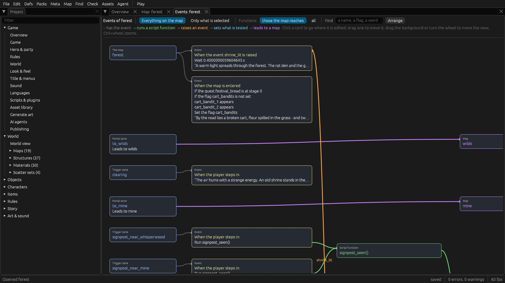

# 7. Events

Most of a game's logic needs no programming. It's made of **triggers**:

> **When** something happens (the event), **if** all conditions hold, **do** these actions.

A villager who talks when the player presses E, a door that opens with a key, a quest step when a
zone is entered, a reward when a boss is defeated: all triggers. When the editor's actions aren't
enough, a trigger runs a script ([Scripting](08-scripting.md)).

## Where triggers live

Triggers belong to an **owner**, and each owner receives only some events:

| Triggers of | Events they can react to |
|---|---|
| a **map** (map settings, nothing selected) | *Map enter*, *Woke up*, *Time reached*, *Fight starts*, *Fight ends*, *Custom event* |
| a **zone** (trigger area) | *Enter*, *Leave*, *Interact*, *Searched*, *Custom event* |
| a **character** (placed, or its definition) | *Interact*, *Use item*, *Defeat*, *HP below %*, *Fight starts*, *Fight ends*, *Searched*, *Custom event* |
| a **prop** (placed, or its definition) | *Interact*, *Use item*, *Unlocked*, *Locked*, *Woke up* (beds), *Searched*, *Defeated* (broken), *Custom event* |
| an **item lying on a map** | *Interact*, *Use item*, *Custom event* |
| an **item definition's** *On use* | *Use item* |

The editor offers only the events that can reach a trigger where it is. A placed entity runs its
definition's triggers first, then its own. Edit them in the inspector (placed entities, zones, the
map) or in the Database (definitions).

### The events

| Event | When it happens |
|---|---|
| **Interact** | The player presses E at the entity (in front of them), or inside the zone. Picking up an item lying on the map happens by itself on Interact. |
| **Enter** / **Leave** | The player walks into / out of a trigger zone. |
| **Use item** | The player uses an item (or a particular one) on the entity in front of them. If nothing reacts, the item's own *On use* triggers run. |
| **Map enter** | The player arrives on the map. Not when a save game is loaded: loading resumes the game. |
| **Custom event** | An *Emit event* action or `emit("name")` with that name. It reaches the map, all zones and all active entities on the map. |
| **Defeat** | The character's HP reached 0, or the prop (with object statistics) broke. |
| **HP below %** | The character fell below that share of its HP and survived the hit. |
| **Unlocked** / **Locked** | The prop's lock was opened with its key, or locked again. |
| **Woke up** | The player woke up after sleeping: the map's triggers (anywhere on it) and the bed's own. |
| **Searched** | The player used *Search* on the [action bar](09-gameplay.md#the-action-bar): a Perception roll, then the *Searched* triggers of the zones they stand in and of the props and characters within 2 tiles. Pair it with *Search found* (the roll against a DC); "You find nothing." when none runs. *Since 0.32* |
| **Time reached** | The clock reached that hour (12.0 = noon, 5.5 = 5:30) while the player is on the map, every day; also when time jumps past it by sleeping or *Set time*. |
| **Fight starts** / **Fight ends** | A [turn-based fight](09-gameplay.md#health-and-combat) started on the map / is over (won or fled; not when lost: the *defeated* menu comes). The map's triggers, and a character's own when it takes part (a boss's words when its fight starts; one that joins later fires *Fight starts* as it joins). |

## Conditions

All conditions of a trigger must hold; each can be negated (*not*). Comparisons are *=, ≠, <, ≤, >,
≥*.

| Condition | Checks |
|---|---|
| **Flag set** | A flag (yes / no) was set |
| **Variable** | A variable (a whole number) compared with a value |
| **Has item** | The player carries at least so many of an item |
| **Player HP** | The player's HP compared with a value |
| **Prop state** | A prop is in a state (*open*, *lit*…) |
| **Quest** | Not started, active, completed, failed, at a stage, at a stage or later |
| **Timer** | A timer's seconds left compared with a value (a timer that isn't running has 0: *> 0* = running) |
| **Text variable** | A text variable equals a text (*any case*: "Rosehill" = "rosehill"; an empty text = the variable is empty) |
| **Player sex** | Male or female |
| **Player race** | The player's race (*Database › Races*), e.g. goblin; a race holds for its subraces too (*dwarf* for a hill dwarf) |
| **Has money** | The hero's money (every coin carried, in copper pieces: 1 gp = 100) compared with an amount (*≥ 500* = at least 5 gp). Pair it with *Take money*: the example's Greta and the stone house do |
| **Is attuned** | The hero is attuned to a magic item ([Gameplay › Magic items](09-gameplay.md#magic-items)) |
| **Was knocked out** | A fight knocked out a character of this name (or definition id) instead of killing it: the player chose *Knock out* ([Gameplay › Health and combat](09-gameplay.md#health-and-combat)) |
| **Has class** | The hero's class or subclass (*Database › Classes*: *fighter*, *champion*; empty = any class) at a level compared with a number (*≥ 3*); false without a class |
| **Faction standing** | The player's standing with a faction (-100 to 100) compared with a value; at -20 or below its characters attack the player |
| **Time of day** | Between two hours; wraps around midnight (20 to 6 = at night) |
| **Proficient in** | The hero is proficient in a skill, tool or saving throw (`stealth`, `thieves-tools`, `save:dex`). Until 0.27 *Skill level* |
| **Check passed** | The last ability check or saving throw (an *Ability check* action, a lock, crafting, `check()` in a script) succeeded, by at least a number (0 = just succeeded) |
| **Search found** | The hero's last search (a Perception roll) reached a DC: for *Searched* triggers (`search_roll()` in scripts). *Since 0.32* |
| **Passive check** | The hero's passive check of a skill, ability or ability:tool (10 + the bonus, +5 with advantage, −5 with disadvantage: dim light for Perception; 0 looking in darkness) is at least a DC: something noticed without rolling, e.g. on a zone's *Enter* ([Gameplay › Checks outside fights](09-gameplay.md#checks-outside-fights)). *Since 0.32* |
| **Knows spell**, **Player level** | Character progress |
| **Player has condition** | Poisoned, prone, exhausted… (or any condition); until 0.27 *Player has effect* |
| **Defeated count** | How many of a character kind the player has defeated (the bestiary's count) |
| **Pose** | A character is sitting, lying, at furniture or on its feet |
| **Script** | A script function returning yes / no |

## Actions

Actions run in order. *Dialog*, *Choice*, *Wait*, the walking actions and *Play cutscene* pause the
list until they finish; the rest happen at once. Actions that change an entity name a **target**:
`self` (the trigger's owner), `player`, or a placed entity's **name**. What actions change is kept
across map changes and in save games.

**Talking**
- **Dialog**: a line of text with a speaker. **Choice**: a question with options; the chosen
  option's number (0, 1, 2…) goes into a variable that later conditions check.
- **Set mood**: the portrait mood a character shows ([Characters](06-characters.md#dialog-portraits-and-moods)).
- **Show emotion** / **Clear emotion**: an icon over a character's head (below).
- **Bark (speech bubble)**: a short line over a character's head that doesn't stop play (below).
- **Carry prop**: a character (or the player) carries a prop in both hands (empty = puts it
  down); while carrying it holds nothing else and the player can't attack.

**Game state**
- **Set flag**, **Set variable** (= or +=), **Give item**, **Take item**, **Heal player** (negative
  hurts), **Heal character**, **Give experience**, **Quest** (start, advance, set stage, complete,
  fail), **Unlock achievement**, **Autosave**.
- **Give money**, **Take money** (gp / sp / cp): the hero's coins, with change in the fewest gold,
  silver and copper pieces and a toast ("Got 2 gp 5 sp", "Paid 5 sp"). *Take money* takes nothing
  when the hero has less: check *Has money* first. The project needs coins (items with a *Coin
  worth*).
- **Fall** (feet): the hero falls (a trapdoor, a collapsing floor): 1d6 bludgeoning per 10 ft, at
  most 20d6, into the roll log, and prone for a moment; they stay where they are (move them with
  *Teleport*, or use a *Drop* zone).
- **Eat / drink** (food days, water days): what the hero ate and drank today for *Food and water*
  (*Database › Project › Rules*): a ration is 1 day of food, a meal half a day, a waterskin half a
  day of water, a well a whole day. Put it on a food item's *Use* trigger (beside its *Heal*) or a
  well's. With the rule off it does nothing.
- **Change standing**: raises or lowers the player's standing with a faction (*Database ›
  Factions*); at -20 or below its characters attack the player, above it they calm
  down at once.
- **Set faction**: a character on this map (*target*: `self`, a name) or `player` joins a faction;
  empty = back to its own (the placed character's, its definition's, its race's). Saved; who
  attacks whom changes at once ([Characters › Factions](06-characters.md#factions)).
- **If / Else**: conditions and two action lists, for branches inside one trigger.
- **Emit event**: raises a custom event for other triggers. **Run script**: calls a script function.

**Entities and the world**
- **Set active** (show / hide an entity), **Set prop state**, **Set locked**, **Move** (walk by
  tiles), **Face**, **Teleport** (the player to a map's spawn point).
- **Equip item**, **Unequip slot**, **Give item to character**, **Take item from character**.
- **Patrol**, **Schedule** (follow / stop), **Companion** (joins / leaves), **Companion order**,
  **Open companion window**.
- **Rush to (fighters)**: a character with *Chase* behaviour runs to where another character (or
  the player) is, following them for 15 seconds, and fights whoever it sees on the way. In the
  example the bandit chief's *Lads, to me!* brings his two men out of the trees to him.
- **Open shop**, **Shop stock** (add to or set a merchant's stock), **Open crafting**,
  **Pick a lock (DEX check)** (a DEX (Thieves' Tools) check against a DC; 1 or 0 into a variable),
  **Sleep** (hours).
- **Set time of day**, **Set weather**, **Spawners on / off**, **Defeat all enemies**. (*Defeat all enemies* during a fight takes the defeated foes out of it; the fight ends when none is left.)

**Cut-scenes and effects**
- **Play cutscene**, **Walk to tile**, **Walk up to character**, **Place at tile**, **Dim the
  scene**, **Show / hide UI**, **Wait**.
- **Move route**: a character (or the player) walks a list of steps, added with one button each:
  *Move* (tiles in a direction), *Toward player* / *Away from player* (tiles), *Turn*, *Face
  player*, *Turn at random*, *Wait*, *Jump* (tiles away, or 0, 0 on the spot; a hop over anything
  in between), *Speed* (times its usual speed, for the rest of the route), *Animation* (a clip of
  its 3D model for some seconds), *Sound*, *Through walls* (on / off) and *Script*. **Skip
  blocked**: a step whose tile is taken (a wall, a prop, someone) is left out; off, it waits until
  the tile is free. **Repeat**: from the start again (the event doesn't wait for it); **Wait**:
  the event goes on when it is done. A new route replaces the character's current one; routes end
  when the map changes. The example's guard hops for joy in the intro.
- **Camera**: the camera pans to **a tile**, to **a character** it then follows (*self* or a name),
  or back to **the player**, over some seconds with an easing, and can **zoom** (1 = usual, 2 =
  twice as close); **Wait** holds the event until it is there. It stays where the event put it
  while the event or cut-scene runs, then glides back to the player by itself; a map change
  returns it at once. The example's intro pans over the village to Elder Rowan while the title card
  shows.
- **Scroll text**: text rolls up the screen over a background colour (credits, a story intro):
  centred lines, those starting with `# ` as headings in the skin's highlight colour; speed in
  screen pixels per second; a see-through background shows the map. The event waits until the last
  line has gone; holding confirm speeds it up, cancel skips it. It also works from a custom title
  screen entry.
- **Play sound** (with volume, pitch and pan), **Play music** (with a crossfade time), **Play music
  effect** (a fanfare: the music ducks under it and comes back after; *Wait* holds the event until
  it is over), **Shake the screen**.
- **Call common event**: runs a common event's actions here, as if they stood in this list
  ([The Database › Common events](05-database.md#common-events)).
- **Show image** / **Hide image**: a picture over the game (below).
- **Show picture**, **Move picture**, **Erase picture**: picture layers, moved and faded (below).
- **Input number**: a window asks the player for a whole number (from, to, at most so many digits;
  typed, or Up / Down by one and Left / Right by ten for the gamepad) and puts it into a variable.
  **Input text**: asks for a text (at most so many letters; typed, the window starts with the
  current value so a gamepad can confirm it) and puts it into a **text variable**, which `{name}`
  shows in any text like a number variable. The event waits for the answer. The example's
  Whisperwood shrine has a riddle stone (*Input number*: the answer 7), and the old stone house
  asks for its name once it is yours (*Input text*, shown as `{house_name}`).
- **Start timer** / **Stop timer**: a named countdown, **shown** at the top of the screen (minutes
  and seconds, the last ten in red) or hidden; when it runs out it runs a script function and / or
  fires a custom event. Timers pause while a menu or a dialog is open and are saved; starting one
  again restarts it; *Stop timer* ends it without running anything. The example's *Hot Soup*
  errand (Greta, in the tavern) starts a shown timer in its first quest step: Elder Rowan's
  *Talk* step only counts while the timer runs, and running out calls `soup_gone_cold()`, which
  fails the quest.
- **Tint screen** (a colour over the whole screen, its opacity = how strongly, changing over some
  seconds; it stays until changed and is saved; opacity 0 takes it away), **Flash screen** (a
  colour fading out: lightning, a spell; left out when the player turned off screen effects),
  **Fade out** / **Fade in** (cover the screen with a colour and uncover it; a fade-out lasts
  across map changes until *Fade in*, so a *Teleport* between them changes maps unseen; dialogs
  and the HUD stay over it). The tint goes over the world and the pictures, under the HUD.
- **Play effect** (an animation once), **Fly sprite to point** (a projectile that calls a script on
  arrival), **Light at point**, **Light around player**, **Damage area**, **Damage around player**
  (both with a damage type: fire, cold…), **Heal area**, **Aim (then run script)**.

**Rules (SRD 5.1)**
- **Ability check**: rolls a check of the hero against a DC (5 very easy, 10 easy, 15 medium, 20
  hard): a skill (`persuasion`), an ability (`str`) or ability:tool (`dex:thieves-tools`), normal or
  with advantage / disadvantage, and runs its **On a success** or **On a failure** actions. The
  result shows on screen, goes into the journal's *Rolls* page, and *Check passed* sees it later.
- **Saving throw**: the same with an ability's saving throw (`dex`, `wis`…).
- **Damage prop** (a prop, damage, type): damages a prop with object statistics past its damage
  threshold (poison and psychic do nothing); at 0 hit points it breaks: its lock is gone, it
  disappears or takes its broken state, its *Defeated* triggers fire (a collapsing barricade, a
  trap smashing a crate). `damage_prop()` in scripts.
- **Group check** (what, DC): the hero and every companion on the map roll; when at least half
  succeed, the **On a success** actions run, else **On a failure** (sneaking past a camp together).
  Companions roll with their stat blocks, under their names in the *Rolls* page.
- **Contest** (the hero's check, a character, its check): the hero's roll against a character's
  (by name, *self* = the trigger's owner; it needs a stat block) of the same check or another one
  (Athletics against Athletics; Stealth against Perception); the higher total wins, a tie isn't a
  win: **If the hero wins** or **Otherwise**. Both rolls go into the *Rolls* page.
- **Roll dice**: rolls an expression (`2d6+STR`, `1d20`, `8d6`; `STR` to `CHA` = the hero's
  modifier, `PROF` = the proficiency bonus) into a variable.
- **Set proficiency**: makes the hero proficient in a skill, tool or saving throw, or takes it
  away. Until 0.27 *Set skill level*; *Give skill points (unused)* does nothing since then.
- **Apply condition**: a [condition](09-gameplay.md#conditions-and-damage) on the player or a
  character (poisoned, prone, exhaustion with its levels…) for some seconds (0 = until removed),
  with an optional **saving throw** that keeps it off (ability and DC) and **every round** damage
  of a type or healing (`1d4` fire, `2` healing). *None* as the condition = only the per-round part.
  Until 0.27 *Apply effect*.
- **Remove condition**: one condition, or all of them with their damage per round. Until 0.27
  *Cure effect*.
- **Short rest**: opens the rest window, where the hero spends hit dice; an hour passes.
- **Long rest** (hours, 8): like sleeping without a bed: full HP, half the hit dice back, one level of
  exhaustion less, the timed conditions over ([Gameplay › Rests](09-gameplay.md#rests)).
- **Start fight**: a [turn-based fight](09-gameplay.md#health-and-combat) with the hostile
  characters within 12 tiles of the player (their allies and the party join); nothing without any.
  An ambush: *Set active* shows the bandits, *Start fight* begins it.
- **Set class** (target, class, level): gives the hero (*player*) or a party member on this map a
  [class](09-gameplay.md#classes-and-levels): its saving throws and proficiencies; the choices of the
  levels it has open the level-up window. *Level* 0 keeps the level; a party member joins at a
  higher one with its experience and hit points to match.

In the example, Tilda's quest reward offers "Ask for a bit more": an *Ability check* (Persuasion,
DC 13) whose success gives ten more coins. Brom the smith, on his stool at the tavern in the evening,
offers an arm-wrestle for a gold piece: a *Contest* of Athletics against his (his entity's stat block
has STR 16). A zone by the forest clearing's plaza has a *Passive check* (Perception 13): by day the
hero notices some lost gold pieces in the grass, at night (dim light) they walk past, unless a
*Search* finds them (*Searched* with *Search found* 13; a flag keeps them found once). The mine's
lower chamber hides a miner's stash behind a loose stone (*Searched*, *Search found* 15).

**Magic**
- **Learn spell** (only when the hero's class lists the spell), **Teach spell** (a party member
  whose class lists it), **Add mana** (does nothing since spells use slots).
- **Cast spell** (spell, target, free): the hero casts a spell outside a fight on *player* or a
  character on this map; with a slot unless *free* (a scroll, the story's casting: a priest's
  blessing). Story-only spells act only this way.

AI agents get every event, condition and action with its fields as JSON ([below](#the-json-form-ai-agents-hand-written-files)).

## How triggers run

- **Every** trigger whose event matches and whose conditions hold runs, in order: a definition's
  triggers before a placed entity's own, each list from top to bottom.
- All conditions are checked **before** any action runs. A trigger that sets a flag doesn't stop
  another trigger of the same moment that checks that flag: give such triggers conditions that
  exclude each other (*Flag set* on one, *not Flag set* on the other).
- **once** makes a trigger run a single time per save game.
- Texts may use `{player}` (the player's name), `{sir|madam}` (by the player's sex),
  `{variable}` (a variable's value) and `{key:interact}` (the key or gamepad button of an action:
  "E" with the keyboard, "A" with an Xbox pad; any action id such as `attack`, `journal`, `map`
  works, `interact` is the same as `confirm`). In a speaker, `{self}` is the owner's name. Item
  descriptions understand `{key:…}` too ("press {key:interact} to cast").

### Message codes

Dialog and Choice texts may also carry **message codes**, in the same braces:

| Code | What it does |
|---|---|
| `{c:gold}…{/c}` | Colours the text up to `{/c}`. Colour names: `white`, `gray`, `red`, `green`, `blue`, `cyan`, `yellow`, `gold`, `orange`, `purple`, `pink`, `brown`, plus the names the game's UI skin adds ([UI skins](05-database.md#ui-skins)); or `#rrggbb`. |
| `{i:room_key}` | Shows an item's icon inside the line (the item's id). |
| `{w:0.5}` | Pauses the typing for that many seconds (up to 60). |
| `{s:2}` | Types the rest of the line at that speed: 2 = twice as fast, 0.5 = half as fast. |
| `{name:A voice}` | Shows another name in the name box (and the dialog log). |
| `{at:top}` | Shows the box at the `top`, `middle` or `bottom` (the usual place) of the screen. |

Example: `Here's the {i:room_key} {c:gold}key{/c} to your room.{w:0.4} Sleep well!`

- The action's form has a row above the text: the box's place, **Colour** and **Icon** menus and
  **Pause**, each inserting its code at the cursor. A preview below the text shows the colours,
  icons and pauses, and names anything in braces that isn't a valid code.
- Pressing E while the text types out still shows all of it at once, pauses included.
- The dialog log (journal) and Choice options show the text without codes.
- A leading `{at:…}` isn't part of the text translators see. The other codes are: a translation
  keeps them (*Problems* warns when one is missing, and about unknown codes and icons of items that
  don't exist).
- Scripts: `say_at("top", speaker, text)`, or the codes inside any `say` text.

## Common patterns

### A character with something new to say

Two *Interact* triggers on the character:

1. *Interact*, if **not** *Flag set* `met_mira`: *Dialog* "Hi! I'm Mira.", *Set flag* `met_mira`.
2. *Interact*, if *Flag set* `met_mira`: *Dialog* "Hello again, {player}."

Because both are checked before either runs, the first conversation shows only the first trigger.

### A reward that happens once

*Interact* on a chest-like prop, **once**: *Dialog* "You found 20 coins.", *Give item* `coin` 20,
*Set prop state* `self` `open`. For real containers, tick *Lootable container* in the prop instead.

### A locked door

Give the door prop a lock (*Database › Props › Lockable*): the key item, *on unlock: switch to state
open*. Put the key somewhere: in a chest, a shop, an item lying on a map, or a *Give item* action.
An *Unlocked* trigger on the door can add a line or a sound.

### A quest

Describe it in *Database › Quests* ([Database › Quests](05-database.md#quests)): the giver, the
offer, each step (talk to someone, reach a place, conditions that hold) with actions when it starts
and when it is done, and the rewards. The game plays it; the giver needs no triggers. The example's
quests are all built this way (Elder Rowan's two, Tilda's, Mira's, Bram's, Ida's, Brom's and the
elven herbalist's).

Triggers still take part where a quest needs more than the editor describes:

- something the player does elsewhere counts: the clues three villagers give for Mira's cat (their
  *Interact* triggers run `cat_clue()`, which adds to `cat_clues`; the quest's step is done when
  `cat_clues` >= 2);
- a map changes during a step: a *Map enter* trigger with the *Quest* condition (*active at
  stage*) puts the cart's outlaws or the lost cat there;
- a quest is started from somewhere else: Greta's tavern menu starts *Rumours at the Tavern* with
  the *Quest* action (**start**); the quest has no giver, its steps and rewards still play.

The *Quest* action (**advance**, **set stage**, **complete**, **fail**) and condition work on these
quests too, and their step actions and rewards run whichever way a quest moves on.

### A shop after a greeting

A merchant whose *Talking opens the shop* is off: *Interact*: *Dialog* "Welcome!", *Choice* "Buy
something?" (Yes / No) into `shop`, *If* `shop` = 0: *Open shop* `self`.

### Emotions over heads

**Show emotion** puts a small animated icon over a character (or the player): surprise, joy, anger,
a thinking "...", a sleepy "Zz" and so on. It pops up, follows the character while it walks, bobs a
little and fades out.

| Setting | Effect |
|---|---|
| **target** | `self`, `player`, a placed character's name |
| **emotion** | The name of an animation of a sprite sheet of the kind *Emotions* (the starter library has 14: `surprise`, `confused`, `anger`, `joy`, `love`, `embarrassed`, `sad`, `fear`, `sleepy`, `thinking`, `idea`, `music`, `sweat`, `annoyed`) |
| **seconds** | 0 = 2.5 s; -1 = until **Clear emotion** |
| **wait until it is over** | The event goes on only afterwards (a beat before a line) |

Put it right before a *Dialog* to show how the speaker feels while they talk. Characters also show
emotions by themselves when *Automatic emotions* is on (*Database › Project*): enemies are
surprised when they notice the player, confused when they lose them and afraid when they flee;
sleepers snore; companions are happy when they learn a spell. In the example, the guard is surprised
to see you arrive, Tilda is glad to meet you, Elder Rowan dozes, thinks before he tells you about the
lights and is happy when you return, and Pip is relieved when the remedy works.

### Barks: lines in passing

**Bark (speech bubble)** shows a short line in a speech bubble over a character (or the player):
"Fresh bread!", "Cold tonight...". Unlike a *Dialog* it opens no dialog box and doesn't stop the
player or the event; the bubble follows the character, pops up and fades out.

| Setting | Effect |
|---|---|
| **target** | `self`, `player`, a placed character's name |
| **lines** | One line per row: one of them is said, at random, never the same one twice in a row. Placeholders (`{player}`, `{sir\|madam}`) work, and the lines are translated like dialogs |
| **seconds** | 0 = by the line's length (2 to 7 s) |

When a character barks is up to the trigger: an *Hour* map trigger (the baker calling out at dawn),
a *Trigger* zone the player walks through (the stalls of a market), an *If* on the weather or a
variable. A character says one line at a time; a new bark replaces the old one. A character more
than 12 tiles from the player, or not on the map (away on its daily routine), says nothing. In scripts:
`bark("Tilda", "Fresh bread!")`.

In the example, Oswin the crier calls the news in the square in the morning and afternoon, Dagny
calls the hours on her night rounds, Tomas offers apples at the market (and grumbles when it rains),
Finn shushes you at the pier, the elder looks up from his book, and Bram, Brom and Greta greet you
in the bakery, the smithy and the tavern: *Hour* map triggers, *Trigger* zones by their stops and
*Map enter* triggers indoors.

### A picture when you first meet someone

**Show image** draws a sprite sheet whole over the game, for a full-body painting of a character, a
letter, a map or a poster:

| Setting | Effect |
|---|---|
| **picture** | The sprite sheet (*Database › Sprite sheets*; *Browse…* a PNG of any size, the frame size doesn't matter) |
| **Wait until closed** | On: the event goes on once the player closes the picture (E, a click or Esc). Off: it stays **behind** the following dialogs until *Hide image* or the end of the event, so a character can talk in front of their portrait |
| **Scroll** | A picture taller than the window keeps the window's width and pans slowly down and back up; the arrow keys and the mouse wheel scroll it by hand |
| **size** | 1 = the picture's own pixels (painted art); 2, 3… for small pixel art. A picture larger than the window is scaled down to fit, keeping its proportions, and drawn smoothly |

The example's Tilda shows both the first time you enter her shop: her full figure, scrolling, then
her portrait behind her greeting. Her first *Interact* trigger (with *not Flag set* `met_tilda`):
*Set flag* `met_tilda`, *Show image* `tilda_full` (wait, scroll), *Show image* `tilda_portrait`
(no wait), *Dialog*, *Dialog*. The portrait goes when the conversation ends and her shop opens.

### Picture layers

For title cards, a portrait sliding in, a glowing rune over a door: up to 100 pictures at once,
each on a numbered **layer** (higher numbers are drawn over lower ones), above the map and below
the HUD. They are saved with the game, a move in progress included.

**Show picture** puts a picture on a layer (replacing what it showed):

| Setting | Effect |
|---|---|
| **layer** | 1 to 100 |
| **picture**, **frame** | A sprite sheet and its frame |
| **place** | On the screen: x, y pixels from an **anchor** (`top_left` … `center` … `bottom_right`; counted inwards from the edges, like HUD elements: with `center` at 0, 0 the picture sits in the middle). **On the map**: x, y are a map tile and the picture's middle sits on it, moving with the map |
| **look** | Size (x 2 for small pixel art), opacity (0 to 1), rotation (degrees), tint (multiplies its colours; white = as drawn), **Additive** (adds its light: glows, magic) |

**Move picture** changes a picture over some **seconds** with an **easing** (*linear*, *in*:
starts slowly, *out*: ends slowly, *in_out*): tick the values to change (place, size, opacity,
rotation, tint); the others stay. **Wait** makes the event wait until the move is done.
**Erase picture** takes a layer's picture away (layer 0: all of them).

The example's intro shows the *Emberbrook* sign as a title card: *Show picture* (layer 1, anchor
center, size x 4, opacity 0), *Move picture* (opacity 1 over 1.5 s, wait), *Wait*, *Move picture*
(opacity 0), *Erase picture*. Scripts: `picture_show`, `picture_move`, `picture_erase`
([Scripting](08-scripting.md#pictures)).

### A cut-scene

*Play cutscene* runs a script function with the HUD hidden and black bars in. See
[Scripting › Cut-scenes](08-scripting.md#cut-scenes).

## The Events graph



The **Events** tab next to *Map* shows the open map's events as a graph:

- on the left the **owners** (the map, its zones, placed entities), next to them their **triggers**
  with their conditions and actions summarised (dialog lines, choices with their options and the
  variable that keeps the answer);
- then the **script functions** they run, with their dialog lines, choices, events, flags and
  teleports read from the script;
- and the **maps** they lead to.

The edges show how things connect: **green** runs a script function, **orange** an emitted event
reaching the triggers that listen for it, **blue** a choice, variable or flag reaching the
conditions and scripts that test it, **purple** a teleport, portal or transition to another map.

Drag the background to pan, Ctrl+wheel to zoom, a node's title to move it (*Arrange* lays them out
again, *Fit* shows everything); click a title to highlight its edges. The pencil on a trigger opens
its condition and action editors inside the node; changes can be undone. Triggers from a definition
are read-only with *Open in Database*; function nodes have *Edit in <file>*, owners *Show on map*,
maps *Open*. *Whole map* / *Selected object* switches between everything and only what the selected
entity's or zone's triggers lead to; *All script functions* also shows functions the map doesn't
run.

## The JSON form (AI agents, hand-written files)

AI agents ([chapter 13](13-ai-agents.md)) write triggers as JSON, and the definition files hold
them in the same structure:

```json
{"on": "Interact",
 "conditions": [{"cond": {"Quest": {"quest": "pest_control", "check": "NotStarted", "stage": 0}}, "negate": false}],
 "actions": [{"Dialog": {"speaker": "Elder", "text": "Slimes in the cellar again, {player}…"}},
             {"Choice": {"speaker": "Elder", "text": "Will you help?", "options": ["Yes", "Later"], "var": "help"}},
             {"If": {"conditions": [{"cond": {"Var": {"name": "help", "op": "Eq", "value": 0}}, "negate": false}],
                     "then": [{"Quest": {"quest": "pest_control", "op": "Start", "stage": 0}}], "otherwise": []}}],
 "once": false}
```

Every event, condition and action has a JSON form like these; the agent server's
`events_reference` tool prints all of them with example values (always matching the running
editor), the events each owner accepts, and the operators (`Eq`, `Ne`, `Lt`, `Le`, `Gt`, `Ge`;
quest checks `NotStarted`, `Active`, `Completed`, `Failed`, `AtStage`, `StageAtLeast`; quest
operations `Start`, `Advance`, `SetStage`, `Complete`, `Fail`; variable operations `Set`, `Add`).
A `"target"` names `self` (the trigger's owner), `player` or a placed entity's name. Agents send
triggers to `set_triggers`, `add_trigger`, `place_entity` / `update_entity` (`triggers`),
`add_zone` (`triggers`) and `upsert_def` (`triggers` / `on_use`); `set_triggers` refuses events
the owner can't receive ([Where triggers live](#where-triggers-live)).
