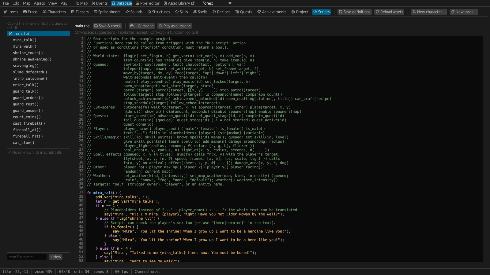

# 8. Scripting

Triggers cover most of a game. When you need more (a calculation, a puzzle, a long branching
conversation, a spell that flies and explodes), write a **script**. Scripts are written in
[Rhai](https://rhai.rs), a small language that looks like a mix of Rust and JavaScript. You don't
need to know either; the examples here and in the [scripting reference](../scripting.md) are enough
to start.

This chapter is the overview. The [scripting reference](../scripting.md) lists every function, with
recipes for common tasks.

## A first script

A shrine that stays dormant until the player has accepted a quest, then lights up:

```rust
fn shrine_touch() {
    if !flag("quest_accepted") {
        say("It seems dormant.");
        return;
    }
    say("Ancient runes begin to glow!");
    set_flag("shrine_lit", true);
    set_state("self", "glowing");
    emit("shrine_lit");
}
```

To use it, give the shrine a trigger: **On Interact**, action **Run script**, function
`shrine_touch`. When the player presses E at the shrine, the game calls the function.

## Where scripts live and how they're called

Scripts are the `.rhai` files in the project's `scripts/` folder. All files are loaded together as
if they were one, so a function in one file can call one in another, and every function name must
be unique. Put only functions (and comments) at the top level; keep lasting state in **flags** and
**variables**, which are saved with the game.

The game never runs a script by itself. Something calls a function:

| Caller | Called as |
|---|---|
| A **Run script** action in any trigger | `name()`; `SELF` is the trigger's owner |
| A **Script** condition | `name()`, which must return `true` or `false` |
| A skill or spell with the **Script** effect | a skill: `name(level)` when its level changes; a spell: `name()` when cast |
| `then_call("name")`, `aim("name")`, `fly(…, "name")` in a script | after the queued actions, with the target the player clicked, when a flying sprite arrives |

## The one rule: immediate and queued

- **Immediate** functions act at once, while your function runs: `flag`, `set_flag`, `get_var`,
  `set_var`, `item_count`, `give_item`, `take_item`, and everything that only reads (`hour()`,
  `player_hp()`, `skill(…)`).
- **Queued** functions (`say`, `choice`, `teleport`, `move_by`, `wait`, `heal`, `start_quest`,
  `play_sound`, `fly`…) add an action to a queue that runs **after your function returns**, in
  order. Dialogs, choices, walks, waits and teleports block the queue until they finish.

So a function never sees the result of something it queued. To continue after a dialog or a choice,
queue the next function with `then_call`:

```rust
fn ask() {
    choice("Buy a potion for 5 coins?", ["Yes", "No"], "buy");
    then_call("after_ask");          // runs once the player has answered
}

fn after_ask() {
    if get_var("buy") == 0 {         // 0 = the first option, "Yes"
        if item_count("coin") >= 5 {
            take_item("coin", 5);
            give_item("potion", 1);
            say("Here you are.");
        } else {
            say("You can't afford it.");
        }
    }
}
```

## Writing scripts in the editor



*Database › Scripts* lists every script file with its functions underneath; click a file to edit
it, or a function to jump to it. *+ New* creates a script. **Save & check** (Ctrl+S) saves and
reports errors.

The script editor helps as you type:

- **Highlighting** of keywords, strings, numbers, comments, engine functions and your own functions,
  with line numbers.
- **Completion** suggests engine functions with their parameters, your functions, keywords and
  variables (Ctrl+Space shows everything; ↑↓ choose, Tab / Enter accept, Esc closes). Inside a
  string it offers exactly what the function expects: items for `give_item("`, maps and then that
  map's spawn points for `teleport(`, quests, sounds, prop states, flags, variables, entity names,
  functions for `then_call("`.
- A line above the editor shows the **parameters** of the call around the cursor with a short
  description.
- **Ctrl+click** on a function name jumps to its definition, also in other files.
- **Problems** under the file list are checked live and underlined in red: ids that don't exist in
  the project, such as `give_item("potoin")`. Click one to jump there.

Renaming an item, map or sound in the Database also rewrites the ids your scripts pass to functions.

## Trying scripts while the game runs

Play-tests from the editor run in developer mode:

- **Live reload**: saving a script reloads it in the running game within half a second (a toast
  says so). A script with an error keeps the previous version running and shows the error.

### The developer console

**F4** in a play-test opens the console, which pauses the game:

| Command | Does |
|---|---|
| `call FN` | Calls a script function |
| `give ITEM [N]`, `take ITEM [N]` | Changes the inventory |
| `flag NAME on\|off`, `var NAME V` | Sets flags and variables |
| `settime H` | Sets the time of day |
| `teleport MAP SPAWN` | Moves the player |
| `hp N`, `xp N` | Sets HP, gives experience |
| `effects`, `status` | Shows the player's effects, the game's state |
| `reload`, `clear`, `help` | Reloads the scripts, clears the console, lists the commands |
| anything else | Runs as a line of script with your project's functions: `item_count("coin")` prints the count |

Up / Down recall earlier lines; Esc clears the line, then closes. Exported games never have the
console.

## Cut-scenes

Any script function can be played as a cut-scene: the *Play cutscene* action or `cutscene("fn")`.
While it plays, the HUD is hidden, black bars slide in, and the player and other characters wait for
its walks, dialogs and waits.

```rust
fn intro_cutscene() {
    place("player", 2, 30);              // put the player at a tile
    walk_to("player", 12, 30);           // and let them walk in
    approach("guard", "player");         // the guard walks up to them
    say("Town Guard", "Halt, traveller! The elder wants to see you.");
    dim(0.5, 1.0);                       // darken the scene a little
    wait(1.0);
}
```

- `walk_to(target, x, y)` (*Walk to tile*), `approach(target, other)` (*Walk up to character*: stops
  a tile before it, then both face each other), `place(target, x, y)` (*Place at tile*).
- `dim(amount, seconds)` (*Dim the scene*) darkens it so lights show even by day; the end of the
  cut-scene brightens it again.
- `shake`, `effect`, `fly`, `play_sound`, `play_music`, `set_weather`, `disable_spawners` and
  `defeat_enemies` make scenes more dramatic.

In the editor, the Scripts tab's **+ Cutscene** adds a template function, **Play as cutscene**
play-tests a function as a cut-scene on the open map (its *Map enter* triggers are skipped), and the
*Play cutscene* action has a *Preview* button.

The example has two: a new game starts with the hero walking into Emberbrook and the guard sending
them to Elder Rowan; and the first touch of the forest shrine darkens the clearing, lights the
statues with bursts of blue magic, defeats every monster left in the forest and switches off its
spawners.

## A scripted spell

The example's **Fireball** is a spell with the *Script* effect whose function aims, throws an
animated sprite, and explodes where it lands:

```rust
fn cast_fireball() { aim("fireball_at"); }          // the spell's Script function

fn fireball_at(x, y) {                               // the spot the player clicked
    play_sound("fireball");
    fly("fireball", x, y, "fireball_hit", #{ speed: 9, fps: 14, light: 2.5 });
}

fn fireball_hit(x, y) {                              // where the fireball lands
    play_sound("explosion");
    effect("explosion", x, y, #{ fps: 14, scale: 2.4, light: 5, shake: 0.3 });
    damage_area(x, y, 2, 5);
    light_at(x, y, 2, 4, #{ color: [255, 120, 50], flicker: true });   // embers
}
```

The spell's mana is only spent once the player picks a target. Spells and skills like this travel
to other projects through the asset library together with their functions
([The asset library › Scripted assets](11-asset-library.md#scripted-assets)).

## Safe by design

Scripts can't touch files or the network, and an operation limit stops endless loops. Errors are
logged and never crash the game. Positions are in tiles (fractions allowed: `10.5` is the middle of
tile 10).
