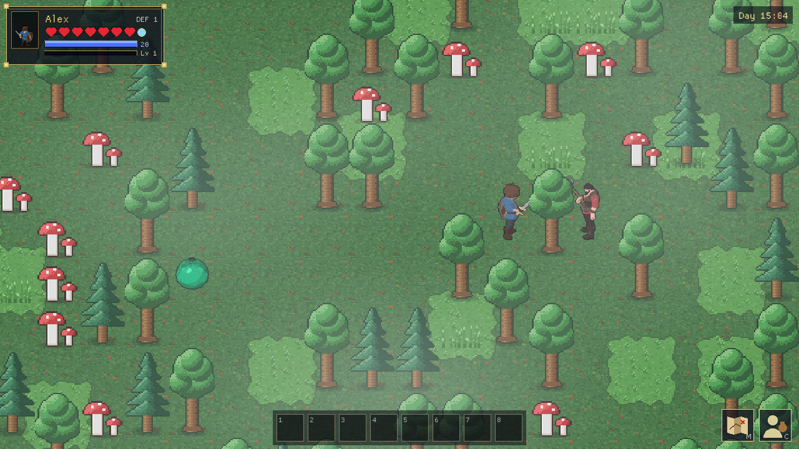
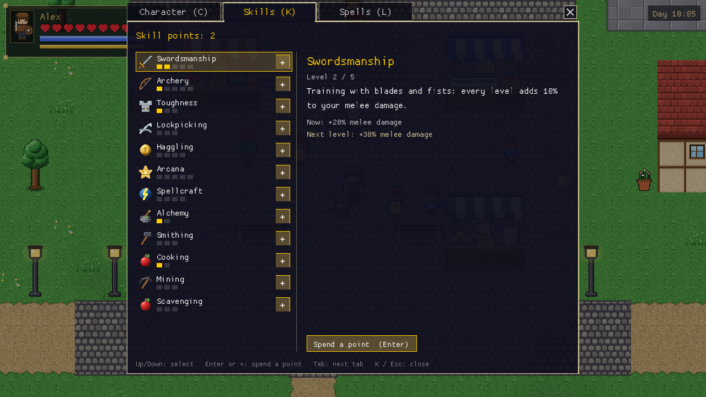
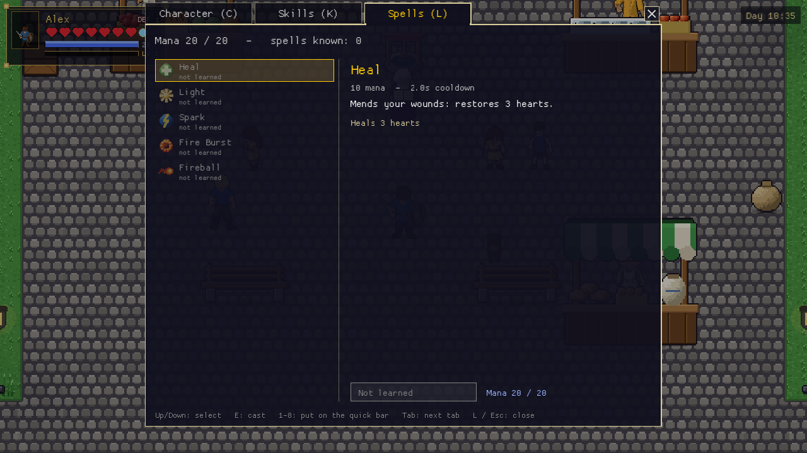
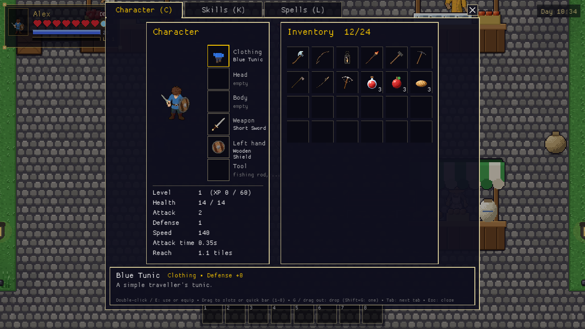
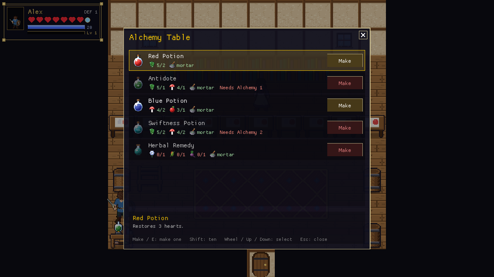
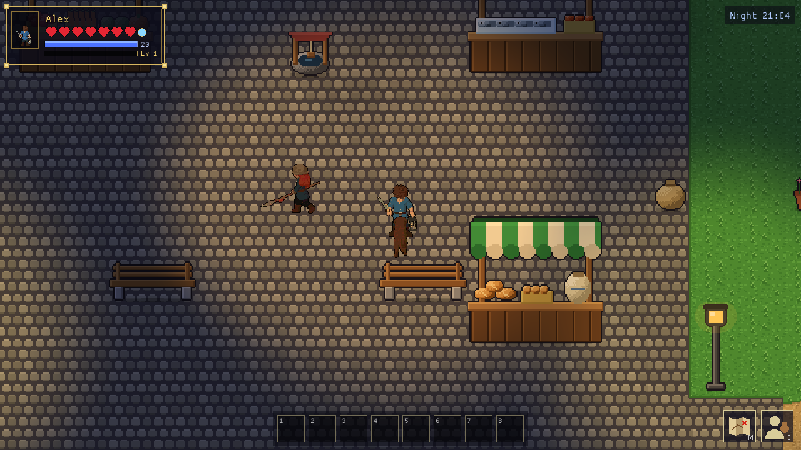
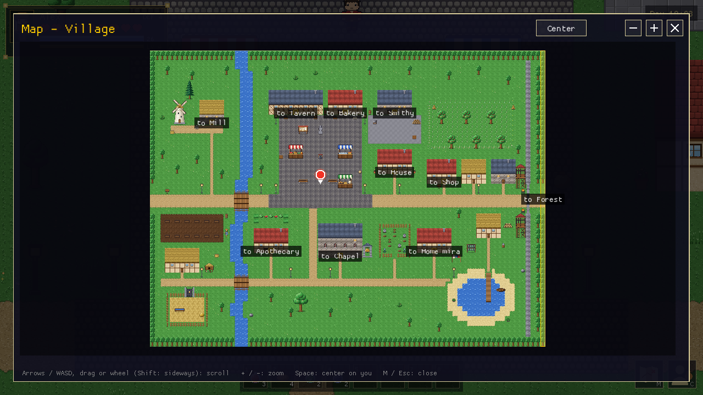

# 9. Gameplay systems

The engine brings the systems of a classic action RPG. You switch on what your game needs and fill
it with content; most systems are set up in the Database and driven by triggers.

## Health and combat

The **status frame** at the top left shows a small portrait of the hero as dressed, the name, the
**hearts** (one heart = 2 HP), the mana and experience bars, the defense and the ammunition of an
equipped bow or crossbow.

- **Melee weapons** have their own damage, speed, reach, swing arc and knockback (a sword, a spear,
  an axe). **Ranged weapons** (bow, crossbow) shoot projectiles and use ammunition. Shots fly over
  low obstacles (fences, rocks, water, barrels) and stop at high ones (walls, tree trunks, statues);
  enemy archers only shoot when they have such a clear line ([Maps › Low and high
  obstacles](03-maps.md#low-and-high-obstacles)).
- **Armor** reduces damage: what gets through is `damage − defense`, at least 1. Heavy armor can
  slow the wearer.
- Hits knock back and give a moment of invulnerability. When the player is hurt the screen shakes
  briefly and flashes red (players can turn this off in *Options › Shake & flash*).
- **Hostile characters** chase or shoot at the player ([Characters › Behaviour](06-characters.md#behaviour)),
  and their attacks can be seen coming:
  - **Armed** (a melee weapon in their equipment): they stop at their weapon's reach and **wind up**
    (0.4 s: the weapon raised over the head, a red zone on the ground shows where the swing will
    land), then **swing** in the direction they locked when the wind-up began, for the weapon's
    damage, reach, arc and knockback, and **recover** for the weapon's cooldown and a moment more.
    Stepping out of the red zone during the wind-up dodges the blow. They don't hurt by touch.
  - **Unarmed chasers** (slimes): close to their target they **crouch** (0.3 s, a red ring
    tightening around them) and **lunge**, hurting by touch (and its *On touch* effect) only during
    the hop; then they rest a moment.
  - **Archers** shoot; other hostile characters (traps, creatures that don't chase) hurt by touch.
  - They attack companions as well as the player. *Attack wind-up* on the character's form changes
    the wind-up (a slow, heavy brute; a quick assassin).
  The player's attacks only hit hostile characters, never companions or friendly villagers; make a
  huntable animal *hostile* with 0 damage.
- A defeated character runs its *Defeat* triggers and drops its loot and gear.
- A defeated **player** gets a menu: *Continue from last save* (the newest, autosave included),
  *Start over* (a new game as the same hero) or *Quit to main menu*.

## Experience and levels

Optional: *Database › Project › Experience and levels*. Defeated characters give the XP set in their
definition, completed quests their *Experience reward*. Enough XP raises the level, and each level
adds max HP (and heals as much), mana and skill points as set in the project. The XP needed starts
at *XP for level 2* and grows by *Growth* per level, up to the *Highest level*.

The status frame shows `Lv N` with a gold XP bar, the character window *Level N (XP a / b)*, and a
message announces every level. Triggers use the *Give experience* action and the *Player level*
condition; scripts `give_xp(n)`, `xp()` and `level()`.

## Status effects

Timed effects on the player and on characters:

| Effect | What it does |
|---|---|
| **Poison**, **Burning** | HP lost per second; defense doesn't help |
| **Regeneration** | HP gained per second |
| **Slow**, **Haste** | Slower / faster movement |
| **Strength**, **Weakness** | More / less damage dealt |
| **Shield** | Extra defense |
| **Stun** | Can't move, attack or interact |

Weapons apply one **on hit**, hostile characters **on touch**, and potions, traps and scripts with
the *Apply effect* / *Cure effect* actions or `apply_effect` / `cure`. Applying a running effect
again restarts it (the longer duration and the stronger strength win). The status frame shows a badge
per effect with the seconds left; characters with effects get coloured markers and tints. The
player's effects are saved.

## Skills and magic

Turn them on in *Database › Project › Skills & magic*.

**Skills** (*Database › Skills*) have a name, description, icon, max level and an **effect** per
level:

| Effect | Per level |
|---|---|
| *Melee damage*, *Ranged damage*, *Spell damage* | + % damage of that kind |
| *Defense*, *Speed* | + defense points, + % speed |
| *Lockpick* | Picks locks ([Lockpicking](#lockpicking)) |
| *Haggle* | Better merchant prices by % |
| *Mana*, *Mana regen* | More max mana, faster regeneration |
| *Food* | Food heals more |
| *Gathering* (with a tool kind) | Fewer hits to mine or gather |
| *None* | Nothing by itself; for conditions and scripts |
| *Script* | Calls a script function `name(level)` when the level changes, so a script can do anything |

Players get **skill points** from the *Give skill points* action (quest rewards), from levelling up
and from the project's *Starting skill points*, and spend them on the **Skills** tab (K).

**Magic** adds **mana** (*Max mana*, *Mana regeneration*; a blue bar under the hearts) and
**spells** (*Database › Spells*): mana cost, cooldown, an optional required skill level, an icon and
an effect:

| Effect | What it does |
|---|---|
| *Heal* | Restores hearts; with companions on the map it asks whom to heal |
| *Bolt* | A projectile, aimed with the mouse |
| *Blast* | Damages everything within a radius |
| *Light* | A glow around the player for a while |
| *Script* | A script function: aim, throw animated sprites, play effects, damage areas ([the Fireball](08-scripting.md#a-fireball-spell)) |

Spells are learned from items with *Teaches spell* (scrolls that are consumed, books that aren't) or
the *Learn spell* action, and cast from the **Spells** tab (L) or the quick bar. **Bolt spells are
aimed**: the cursor turns into a crosshair (gold over an enemy); the next left click fires at what's
under it, X fires straight ahead, right-click or Esc cancels, and mana is only spent when the bolt
flies.

Conditions: *Skill level*, *Knows spell*. Actions: *Give skill points*, *Set skill level*, *Learn
spell*, *Add mana*, *Damage around player*, *Light around player*.

**Companions use magic too**: hand a companion with mana a scroll or a spell book and it learns
*Heal* and *Bolt* spells, then heals whoever is badly hurt and casts bolts at its enemy
([Characters › Companions](06-characters.md#companions)).

## Inventory, quick bar and containers

- The **inventory** has as many slots as *Database › Project › Inventory slots* says; each item has
  a stack size. The character window (C or I) shows it next to the equipment slots (clothing, head,
  body, weapon, left hand, tool), a portrait in the current gear and live stats.
- The **quick bar** has 8 slots: drag items onto it (or select one and press 1–8), then press 1–8 or
  click to use them. Slots show how many you own and grey out at 0.
- **Dropping**: G drops the selected stack (Shift+G one item), or drag it out of the window. Dropped
  items stay where they are, also across map changes and in save games.
- **Containers** (chests, barrels: *Lootable container* props) open a window next to the inventory:
  take what you want, or store things. Their contents are saved.

## Villagers who produce

What villagers do can yield goods for sale. The **Shop stock** action adds items to a merchant's
stock (or sets how many it has; 0 removes the item), and the scripts `add_stock`, `set_stock`,
`stock_of` and `day()` do the same with a count of in-game days. The example's fisher and baker
definitions have an *Interact* trigger that runs a small library script before their shop opens:
for every day since the last restock it adds what they made (Finn's trout from the pond, Bram's
apple pies from the oven), up to a limit. So Finn's catch is at his stall the next morning, even if
the player was elsewhere at dawn, and while he fishes he tells you so. The script
(`restock_from_activity` in the [scripting chapter](08-scripting.md#a-stall-that-sells-what-was-made))
comes along when you add the fisher or the baker from the asset library.

## Crafting, cooking and blacksmithing

**Recipes** (*Database › Recipes*) turn ingredients into an item:

| Setting | Meaning |
|---|---|
| **Makes** | The result and how many |
| **Ingredients** | Items used up (they can be equipped items, so a recipe can upgrade the sword in hand) |
| **Station** | A name such as `alchemy`, `anvil` or `oven`; a station shows only its recipes |
| **Requires skill** | A skill and level needed |
| **Tools** | Tool kinds needed but not used up (an item with that *Tool kind* equipped, held or carried) |
| **Station state** | The station prop must be in a state, e.g. a campfire *lit* |
| **Better results** | From a higher level of the recipe's skill on, it makes another item (a *Fine Iron Sword*) |

The **Open crafting** action (station, window title), typically on a workbench prop's *Interact*
trigger, or `open_crafting(station)` opens the crafting window with that station's recipes. It lists
each recipe with its ingredients and what the player has of each (red where short) and a *Make*
button. Items marked **Food** heal more with a skill with the *Food* effect.

The example has an alchemy table (potions, the herbal remedy; needs a mortar), a smelter (ingots;
needs tongs), an anvil (swords, helmets, chainmail, arrows, the woodcutter's axe; needs a hammer and
tongs), a sawhorse by the mill (planks from logs, a wooden shield, a fishing rod), a kitchen
hearth and a bread oven that cook while lit, and a campfire by the forest path.

**Cooking fires burn wood.** The library's campfire, kitchen hearth, bread oven and fireplace are lit
by using a **Log** on them (one log is used; on a fire that already burns, nothing is used). A
campfire burns for four in-game hours and then goes out; while it is cold, E on it says what it
needs instead of opening the cooking window. The hearth, oven and fireplace start lit and stay lit:
their owners tend them. The forge and the smelter keep burning coal. In the example a cold campfire
with three logs beside it waits by the forest path.

## Gathering and mining

A prop can be **gathered** (*Database › Props › Gathering*): with a tool kind (e.g. `pickaxe`, or bare
hands) the player presses E or swings at it. After its number of hits (a progress bar shows it, chips
fly) its loot table rolls and it switches to its *used up* state. A skill with the *Gathering* effect
needs fewer hits per level. **Regrows** turns the state back after some in-game hours, also while the
player is elsewhere, so a mined-out vein refills and a picked bush grows back.

The example's old mine has copper, iron, silver, gem and coal veins that refill after three days, a
crate with a pickaxe, and a Mining skill.

### Woodcutting

Trees are gathered the same way, with an axe: the starter library's **Woodcutter's Axe** (tool kind
`axe`; the *Battle Axe* is a weapon and doesn't chop) fells the **Big Oak** and **Big Pine** in five
strokes (2 to 4 **Logs**, sometimes an apple from the oak) and the smaller **Young Oak** and **Young
Pine** in three (1 or 2 logs). A felled tree leaves a stump you can walk over, which grows back into
a tree after four days (three for the young ones). The **Woodcutting** skill takes 20 % fewer strokes
per level. At a **Sawhorse** (a crafting station) two logs make three **Planks**, and planks make a
wooden shield, a fishing rod and, at the anvil with an iron ingot, a new woodcutter's axe. All of it
is library content: give your own tree props a *Gathering* section with the tool kind `axe` and a
*stump* state to make them choppable.

In the example, a woodcutter's axe lies in the mill, Brom the blacksmith stocks two, young trees
grow by the mill and along the forest path, and the sawhorse stands next to the mill's door. Trees
drawn as map tiles can't be felled: only tree props can.

## Farming

A prop marked **Farm plot** (*Database › Props*) takes seeds: items with a **Seed** section (growth
stages with a sprite and in-game hours each, the last one ripe, and the harvest). E on an empty plot
plants the first seed the player carries (or use a seed while facing a plot); E on a growing crop
says how long it still needs; E on a ripe one harvests it. Crops grow while the player is away too,
half again as fast while it rains on their map.

## Fishing

A **Fishing spot** zone covers the water where the fish are. In the inspector: the item needed
(e.g. a fishing rod) and the **catch** table (chances are weights; every fish landed gives one
entry). Fish shadows glide through the zone now and then, also in the editor, so players see where to
fish.

Facing the spot from the shore (up to three tiles away), the player presses E to cast; the rod moves
into the tool slot by itself. Wait until the bobber dips, strike in time, then hold E to reel in,
letting go before the tension turns red, or the line snaps.

## Lockpicking

A lock with a **Lockpicking** difficulty (*Database › Props › Lockable*, or a placed prop's lock) can
be picked by a player with the *Lockpick* skill effect:

- from a skill level one below the difficulty (at least 1) up to one above it, a short game starts: three pins,
  each set by pressing E while the sweeping marker is in the green spot (smaller and faster the
  harder the lock); three misses and the lock holds;
- two levels above the difficulty, the lock opens at once;
- a lock without a key item can only be picked.

The **Lockpicking game** action and `lockpick(difficulty, var)` play the game for any puzzle and put 1
(success) or 0 into the variable.

## Furniture: sitting and sleeping

*Database › Props › Furniture* makes a prop sittable or a bed: a pose (*Sit*, *Lie*, *Stand*), the
spot where the user's feet go (with a preview), the way they face (a chair per direction; for beds
the side the head is on), for beds the hour sleep lasts until, a **cover** sprite drawn over the
user (a blanket, a chair's backrest), and optional conditions with a refusal text (a paid inn room).

E at the furniture sits the player down: HP comes back (1 every 4 s) and mana twice as fast. At a bed
it asks "Sleep until 07:00?": the screen fades, the clock jumps, HP and mana are restored, effects
wear off, enemies due to respawn return, scheduled villagers are at their new places; then *Woke up*
triggers run and the game autosaves. Not with enemies nearby. A movement key, an attack or E stands
up. The **Sleep** action and `sleep(hours)` rest without a bed (camping, an inn's "Rest").

Villagers use furniture too, through their schedules ([Characters](06-characters.md#daily-schedules)).

## Time of day

The clock runs on: *Database › Project* sets the **day length** (real minutes per in-game day,
default 24; 0 stands still) and the hour new games start at. The clock counts days (sleeping and
midnight move it on), and save games keep it. On outdoor maps the game shows the time. The *Set time
of day* action, the *Time of day* condition, the *Time reached* event and the scripts `hour()`,
`is_night()` and `set_hour(h)` use it. How dark night gets is a map setting
([Maps › Lighting](03-maps.md#lighting)).

## Quests, journal, bestiary and dialog log

The **journal** (J) has three tabs:

- **Quests**: active quests (newest first) and finished ones, with the description and the objectives
  reached so far ([The Database › Quests](05-database.md#quests)).
- **Bestiary**: every kind of character the player has defeated, how many, a portrait, the
  definition's *Description*, its numbers and drops. The *Defeated count* condition and
  `defeated_count("slime")` make "defeat ten slimes" quests without a script.
- **Dialogs**: the last 1000 lines of every conversation, with the options the player picked, so
  nothing said is lost.

## Achievements

*Database › Achievements*: a name, description, icon, *Hidden* (shown as "???" until unlocked) and
the conditions that unlock it, checked twice a second while playing (quests, flags, variables,
defeated counts, level, items, a script…). Achievements without conditions are unlocked by the
**Unlock achievement** action or `unlock_achievement(id)`. An unlock shows a toast.

Achievements belong to the **player, not to a save game**: they are kept next to the game's settings
and listed on the **Achievements** page of the title and pause menus ("N of M unlocked", the date of
each, *Reset achievements*).

## Saving

- **Autosave** after every map change (once the new map's events are done), plus the *Autosave*
  action and `autosave()`.
- **Quick save / load**: F5 / F9.
- **Named saves** from the pause menu, each with a picture of the world, the map, the play time and
  its age.
- Save games keep the world: flags, variables, inventories, quests, every entity's state, containers,
  shops, dropped items, companions, explored areas, the time and the weather.

## The map screen

M (or the map button) shows the current map from above with the player's marker and the exits
labelled with the maps they lead to; the game pauses meanwhile. Large maps scroll and zoom. On maps
with **fog of war** only the explored parts show ([Maps › Fog of war](03-maps.md#map-screen-and-fog-of-war)).

