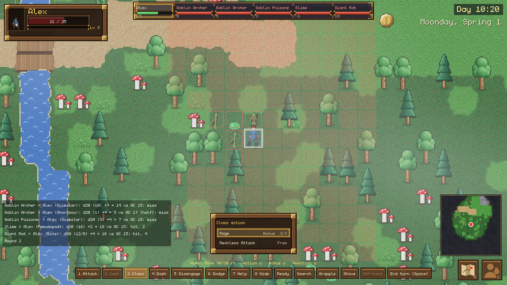
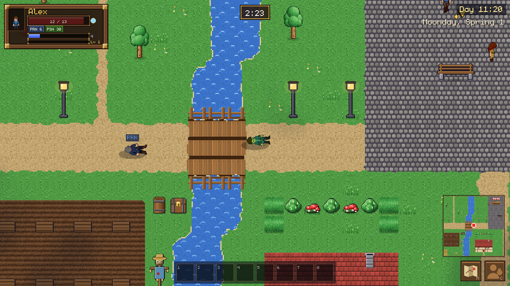
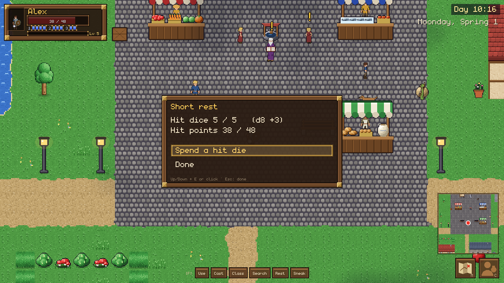
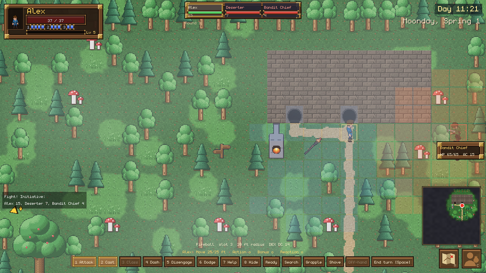
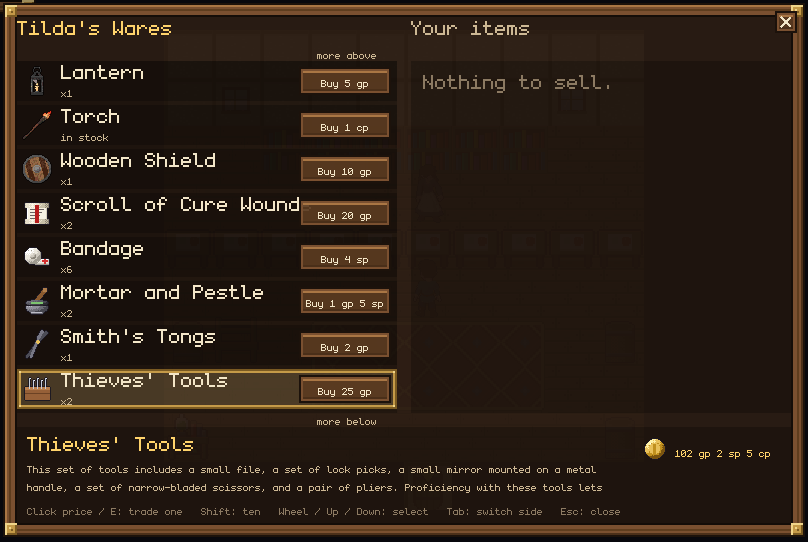

# 9. Gameplay systems

The engine brings the systems of a classic action RPG. You switch on what your game needs and fill
it with content; most systems are set up in the Database and driven by triggers.

## Health and combat

The **status frame** at the top left shows a small portrait of the hero as dressed, the name, the
**HP bar** with the hit points (`34 / 44`), a caster's spell slots (a pip per slot by level), the experience bar and the ammunition of an
equipped bow or crossbow.

Fights follow the SRD 5.1's combat rules **in turns**, on the map where they happen; exploring
stays real-time ([Player's guide › Fighting](15-players-guide.md#fighting)).

- **A fight starts** when a hostile character notices the player or a companion (within its
  *Sight*; darkness shortens it, and a sneaking hero has to beat its Perception), when the player
  attacks one in sight (Attack, or a click on it), shoots at it, casts a combat spell at it (the
  action bar's *Cast*, the Spells tab), or with the *Start fight* action / `start_combat()`. A fight
  the hero starts keeps their move: when their first turn comes (by initiative, as the SRD has it),
  it is aimed at the enemy it was meant for (the attack, or the spell with its area), one confirm
  away; the spell's slot is spent when it is cast. Every character within 12
  tiles that is hostile to the player **and knows of the party** joins: it is hunting already, or it
  notices the hero or a companion now (within its *Sight*, behind trees and walls only when closer
  than half of it; when the hero strikes first, also those the hero sees). The others go on with
  what they were doing and join when they notice the party. *Start fight* / `start_combat()` takes
  every hostile character near. The companions and characters of factions hostile to the enemies
  (the village guards against bandits) fight on the player's side.
- **Surprise** (the SRD's rule: a creature that notices no threat): when the player strikes first
  **while sneaking**, the hero's Stealth roll (made when the sneaking began) and the companions'
  count, and each enemy whose passive Perception is below every roll is surprised: it loses the
  first round. When none noticed them, the hero is still **hidden**: their first attack has
  advantage. Striking first **without sneaking** (a shot or a spell from afar, at night, from behind
  a corner), the enemies that hadn't noticed the hero (not hunting, the hero beyond their sight)
  are surprised; those that see them aren't (*Unnoticed* in the fight log).
  The other way round, when monsters start a fight while the hero can't see any of them (behind
  walls or trees), they roll Stealth against each party member's passive Perception. The fight log
  shows the lowest roll and who is surprised.
- **Initiative:** everyone rolls d20 + DEX; the turn order bar at the top shows it with everyone's
  hit points. Everyone steps onto the middle of their tile (a tile is 5 ft).
- **A turn:** moving up to the speed (30 ft = 6 tiles; the race's speed; conditions slow it),
  **one action**, **one bonus action** and **one reaction** a round. Diagonal steps cost 5 ft like
  straight ones, also past a wall's corner or a creature (only two walls touching at a corner can't
  be squeezed through); **difficult terrain** (materials with *Difficult terrain*, e.g. mud, deep snow)
  costs double. Characters can pass through allies, not through foes.
- **Items on the ground** in a fight: a right-click on them (or E with the cursor there) picks them
  up, from next to them (it walks there first when farther); stepping onto items picks them up too.
  It is free: no action. The hero puts them into the bag, a party member it plays into its own.
- **Actions:** *Attack* (stat blocks with Multiattack attack several times), *Cast a Spell*,
  *Dash* (the speed again), *Disengage* (no opportunity attacks this turn), *Dodge* (attacks
  against it have disadvantage), *Help* (an ally's next attack against a foe next to you has
  advantage), *Hide* (Stealth against the foes' passive Perception: unseen until it attacks),
  *Ready* (a window: the **attack**, made when a foe comes within reach, or a **spell** that targets
  a creature, cast at the first foe that comes within its range; the spell's slot is spent at once and
  it is held with concentration: a hit that breaks it, or the next turn, loses it), *Search* (Perception against hidden foes),
  *Use an Object* (an item from the inventory), *Grapple* and *Shove* (Athletics against the
  target's Athletics or Acrobatics: grappled, or knocked prone / pushed a tile; only a target at
  most one size larger: "Too big"). A grappler **drags** the grappled creature along when it walks,
  at half speed unless the creature is two or more sizes smaller; *Grapple* on the creature you hold
  lets it go (free). *Help* aimed at an
  ally at 0 HP next to you is **first aid**: a healer's kit in the bag makes it stable at once (one
  of the kit's ten uses), else a Medicine check against DC 10 does. While a monster's hit holds you
  (grappled or restrained, with an escape DC), or any grapple holds you, *Grapple* becomes
  **Escape**: Athletics or Acrobatics (the better one) against the escape DC, or against the
  grappler's Athletics roll; held characters the AI plays try it when no foe is in reach. Drawing or
  stowing a weapon (or putting on a ring, a cloak…) in a fight is free once a turn, a second change
  takes the action; a shield takes the action, and body armor, clothing and helmets can't be changed
  in a fight. The **bonus action**
  is the off-hand attack: a weapon in the left hand attacks after the Attack action, without the
  ability modifier on its damage; both weapons must be *light* (two-weapon fighting).
- **Attacks** roll d20 + the ability modifier (STR for melee, DEX for ranged; a *finesse* weapon
  the better of both) + the proficiency bonus (only with a weapon the attacker is proficient with,
  see [Equipment and money](#equipment-and-money)) against the target's **armor class**. A natural 20 always hits and is a **critical hit**
  (the damage dice twice; a *keen* weapon on 19 or 20 too), a natural 1 always misses. Damage is
  the weapon's **dice** (*Damage dice* on the item form) + the modifier, of its damage type through
  the target's resistances. Characters attack with their stat block's attacks; without them with
  their weapon or *Damage* (1 = 1d4 … 5 = 1d12, +2 to hit).
- **Monster attacks in full:** a stat block's attack can do more damage of other types (a red
  dragon's bite: piercing plus 2d6 fire, each part through the target's resistances) and something
  on a hit: a saving throw against a condition (a wolf's bite: DC 11 STR or prone; a ghoul's claws:
  DC 10 CON or paralyzed for a minute) or against more damage (a giant spider's bite: 2d8 poison, half
  on a success), or a grapple with its escape DC (a constrictor snake). The SRD import gives the
  monsters theirs (67 attacks with more damage, 85 effects on a hit in 65 attacks); the stat block
  form edits them (*on a hit*).
- **Magic and silvered weapons:** a resistance or immunity "from nonmagical attacks" (a ghost's,
  a werewolf's) doesn't cover a hit with a magic weapon or magic ammunition (+1 Arrows), a spell or
  a monster with the *Magic Weapons* trait; one "that aren't silvered" doesn't cover a silvered
  weapon or silvered ammunition either (the item form's *Silvered*; the library has a Silvered Dagger
  and Silvered Arrows).
- **Advantage and disadvantage** come from the SRD's sources: the attacker's conditions
  (poisoned, prone, restrained, blinded, frightened, exhaustion 3+), the target's (prone:
  advantage in melee, disadvantage at range; restrained, paralyzed, stunned, unconscious, blinded:
  advantage; invisible: disadvantage), Dodge, Help, a hidden attacker, and for ranged attacks a foe
  next to the shooter or a target beyond the normal range (up to the long range: *Long range* on
  the weapon). Paralyzed or unconscious targets within 5 ft take critical hits.
- **Space:** a Large creature takes 2×2 tiles, a Huge one 3×3, a Gargantuan one 4×4 (its stat
  block's size); reach, ranges, areas and cover count from its whole square, and its ring in the
  fight shows it. It can **squeeze** into a space one size smaller (a Large troll in a one-tile
  corridor): every step costs double, and while squeezed it attacks and makes DEX saves at
  disadvantage, and attacks against it have advantage. Anyone can move through an ally's space (as
  difficult terrain) and through a foe's only when one of the two is two sizes larger or more; nobody
  ends a move there.
- **Seeing:** dim light (night outdoors, a lamp's edge), the weather's fog a few tiles away and
  foliage (bushes, tall grass: props marked *Obscures*) **lightly obscure**; darkness (caves, dark
  rooms without lights) and dense fog farther away **heavily obscure**. Darkvision sees darkness
  within its range as dim light and dim light as bright. A creature in a heavily obscured spot, or an
  invisible one, can't be seen: attacks at it have disadvantage, its own attacks advantage. Blindsight,
  tremorsense and truesight (from a stat block's senses) see within their range regardless
  (truesight and blindsight invisible creatures too). Foes the hero can't see are drawn faded with a
  "?" over them. *Hide* works only out of plain sight: obscured, or behind three-quarters cover from
  every foe; and a dim view of a hider lowers the seeker's passive Perception by 5 for surprise.
- **Difficult terrain** comes from the painted ground's materials and from props marked *Difficult
  terrain*, as decorations or placed (undergrowth; the library's herb and feverleaf bushes).
- **Cover:** walls, tall props, trees and other creatures between the attacker and the target give
  **half cover** (+2 AC) or **three-quarters cover** (+5 AC); behind full cover it can't be
  targeted. Cover counts for **DEX saving throws** too (+2 / +5), from where the effect comes: a
  Fireball's point, the caster of a cone, a line or a targeted spell; full cover keeps a creature
  out of an area. Shots fly over low obstacles (fences, rocks, water) ([Maps › Low and high
  obstacles](03-maps.md#low-and-high-obstacles)).
- **Opportunity attacks:** leaving a foe's reach without *Disengage* gives it a melee attack (its
  reaction), also by a single step away; a step that stays within its reach doesn't. Reach is the
  foe's melee reach: two tiles for a glaive or a reach monster. The move overlay
  shows the reachable tiles that would leave a foe's reach in red, and the path in red when it
  provokes.
- **0 hit points:** characters die (their *Defeated* triggers run, they drop their loot and
  gear). **Knocking out:** when a melee hit of the hero (or of a companion the player plays) would
  drop a foe to 0 HP, the game asks **Kill or knock out?**. A knocked-out foe counts as defeated
  (experience, loot, *Defeated* triggers) but lies unconscious where it fell until the hero leaves
  the map, and stays gone like a defeated one; the condition *Was knocked out* and the script
  function `knocked_out(name)` tell it apart (a bandit to bring in alive). The hero and companions
  fall **unconscious** and roll a **death saving throw** on each of
  their turns: 10 or more is a success, three successes and they are stable, three failures and
  they die; a natural 20 brings them back with 1 HP, a natural 1 counts twice. Damage while down is
  a failure (a critical hit two); any healing brings them back up. **Massive damage** kills at once:
  damage that leaves at least the hit point maximum after dropping to 0 (a 12-HP hero at 6 HP taking
  18), or as much as the maximum while down. A **stable** creature (three successes, first aid, the
  cantrip *Spare the Dying*) rolls no more death saves. Enemies leave the unconscious
  alone, except those with Multiattack. When nobody of the party stands any more and those down are
  stable (or dead), the fight is lost: the *defeated* menu. A companion that dies follows the
  project's rule for companions at 0 HP (lies there, goes home, gets up).
- **Conditions in full:** a frightened creature can't move closer to the source of its fear while
  it can see it (the move overlay leaves those tiles out), and its disadvantage counts only then; a
  charmed one can't attack its charmer or aim a harmful spell at it; a caster that can't act
  (incapacitated, stunned, paralyzed, unconscious) loses its concentration.
- **The party:** the player plays the hero's and every companion's turns. The orders menu (G)
  hands a companion to the AI (*AI fights*) or back (*I command*). Characters on the player's side
  that aren't companions (the guards) always fight on their own.
- **The AI** goes for the nearest foe it can reach (those with Multiattack for the most hurt),
  walks into reach or, with a ranged attack, to a spot within its range with a line to its target,
  and attacks. A weapon that can be thrown too (a guard's spear, a javelin, a dagger) is thrown
  only when no foe can be reached in melee this turn; otherwise it walks up and strikes. A throw
  shows the weapon flying (its icon) and leaves it on the ground: the AI fights on with its other
  attacks (else an unarmed strike) and walks to its weapon to pick it up when it can. Fighters walk through their allies' tiles, and round trees and walls by the
  walking distance to their foe (not into dead ends). Below its *Flee below* share of HP (or frightened) it dashes away and leaves the
  fight 15 tiles away; it drinks a healing potion it carries when its health is critical.
- **Fliers** (a fly speed in the stat block) cross pits, water and low obstacles in fights; walls
  and tall props still stop them. Those that end a fight over one land on the nearest walkable tile.
  The hero falls, jumps and climbs outside fights ([Maps › Climbing, jumping and
  falling](03-maps.md#climbing-jumping-and-falling)). In a fight walkers never step into a drop,
  but they **long-jump** one as part of their move: up to their Strength score in feet when the
  two tiles before the gap are walked straight at it this turn, half from standing, each foot
  jumped costing a foot of movement (the move overlay shows the tile past the gap; the log says
  "jumps across"). Monsters jump too, with their stat block's Strength.
- **Getting away:** at the start of a new round the fight ends when every foe is 15 tiles or more
  from the whole party ("You got away."), or when no foe can get at the party any more: none can
  walk to it, fly or shoot ("Your foes can't reach you.": across a chasm too wide for them). A
  monster that notices the hero across such a gap doesn't start a fight at all, and none starts
  while the hero is in the air over one: it starts when they land.
- **The AI's spells:** a party member with a casting class handed to the AI and a monster with
  *Spellcasting* in its stat block choose a spell before attacking: **healing** first when an ally
  in range (itself too) is down or below a third of its hit points (the strongest heal, at its
  lowest slot); then an **area** that catches two foes or more and none of its side; then a
  **condition** that takes a foe out of the fight (paralyzed, stunned, restrained, frightened… not
  a mere prone) on the strongest foe in range that hasn't got it; then **damage** on the most hurt
  foe: a cantrip, or a slot spell when the foe has at least twice the cantrip's damage left. It
  casts only at foes it sees and has a line to, starts no concentration spell while it
  concentrates, and keeps its distance like an archer. A monster's slots and innate uses per day
  come back at dawn.
- **The AI's other actions:** a fighter that only shoots, with a foe next to it, *Disengages*
  first (with *Nimble Escape*, the goblin's trait, as the bonus action, and still shoots) and
  steps away; *Nimble Escape* also lets it *Hide* after attacking when it is obscured or behind
  three-quarters cover. When every foe it knows of is hidden, it *Searches*. Before a melee attack
  it **shoves** its target prone when an ally of its side stands next to the target too (their
  attacks get advantage), or **grapples** a caster or a shooter with a free hand, when its
  Athletics is at least as good as the target's Athletics or Acrobatics (once per target and
  round). A fighter without any attack *Helps* an ally next to the same foe.
- **The end:** when no enemy is left fighting. A foe that stops being hostile (spared and given a
  friendly faction with *Set faction*, like the example's deserter) leaves the fight at once. Companions still down get up with 1 HP, the
  experience of the defeated is gained, the game autosaves. Saving is refused during a fight (the
  autosave waits). Leaving the map ends a fight.
- **Conditions** run by rounds in a fight: damage and healing per round fall on each fighter's
  turn ([Conditions and damage](#conditions-and-damage)).
- **Feedback:** every roll goes into the **fight log** at the bottom left and the journal's
  *Rolls* page. Damage numbers rise from those hit (white for the player's hits, big and yellow
  for critical hits, red when the player or a companion is hurt, *miss* for a miss; *Options ›
  Gameplay › Damage numbers*); hit characters flash white and show a **health bar** for three
  seconds. When the player is hurt the screen shakes briefly and flashes red (*Options › Graphics
  › Shake & flash*).
- **What they hold shows how they fight**: characters play the animations of their weapon and
  shield ([Characters › Weapon animations](06-characters.md#weapon-animations)) when they attack.
- **Battle stance and battle music**: those in a fight take their weapon's stance with a
  one-handed weapon in the hand; out of fights it hangs at the left hip (two-handed, ranged and
  long weapons such as spears, shields and tools stay in the hands). A fight crossfades the music to the **battle
  music** (*Database › Project › Game sounds › Battle music*; a map can choose another track or
  none in its properties) and back when it is over, with the *Victory* fanfare when enemies were
  defeated. The example plays *Steel in the Woods* (`music_battle`, in the starter library).
- **Sneaking** (Left Ctrl / V, gamepad left stick click): the player walks at half speed and
  quietly, and starting to sneak rolls their **Stealth** once (a roll line, no DC). A hostile
  character sees the player within its *Sight*, times 0.4 (dark) to 1 (lit) by the light at the
  player: the map's lighting by the clock plus the light sources around them, their own lantern
  included (at night everyone is harder to see); behind walls the usual half of that. A sneaking
  player it notices there only when its **passive Perception** reaches the Stealth roll, so a good
  roll lets them walk right up to an enemy; within three quarters of a tile (bumping into it), or
  within its blindsight or tremorsense, it always does. An enemy that notices none of the party
  when they attack while sneaking is **surprised** (see *Surprise* above). Models play their **sneak** clip
  while sneaking (*Database › 3D models*; every playable model of the example has a creeping walk),
  others their walk, slowed. Scripts ask `is_sneaking()`; `status` prints
  `sneak=on|off:light…:sight10=…[:stealth=ROLL]`. In the example a sign on the way to the bandits' camp in
  Whisperwood hints at a night approach.
- **Outside fights** the Attack key swings at trees and ore veins in front ([Gathering and
  mining](#gathering-and-mining)); scripted damage (traps, *Damage area*) subtracts the target's
  *Defense* there. The player's attacks only start fights with hostile characters; make a
  huntable animal *hostile* with 0 damage.
- **Scripts and events:** *Fight starts* and *Fight ends* triggers (map triggers, and a
  character's own when it fights: a boss's words), the *Start fight* action, `start_combat()`,
  `in_combat()`, `combat_round()` ([Scripting](08-scripting.md)). `status` prints `combat=` and
  `death_saves=` ([Testing](17-testing.md)).
- A defeated **player** gets a menu: *Continue from last save* (the newest, autosave included),
  *Start over* (a new game as the same hero) or *Quit to main menu*.

## Experience and levels

Optional: *Database › Project › Experience and levels*. Defeated characters give the XP set in their
definition, completed quests their *Experience reward*. Levels follow the SRD's experience table, up
to the project's *Highest level* (20 at most):

| Level | 2 | 3 | 4 | 5 | 6 | 7 | 8 | 9 | 10 | 11 | 12 | … | 20 |
|---|---|---|---|---|---|---|---|---|---|---|---|---|---|
| Total XP | 300 | 900 | 2,700 | 6,500 | 14,000 | 23,000 | 34,000 | 48,000 | 64,000 | 85,000 | 100,000 | … | 355,000 |

Each level adds **hit points** (and heals as many), a **hit die**, a caster's spell slots, and the
proficiency bonus grows with it ([Rules](#rules-srd-51)). The SRD
gives XP by challenge: a commoner is worth 10, a bandit or guard 25, a goblin 50, an orc 100, a
bandit captain 450, a veteran 700, an adult red dragon 18,000 (the library's monsters carry theirs);
quests give what their *Experience reward* says. The XP is **split** equally between the hero and
the party members on the map that have a [class](#classes-and-levels) (they level too); companions
without a class leave the hero all of it.

**Hit points** follow the SRD and the hero's **class** hit die (a wizard's d6, a fighter's d10, a
barbarian's d12; a hero without a class, as in projects without classes and saves of 0.29 and
older, has a d10):

- **Level 1**: the die's maximum + the CON modifier.
- **Every further level**: the die's average (d6: 4, d8: 5, d10: 6, d12: 7) + CON, or with *Hit
  points per level: Rolled* a roll of the die + CON (into the roll log); at least 1 per level.
- Plus what the race adds (the hill dwarf's *Dwarven Toughness*: +1 per level) and the class (the
  draconic sorcerer's *Draconic Resilience*: +1 per level).

The max HP follows the CON score: a potion or script that raises CON raises it at once. A save of an
older version counts its levels as averages.

The status frame shows `Lv N` with a gold XP bar, the character sheet *Level N* and *XP a / b*, and a
message announces every level, with the project's *Level up* fanfare (*Game sounds*) if it has one. Triggers use the *Give experience* action and the *Player level*
condition; scripts `give_xp(n)`, `xp()` and `level()`.

## Classes and levels

The SRD's twelve **classes** (barbarian, bard, cleric, druid, fighter, monk, paladin, ranger, rogue,
sorcerer, warlock, wizard) are definitions (*Database › Classes*,
[Characters › Classes](06-characters.md#classes)) with their subclass, hit die, saving throws,
proficiencies, skills to choose, starting equipment and their features from level 1 to 20. The
character creator offers them on its *Class* step (with level 1's choices and spells, and the
starter store's gear instead of the starting equipment when the project has one); the hero then is
a class at their level, and
*Set class* / `set_class()` give or change one in play.

- **Starting**: the class's saving throws and armor, weapon and tool proficiencies, the skills
  picked in the creator and its starting equipment in the inventory (the SRD's first options,
  mapped to the library's items: a fighter's chain mail, iron sword, wooden shield, crossbow and
  bolts). With a starter store in the creator, the class's **starting gold** (the average of its
  dice, `5d4x10` = 125 gp) or the equipment's price, whichever is more, is the budget there: the
  cart starts with the starting equipment, the player swaps what they like, and the rest stays in
  the purse; level 1's
  choices and spells are picked in the creator too.
- **Levelling**: every level the hit die adds hit points. When a level brings **choices**, the
  **level-up window** opens as soon as nothing else is going on (no fight, dialog or cut-scene):
  the **subclass** at its level (a fighter's *Martial Archetype* at 3, a cleric's *Divine Domain* at
  1), an **ability score improvement** (+1 to two abilities, +2 to one, or the feat **Grappler**:
  advantage on attacks against the creature the hero grapples), **expertise** (a rogue's or bard's
  doubled proficiency), a **fighting style** and other options. Levels with new features but no
  choice show them in the window too. The hero's level-ups come first, then the party's.

- **Features** that work by themselves act in play: *Unarmored Defense* (barbarian 10 + DEX + CON,
  monk 10 + DEX + WIS), the fighting styles (*Archery* +2 to hit with ranged weapons, *Defense* +1 AC
  in armor, *Dueling* +2 damage one-handed, *Great Weapon Fighting* rerolls 1s and 2s, *Two-Weapon
  Fighting* adds the modifier to the off-hand attack), *Extra Attack* (two to four attacks),
  *Improved* / *Superior Critical* (a critical hit on 19 or 18), *Brutal Critical*, *Fast Movement*
  and *Unarmored Movement*, *Martial Arts* (DEX and the martial arts die for unarmed strikes),
  *Expertise*, *Jack of All Trades* and *Remarkable Athlete* (half the proficiency bonus), *Reliable
  Talent* (a d20 under 10 counts as 10 on proficient checks), *Danger Sense* (advantage on DEX
  saves), *Feral Instinct* (advantage on initiative), *Evasion*, the auras of the paladin
  (*Aura of Protection*: CHA to the saves of allies within 10 ft; *Aura of Courage*), resistances and
  immunities (*Purity of Body*, *Diamond Soul*), *Primal Champion*.
- **Class actions** are used in fights with the action bar's **Class** entry (3): a window lists
  them with their cost and uses left (those that can't be used now greyed, with why); the one
  picked is aimed, and E / Enter or a click uses it: on the hero, or on the ally or foe under the
  cursor. They cost an action, a bonus action or nothing, and many spend a
  **resource** that a rest gives back (*Short rest* or a night's sleep: second wind, action surge,
  ki, channel divinity come back after a short rest; rages, Lay on Hands, Wholeness of Body,
  Indomitable after a long one; bardic inspiration after a long rest, a short one from *Font of
  Inspiration*):
  - barbarian: *Rage* (bonus action: resistance to bludgeoning, piercing and slashing damage, the
    rage damage on STR melee hits, advantage on STR checks and saves; 10 rounds, over early after a
    turn without attacking or being hurt), *Reckless Attack* (advantage on STR melee attacks this
    turn, attacks against the barbarian too), the Berserker's *Frenzy* attack (a bonus melee attack
    while raging; a level of exhaustion when the rage ends), *Intimidating Presence*;
  - fighter: *Second Wind* (bonus action: 1d10 + level hit points), *Action Surge* (another action);
  - monk: *Flurry of Blows* (1 ki, two unarmed strikes after the Attack action), the *Martial Arts*
    bonus strike, *Patient Defense* (Dodge) and *Step of the Wind* (Dash or Disengage) for 1 ki,
    *Wholeness of Body*;
  - rogue: *Cunning Action* (Dash, Disengage or Hide as a bonus action);
  - paladin: *Lay on Hands* (a pool of 5 × level hit points: heals what someone it touches lacks),
    *Sacred Weapon* (CHA to its attack rolls for 10 rounds), *Turn the Unholy*;
  - cleric: *Turn Undead* (undead within 30 ft make a WIS save or are frightened for 10 rounds; with
    *Destroy Undead* those of a low challenge rating are destroyed), the Life domain's *Preserve
    Life* (5 × level hit points shared among the allies within 30 ft, each up to half its maximum);
  - bard: *Bardic Inspiration* (an ally within 60 ft gets the die for an attack roll or save that
    would fail).

  

- **Divine Smite** (paladins from level 2): after a melee weapon hit the hero is asked in the
  Reaction window (*Divine Smite*: 2d8 radiant, 1d8 more a slot level above 1st, at most 5d8, 1d8
  more against undead and fiends, doubled on a critical hit; the lowest slot is spent); with
  *Options › Reactions: Auto*, and for party members, critical hits are smitten. *Improved Divine
  Smite* adds 1d8 radiant to every melee weapon hit.
- More class features that act (0.32): *Divine Sense* (an action, 1 + CHA a long rest: celestials,
  fiends and undead within 30 ft glow for a round), *Song of Rest* (a short rest with hit dice
  spent heals the bard's die more; a bard in the party counts), *Escape the Horde* (opportunity
  attacks against the hunter have disadvantage), *Favored Enemy* (advantage on Survival checks).
- **Spell features** (0.32): *Domain Spells* and *Oath Spells* are always prepared (on top of the
  prepared ones; a spell the project lacks is skipped); *Arcane Recovery* / *Natural Recovery* (a
  short rest gives back spent slots worth half the level, rounded up, highest first, none of 6th
  level or higher; once a long rest); *Font of Magic*: sorcery points (the class table's), *Create
  Spell Slot* and *Convert Spell Slot* (bonus actions: 2/3/5/6/7 points for a slot of level 1-5, a
  slot for its level in points), *Quickened Spell* (a picked Metamagic: 2 points, the next spell of
  an action takes the bonus action); *Agonizing Blast* (CHA on Eldritch Blast's damage),
  *Devil's Sight* (darkvision 120 ft), *Empowered Evocation* (INT on evocation damage), *Sculpt
  Spells* (allies in the caster's evocation saves take nothing), *Potent Cantrip* (a saved
  cantrip still does half). The other Metamagic options, the invocations besides these two, Pact
  Boons, Mystic Arcanum, Magical Secrets, Overchannel and the draconic sorcerer's features stay
  text.
- **Riders and reactions** work by themselves: *Sneak Attack* (once a turn, extra d6s with a ranged
  or one-handed weapon when the rogue has advantage or an ally stands next to the target), *Colossus
  Slayer* and *Divine Strike* (extra dice once a turn), *Stunning Strike* (1 ki on the first melee
  hit of a turn: a CON save or stunned until the monk's next turn is over), *Open Hand Technique*
  (Flurry's strikes knock prone on a failed DEX save), *Uncanny Dodge* (the reaction halves a hit's
  damage), *Deflect Missiles* (the reaction lowers a ranged weapon's damage by 1d10 + DEX + level),
  *Relentless Rage*, *Retaliation*, *Survivor*, *Indomitable* (a failed save rolled again), *Dark
  One's Blessing* (temporary hit points for a foe brought to 0 HP). *Uncanny Dodge* and *Deflect
  Missiles* are reactions: see *Reactions*.
- Party members with a class use theirs on their AI turns: *Rage* when foes are near, *Second
  Wind* (and other heals) below half their hit points, *Action Surge* when their attacks are spent,
  the monk's strikes after attacking, their spells (see *The AI's spells*). The features that need
  other systems (Divine Smite, Favored Enemy's tracking) are their rules text on the sheet; Wild
  Shape is the hero's (see *Shapes and summons*).
- The **character sheet** (K) shows the class, subclass and level, the hit dice by the class's
  die, and the class's features first in *Features and traits* (their text below the list), those
  with uses with the uses left (*Rage 2/3*).

**Party members** have a class too: a character's *Class* and *level* in its form (*Database ›
Characters*), or given when it joins (*Set class*, `set_class("finn", "ranger", level())`). A party
member with a class fights with a stat block made from it: its ability scores, the class's hit
points at its level, armor class from its equipment or the class's unarmored defense, attacks with
its weapon (proficiency + modifier, its fighting style, extra attacks). It gets its share of the XP,
levels with its own hit point rolls, and its choices open the level-up window in turn. In the
example, **Dagny** (the night guard, a fighter) and **Old Finn** (the fisher, a ranger with his old
hunting bow) join when asked and arrive at the hero's level.

## Conditions and damage

The SRD's **conditions** on the hero and on characters (until 0.27 they were status effects):

| Condition | What it does in the game |
|---|---|
| **Blinded** | Checks that need sight (Perception, Investigation) fail. The hero sees only a small circle around them; a character sees a tile |
| **Charmed** | A charmed character leaves the hero alone; a charmed hero doesn't attack |
| **Deafened** | Checks that need hearing fail |
| **Frightened** | Disadvantage on ability checks; a frightened character runs from the hero |
| **Grappled** | Speed 0 |
| **Incapacitated** | Can't attack, use or interact (and stands still) |
| **Invisible** | Drawn faint; enemies notice an invisible hero only up close |
| **Paralyzed** | Incapacitated and can't move; STR and DEX saving throws fail; hits against it are critical |
| **Petrified** | Like paralyzed, grey, and resistant to all damage |
| **Poisoned** | Disadvantage on ability checks |
| **Prone** | Lies on the ground and crawls at half speed |
| **Restrained** | Speed 0; disadvantage on DEX saving throws |
| **Stunned** | Incapacitated and can't move; STR and DEX saving throws fail |
| **Unconscious** | Lies on the ground, incapacitated; STR and DEX saving throws fail; hits against it are critical |
| **Exhaustion** | Six levels: 1 disadvantage on ability checks, 2 half speed, 3 disadvantage on saving throws, 4 max HP halved, 5 speed 0, 6 death. A long rest takes one level off |

In fights the conditions give advantage and disadvantage on attack rolls (poisoned, prone,
restrained…; [Health and combat](#health-and-combat)). A condition can come with **damage or
healing every round** (6 seconds while exploring, each fighter's turn in a fight; the first at once):
a poison, a burning oil flask, a stew that heals on. A **saving throw** can keep a
condition off: the cave troll's blow knocks prone only when a STR save against DC 13 fails; characters roll
theirs with their [stat block](06-characters.md#stat-blocks) (the roll log shows them, "Guard: CON
save").

**Where they come from**: weapons **on hit**, hostile characters' melee hits (**On touch**, Database), and
potions, traps and scripts with the *Apply condition* / *Remove condition* actions, or
`apply_condition` / `remove_condition`. Applying a running condition keeps the longer duration;
exhaustion adds a level. The status frame shows a badge per condition with the seconds left
(`PSN 9`, `EXH2`); characters get badges over their heads and tints; the character sheet lists
them. The hero's conditions are saved, and a stat block's *Can't get* list keeps a character free
of some.

**Damage types**: the SRD's 13 (acid, bludgeoning, cold, fire, force, lightning, necrotic,
piercing, poison, psychic, radiant, slashing, thunder). A weapon, a spell's bolt or blast, area
damage and damage per round can have one. **Resistance** halves it (rounded down), **immunity**
stops it, **vulnerability** doubles it; outside fights the old defense comes off afterwards. The hero resists what
their race resists (a dwarf's poison) and what their armor names; characters what their stat block
says (an assassin resists poison).

**In the example** the weapons have their types (swords and axes slashing, spears and bows
piercing), the Spark spell is force and the Fire Burst and Fireball fire. The goblin poisoner's blade stings
(CON DC 10 or 1d4 poison damage), Grumbold the cave troll's blows knock the
hero prone (STR DC 13), skeletons restrain, the antidote and the remedy end poison, and food heals
on for a few rounds. The Potion of Hill Giant Strength makes Strength 21 for an hour (an SRD magic
item: [Magic items](#magic-items)), the Swiftness Potion takes off a level of exhaustion and frees you
from a grapple.

## Rests

- A **short rest** (R on the character sheet, the *Short rest* action or `short_rest()`) opens a
  window where the hero spends **hit dice**: each heals d10 + the CON modifier (rolled into the roll
  log); *Done* lets an hour pass. Not with enemies nearby or in a fight.
- A **long rest** is a night's sleep (a bed, the *Sleep* or *Long rest* action, `long_rest()`): full
  HP and spell slots, half the level's hit dice back (at least one), one level of exhaustion less, and the
  conditions with a duration are over. With *Food and water* on, exhaustion goes down only when the
  hero ate and drank something that day (or the day that just ended, for a sleep past midnight).
- **One long rest in 24 hours** (since 0.32): a long rest that starts less than 16 hours after the
  last one ended passes the time but gives nothing ("You rested less than a day ago."). Short rests
  have no limit. Rests are time that passes at once and can't begin with enemies near, so nothing
  interrupts them. `status` prints `rest=closed:long:HOURS` (hours since the last long rest).

## Checks outside fights

The SRD's *Using Ability Scores* away from fights (since 0.32):

- **Light and sight.** Checks that rely on sight (Perception, Investigation) look at the light where
  the hero stands, the same light that hides a sneaking hero: in **dim light** (night outdoors, a
  lamp's edge) they have disadvantage and passive values are 5 lower; in **darkness** (a cave without
  a light) they fail. **Darkvision** (elves, dwarves…) sees darkness as dim light and dim light as
  bright. Saving throws and other skills don't care. Carry a torch or a lantern into the mine.
- **Help.** A companion within 6 tiles who is proficient in a skill or tool helps with the hero's
  checks of it: advantage, and the *Rolls* page says "Survival (Fisher helps)". Party members' skills
  are their stat block's proficiencies. In fights *Help* is an action instead.
- **Passive checks** of any skill: 10 + the bonus, ±5 for advantage / disadvantage (`passive()`, the
  *Passive check* condition). The sheet's passive Perception shows the light too (and −5 while running).
- **Group checks** (*Group check*, `group_check()`): everyone in the party rolls; at least half
  succeeding is a success.
- **Contests** (*Contest*, `contest()`): the hero's check against a character's; the higher total
  wins, a tie keeps things as they are (the hero doesn't win).

`status` prints `senses=light:bright|dim|dark[:darkvision] help:SKILL=NAME,…`.

## Survival and travel

The SRD's *Adventuring* rules for the road (since 0.32). Carrying always counts; food and water and the
forced march are options of *Database › Project › Rules* (*Survival and travel*), off in the example.

- **Carrying.** Everything in the bag and everything worn or held weighs what its item form says
  (*Weight*, in pounds; the SRD's items have theirs). The purse weighs nothing: it holds a value, not
  coins. The sheet shows *Carried* `42 / 240 lb`, where 240 is the hero's **capacity**, STR × 15.
  - **Carrying capacity** (the plain rule): over the capacity, up to twice it, the hero drags the load
    at 5 ft; over twice it they can't move ("You carry too much to move.").
  - **Variant encumbrance** (the option): over STR × 5 lb the hero is *encumbered* (10 ft slower), over
    STR × 10 lb *heavily encumbered* (20 ft slower, and disadvantage on STR, DEX and CON checks and
    saving throws and on attack rolls); past the capacity the plain rule's limits follow.
  - The speed counts in fights (the sheet's *Speed*) and outside them (walking slows down the same).
    Companions and other characters carry without limits.
- **Food and water** (option). Each day the hero needs a day's food and a day's water: the *Eat /
  drink* action ([Events](07-events.md)) and `eat(days)` / `drink(days)` count them. In the starter
  library a ration is a day of food, bread, meals and pies half a day, an apple a quarter (soups and
  stews add a quarter day of water); a full *Waterskin* is half a day of water and leaves an *Empty
  waterskin*; using a *Well* or a *Fountain* gives a day's water and fills every empty waterskin
  (`drink_from_well()`, library content). At midnight:
  - **food**: a full day resets the count of days without food, half a day counts as half a day
    without; after 3 + the CON modifier days (at least 1) each further day adds a level of exhaustion
    ("You go hungry.");
  - **water**: less than a day's water calls for a CON saving throw DC 15 with half a day (with
    disadvantage when already exhausted), a failure adds a level of exhaustion; with less than half a
    day the level comes for sure, two when already exhausted ("You are parched.").
  - The sheet shows *Food / water today*; a sleep over several days counts each.
- **Travel pace.** Running is the *fast* pace: −5 to the hero's passive Perception (the sheet, and
  when monsters jump the hero: [surprise](#health-and-combat)). Sneaking is the *slow* pace, the one that
  allows Stealth (*Sneaking* under [Health and combat](#health-and-combat)).
- **Forced march** (option). Game hours spent walking (out of fights) since the last long rest count
  as the day's march; past 8 hours each further hour calls for a CON saving throw, DC 10 + 1 per hour
  past 8, and a failure adds a level of exhaustion ("The march wears you out."). A long rest starts
  the count again. With a day of 24 minutes (*Day length*) an hour is a minute of walking.

`status` prints `survival=` (`food:1.00 water:0.50 unfed:0 march:3.2h`, the parts whose option is on;
`-` with both off) and `load=` (`42/240`, `:encumbered`, `:heavy`, `:dragging`, `:over`).

## Rules (SRD 5.1)

R(ust)PG2D's rules follow the **System Reference Document 5.1** (SRD 5.1, by Wizards of the Coast,
CC BY 4.0): every roll in the game is an SRD roll. [The SRD 5.1 rules](19-srd-rules.md) sums them up,
with what is simplified and what the licence asks of your game.

- **Ability scores**: Strength, Dexterity, Constitution, Intelligence, Wisdom and Charisma, 1 to 30.
  Each gives a **modifier**: (score − 10) / 2, rounded down (8-9 = −1, 10-11 = +0, 14-15 = +2).
- **Proficiency bonus** by level: +2 at levels 1-4, +3 at 5-8, +4 at 9-12, +5 at 13-16, +6 at 17-20.
- **Ability checks**: a d20, plus the ability's modifier, plus the proficiency bonus when the hero is
  proficient in the skill or tool used. The check succeeds when the total meets the **DC** (5 very
  easy, 10 easy, 15 medium, 20 hard, 25 very hard, 30 nearly impossible). A natural 20 or 1 is shown
  but, as in the SRD, doesn't decide a check by itself.
- **Advantage** / **disadvantage**: two d20s, the higher / the lower counts; both at once cancel out.
- **Saving throws**: a d20 plus the ability's modifier, plus the proficiency bonus when the hero is
  proficient in that saving throw.
- **The 18 skills** and their abilities: Acrobatics (DEX), Animal Handling (WIS), Arcana (INT),
  Athletics (STR), Deception (CHA), History (INT), Insight (WIS), Intimidation (CHA), Investigation
  (INT), Medicine (WIS), Nature (INT), Perception (WIS), Performance (CHA), Persuasion (CHA), Religion
  (INT), Sleight of Hand (DEX), Stealth (DEX), Survival (WIS). **Passive Perception** is 10 plus the
  Perception bonus.
- **Tools**: the SRD's tools (Thieves' Tools, Smith's Tools, Alchemist's Supplies, Cook's Utensils,
  Herbalism Kit, instruments…). A check with a tool names its ability: DEX (Thieves' Tools).

**The hero** is made in the [character creator](06-characters.md#the-player-character-and-the-character-creator):
an SRD race (or subrace) with its ability increases, speed, size, darkvision, languages,
resistances and traits ([Races](06-characters.md#races)), base scores by the standard array, point
buy or 4d6, the race's choices and a [background](06-characters.md#backgrounds). Without the
creator, the scores and proficiencies come from *Database › Project › Rules* (the standard array
15 14 13 12 10 8 by default) and the player character's race. Players see them on the **Sheet**
tab of the character window (K), laid out like an SRD character sheet:

- **At the top**: name, race and background, the level, the proficiency bonus and the XP towards the
  next level.
- **Left**: the six scores with their modifiers and saving throws (a dot marks a proficient save),
  then **armor class** (10 + the DEX modifier + the worn armor's defense, until the SRD's armor
  arrives in 0.31), **initiative** (the DEX modifier), **speed** in feet, **hit points**, **hit dice**
  (left / level, d10) and **passive Perception**.
- **Middle**: the 18 skills with their bonuses (a dot marks the proficient ones).
- **Right**: languages, the other proficiencies (tools, weapons, armor) and the **features and
  traits** of the race and the background. Up / Down picks one; its rules text shows at the bottom.

- **Speed**: a hero walks at their race's speed / 30 ft (dwarves, halflings and gnomes at 25 ft
  are a sixth slower).
- **Darkvision**: a hero whose race has it sees dark places as dim ones: the night and caves are
  lifted towards a dim grey (the SRD: in darkness only shades of grey), lit places stay as they are.

Every check shows a line on screen ("Persuasion: 14 vs DC 13 - success"; *Show check results on
screen* in the project turns it off) and goes into the journal's **Rolls** page: the last 50 checks,
saving throws and dice rolls with their dice, total, DC and result, kept in the save game.

**Events and scripts**: the *Ability check* and *Saving throw* actions roll and run their *On a
success* or *On a failure* actions; the *Check passed* condition asks about the last check later;
*Roll dice* rolls `2d6+STR` into a variable; *Proficient in* and *Set proficiency* ([Events ›
Actions](07-events.md#actions)). Scripts: `check`, `save`, `roll`, `modifier`, `ability`,
`proficiency`, `is_proficient` ([Scripting › Rules](08-scripting.md#rules-srd-51-dice-abilities-and-checks)).
Automated runs make the dice repeat with `seed N` (autoplay) or `RUSTPG2D_SEED`.

**In the example** the hero has STR 15, DEX 14, CON 13, INT 10, WIS 12 and CHA 8, and is proficient
in Athletics, Perception, Persuasion and Thieves' Tools. They can pick the locked chest by the
river near the farm (DC 12), read the shrine's carvings in Whisperwood (Religion, DC 12: lore and a
little experience) and ask Tilda for a little more after the rat hunt (Persuasion, DC 13).

**Stat blocks**: every character can have an SRD stat block (abilities, armor class, hit points,
speed, proficiencies, challenge and XP), from the SRD's 35 NPC templates (commoner, guard, bandit,
veteran, priest, goblin, orc…) or filled in by hand ([Characters › Stat
blocks](06-characters.md#stat-blocks)). Fights use them ([Health and combat](#health-and-combat)); scripts read them with `npc_stat`, and
automated runs see them in `statblocks=`.

What isn't there yet: classes (0.30) and the SRD's weapons and armor (0.31): [The SRD 5.1
rules › What is simplified](19-srd-rules.md#what-is-simplified).

### Converting a project of 0.27 or older

Until 0.27 a skill tree (skill points bought levels of skills such as Lockpicking or Haggling) did
this. The editor converts a project once when it opens it, after keeping a copy beside it
(`<name>-backup-srd`):

- Each skill becomes an SRD proficiency, by its effect (*Lockpick* = Thieves' Tools, *Haggle* =
  Persuasion, *Sneak attack* = Stealth, *Gathering* = Athletics) or by its name (Arcana; Smithing =
  Smith's Tools, Alchemy = Alchemist's Supplies, Cooking = Cook's Utensils…). Races, recipes,
  spells, conditions, actions and scripts then use the proficiency. Skills nothing fits (combat and
  magic skills, script skills) are dropped, and the message names them: classes bring those back.
- Lock difficulties become DCs (1 = 10, 2 = 12, 3 = 15, 4 = 18, 5 = 20…), and so do recipe quality
  levels. *Skill level* conditions now ask for proficiency, and *Give skill points* does nothing.
- **Status effects** become conditions: poison = poisoned with poison damage every round, burning
  = fire damage every round, regeneration = healing every round, stun = stunned, slow = restrained.
  Haste, strength, weakness and shield have no SRD condition and are taken out (the message lists
  the items, characters and maps that had them; spells bring them back in 0.30). A project made with
  0.28 before conditions arrived is converted this way when it opens too.
- Asset libraries are converted the same way when they open.
- Saved games still load: their hero gets the project's starting scores and proficiencies.

## Spellcasting

Spells are the **SRD 5.1's** (since 0.30): *Database › Spells*, the starter library's 159 that act
in play, with their texts ([Asset library › The SRD 5.1 data](11-asset-library.md#the-srd-51-data)). The
casting classes (bard, cleric, druid, paladin, ranger, sorcerer, warlock, wizard) cast them with
**spell slots** by their class level (the class's table); a spell of level 1 to 9 takes a slot of
its level or higher, a **cantrip** (level 0) none and grows with the caster's level. Mana is gone:
projects of 0.29 and older are converted when the editor opens them (with a backup): their spells
become SRD spells of level 1 (a bolt a cantrip) that every casting class has.

- **Knowing and preparing**: a bard, ranger, sorcerer and warlock **know** the spells their
  level-ups choose; a cleric, druid and paladin **prepare** from their class's whole list (the
  spellcasting modifier + their level, half the level for a paladin); a wizard writes spells into a
  **spellbook** (six at level 1, two each level, more copied from scrolls and books) and prepares
  from it. Cantrips are chosen at level-ups. The [level-up window](#classes-and-levels) asks for
  the new cantrips and spells; a new preparing caster starts with the first spells of its list
  prepared.
- **Save DC and attack**: 8 + proficiency + the spellcasting modifier (INT, WIS or CHA), and
  proficiency + the modifier for spell attacks.
- **Components** (since 0.31): a spell with a material component (*M*) needs a **component pouch**
  or a **spellcasting focus** in the caster's bag or hands (an arcane focus, a holy symbol, a druidic
  focus, a bard's musical instrument; any of them does). The casting classes start with one. Costly
  materials aren't used up yet. A caster in **armor it isn't proficient with** can't cast at all
  ("Untrained armor"). A project without any focus item needs none.
- **Slots come back** after a long rest; a warlock's (pact magic: few slots, all of its highest
  level) after a short rest too. **Rituals**: a bard, cleric, druid or wizard casts a ritual spell
  it knows or prepared without a slot outside fights, and ten minutes pass.
- **In a fight** the action bar's **Cast** entry (2) opens a window with every spell it can cast
  now, a row for each slot level it has left (a higher slot **upcasts** it, more damage or more
  targets), with its range and area; spells it knows but can't cast now are greyed with why (no
  slot left, untrained armor, no focus). The spell picked is aimed; E / Enter or a click casts it at
  the creature or tile under the cursor. The line above
  the bar tells the spell, the slot, its area and its save or attack bonus. **Areas** are drawn on
  the grid: spheres and cylinders around the aimed tile (around the caster for a *Self* spell), cubes
  on it, cones and lines from the caster toward it; everyone inside is a target, allies too.
- **What spells do** (their *parts*): a spell attack (the damage on a hit, a critical hit doubles the
  dice) or a saving throw against the DC (damage halved or none on a success, conditions only on a
  failure; Evasion counts), damage, healing, temporary hit points, conditions (paralyzed, prone,
  frightened…), boons and banes (Bless and Bane's d4 on attacks and saves, Shield and Shield of Faith
  on AC, Mage Armor's AC 13 + DEX, Haste, Longstrider, resistances), light, Knock (the lock within
  two tiles opens), a beast's shape (*Polymorph*), summoned creatures (*Find Familiar*, *Conjure
  Animals*), a script function. The fight log tells each target's save and damage. See *Shapes and
  summons*.
- **More spell parts** (0.32):
  - **Teleport**: the caster to the aimed free tile within range (*Misty Step* 30 ft as a bonus
    action, *Dimension Door*); cast outside a fight, as far as the range goes straight ahead.
  - **HP pool**: the dice's total in hit points; the creatures in the area, the fewest hit points
    first, get the condition while the pool covers them (*Sleep*: unconscious until hurt, undead and
    those immune to charm are left out; *Color Spray*: blinded).
  - **Mark**: a boon on the caster aimed at the target: *Hunter's Mark* (+1d6 on weapon hits against
    it), *True Strike* (advantage on the next attack against it).
  - **Boons**: damage on weapon hits (*Divine Favor* +1d4 radiant; *Branding Smite* 2d6 radiant on
    the next hit), a die on the next ability check (*Guidance*), advantage on checks of the target's
    best ability (*Enhance Ability*), *Beacon of Hope* (advantage on WIS and death saves, healing at
    its most), AC at least 16 (*Barkskin*), *Shillelagh* (the melee weapon's die becomes 1d8, attacks
    and damage use the spellcasting ability, the hits are magical).
- **Defences** (boons): *Blur* (attackers that rely on sight have disadvantage), *Mirror Image*
  (three images: an attack hits one on a d20 of 6, 8 or 11+ by how many are left, and a hit on it
  against AC 10 + DEX ends it), *Sanctuary* (an attacker makes a WIS save against the caster's DC
  or loses the attack; attacking ends it), *Protection from Evil and Good* (aberrations,
  celestials, elementals, fey, fiends and undead attack with disadvantage), *Protection from Energy*
  (resistance to fire), *Death Ward* (the first drop to 0 HP leaves 1), *Warding Bond* (+1 AC and
  saves, resistance to all damage; the caster takes the same damage), *Freedom of Movement* and
  *Mind Blank* (immunity to conditions: paralyzed and restrained, charmed).
- **Ending spells**: *Greater Restoration* (charmed, petrified, a level of exhaustion; a *Cure*
  part's new switch), **Dispel** (*Dispel Magic*: the spells on the target, or a lasting area at
  the aimed tile, end; up to the slot's level at once, a higher one with a check of the caster's
  spellcasting ability against DC 10 + its level; a spell its caster concentrates on ends for
  everyone) and **Counter** (*Counterspell*, a reaction: when a foe within 60 ft casts a spell, it
  stops it the same way; the hero is asked in the Reaction window, monsters with it in their spells
  counter a spell of 1st level or higher by rule).
- **Life and death** (a spell part *Revive*): the fallen party member nearest the caster (within
  two tiles) gets up: one only down, or one dead (the project's *Companions at 0 HP* = *Dead*) for
  at most the spell's time: *Revivify* a minute (with 1 hit point), *Raise Dead* ten days (1 hit
  point), *Resurrection* a century (all hit points). In a fight it is back in the order.
- **Costly components**: a spell whose material component is worth 10 gp or more needs it as items
  in the caster's bag, and casting uses them up (the definition's *costly* items; cheaper
  components are the component pouch's or the focus's): *Revivify* 3 diamonds, *Raise Dead* 5,
  *Resurrection* 10, *Greater Restoration* and *Stoneskin* 4 diamond dust, *Continual Flame* ruby
  dust, *Warding Bond* 2 platinum rings, *Find Familiar* charcoal, incense and herbs, *True Seeing*
  an eye ointment, *Identify* a pearl (library items; the example's dwarf merchant sells diamonds).
  Scrolls and monsters' spells need none.
- **Exploring** (boons, and a *Find traps* part): *Feather Fall* (no falling damage, not prone),
  *Jump* (long jumps three times as far), *Spider Climb* (climbable walls without a check), *Fly*
  (60 ft flying speed: over drops while exploring, over drops and water in fights), *Comprehend
  Languages* and *Tongues* (`knows_language` is true for every language), *Pass without Trace*
  (+10 to Stealth checks for up to six), *Detect Magic*, *Detect Poison and Disease* and *Detect
  Evil and Good* (what they sense within 30 ft glows: magic items lying there, carried or in a
  container; poisons and poisonous creatures; creature types; `status` prints `detect=`), *Find
  Traps* (the armed traps within its range are found and shown). Identify, Levitate, Water
  Breathing / Walk and Locate Object stay the story's.
- **Lasting areas** (a spell part *Lasting area*): the spell's area stays on the map for its
  duration, in fights by rounds and while exploring (every six seconds), drawn as a tint (fog grey,
  darkness black, walls stone). What it does, by its switches:
  - **fog** / **darkness**: who stands inside can't be seen (*Fog Cloud*, *Cloudkill*, *Stinking
    Cloud*; *Darkness* also against darkvision; blindsight and truesight still see);
  - **difficult**: moving through costs double (*Spike Growth*, *Web*, *Entangle*, *Grease*,
    *Black Tentacles*, *Sleet Storm*), for the caster's foes only with **foes only**;
  - **acts again**: the spell's save, damage and condition hit a creature that starts its turn
    inside or enters it (once a turn), with **per tile moved** on every tile (*Spike Growth*'s 2d4
    piercing); **not when cast**: only then (*Spirit Guardians*, *Spike Growth*); *Moonbeam*,
    *Cloudkill*, *Wall of Fire*, *Insect Plague*, *Blade Barrier* and others hit again;
  - **moves with the caster** and a radius in feet (*Spirit Guardians*: 15 ft around the cleric,
    3d8 radiant, WIS save for half, foes only, their speed halved);
  - **silence**: no spell with a verbal component is cast inside (*Silence*);
  - **wall**: a wall across the aimed tile, its length in feet, stops walking and sight (*Wall of
    Stone*, *Wall of Force*; cast outside a fight two tiles ahead).
  The areas end with the spell's duration or concentration and when the hero leaves the map; they
  aren't saved. `status` prints `areas=` (`spirit-guardians:49:600s`: tiles and seconds left).
- **Concentration**: a concentration spell lasts while the caster keeps it: one at a time (a new one
  ends the old), and damage asks for a CON save (DC 10 or half the damage); a failure ends what the
  spell gave everyone.
- **Outside fights** the **Spells** tab (L) is the spellbook: the known and preparable spells by
  level, the slots, the DC, P prepares or unprepares, ←/→ choose the slot, Enter casts (healing,
  boons, light, Knock; spells that attack wait for a fight). A heal
  with companions around asks whom to heal.
- **Scrolls and books** (items with *Teaches spell*), as the SRD has it: a wizard copies the spell
  into the spellbook (a spell of a level it has slots of); another caster whose class lists the spell
  reads a scroll to cast it once without a slot; nobody else can use them. A book only teaches wizards.

**The 159 spells** of the starter library all act by their parts (the SRD data's attack, save,
damage and healing, plus a table in the import for conditions, boons, light, Knock, shapes,
summons, teleports and the rest below). The SRD's 152 **story-only** spells (divination, travel,
illusions: only their text) and eight working ones of little use here (Comprehend Languages, Tongues, Detect Poison and Disease, Detect Evil and Good, Animal Friendship, Dream, Plane Shift and Control Water) are left out; a
project's own spell can still be *Story only* (its text shown, cast by events and scripts: *Cast
spell*, `cast_spell`). The example has every spell of levels 0 to 2 from the starter library (84,
all a hero can pick or prepare in its levels), and Fireball and a few others for its scrolls and
monsters; Wren the herbalist sells scrolls of Cure Wounds, Light, Fire Bolt, Burning Hands, Magic
Missile, Fireball, Misty Step and Sleep. Every spell of the starter library and the example has a
**look** of its own (*Look* in the spell's form): an animated impact where it lands (an area's
the size of the area), a flying sprite for the bolts and rays (Fire Bolt, Ray of Frost, Magic
Missile, Eldritch Blast…) and for some a sound; Fireball keeps its hand-made sprite and explosion.
Every spell also has an **icon** (the sheet `spell_icons`: a badge in its school's colour, a glyph
for what it does, its level as pips) in the Spells tab, the cast lists and the action bar.
**Brother Ansel** is a cleric of the Life domain who heals a hurt hero with Cure Wounds once a day.

Conditions: *Knows spell*. Actions: *Learn spell*, *Cast spell*, *Damage around player*, *Light
around player*. Party members with a casting class cast in fights, on the player's turns for them
or on their own when handed to the AI (*The AI's spells* above); a scroll handed to one teaches it
the spell when its class lists it.

## Equipment and money

Weapons, armor, tools and coins are the **SRD 5.1's** (since 0.31): the starter library has all 237
items of its equipment list ([Asset library › The SRD 5.1 data](11-asset-library.md#the-srd-51-data))
with their costs, weights and rules, and the item form edits them ([Database ›
Items](05-database.md#items)).

- **Weapons** are *simple* or *martial*; a hero proficient with the category (*simple-weapons*,
  *martial-weapons*: the class's proficiencies) or with the weapon by name (*longswords*,
  *hand-crossbows*: an elf's, a dwarf's) adds the proficiency bonus to the attack roll, others not.
  Their **properties**:

  | Property | In play |
  |---|---|
  | Finesse | The better of STR and DEX for the attack and damage; Sneak Attack works with it (and with ranged weapons). |
  | Versatile | With the left hand free it rolls its two-handed dice (a longsword 1d10 instead of 1d8). |
  | Light | Two light weapons, one in each hand, make the off-hand attack. |
  | Heavy | Small heroes (halflings, gnomes) attack with disadvantage. |
  | Two-handed | Nothing can be held in the left hand (a lance too: there are no mounts). |
  | Reach | Reaches 10 ft (two tiles). |
  | Thrown | *Attack* asks: **Strike** or **Throw** (a ranged attack with the same ability, at its thrown range). A click on a foe always strikes. The thrown weapon lands next to the target: the hand is empty (bare hands, or draw another weapon) until the thrower steps onto it again, which picks it up (free in a fight); after the fight the other characters take theirs back, the hero's lies there. |
  | Ammunition | Each shot uses one piece of ammunition of the weapon's kind (arrows, bolts, sling bullets, needles): +1 Arrows are arrows too. It takes the stack in the **Ammunition** slot when that fits the weapon, else ammunition from the bag (the weapon's own first, plain before magic). |
  | Loading | One attack with it per action, however many attacks the hero has. |
  | Net | A hit restrains a creature of Large size or smaller (no damage); it escapes with a check against DC 10. One attack with it per action. |
  | Lance | Disadvantage against a target within 5 ft. |

  **Half the ammunition shot is found again** after a fight (the SRD's minute of searching): it goes
  back into the bag ("Recovered 4 Arrows"). Monsters' attacks with a versatile weapon use its
  two-handed damage when the character visibly holds it with nothing in the left hand.

- **Armor** is *light*, *medium* or *heavy* body armor, a *shield*, or *clothing* (helmets, outfits,
  backpacks, lights: no armor class). The **armor class** is the body armor's (leather 11, chain
  mail 16, plate 18) plus DEX: all of it with light armor, up to +2 with medium, none with heavy;
  without body armor 10 + DEX (or the class's unarmored defense); a shield adds +2. Heavy armor
  with a **Strength** below its minimum makes the hero **10 ft slower** (dwarves aren't); armor
  with *Stealth disadvantage* makes Stealth checks and sneaking harder. Armor without its
  proficiency (*light-armor*, *medium-armor*, *heavy-armor*, *shields*) gives **disadvantage** on
  STR and DEX checks, saves and attacks, and no spells can be cast in it.
- **Tools**: picking a lock needs **thieves' tools** in the bag ([Lockpicking](#lockpicking)); a
  caster's material components need a component pouch or a focus ([Spellcasting](#spellcasting)).
  Other tools, instruments and gaming sets are items for proficiencies and the story.
- **Packs** (Burglar's, Explorer's, Priest's…) unpack when used: their contents go into the bag.
  The classes start with the SRD's starting equipment.
- **Money** is the SRD's five coins: **copper** (cp), **silver** (sp = 10 cp), **electrum** (ep = 5
  sp), **gold** (gp = 10 sp) and **platinum** (pp = 10 gp), items with a *Coin worth*. The hero
  keeps no coins in the bag: money is a **purse**, a value in copper pieces shown on the character
  sheet (*Money* on the Character and the Sheet tab: `12 gp 3 sp`). Coins that reach the hero (a
  monster's dropped coins picked up, a chest's, a quest's *Give item: coin*) go into it at once;
  coins in the bag of an older save do so when it loads. A shop whose currency is a coin is paid
  from the purse and pays into it: prices read `15 gp`, `1 gp 5 sp`, `4 cp`. Monsters, chests and
  companions still hold coins as items. A shop line's price counts in its currency (a price of 3 with gold as
  the currency: 3 gp); without one an item costs its *Cost* in coins, else its *Value* in the
  currency. Shops of projects of 0.30 and older, whose currency item has no coin worth, count that
  one item as before. Each list of the trade window has **filter tabs** (*All*, *Weapons* with
  ammunition, *Armor* with shields, *Tools*, *Gear* (adventuring gear, food, a project's own
  things), *Magic*), worked out from what the items are (the SRD categories the editor's item
  lists filter by); a list whose items all fall under one tab has none. Condition: *Has money*; actions: *Give money*, *Take money*; scripts:
  `money()`, `give_money`, `take_money`, `format_money`; developer console: `money CP`, `pay CP`.

In the example the **coin is the gold piece** (its id stays `coin`, so quests and saves keep their
gold), and the copper, silver, electrum and platinum pieces are new; everyday goods cost silver
and copper (bread 6 sp, an apple 3 sp), weapons and armor the SRD's prices (an iron sword, a
longsword, 15 gp). **Tilda** sells thieves' tools, daggers, quarterstaffs (carried like a spear) and a component pouch; Greta rents a
room for 5 sp and the stone house costs 100 gp, paid from any coins.

## Magic items

The SRD 5.1's **magic items** (since 0.31) are items with a *Magic item* section ([Database ›
Items](05-database.md#items)). The starter library has all of them
([Asset library › The SRD 5.1 data](11-asset-library.md#the-srd-51-data)); about half work by the
rules, the others (a flying carpet, the Deck of Many Things) are **story items** whose effect is
up to triggers and scripts.

- **Worn items** go into seven slots of their own in the character window, a row under the figure:
  **Neck** (amulets, brooches), **Cloak**, **Belt**, **Feet** (boots), **Hands** (gloves,
  gauntlets, bracers) and two **Rings**. They aren't drawn on the character. Magic helmets,
  headbands and goggles go on the head, magic weapons and armor where any weapon and armor go, and
  party members have the same slots in their window.
- **Attunement**: an item that requires it works only while its wearer is attuned to it. Select it
  in the character window and press **T** (*Take all*'s key; a gamepad's West button): attuning
  takes an hour (the SRD's short rest with the item), only outside fights, at most **three** items
  at a time, and only for those the item names (*by a wizard*, *by a spellcaster*). T again ends
  it at once. Attuned items have a gold dot; the Sheet tab lists the magic items at work.
- **What they do**, while worn or held (and attuned when they need it):
  - a **+1 to +3** on attack and damage rolls (weapons, the ammunition a shot takes: put magic
    arrows into the *Ammunition* slot to shoot them) or on armor class
    (armor, shields);
  - bonuses to AC, saving throws, spell attacks or the spell save DC (a Ring of Protection: +1 AC
    and saves);
  - an ability score of at least a value (Belt of Giant Strength STR 21, Amulet of Health CON 19);
  - resistances, darkvision, advantage on a skill (Boots of Elvenkind: Stealth), an armor class
    without armor (Bracers of Defense), extra damage on hits (Flame Tongue 2d6 fire), and whatever
    else class features can do.
- **Using** a potion drinks it: its effect works like a spell's parts on the hero, or on whom the
  "heal whom?" choice picks (Potion of Healing 2d4 + 2, Greater 4d4 + 4; Giant Strength, Heroism,
  Speed, Invisibility and the potions of resistance last their time). In a fight it is the action.
- **Charges**: a wand or staff has charges (*5/7 charges* in its details) that it spends on the
  spells it casts. **Outside fights** *Use* casts its first spell that works there (Cure Wounds
  from a Staff of Healing); **in a fight** the **Cast** window lists the items' spells next to the
  hero's own, one row per slot level the charges allow (a Wand of Magic Missiles: slot 1 for one
  charge, slot 2 for two…). Casting from an item is the action and needs no spell slot; a wand
  with its own DC (Wand of Fireballs: 15) uses it. Charges come back **at dawn** (when the clock
  passes 6:00, and after a long rest) by the item's dice (1d6 + 1); spending a wand's last charge
  may make it crumble (a d20 roll of 1). An item keeps its charges in the bag, in chests and on
  the ground.
- A staff is also a weapon: drag it into the right hand to fight with it (*Use* casts).

Condition: *Is attuned*; scripts: `attuned`, `attune`, `end_attunement`, `item_charges`,
`set_item_charges`; developer console: `charges ITEM N`.

In the example the red **Potion of Healing** (2d4 + 2) and the **Potion of Hill Giant Strength**
(STR 21 for an hour) are the SRD's, the locked chest on
the farm holds a **Ring of Protection**, and the hidden hoard in the mine a **+1 Longsword** and a
**Wand of Magic Missiles**.

## The action bar

One bar at the bottom of the screen for everything the hero does (since 0.32; it replaced the quick
bar). **In a fight** it is the turn's bar ([Health and combat](#health-and-combat)). **Outside fights**
it shows the project's entries (*Database › Project › Menus › Action bar*; built in:
Use, Cast, Class, Search, Rest, Sneak, Party):

- **Use**: the usable items in the bag (consumables, items with *Use* triggers, scrolls, items that
  cast spells); **Cast**: the spells castable now (the lowest slot is spent; a combat spell starts a
  fight with an enemy in sight, greyed *No enemy in sight* without one); **Class**: the hero's class actions that work outside fights (Second Wind, Lay on
  Hands with *Heal whom?* when companions are hurt, Preserve Life, script actions; the others greyed:
  *Only in a fight*; a use of the resource, no action).
- **Search**: the hero rolls Perception (dim light, darkness and a helping companion count) and a
  minute passes; the *Searched* triggers of the zones they stand in and of the props and characters
  within 2 tiles run, and *Search found* compares the roll with their DC ([Events](07-events.md)):
  hidden doors, stashes, clues. "You find nothing." otherwise. `status` prints `search=` (the last
  total). In the example a night search can still find the lost coins by the forest plaza, and the
  mine's lower chamber hides a stash (DC 15).
- **Rest**: *Short rest* (the hit dice window) or **Make camp**: a long rest anywhere, the night's
  sleep of 8 hours, with the **camp item** in the bag (*Database › Project › Rules › Camp item*, the
  SRD's `bedroll` by default, by item id or SRD id; empty = nothing needed), no enemies near and no
  fight. The long rest's rules apply (one in 24 hours, food and water), and the map's *Woke up*
  triggers fire as after a bed.
- **Sneak** (on / off) and **Party** (the companions' orders; only with companions) act at once;
  Cast and Class show only when the hero has something there.
- **Custom entries** run a script function (a plugin's "Pray", a camp of the game's own).

A list pauses the world like the inventory; greyed rows say why. **F** (gamepad **RB**) focuses
the bar: Left / Right choose, Confirm opens, Cancel leaves. The quick bar of 0.31 and older is gone
(old saves load without it): items are used from the bar's *Use* or the inventory, spells from
*Cast* or the Spells tab.

## Inventory and containers

- The **inventory** has as many slots as *Database › Project › Inventory slots* says; each item has
  a stack size. The character window (C or I) shows it next to the character sheet: the player's
  figure in the current gear with the equipment slots around it where things are worn (head, body
  armor, right hand and tool on the left, as the figure faces you; backpack, clothing and left hand
  on the right; a two-handed weapon shows faded in the left hand too), and live stats below. A
  selected or hovered slot's item is described in the line at the bottom.
- **Backpacks** go into the *Backpack* slot and show on the character's back; while worn the
  inventory has the backpack's extra slots (*Extra inventory slots* on the item). Taking one off, or
  changing it for a smaller one, moves what lies in the slots that go away into free slots; when
  they don't fit it stays on (*Make room first*). In the example Tilda sells a **Small Backpack**
  (+6) and a **Traveller's Pack** (+12), and the bandit chief carries a **Magic Backpack** (+24);
  all three are in the starter library.
- **Dropping**: G drops the selected stack (Shift+G one item), or drag it out of the window. Dropped
  items stay where they are, also across map changes and in save games.
- **Containers** (chests, barrels: *Lootable container* props) open a window next to the inventory:
  take what you want, or store things. Their contents are saved.

## Villagers who produce

What villagers do can yield goods for sale. The **Shop stock** action adds items to a merchant's
stock (or sets how many it has; 0 removes the item), and the scripts `add_stock`, `set_stock`,
`stock_of` and `day()` do the same with a count of in-game days. The example's fisher and baker
definitions have an *Interact* trigger that runs a small library script before their shop opens:
for every day since the last restock it adds what they made (Finn's trout from the pond, Bram's
apple pies from the oven), up to a limit. So Finn's catch is at his stall the next morning, even if
the player was elsewhere at dawn, and while he fishes he tells you so. The script
(`restock_from_activity` in the [scripting chapter](08-scripting.md#a-stall-that-sells-what-was-made))
comes along when you add the fisher or the baker from the asset library.

## Crafting, cooking and blacksmithing

**Recipes** (*Database › Recipes*) turn ingredients into an item:

| Setting | Meaning |
|---|---|
| **Makes** | The result and how many |
| **Ingredients** | Items used up (they can be equipped items, so a recipe can upgrade the sword in hand) |
| **Station** | A name such as `alchemy`, `anvil` or `oven`; a station shows only its recipes |
| **Tool or skill** | The proficiency the recipe is about: a tool (Smith's Tools, Alchemist's Supplies) or an SRD skill; *proficiency needed* lets only proficient heroes make it |
| **Tools** | Tool kinds needed but not used up (an item with that *Tool kind* equipped, held or carried) |
| **Station state** | The station prop must be in a state, e.g. a campfire *lit* |
| **Better results** | Making it rolls a check (Intelligence with the tool, or the skill's ability); the best result whose DC the roll meets is made instead (a *Fine Iron Sword* at DC 12). A failed roll still makes the plain item |

The **Open crafting** action (station, window title), typically on a workbench prop's *Interact*
trigger, or `open_crafting(station)` opens the crafting window with that station's recipes. It lists
each recipe with its ingredients and what the player has of each (red where short) and a *Make*
button.

The example has an alchemy table (potions, the herbal remedy; needs a mortar), a smelter (ingots;
needs tongs), an anvil (swords, helmets, chainmail, arrows, the woodcutter's axe; needs a hammer and
tongs), a sawhorse by the mill (planks from logs, a wooden shield, a fishing rod), a kitchen
hearth and a bread oven that cook while lit, and a campfire by the forest path.

**Cooking fires burn wood.** The library's campfire, kitchen hearth, bread oven and fireplace are lit
by using a **Log** on them (one log is used; on a fire that already burns, nothing is used). A
campfire burns for four in-game hours and then goes out; while it is cold, E on it says what it
needs instead of opening the cooking window. The hearth, oven and fireplace start lit and stay lit:
their owners tend them. The forge and the smelter keep burning coal. In the example a cold campfire
with three logs beside it waits by the forest path.

## Gathering and mining

A prop can be **gathered** (*Database › Props › Gathering*): with a tool kind (e.g. `pickaxe`, or bare
hands) the player presses E or swings at it. After its number of hits (a progress bar shows it, chips
fly) its loot table rolls and it switches to its *used up* state. **Regrows** turns the state back after some in-game hours, also while the
player is elsewhere, so a mined-out vein refills and a picked bush grows back.

The example's old mine has copper, iron, silver, gem and coal veins that refill after three days, a
crate with a pickaxe.

### Woodcutting

Trees are gathered the same way, with an axe: the starter library's **Woodcutter's Axe** (tool kind
`axe`; the *Battle Axe* is a weapon and doesn't chop) fells the **Big Oak** and **Big Pine** in five
strokes (2 to 4 **Logs**, sometimes an apple from the oak) and the smaller **Young Oak** and **Young
Pine** in three (1 or 2 logs). A felled tree leaves a stump you can walk over, which grows back into
a tree after four days (three for the young ones). At a **Sawhorse** (a crafting station) two logs make three **Planks**, and planks make a
wooden shield, a fishing rod and, at the anvil with an iron ingot, a new woodcutter's axe. All of it
is library content: give your own tree props a *Gathering* section with the tool kind `axe` and a
*stump* state to make them choppable.

In the example, a woodcutter's axe lies in the mill, Brom the blacksmith stocks two, young trees
grow by the mill and along the forest path, and the sawhorse stands next to the mill's door. Trees
drawn as map tiles can't be felled: only tree props can.

## Farming

A prop marked **Farm plot** (*Database › Props*) takes seeds: items with a **Seed** section (growth
stages with a sprite and in-game hours each, the last one ripe, and the harvest). E on an empty plot
plants the first seed the player carries (or use a seed while facing a plot); E on a growing crop
says how long it still needs; E on a ripe one harvests it. Crops grow while the player is away too,
half again as fast while it rains on their map.

## Fishing

A **Fishing spot** zone covers the water where the fish are. In the inspector: the item needed
(e.g. a fishing rod) and the **catch** table (chances are weights; every fish landed gives one
entry). Fish shadows glide through the zone now and then, also in the editor, so players see where to
fish.

Facing the spot from the shore (up to three tiles away), the player presses E to cast; the rod moves
into the tool slot by itself. Wait until the bobber dips, strike in time, then hold E to reel in,
letting go before the tension turns red, or the line snaps.

## Objects

Props with object statistics (*Database › Props › Object*, since 0.32: the starter library's doors,
chests and crates) are the SRD's objects:

- **Breaking**: Attack (X) outside fights swings at the one in front: the hero's melee attack roll
  against its armor class (both rolls in the journal's *Rolls* page), then the damage; a hit below
  its damage threshold does nothing, and poison and psychic never hurt objects. At 0 hit points it
  breaks ("The door breaks."): its lock is gone (a container stays lootable), it disappears or
  takes its broken state (a door stands open, a crate lies in pieces), and its *Defeated* triggers
  fire. Damaged ones keep their hit points in save games. In a fight objects can't be attacked.
- **Forcing**: E on a locked one whose key the hero hasn't got and that they can't pick (no
  thieves' tools, or no pick DC) tries to force it with Strength (Athletics) against its *Force DC*:
  "You force it open." opens it as the key would, "It won't budge." waits ten minutes of game time.
- In the example the stone house's door (wood, 18 hit points, threshold 5, force DC 15) can be
  broken or forced; breaking in sets the flag `broke_into_stone_house`.

`status` prints `objects=` (`name:hp/max@x,y` for damaged or broken props).

## Traps

Trap zones (*Map › Zones › Trap*) and trapped props (*Database › Props › Trap*) are the SRD's traps
(since 0.32):

- **Noticing**: within 2 tiles the hero notices a trap when their passive Perception (10 + the
  bonus), or passive Investigation for one found by studying it (a pressure plate, a needle in a
  lock), reaches its DC: "You spot a trap.", a red outline on the zone or a red mark over the prop.
  Both count as sight: dim light gives −5, darkness hides the trap. A **Search** on the action bar
  rolls Perception, and Investigation when such a trap is near, against the traps within 2 tiles.
- **Disarming**: E standing in or beside a found trap zone, or on a found trapped prop, rolls DEX
  with Thieves' Tools against its disarm DC (the proficiency adds the bonus; without the tools:
  "You need thieves' tools to disarm it."). A success disarms it for good; a failure by 5 or more
  springs it; a smaller one waits ten minutes of game time. A pit can't be disarmed (DC 0): go
  around it.
- **Springing**: walking into an armed trap zone, found or not, or using an armed trapped prop
  that wasn't found. An attack roll against the hero's armor class or a saving throw, the damage
  (half or none on a successful save), a second save after a hit (the darts' and the needle's
  poison), a condition (a net's *restrained*, a needle's *poisoned* for an hour), a fall (1d6 per
  10 ft and prone). The rolls go into the journal's *Rolls* page. A trap set to be armed again
  after some hours springs again then; the others are spent. Companions and other characters
  don't spring traps, and nothing springs in a fight.
- The SRD's sample traps are the presets: collapsing roof (DEX 15, 4d10 bludgeoning), falling net
  (restrained), fire-breathing statue (DEX 13, 4d10 fire), hidden pit (10 ft), poison darts (+8,
  1d4 piercing, CON 15 or 2d10 poison), poison needle (1 piercing, CON 15 or 2d10 poison and
  poisoned), rolling sphere (DEX 15, 10d10 bludgeoning).
- Found, disarmed and sprung traps are kept in save games. *Trap sprung* and *Trap disarmed*
  triggers react to them; `trap_state("name")` and `disarm_trap("name")` in scripts, *Disarm trap*
  as an action.
- In the example the mine has three: a hidden pit in the corridor to the rats' nest (Perception
  15), a pressure plate that fires poison darts from the walls (Investigation 15, armed again after
  a day) and an old chest with a poison needle (Investigation 20). Its darts and needle deal 1d6 and
  1d10 poison, the SRD's *setback* damage for levels 1 to 4, not the samples' 2d10.

`status` prints `traps=` (`name:armed|found|disarmed|sprung@x,y`, the traps on the map).

## Poisons

Items with a *Poison* section (*Database › Items*, since 0.32) are the SRD's poisons; the starter
library has all of them (the basic vial, Assassin's Blood, Burnt Othur Fumes, Crawler Mucus, Drow
Poison, Essence of Ether, Malice, Midnight Tears, Oil of Taggit, Pale Tincture, Purple Worm Poison,
Serpent Venom, Torpor, Truth Serum, Wyvern Poison) and the Potion of Poison:

- **Coating**: using an injury or contact poison (from the inventory or the action bar's *Use*)
  coats the weapon in hand if it deals piercing or slashing damage, or the ammunition a bow or
  crossbow shoots next ("You coat your Short Sword."). In a fight it is the turn's action. The
  next hit with it delivers the dose; the basic vial dries after a minute ("The poison on your
  weapon has dried."), the others last until delivered.
- **Exposure**: the creature makes a Constitution saving throw against the poison's DC: on a
  failure it takes the damage and the conditions (poisoned for an hour, paralyzed, blinded,
  unconscious…), on a success half the damage or none. Ingested and inhaled poisons are given by
  *Expose to poison* (an action or `poison()`): a drugged ale, a gas trap. The Potion of Poison
  poisons whoever drinks it.
- **Asleep**: a creature a poison made unconscious wakes when it takes damage. The hero who passes
  out outside a fight sleeps it off: the hours go by at once ("You pass out and wake 8 hours
  later.").
- **Advantage against poison**: Antitoxin (an hour), *Protection from Poison* and a race that
  resists poison (a dwarf's, a stout halfling's resilience) give advantage on saving throws against
  poison: coatings, *Expose to poison*, monsters' poisonous bites and arrows, poisoned traps.
- **Curing**: *Lesser Restoration* ends poisoned (or blinded, deafened, paralyzed), *Protection
  from Poison* ends it too; the example's antidote and remedies cure it as before.
- Monsters' poisonous attacks are their stat blocks' riders (a giant spider's bite). In the example
  a Goblin Poisoner in the forest camp shoots arrows dipped in the basic poison (CON 10 or 1d4
  poison) and may drop a vial; Wren the herbalist sells Antitoxin and basic poison.
- The SRD's repeated saves are durations here: Crawler Mucus paralyzes for 2 rounds, Burnt Othur
  Fumes burns for 3 rounds, Pale Tincture is one dose; Midnight Tears acts at once.

`status` prints `coating=` (`POISON>ITEM[:SECONDSs]`, the poison on the hero's weapon, `-` without).

## Monster abilities

What the SRD's stat blocks do besides their attacks (since 0.32; *Characters › Stat block ›
Special abilities*):

- **Save actions**: a dragon's breath, a wing beat, a gaze. The monster uses one when it catches a
  foe and none of its own side: everyone in the area (a cone or line from it, a sphere at a point
  or around itself) rolls the saving throw against its DC, and takes the damage (half on a success
  when the action says so) and the condition. *Recharge 5-6*: it is spent until a d6 at the start
  of the monster's turn shows 5 or 6 ("Fire Breath recharges (6)"); others have uses a day, and
  one without damage or recharge (Frightful Presence) once a fight.
- **Legendary actions**: at the end of each other creature's turn a legendary monster takes one,
  an attack in reach or a save action, while its points last (three a round, back at the start of
  its turn; a wing attack costs two).
- **Legendary Resistance**: a failed saving throw becomes a success, so many times a day (in the
  game: a fight).
- **Regeneration**: hit points at the start of its turns, unless it took the damage that stops it
  since its last turn (a troll: fire or acid). A troll at 0 hit points falls, still twitching, and
  gets up on its turn; only fire or acid then lets it die. Alchemist's fire and acid (*Wren* sells
  them in the example) are thrown like a dagger and shatter: the fire burns for three rounds.
- **Pack Tactics**: advantage on attacks when an ally of the attacker's that can act stands next to
  the target (wolves).
- **Senses** (the stat block's *Senses* text): within its range, **blindsight** and
  **tremorsense** perceive without sight, in darkness, the invisible and the hidden (a hero can't
  hide from them, and a hiding hero is still found); **truesight** sees in darkness and the
  invisible. Outside fights they notice a sneaking or invisible hero within the creature's sight
  whatever the light (the example's bats find a hero sneaking through the dark by blindsight).
- **The hero's senses**: *Darkvision* (60 ft, 8 hours), *See Invisibility* (1 hour: the invisible
  are seen) and *True Seeing* (truesight 120 ft, 1 hour) in the starter library give them as
  boons, magic items with a *Sense* effect while worn (`Sense(sense: Truesight, feet: 120)`), and
  darkvision from the race or Goggles of Night as before.
- Of the starter library's monsters, 70 have save actions (40 of them recharge), 30 legendary
  actions, 25 Legendary Resistance, 7 Regeneration and 17 Pack Tactics; 83 have blindsight, 6
  tremorsense and 13 truesight. Still text only: innate abilities like swallowing, multi-headed
  traits, damage transfer, lair actions; shapes come in the next part. 8 have the *Parry* reaction.
- In the example, the bridge troll in the Wilds regenerates, and the wolves hunt with Pack Tactics.

`status` prints `monster_fx=` (`name:spent(ACTION)…:legendaryN:resistN:regen[:down][:stopped]`, the
fighters with special abilities).

### Reactions

Every fighter has one reaction a round (it comes back at the start of its turn). Besides
opportunity attacks and readied actions, these reactions act in fights:

| Reaction | Who | When | What it does |
|---|---|---|---|
| *Protection* | a fighter with the Protection fighting style and a shield in the off hand | a creature it sees attacks an ally next to it | the attack roll has disadvantage |
| *Shield* (spell, 1st level) | casters who know or prepared it (wizards, sorcerers, monsters with it in their spells) | an attack hits them, and +5 AC would make it miss | +5 AC until the start of its next turn (a round): the hit misses; spends a slot |
| *Parry* | monsters whose stat block has the *Parry* reaction (the bandit captain, knight, noble, gladiator, erinyes, marilith) | a melee attack it sees would hit by less than the bonus | +2 (or the text's bonus) AC: the hit misses |
| *Uncanny Dodge* | rogues from level 5 | an attacker it sees hits it | half the damage |
| *Deflect Missiles* | monks from level 3 | a ranged weapon hits it | the damage drops by 1d10 + DEX + level |
| *Counterspell* (spell, 3rd level) | casters who know or prepared it | a foe within 60 ft that it sees casts a spell | the spell stops (up to the slot's level, a higher one with a check); spends a slot |
| *Hellish Rebuke* (spell, 1st level) | casters who know it (warlocks) | a creature within 60 ft that it sees hurts it | 2d10 fire (one more d10 per slot level above 1st), DEX save for half; spends a slot |

**The hero is asked.** When one of these reactions is possible for the hero, the fight pauses and
the **Reaction** window opens over the action bar: the reactions that fit (*Shield*: "+5 AC until
your next turn: the hit misses") and *No reaction*. Arrows or the mouse choose, E or a click
takes it; Esc or a click outside is *No reaction*. Shield and Parry are only offered when they
turn the hit into a miss, so the window never asks for nothing; a natural 20 can't be parried.
*Options › Gameplay › Reactions* switches from *Ask* to *Auto*: the game then takes the first
reaction that fits by rule, as it always does for companions and monsters. While the window is
open, other reactions in the same moment are decided by rule; spell attacks don't wait for an
answer (the rule decides).

The starter library has the spells *Shield* and *Hellish Rebuke*; Parry comes from the stat
blocks' reaction texts (nothing to set up). `status` prints `react=` (the reactions asked now,
`shield|pass`, `-` when none); autoplay `turn pick K` answers the window on any fighter's turn.

### Shapes and summons

**Wild Shape** (the druid's class action from level 2: two uses, back after a short rest) turns the
hero into a beast. The window (in a fight: over the action bar; outside: the action bar's list)
shows the beasts the hero knows: those in the bestiary (defeated) and those on the map now, of a
challenge rating up to 1/4 (level 2, no flying or swimming speed), 1/2 (level 4, no flying speed)
or 1 (level 8), with their CR, hit points and AC. In the shape the hero plays the beast's stat
block: its hit points, AC, speed (its flying speed when it has one), size, attacks (Multiattack
too), senses and STR, DEX and CON; INT, WIS, CHA, proficiencies and class features stay, spells
don't. It lasts half the druid level in hours. Using Wild Shape again leaves the shape (a bonus
action in a fight); at 0 hit points the hero is back with their own hit points and the rest of the
damage carries over. The look is the beast's character's.

**Polymorph** (a spell part *Shape*: a beast up to a challenge rating, empty = the target's level
or CR): on the hero cast by themselves the same window opens (all six scores are the beast's); a
foe that fails its WIS save becomes the weakest beast it may (an orc warrior an owl), an ally the
strongest. The shape lasts while the caster concentrates, and at 0 hit points the creature is
itself again (the rest of the damage carried over) and the spell ends.

**Summons** (a spell part *Summon*: a character and how many): the creatures appear at the aimed
tile, or next to the caster, on its side. The party's are companions the AI plays (the orders
menu, G, works; their HUD rows show), joining a fight at once with their own initiative; a foe's
fight for it. They stay for the spell's duration or while it is concentrated on, an instantaneous
spell's until they drop to 0 hit points (they vanish, nothing is left) or the hero leaves the map;
they aren't saved. A caster who casts the spell again replaces the creatures of the earlier casting
(one familiar at a time). In the starter library *Find Familiar* summons an owl, *Conjure Animals* two
dire wolves; the druid's Wild Shape is in the library's and the example's classes.

The hero's shape is saved with the game. `status` prints `shape=` (`player>wolf:11/11:7199s`, a
character's `orc>owl:1/1`; `-`) and `summons=` (`dire-wolf:37/37:3600s`, `owl:1/1:-`).

## Diseases

Diseases (*Database › Diseases*, since 0.32) are the SRD's; the starter library has Cackle Fever,
Sewer Plague, Sight Rot and Rat-Bite Fever (the diseased giant rat's):

- **Catching**: a monster's attack with a disease (a failed save against its bite), *Expose to
  disease* or `infect()`: a Constitution save against the disease's DC (or none), then it incubates
  until its onset (Cackle Fever 1d4 hours, Sewer Plague 1d4 days, Sight Rot a day, the rat's at once).
  Only the hero catches diseases.
- **Sick**: "You feel sick: Sewer Plague." Its exhaustion comes (and long rests don't take it
  while it lasts), natural healing stops or halves (no hit points from long rests, half from hit
  dice, or only magic heals), the hit point maximum drops every 24 hours (the rat's: 1d6; at 0 the
  hero dies), sight fails (−1 to attack rolls and checks by sight, worse every long rest, blinded at
  −5), or hurting the hero brings a fit (Cackle Fever: a CON save at its DC, else 1d10 psychic and
  incapacitated for a minute).
- **Course**: after each long rest a save against its DC: Cackle Fever's DC drops by 1d6 on a
  success and it is over at 0; Sewer Plague takes a level of exhaustion on a success (over below one)
  and adds one on a failure; Sight Rot gets worse.
- **Cures**: *Lesser Restoration* (when the target has none of its conditions it ends one disease),
  *Cure disease* and `cure_disease()`; the condition and blindness end, the lost hit point maximum
  comes back, the exhaustion stays for rests. In the example a diseased giant rat lives in the
  mine's rat nest, and Brother Ansel (the chapel's priest, at the graves in the afternoon) heals a
  sick hero for 25 gold.
- Simplified: Cackle Fever's three failed saves (madness) and its spread to others, Sight Rot's
  Eyebright ointment.

`status` prints `diseases=` (`id:onset@HOURS` while it incubates, `id:sick:DC/STAGE/-HP` when sick,
`-` without).

## Lockpicking

A lock with a **Pick DC** (*Database › Props › Lockable*, or a placed prop's lock) can be picked:
E on it without the key rolls a DEX (Thieves' Tools) check against the DC, proficiency in
Thieves' Tools adding the bonus. On a success the lock opens (a chest then opens too); on a
failure the same lock can be tried again after ten minutes of game time ("The lock won't give. Try
again later."). A lock without a key item can only be picked. Nearby locked props with a key or a
pick DC show a padlock. Picking needs **thieves' tools** in the bag (an item whose *SRD item* is
`thieves-tools`; since 0.31): without them "You need thieves' tools to pick this lock." (A project
without such an item picks with bare hands.) Rogues start with them; Tilda sells them.

The **Pick a lock (DEX check)** action and `lockpick(dc, var)` roll it for any puzzle and put 1
(picked) or 0 into the variable. Until 0.27 lockpicking was a minigame: its difficulty levels
became DCs.

In the example, the **Locked Chest** by the river near the farm (DC 12) holds coins and a potion.

## Doors

Props marked **Door** (*Database › Props*) open and close with E. A door with a lock stays shut
until it is opened with its key (kept, unless the lock uses it up) or picked
([Lockpicking](#lockpicking)); a picked door then opens and closes freely, and with the key closing it
locks it again ("Locked with the Room Key."). Nobody can be shut in: a door doesn't close on the
player or a character standing in it.

Villagers walking their daily routes (and patrols, companions) open closed doors on their way
and close them again a moment after passing; a locked door only for those who carry its key in
their inventory (a placed character's items), and it is locked again behind them. The *Set locked*
action and `set_locked(target, locked)` lock a door (closing it) or unlock it (it stays closed);
`is_locked(target)` asks. `status` prints `doors=` (name:open|closed[:locked]@x,y).

The example's tavern: Greta hands over a **Room Key** with a paid room (the first guest room
upstairs); stepping onto the landing after the night puts it back on its hook and locks the room.
Greta and Dagny lock their own rooms behind them, and the second guest room needs Greta's key or a
lockpick.

## Furniture: sitting and sleeping

*Database › Props › Furniture* makes a prop sittable or a bed: a pose (*Sit*, *Lie*, *Stand*), the
spot where the user's feet go (with a preview), the way they face (a chair per direction; for beds
the side the head is on), for beds the hour sleep lasts until, a **cover** sprite drawn over the
user (a blanket, a chair's backrest), and optional conditions with a refusal text (a paid inn room).
The example's and the starter library's chairs (`chair`, `chair_up`, `chair_left`, `chair_right`,
the sheet `chairs`) are drawn for the sitting characters: the seat at the height of their thighs,
the back right behind them (from the side too), and facing up the back drawn over the sitter.

E at the furniture sits the player down: HP comes back (1 every 4 s). At a bed
it asks "Sleep until 07:00?": the screen fades, the clock jumps, and the night is a [long
rest](#rests) (HP and spell slots, hit dice, exhaustion, timed conditions), enemies due to respawn return, scheduled villagers are at their new places; then *Woke up*
triggers run and the game autosaves. Not with enemies nearby. A movement key, an attack or E stands
up. The **Sleep** action and `sleep(hours)` rest without a bed (camping, an inn's "Rest").

Villagers use furniture too, through their schedules ([Characters](06-characters.md#daily-schedules)).

## Homes and furniture

A map can be one of the player's **homes**: a quest, a trigger or a script makes it so with
`set_home("stone_house", true)` (`is_home(map)` asks; [Scripting](08-scripting.md)). It is saved with
the game.

Items with **Places prop** set (*Database › Items › Furniture*) are furniture. Used from the
inventory in a home, the item becomes its prop on the free tile in front of the player: not on
walls, doors (portals, transitions) or arrival points, not over another entity, the player or a
solid decoration. Props wider or deeper than a tile reach away from the player. Elsewhere the game
says "Furniture goes in your home."

E at placed furniture asks first: **Use** / **Pick up** / **Leave it** for props that do something
(sit on a chair, sleep in a bed, open a chest), **Pick up** / **Leave it** for the others. Picking
it up gives the item back; a chest with something in it has to be emptied first. Placed furniture is
an ordinary prop otherwise: its states, a chest's contents and its triggers work as on a prop placed
in the editor, and it stays where it was put, in save games too.

Props that **lie flat on the ground** (rugs, *Database › Props*) are drawn under everything and are
judged by their picture: a rug may go under a table, a chair or the player, but not onto another
rug; a table or chair may then be placed on it. E takes what stands on a rug before the rug.

In the example, Elder Rowan's quest *A Home in Emberbrook* makes Halvar's old stone house by the
east gate the player's home (its reward runs `own_stone_house()`, which calls `set_home`); the
starter library's furniture items (`furn_chair`, `furn_bed`, `furn_rug`…) are made from planks at
the sawhorse or bought from Tilda.

## Emotions

Characters show how they feel with a small icon over their head
([Events › Emotions over heads](07-events.md#emotions-over-heads)). With *Automatic emotions* on
(*Database › Project*, on by default) they also do it by themselves: an enemy shows **surprise** when
it notices you, **confused** when it lost you and **fear** when it flees; villagers asleep in bed
show **sleepy**; a companion who learns a spell shows **joy**. The emotions come from the project's
*Emotions* sprite sheets (the starter library's `emotions`); a project without one shows none.

## Time of day

The clock runs on: *Database › Project* sets the **day length** (real minutes per in-game day,
default 24; 0 stands still) and the hour new games start at. The clock counts days (sleeping and
midnight move it on), and save games keep it. On outdoor maps the game shows the time. The *Set time
of day* action, the *Time of day* condition, the *Time reached* event and the scripts `hour()`,
`is_night()` and `set_hour(h)` use it. How dark night gets is a map setting
([Maps › Lighting](03-maps.md#lighting)).

## Fast travel by signposts

The starter library's **Signpost** prop is a fast-travel point: coming within 5 tiles of it (or
pressing E at it) marks it found, and the player says so in a speech bubble; pressing E at a
signpost offers the other signposts the player has found, each with the hours the trip takes on the roads
(the clock moves on by that much; *Stay here* cancels). The roads are too dark to travel between
21:00 and 5:00, and a trip that would end after midnight waits for the next day.

Set it up as content, no events needed:

1. Place a *Signpost* prop and a *Spawn* zone on the tile in front of it (where travellers arrive),
   and a *Trigger* zone of 11 × 11 tiles centred on the signpost whose *Enter* trigger (*once*)
   runs the script function `signpost_seen()`: walking into it marks the signpost found.
2. List it in the script function `signposts()` (the starter library adds it to
   `scripts/library.rhai` with the prop): an `id`, its `name` (in `text("…")`, so it is
   translated), its `map`, the tile `x` / `y` of the prop, the spawn `arrive_at` and `hours`, how far
   along the roads it lies (a trip takes the difference, at least one hour).

The prop's own *Interact* trigger runs `signpost_menu()`; it finds the signpost the player stands
at by map and position, so placed signposts need no triggers of their own (`signpost_seen()` too
takes the nearest signpost on the map). In the example there are
signposts in the village square, the Whisperwood clearing, at the old mine and in the Wilds.

## Friendship and gifts

Villagers like the player more for a chat each day and for gifts. Friendship is the variable
`friend_<name>` of a placed character (0 to 100 points; `friend_tomas` for *tomas*), and the
journal's **People** page shows everyone with friendship points in ten hearts (half hearts from
five points), friendliest first. Any event or script can raise it (`add_var("friend_tomas", 10)`
for a quest well done) or check it in conditions.

The starter library's villagers (and the example's) come with friendship as content:

- **A chat a day**: the first time each day the player talks to them, +2.
- **Gifts**: use an item on them (the action bar's *Use* or the inventory while facing them): a gift they
  love +15, like +8, anything else +3, a gift they dislike -8, each with a reply and an emotion.
  One gift a day: a second one is handed back.
- **Five hearts**: they give the player something once ("You're a true friend...").
- **Friends' prices** (the example only): merchants who count the player a friend sell 10 %
  cheaper and pay 10 % more, through the `buy` and `sell` [script hooks](08-scripting.md#script-hooks).

What each villager loves, likes, dislikes and gives back is one list in the script function
`friend_tastes()` (by their names on the map); the villager definitions' *Interact* and *Use item*
triggers run `friend_chat()` and `give_gift()`. Characters not in the list take no gifts (their
*Use item* trigger's condition, `friend_takes_gifts()`, says no, so the item isn't used up). The
scripts use `used_item()`, `self_name()` and `is_consumable(item)`
([Scripting](08-scripting.md)).

## Quests, journal, bestiary and dialog log

The **journal** (J) has four tabs:

- **Quests**: active quests (newest first) and finished ones, with who gave them, the description,
  the rewards and the objectives reached so far ([The Database › Quests](05-database.md#quests)).
- **Bestiary**: every kind of character the player has defeated, how many, a portrait, the
  definition's *Description*, its numbers and drops. The *Defeated count* condition and
  `defeated_count("giant-rat")` make "defeat ten giant rats" quests without a script.
- **Dialogs**: the last 1000 lines of every conversation, with the options the player picked, so
  nothing said is lost.
- **People**: the characters the player is friends with ([Friendship and gifts](#friendship-and-gifts)).

### Quest markers

A quest stage that leads somewhere (*Database › Quests*, *leads to*) shows the way while it is
current, for every active quest:

- a golden marker bobs over the target (a character's head, a prop, the middle of a zone) when it
  is on screen, and an arrow at the screen's edge points to it when it isn't;
- a target on another map is shown at the exit leading there (a door, a map transition or a map
  edge) on the current map;
- the map screen (M) pins the same spots with the quest's title.

A step that waits for a talk with someone marks that character when it is on the map, but while
the player still has to fetch or make something first (the flour, the festival loaf) the marker
points there instead. A target two or more maps away is shown at the exit on the way to it (from
the bakery, the door to the village for the forest's cart). A character with a quest to offer
right now has a golden **!** over its head (talking to it offers the quest).

Players switch them off in *Options › Gameplay › Quest markers*. In the example every quest stage with one place
to go has a marker: the chest in the elder's house, the shrine, the rat den, Tilda, the mill's cat,
the raided cart, Bram, Wren, Pip, Brom, Halvar's locket and the elven herbalist in the Wilds.

## Achievements

*Database › Achievements*: a name, description, icon, *Hidden* (shown as "???" until unlocked) and
the conditions that unlock it, checked twice a second while playing (quests, flags, variables,
defeated counts, level, items, a script…). Achievements without conditions are unlocked by the
**Unlock achievement** action or `unlock_achievement(id)`. An unlock shows a toast.

Achievements belong to the **player, not to a save game**: they are kept next to the game's settings
and listed on the **Achievements** page of the title and pause menus ("N of M unlocked", the date of
each, *Reset achievements*).

## Saving

- **Autosave** after every map change (once the new map's events are done), plus the *Autosave*
  action and `autosave()`.
- **Quick save / load**: F5 / F9.
- **Named saves** from the pause menu, each with a picture of the world, the map, the play time and
  its age.
- Save games keep the world: flags, variables, inventories, quests, every entity's state, containers,
  shops, dropped items, companions, explored areas, the time and the weather.

## Photo mode

P (or *Photo mode* in the pause menu) freezes the world and hides the HUD; the player moves the
camera, zooms (0.5× to 3×), may hide themselves and show another hour's light, and takes pictures
of the world alone (PNG, into the Pictures folder; a download in the web game). The controls are in
the [Player's guide](15-players-guide.md#photo-mode). Not during cut-scenes, dialogs, open windows
or on the title screen.

## The map screen

M (or the map button) shows the current map from above with the player's marker and the exits
labelled with the titles of the maps they lead to (map settings, [Maps](03-maps.md)); labels of
doors side by side stack instead of covering each other. The game pauses meanwhile. Large maps scroll and zoom. On maps
with **fog of war** only the explored parts show ([Maps › Fog of war](03-maps.md#map-screen-and-fog-of-war)).

