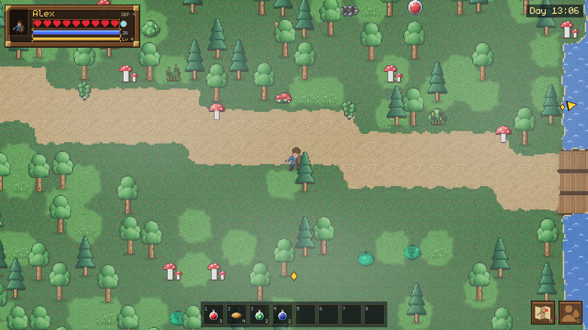
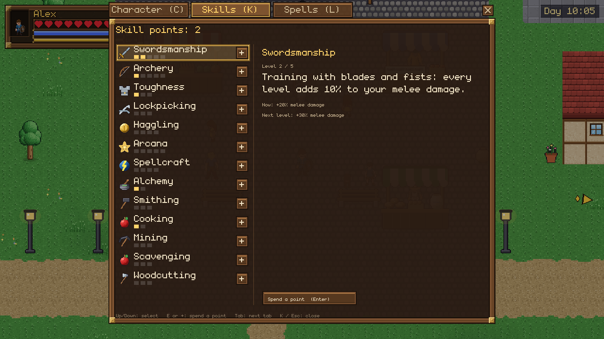
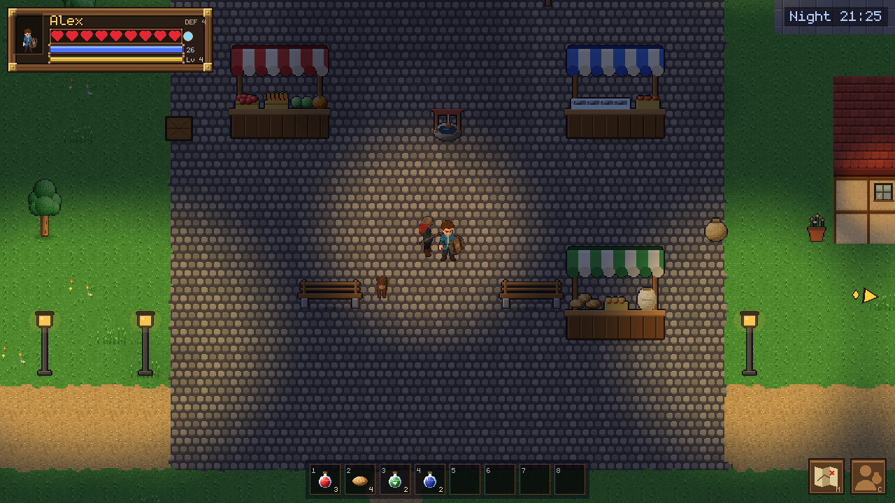
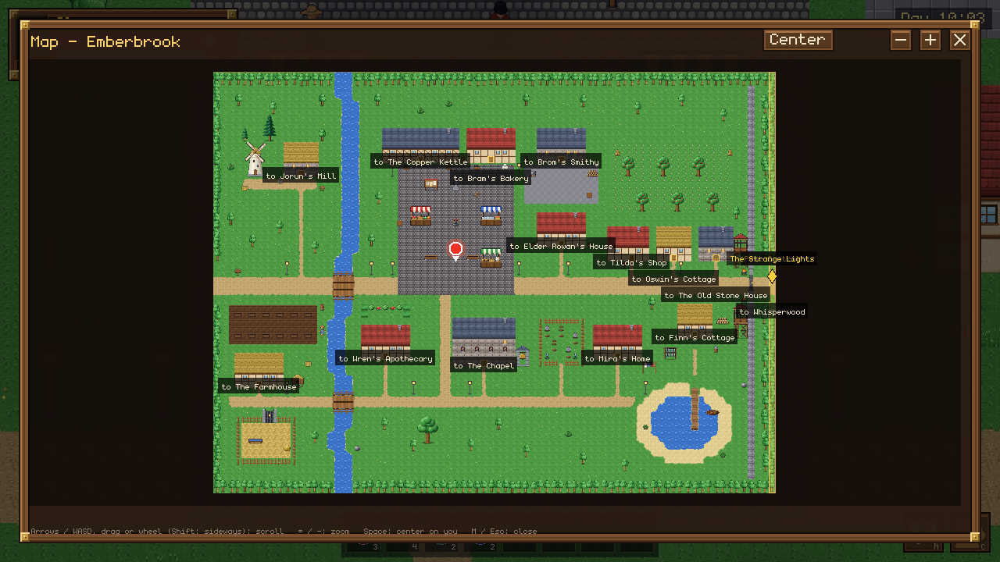

# 9. Gameplay systems

The engine brings the systems of a classic action RPG. You switch on what your game needs and fill
it with content; most systems are set up in the Database and driven by triggers.

## Health and combat

The **status frame** at the top left shows a small portrait of the hero as dressed, the name, the
**hearts** (one heart = 2 HP), the mana and experience bars, the defense and the ammunition of an
equipped bow or crossbow.

- **Melee weapons** have their own damage, speed, reach, swing arc and knockback (a sword, a spear,
  an axe). **Ranged weapons** (bow, crossbow) shoot projectiles and use ammunition. Shots fly over
  low obstacles (fences, rocks, water, barrels) and stop at high ones (walls, tree trunks, statues);
  enemy archers only shoot when they have such a clear line ([Maps › Low and high
  obstacles](03-maps.md#low-and-high-obstacles)).
- **Armor** reduces damage: what gets through is `damage − defense`, at least 1. Heavy armor can
  slow the wearer.
- Hits knock back (a hard shove that stops quickly) and give a moment of invulnerability. When
  the player is hurt the screen shakes briefly and flashes red (players can turn this off in
  *Options › Graphics › Shake & flash*).
- **Hits feel like hits**: when the player's blow, arrow or spell lands, the world pauses for a
  few hundredths of a second (longer for a critical hit or a kill; off with *Shake & flash*), the
  character hit flashes white, and a **damage number** rises from it: white for the player's hits,
  big and yellow for **critical hits**, red when the player or a companion is hurt (*Options › Gameplay ›
  Damage numbers*). A **critical hit** does double damage and shakes the view a little; each
  weapon has its own chance (*Critical hits* on the item form, 5 % by default; in the example
  the crossbow and the fine iron sword are best at it). Characters show a **health bar** for
  three seconds after they were hurt; the part the hit took drains away in white.
- **Hostile characters** chase or shoot at the player ([Characters › Behaviour](06-characters.md#behaviour)),
  and their attacks can be seen coming:
  - **Armed** (a melee weapon in their equipment): they stop at their weapon's reach and **wind up**
    (0.4 s: the weapon raised over the head, a red zone on the ground shows where the swing will
    land), then **swing** in the direction they locked when the wind-up began, for the weapon's
    damage, reach, arc and knockback, and **recover** for the weapon's cooldown and a moment more.
    Stepping out of the red zone during the wind-up dodges the blow. They don't hurt by touch.
  - **Unarmed chasers** (slimes): close to their target they **crouch** (0.3 s, a red ring
    tightening around them) and **lunge**, hurting by touch (and its *On touch* effect) only during
    the hop; then they rest a moment.
  - **Archers** shoot; other hostile characters (traps, creatures that don't chase) hurt by touch.
  - They attack companions as well as the player. *Attack wind-up* on the character's form changes
    the wind-up (a slow, heavy brute; a quick assassin).
  - **Hit from afar, they come**: an enemy hurt by the player's or a companion's blow, arrow or
    spell notices the attacker even out of its sight: surprised, it alerts its kind around it and
    hunts toward where the attack came from until it sees the player (its *Leash* still sends it
    home). A blow that kills alerts no one, so a silent sneak attack stays silent.
  - **What they hold shows how they fight**: characters play the animations of their weapon and
    shield ([Characters › Weapon animations](06-characters.md#weapon-animations)): a guard stance with
    a sword, a thrust with a spear, a drawn bow, an overhead blow with a two-handed weapon, a punch
    with bare hands, a raised shield while blocking. The player's strikes too.
- **Battle stance and battle music**: characters are **in combat** while they hunt someone or fight
  (companions too), the player while an enemy close by (16 tiles) hunts them or a companion, while
  striking, blocking or hurt; it ends four seconds after the last of these. In combat characters take
  their weapon's stance with a one-handed weapon in the hand; out of it they stand upright and
  relaxed, the one-handed weapon at the left hip (two-handed and ranged weapons, shields and tools
  stay in the hands). While enemies engage the player or a companion the music crossfades to the
  **battle music** (*Database › Project › Game sounds › Battle music*; a map can choose another
  track or none in its properties) and back to the map's music when the fight is over; the
  player's own swing at nothing draws the sword but doesn't start the music. The example plays
  *Steel in the Woods* (`music_battle`, in the starter library); `status` prints `battle=` (the
  player's combat and who is in combat) and `music_fade=`.
- **Groups fight like groups** (*Group* on the character's form, on by default): at most two
  enemies close in on the player (or on one companion) at a time; the others **circle** at about
  two and a half tiles, facing their target, and step in when one of the two falls or falls
  behind. They spread out instead of stacking up. An enemy that sees the player for the first
  time **alerts** others of its kind within its *Alert* range (6 tiles), who come over with a
  surprised look even without seeing the player. **Archers** without a clear shot (a wall or a
  tall prop in the way) step sideways along it until they have one, and aim a little ahead of a
  player who keeps walking. **Badly hurt** enemies run to an ally out of the fight instead of
  just away, tell it (it joins the hunt), catch their breath for three seconds and come back.
- **Sneaking** (Left Ctrl / V, gamepad left stick click; [Player's guide](15-players-guide.md#defending-yourself)):
  the player walks at half speed and quietly, and a hostile character notices them within half of
  its *Sight*, times 0.4 (dark) to 1 (lit) by the light at the player: the map's lighting by the
  clock plus the light sources around them, their own lantern included. That applies sneaking or
  not (at night everyone is harder to see); behind walls the usual half of that, and within three
  quarters of a tile always. A hit on a chasing enemy that hasn't noticed anyone (and isn't fleeing)
  is a **sneak attack**: double damage, shown like a critical hit, plus the *Sneak attack* skill
  effect. Models play their **sneak** clip while sneaking (*Database › 3D models*; every playable
  model of the example has a creeping walk), others their walk, slowed. Scripts ask `is_sneaking()`;
  `status` prints `sneak=on|off:light…:sight10=…` (how far a 10-tile enemy would notice the player).
  In the example a sign on the way to the bandits' camp in Whisperwood hints at a night approach.
- **Blocking and dodging**: the player blocks with a shield (frontal hits do no damage; a block
  raised right before a blow parries it and stuns the attacker) and dodges with a roll that nothing
  touches ([Player's guide › Defending yourself](15-players-guide.md#defending-yourself)).
  The player's attacks only hit hostile characters, never companions or friendly villagers; make a
  huntable animal *hostile* with 0 damage.
- A defeated character runs its *Defeat* triggers and drops its loot and gear.
- A defeated **player** gets a menu: *Continue from last save* (the newest, autosave included),
  *Start over* (a new game as the same hero) or *Quit to main menu*.

## Experience and levels

Optional: *Database › Project › Experience and levels*. Defeated characters give the XP set in their
definition, completed quests their *Experience reward*. Enough XP raises the level, and each level
adds max HP (and heals as much), mana and skill points as set in the project. The XP needed starts
at *XP for level 2* and grows by *Growth* per level, up to the *Highest level*.

The status frame shows `Lv N` with a gold XP bar, the character window *Level N (XP a / b)*, and a
message announces every level. Triggers use the *Give experience* action and the *Player level*
condition; scripts `give_xp(n)`, `xp()` and `level()`.

## Status effects

Timed effects on the player and on characters:

| Effect | What it does |
|---|---|
| **Poison**, **Burning** | HP lost per second; defense doesn't help |
| **Regeneration** | HP gained per second |
| **Slow**, **Haste** | Slower / faster movement |
| **Strength**, **Weakness** | More / less damage dealt |
| **Shield** | Extra defense |
| **Stun** | Can't move, attack or interact |

Weapons apply one **on hit**, hostile characters **on touch**, and potions, traps and scripts with
the *Apply effect* / *Cure effect* actions or `apply_effect` / `cure`. Applying a running effect
again restarts it (the longer duration and the stronger strength win). The status frame shows a badge
per effect with the seconds left; characters with effects get coloured markers and tints. The
player's effects are saved.

## Skills and magic

Turn them on in *Database › Project › Skills & magic*.

**Skills** (*Database › Skills*) have a name, description, icon, max level and an **effect** per
level:

| Effect | Per level |
|---|---|
| *Melee damage*, *Ranged damage*, *Spell damage* | + % damage of that kind |
| *Defense*, *Speed* | + defense points, + % speed |
| *Lockpick* | Picks locks ([Lockpicking](#lockpicking)) |
| *Haggle* | Better merchant prices by % |
| *Mana*, *Mana regen* | More max mana, faster regeneration |
| *Food* | Food heals more |
| *Sneak attack* | Sneak attacks do + % of the hit more (on top of double damage); the example's *Sneaking* skill: +25 % per level |
| *Gathering* (with a tool kind) | Fewer hits to mine or gather |
| *None* | Nothing by itself; for conditions and scripts |
| *Script* | Calls a script function `name(level)` when the level changes, so a script can do anything |

Players get **skill points** from the *Give skill points* action (quest rewards), from levelling up
and from the project's *Starting skill points*, and spend them on the **Skills** tab (K).

**Magic** adds **mana** (*Max mana*, *Mana regeneration*; a blue bar under the hearts) and
**spells** (*Database › Spells*): mana cost, cooldown, an optional required skill level, an icon and
an effect:

| Effect | What it does |
|---|---|
| *Heal* | Restores hearts; with companions on the map it asks whom to heal |
| *Bolt* | A projectile, aimed with the mouse |
| *Blast* | Damages everything within a radius |
| *Light* | A glow around the player for a while |
| *Script* | A script function: aim, throw animated sprites, play effects, damage areas ([the Fireball](08-scripting.md#a-fireball-spell)) |

Spells are learned from items with *Teaches spell* (scrolls that are consumed, books that aren't) or
the *Learn spell* action, and cast from the **Spells** tab (L) or the quick bar. **Bolt spells are
aimed**: the cursor turns into a crosshair (gold over an enemy); the next left click fires at what's
under it, X fires straight ahead, right-click or Esc cancels, and mana is only spent when the bolt
flies.

Conditions: *Skill level*, *Knows spell*. Actions: *Give skill points*, *Set skill level*, *Learn
spell*, *Add mana*, *Damage around player*, *Light around player*.

**Companions use magic too**: hand a companion with mana a scroll or a spell book and it learns
*Heal* and *Bolt* spells, then heals whoever is badly hurt and casts bolts at its enemy
([Characters › Companions](06-characters.md#companions)).

## Inventory, quick bar and containers

- The **inventory** has as many slots as *Database › Project › Inventory slots* says; each item has
  a stack size. The character window (C or I) shows it next to the character sheet: the player's
  figure in the current gear with the equipment slots around it where things are worn (head, body
  armor, right hand and tool on the left, as the figure faces you; backpack, clothing and left hand
  on the right; a two-handed weapon shows faded in the left hand too), and live stats below. A
  selected or hovered slot's item is described in the line at the bottom.
- **Backpacks** go into the *Backpack* slot and show on the character's back; while worn the
  inventory has the backpack's extra slots (*Extra inventory slots* on the item). Taking one off, or
  changing it for a smaller one, moves what lies in the slots that go away into free slots; when
  they don't fit it stays on (*Make room first*). In the example Tilda sells a **Small Backpack**
  (+6) and a **Traveller's Pack** (+12), and the bandit chief carries a **Magic Backpack** (+24);
  all three are in the starter library.
- The **quick bar** has 8 slots: drag items onto it (or select one and press 1–8), then press 1–8 or
  click to use them. Slots show how many you own and grey out at 0.
- **Dropping**: G drops the selected stack (Shift+G one item), or drag it out of the window. Dropped
  items stay where they are, also across map changes and in save games.
- **Containers** (chests, barrels: *Lootable container* props) open a window next to the inventory:
  take what you want, or store things. Their contents are saved.

## Villagers who produce

What villagers do can yield goods for sale. The **Shop stock** action adds items to a merchant's
stock (or sets how many it has; 0 removes the item), and the scripts `add_stock`, `set_stock`,
`stock_of` and `day()` do the same with a count of in-game days. The example's fisher and baker
definitions have an *Interact* trigger that runs a small library script before their shop opens:
for every day since the last restock it adds what they made (Finn's trout from the pond, Bram's
apple pies from the oven), up to a limit. So Finn's catch is at his stall the next morning, even if
the player was elsewhere at dawn, and while he fishes he tells you so. The script
(`restock_from_activity` in the [scripting chapter](08-scripting.md#a-stall-that-sells-what-was-made))
comes along when you add the fisher or the baker from the asset library.

## Crafting, cooking and blacksmithing

**Recipes** (*Database › Recipes*) turn ingredients into an item:

| Setting | Meaning |
|---|---|
| **Makes** | The result and how many |
| **Ingredients** | Items used up (they can be equipped items, so a recipe can upgrade the sword in hand) |
| **Station** | A name such as `alchemy`, `anvil` or `oven`; a station shows only its recipes |
| **Requires skill** | A skill and level needed |
| **Tools** | Tool kinds needed but not used up (an item with that *Tool kind* equipped, held or carried) |
| **Station state** | The station prop must be in a state, e.g. a campfire *lit* |
| **Better results** | From a higher level of the recipe's skill on, it makes another item (a *Fine Iron Sword*) |

The **Open crafting** action (station, window title), typically on a workbench prop's *Interact*
trigger, or `open_crafting(station)` opens the crafting window with that station's recipes. It lists
each recipe with its ingredients and what the player has of each (red where short) and a *Make*
button. Items marked **Food** heal more with a skill with the *Food* effect.

The example has an alchemy table (potions, the herbal remedy; needs a mortar), a smelter (ingots;
needs tongs), an anvil (swords, helmets, chainmail, arrows, the woodcutter's axe; needs a hammer and
tongs), a sawhorse by the mill (planks from logs, a wooden shield, a fishing rod), a kitchen
hearth and a bread oven that cook while lit, and a campfire by the forest path.

**Cooking fires burn wood.** The library's campfire, kitchen hearth, bread oven and fireplace are lit
by using a **Log** on them (one log is used; on a fire that already burns, nothing is used). A
campfire burns for four in-game hours and then goes out; while it is cold, E on it says what it
needs instead of opening the cooking window. The hearth, oven and fireplace start lit and stay lit:
their owners tend them. The forge and the smelter keep burning coal. In the example a cold campfire
with three logs beside it waits by the forest path.

## Gathering and mining

A prop can be **gathered** (*Database › Props › Gathering*): with a tool kind (e.g. `pickaxe`, or bare
hands) the player presses E or swings at it. After its number of hits (a progress bar shows it, chips
fly) its loot table rolls and it switches to its *used up* state. A skill with the *Gathering* effect
needs fewer hits per level. **Regrows** turns the state back after some in-game hours, also while the
player is elsewhere, so a mined-out vein refills and a picked bush grows back.

The example's old mine has copper, iron, silver, gem and coal veins that refill after three days, a
crate with a pickaxe, and a Mining skill.

### Woodcutting

Trees are gathered the same way, with an axe: the starter library's **Woodcutter's Axe** (tool kind
`axe`; the *Battle Axe* is a weapon and doesn't chop) fells the **Big Oak** and **Big Pine** in five
strokes (2 to 4 **Logs**, sometimes an apple from the oak) and the smaller **Young Oak** and **Young
Pine** in three (1 or 2 logs). A felled tree leaves a stump you can walk over, which grows back into
a tree after four days (three for the young ones). The **Woodcutting** skill takes 20 % fewer strokes
per level. At a **Sawhorse** (a crafting station) two logs make three **Planks**, and planks make a
wooden shield, a fishing rod and, at the anvil with an iron ingot, a new woodcutter's axe. All of it
is library content: give your own tree props a *Gathering* section with the tool kind `axe` and a
*stump* state to make them choppable.

In the example, a woodcutter's axe lies in the mill, Brom the blacksmith stocks two, young trees
grow by the mill and along the forest path, and the sawhorse stands next to the mill's door. Trees
drawn as map tiles can't be felled: only tree props can.

## Farming

A prop marked **Farm plot** (*Database › Props*) takes seeds: items with a **Seed** section (growth
stages with a sprite and in-game hours each, the last one ripe, and the harvest). E on an empty plot
plants the first seed the player carries (or use a seed while facing a plot); E on a growing crop
says how long it still needs; E on a ripe one harvests it. Crops grow while the player is away too,
half again as fast while it rains on their map.

## Fishing

A **Fishing spot** zone covers the water where the fish are. In the inspector: the item needed
(e.g. a fishing rod) and the **catch** table (chances are weights; every fish landed gives one
entry). Fish shadows glide through the zone now and then, also in the editor, so players see where to
fish.

Facing the spot from the shore (up to three tiles away), the player presses E to cast; the rod moves
into the tool slot by itself. Wait until the bobber dips, strike in time, then hold E to reel in,
letting go before the tension turns red, or the line snaps.

## Lockpicking

A lock with a **Lockpicking** difficulty (*Database › Props › Lockable*, or a placed prop's lock) can
be picked by a player with the *Lockpick* skill effect:

- from a skill level one below the difficulty (at least 1) up to one above it, a short game starts: three pins,
  each set by pressing E while the sweeping marker is in the green spot (smaller and faster the
  harder the lock); three misses and the lock holds;
- two levels above the difficulty, the lock opens at once;
- a lock without a key item can only be picked.

The **Lockpicking game** action and `lockpick(difficulty, var)` play the game for any puzzle and put 1
(success) or 0 into the variable.

## Doors

Props marked **Door** (*Database › Props*) open and close with E. A door with a lock stays shut
until it is opened with its key (kept, unless the lock uses it up) or picked
([Lockpicking](#lockpicking)); a picked door then opens and closes freely, and with the key closing it
locks it again ("Locked with the Room Key."). Nobody can be shut in: a door doesn't close on the
player or a character standing in it.

Villagers walking their daily routes (and patrols, companions) open closed doors on their way
and close them again a moment after passing; a locked door only for those who carry its key in
their inventory (a placed character's items), and it is locked again behind them. The *Set locked*
action and `set_locked(target, locked)` lock a door (closing it) or unlock it (it stays closed);
`is_locked(target)` asks. `status` prints `doors=` (name:open|closed[:locked]@x,y).

The example's tavern: Greta hands over a **Room Key** with a paid room (the first guest room
upstairs); stepping onto the landing after the night puts it back on its hook and locks the room.
Greta and Dagny lock their own rooms behind them, and the second guest room needs Greta's key or a
lockpick.

## Furniture: sitting and sleeping

*Database › Props › Furniture* makes a prop sittable or a bed: a pose (*Sit*, *Lie*, *Stand*), the
spot where the user's feet go (with a preview), the way they face (a chair per direction; for beds
the side the head is on), for beds the hour sleep lasts until, a **cover** sprite drawn over the
user (a blanket, a chair's backrest), and optional conditions with a refusal text (a paid inn room).

E at the furniture sits the player down: HP comes back (1 every 4 s) and mana twice as fast. At a bed
it asks "Sleep until 07:00?": the screen fades, the clock jumps, HP and mana are restored, effects
wear off, enemies due to respawn return, scheduled villagers are at their new places; then *Woke up*
triggers run and the game autosaves. Not with enemies nearby. A movement key, an attack or E stands
up. The **Sleep** action and `sleep(hours)` rest without a bed (camping, an inn's "Rest").

Villagers use furniture too, through their schedules ([Characters](06-characters.md#daily-schedules)).

## Homes and furniture

A map can be one of the player's **homes**: a quest, a trigger or a script makes it so with
`set_home("stone_house", true)` (`is_home(map)` asks; [Scripting](08-scripting.md)). It is saved with
the game.

Items with **Places prop** set (*Database › Items › Furniture*) are furniture. Used from the
inventory in a home, the item becomes its prop on the free tile in front of the player: not on
walls, doors (portals, transitions) or arrival points, not over another entity, the player or a
solid decoration. Props wider or deeper than a tile reach away from the player. Elsewhere the game
says "Furniture goes in your home."

E at placed furniture asks first: **Use** / **Pick up** / **Leave it** for props that do something
(sit on a chair, sleep in a bed, open a chest), **Pick up** / **Leave it** for the others. Picking
it up gives the item back; a chest with something in it has to be emptied first. Placed furniture is
an ordinary prop otherwise: its states, a chest's contents and its triggers work as on a prop placed
in the editor, and it stays where it was put, in save games too.

Props that **lie flat on the ground** (rugs, *Database › Props*) are drawn under everything and are
judged by their picture: a rug may go under a table, a chair or the player, but not onto another
rug; a table or chair may then be placed on it. E takes what stands on a rug before the rug.

## Emotions

Characters show how they feel with a small icon over their head
([Events › Emotions over heads](07-events.md#emotions-over-heads)). With *Automatic emotions* on
(*Database › Project*, on by default) they also do it by themselves: an enemy shows **surprise** when
it notices you, **confused** when it lost you and **fear** when it flees; villagers asleep in bed
show **sleepy**; a companion who learns a spell shows **joy**. The emotions come from the project's
*Emotions* sprite sheets (the starter library's `emotions`); a project without one shows none.

## Time of day

The clock runs on: *Database › Project* sets the **day length** (real minutes per in-game day,
default 24; 0 stands still) and the hour new games start at. The clock counts days (sleeping and
midnight move it on), and save games keep it. On outdoor maps the game shows the time. The *Set time
of day* action, the *Time of day* condition, the *Time reached* event and the scripts `hour()`,
`is_night()` and `set_hour(h)` use it. How dark night gets is a map setting
([Maps › Lighting](03-maps.md#lighting)).

## Fast travel by signposts

The starter library's **Signpost** prop is a fast-travel point: coming within 5 tiles of it (or
pressing E at it) marks it found, and the player says so in a speech bubble; pressing E at a
signpost offers the other signposts the player has found, each with the hours the trip takes on the roads
(the clock moves on by that much; *Stay here* cancels). The roads are too dark to travel between
21:00 and 5:00, and a trip that would end after midnight waits for the next day.

Set it up as content, no events needed:

1. Place a *Signpost* prop and a *Spawn* zone on the tile in front of it (where travellers arrive),
   and a *Trigger* zone of 11 × 11 tiles centred on the signpost whose *Enter* trigger (*once*)
   runs the script function `signpost_seen()`: walking into it marks the signpost found.
2. List it in the script function `signposts()` (the starter library adds it to
   `scripts/library.rhai` with the prop): an `id`, its `name` (in `text("…")`, so it is
   translated), its `map`, the tile `x` / `y` of the prop, the spawn `arrive_at` and `hours`, how far
   along the roads it lies (a trip takes the difference, at least one hour).

The prop's own *Interact* trigger runs `signpost_menu()`; it finds the signpost the player stands
at by map and position, so placed signposts need no triggers of their own (`signpost_seen()` too
takes the nearest signpost on the map). In the example there are
signposts in the village square, the Whisperwood clearing, at the old mine and in the Wilds.

## Friendship and gifts

Villagers like the player more for a chat each day and for gifts. Friendship is the variable
`friend_<name>` of a placed character (0 to 100 points; `friend_tomas` for *tomas*), and the
journal's **People** page shows everyone with friendship points in ten hearts (half hearts from
five points), friendliest first. Any event or script can raise it (`add_var("friend_tomas", 10)`
for a quest well done) or check it in conditions.

The starter library's villagers (and the example's) come with friendship as content:

- **A chat a day**: the first time each day the player talks to them, +2.
- **Gifts**: use an item on them (the quick bar or the inventory while facing them): a gift they
  love +15, like +8, anything else +3, a gift they dislike -8, each with a reply and an emotion.
  One gift a day: a second one is handed back.
- **Five hearts**: they give the player something once ("You're a true friend...").

What each villager loves, likes, dislikes and gives back is one list in the script function
`friend_tastes()` (by their names on the map); the villager definitions' *Interact* and *Use item*
triggers run `friend_chat()` and `give_gift()`. Characters not in the list take no gifts (their
*Use item* trigger's condition, `friend_takes_gifts()`, says no, so the item isn't used up). The
scripts use `used_item()`, `self_name()` and `is_consumable(item)`
([Scripting](08-scripting.md)).

## Quests, journal, bestiary and dialog log

The **journal** (J) has four tabs:

- **Quests**: active quests (newest first) and finished ones, with who gave them, the description,
  the rewards and the objectives reached so far ([The Database › Quests](05-database.md#quests)).
- **Bestiary**: every kind of character the player has defeated, how many, a portrait, the
  definition's *Description*, its numbers and drops. The *Defeated count* condition and
  `defeated_count("slime")` make "defeat ten slimes" quests without a script.
- **Dialogs**: the last 1000 lines of every conversation, with the options the player picked, so
  nothing said is lost.
- **People**: the characters the player is friends with ([Friendship and gifts](#friendship-and-gifts)).

### Quest markers

A quest stage that leads somewhere (*Database › Quests*, *leads to*) shows the way while it is
current, for every active quest:

- a golden marker bobs over the target (a character's head, a prop, the middle of a zone) when it
  is on screen, and an arrow at the screen's edge points to it when it isn't;
- a target on another map is shown at the exit leading there (a door, a map transition or a map
  edge) on the current map;
- the map screen (M) pins the same spots with the quest's title.

A step that waits for a talk with someone marks that character when it is on the map, but while
the player still has to fetch or make something first (the flour, the festival loaf) the marker
points there instead. A target two or more maps away is shown at the exit on the way to it (from
the bakery, the door to the village for the forest's cart). A character with a quest to offer
right now has a golden **!** over its head (talking to it offers the quest).

Players switch them off in *Options › Gameplay › Quest markers*. In the example every quest stage with one place
to go has a marker: the chest in the elder's house, the shrine, the slime den, Tilda, the mill's cat,
the raided cart, Bram, Wren, Pip, Brom, Halvar's locket and the elven herbalist in the Wilds.

## Achievements

*Database › Achievements*: a name, description, icon, *Hidden* (shown as "???" until unlocked) and
the conditions that unlock it, checked twice a second while playing (quests, flags, variables,
defeated counts, level, items, a script…). Achievements without conditions are unlocked by the
**Unlock achievement** action or `unlock_achievement(id)`. An unlock shows a toast.

Achievements belong to the **player, not to a save game**: they are kept next to the game's settings
and listed on the **Achievements** page of the title and pause menus ("N of M unlocked", the date of
each, *Reset achievements*).

## Saving

- **Autosave** after every map change (once the new map's events are done), plus the *Autosave*
  action and `autosave()`.
- **Quick save / load**: F5 / F9.
- **Named saves** from the pause menu, each with a picture of the world, the map, the play time and
  its age.
- Save games keep the world: flags, variables, inventories, quests, every entity's state, containers,
  shops, dropped items, companions, explored areas, the time and the weather.

## Photo mode

P (or *Photo mode* in the pause menu) freezes the world and hides the HUD; the player moves the
camera, zooms (0.5× to 3×), may hide themselves and show another hour's light, and takes pictures
of the world alone (PNG, into the Pictures folder; a download in the web game). The controls are in
the [Player's guide](15-players-guide.md#photo-mode). Not during cut-scenes, dialogs, open windows
or on the title screen.

## The map screen

M (or the map button) shows the current map from above with the player's marker and the exits
labelled with the titles of the maps they lead to (map settings, [Maps](03-maps.md)); labels of
doors side by side stack instead of covering each other. The game pauses meanwhile. Large maps scroll and zoom. On maps
with **fog of war** only the explored parts show ([Maps › Fog of war](03-maps.md#map-screen-and-fog-of-war)).

