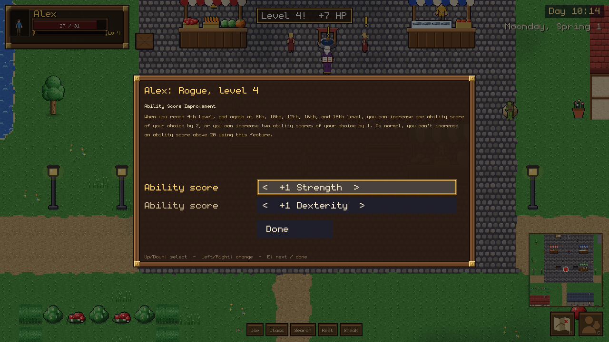
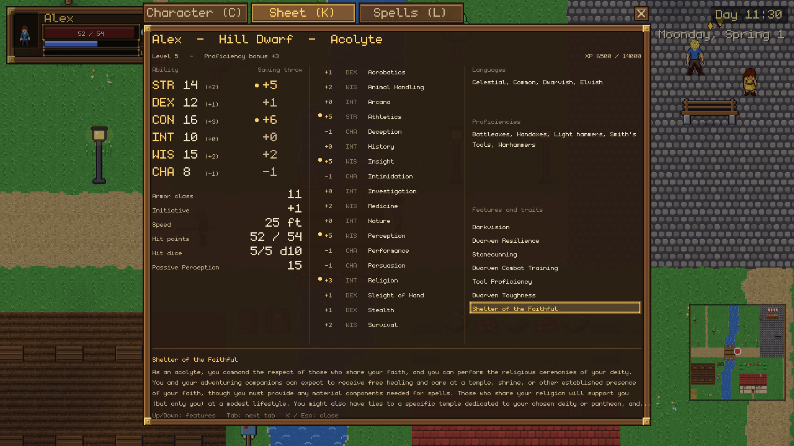
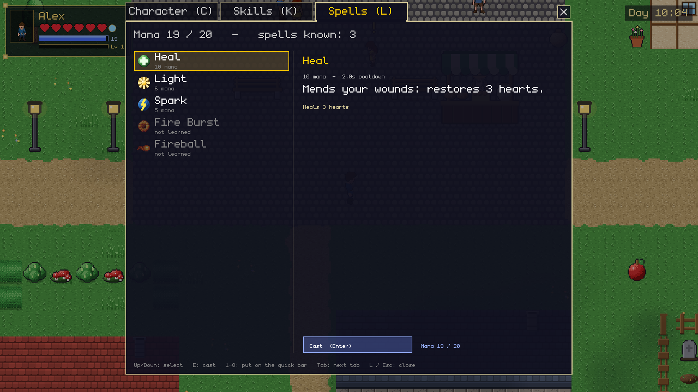
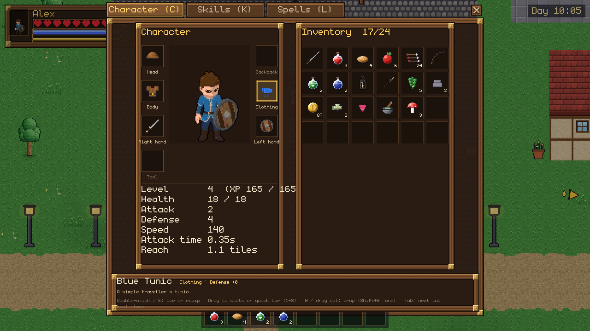
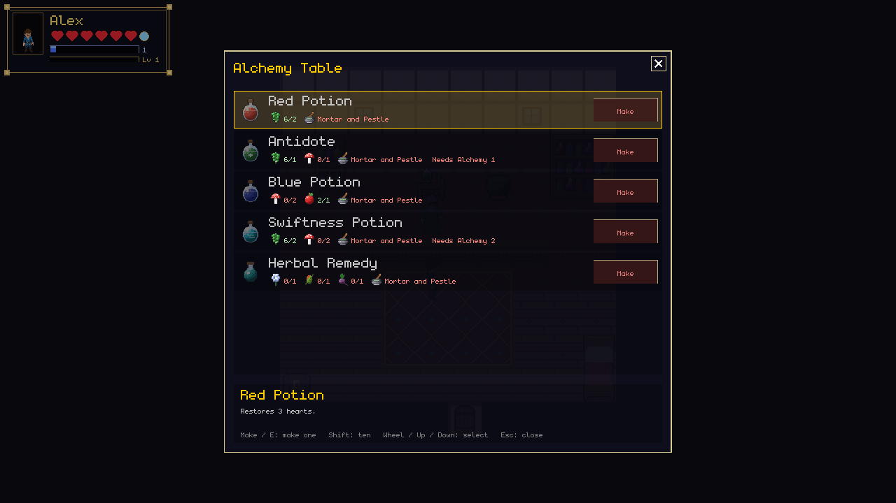

# 9. Gameplay systems

The engine brings the systems of a classic action RPG. You switch on what your game needs and fill
it with content; most systems are set up in the Database and driven by triggers.

## Health and combat

The **status frame** at the top left shows a small portrait of the hero as dressed, the name, the
**HP bar** with the hit points (`34 / 44`), a caster's spell slots (a pip per slot by level), the experience bar and the ammunition of an
equipped bow or crossbow.

Fights follow the SRD 5.1's combat rules **in turns**, on the map where they happen; exploring
stays real-time ([Player's guide › Fighting](15-players-guide.md#fighting)).

- **A fight starts** when a hostile character notices the player or a companion (within its
  *Sight*; sneaking and darkness shorten it), when the player attacks one in sight (Attack, or a
  click on it), or with the *Start fight* action / `start_combat()`. Every character within 12
  tiles that is hostile to the player joins, the companions and characters of factions hostile to
  the enemies (the village guards against bandits) fight on the player's side. Hostile characters
  that come close later join at the end of the round.
- **Surprise:** when the player strikes first, enemies that hadn't noticed them lose the first
  round. Sneaking up on a camp pays.
- **Initiative:** everyone rolls d20 + DEX; the turn order bar at the top shows it with everyone's
  hit points. Everyone steps onto the middle of their tile (a tile is 5 ft).
- **A turn:** moving up to the speed (30 ft = 6 tiles; the race's speed; conditions slow it),
  **one action**, **one bonus action** and **one reaction** a round. Diagonal steps cost 5 ft like
  straight ones; **difficult terrain** (materials with *Difficult terrain*, e.g. mud, deep snow)
  costs double. Characters can pass through allies, not through foes.
- **Actions:** *Attack* (stat blocks with Multiattack attack several times), *Cast a Spell*,
  *Dash* (the speed again), *Disengage* (no opportunity attacks this turn), *Dodge* (attacks
  against it have disadvantage), *Help* (an ally's next attack against a foe next to you has
  advantage), *Hide* (Stealth against the foes' passive Perception: unseen until it attacks),
  *Ready* (an attack when a foe steps into reach), *Search* (Perception against hidden foes),
  *Use an Object* (an item from the inventory), *Grapple* and *Shove* (Athletics against the
  target's Athletics or Acrobatics: grappled, or knocked prone / pushed a tile). The **bonus action**
  is the off-hand attack: a weapon in the left hand attacks after the Attack action, without the
  ability modifier on its damage.
- **Attacks** roll d20 + the ability modifier (STR for melee, DEX for ranged) + the proficiency
  bonus against the target's **armor class**. A natural 20 always hits and is a **critical hit**
  (the damage dice twice; a *keen* weapon on 19 or 20 too), a natural 1 always misses. Damage is
  the weapon's **dice** (*Damage dice* on the item form) + the modifier, of its damage type through
  the target's resistances. Characters attack with their stat block's attacks; without them with
  their weapon or *Damage* (1 = 1d4 … 5 = 1d12, +2 to hit).
- **Advantage and disadvantage** come from the SRD's sources: the attacker's conditions
  (poisoned, prone, restrained, blinded, frightened, exhaustion 3+), the target's (prone:
  advantage in melee, disadvantage at range; restrained, paralyzed, stunned, unconscious, blinded:
  advantage; invisible: disadvantage), Dodge, Help, a hidden attacker, and for ranged attacks a foe
  next to the shooter or a target beyond the normal range (up to the long range: *Long range* on
  the weapon). Paralyzed or unconscious targets within 5 ft take critical hits.
- **Cover:** walls, tall props, trees and other creatures between the attacker and the target give
  **half cover** (+2 AC) or **three-quarters cover** (+5 AC); behind full cover it can't be
  targeted. Shots fly over low obstacles (fences, rocks, water) ([Maps › Low and high
  obstacles](03-maps.md#low-and-high-obstacles)).
- **Opportunity attacks:** leaving a foe's reach without *Disengage* gives it a melee attack (its
  reaction).
- **0 hit points:** characters die (their *Defeated* triggers run, they drop their loot and
  gear). The hero and companions fall **unconscious** and roll a **death saving throw** on each of
  their turns: 10 or more is a success, three successes and they are stable, three failures and
  they die; a natural 20 brings them back with 1 HP, a natural 1 counts twice. Damage while down is
  a failure (a critical hit two); any healing brings them back up. Enemies leave the unconscious
  alone, except those with Multiattack. When nobody of the party stands any more and those down are
  stable (or dead), the fight is lost: the *defeated* menu. A companion that dies follows the
  project's rule for companions at 0 HP (lies there, goes home, gets up).
- **The party:** the player plays the hero's and every companion's turns. The orders menu (G)
  hands a companion to the AI (*AI fights*) or back (*I command*). Characters on the player's side
  that aren't companions (the guards) always fight on their own.
- **The AI** goes for the nearest foe it can reach (those with Multiattack for the most hurt),
  walks into reach or, with a ranged attack, to a spot within its range with a line to its target,
  and attacks. Below its *Flee below* share of HP (or frightened) it dashes away and leaves the
  fight 15 tiles away; it drinks a healing potion it carries when its health is critical.
- **The end:** when no enemy is left fighting. Companions still down get up with 1 HP, the
  experience of the defeated is gained, the game autosaves. Saving is refused during a fight (the
  autosave waits). Leaving the map ends a fight.
- **Conditions** run by rounds in a fight: damage and healing per round fall on each fighter's
  turn ([Conditions and damage](#conditions-and-damage)).
- **Feedback:** every roll goes into the **fight log** at the bottom left and the journal's
  *Rolls* page. Damage numbers rise from those hit (white for the player's hits, big and yellow
  for critical hits, red when the player or a companion is hurt, *miss* for a miss; *Options ›
  Gameplay › Damage numbers*); hit characters flash white and show a **health bar** for three
  seconds. When the player is hurt the screen shakes briefly and flashes red (*Options › Graphics
  › Shake & flash*).
- **What they hold shows how they fight**: characters play the animations of their weapon and
  shield ([Characters › Weapon animations](06-characters.md#weapon-animations)) when they attack.
- **Battle stance and battle music**: those in a fight take their weapon's stance with a
  one-handed weapon in the hand; out of fights it hangs at the left hip (two-handed and ranged
  weapons, shields and tools stay in the hands). A fight crossfades the music to the **battle
  music** (*Database › Project › Game sounds › Battle music*; a map can choose another track or
  none in its properties) and back when it is over, with the *Victory* fanfare when enemies were
  defeated. The example plays *Steel in the Woods* (`music_battle`, in the starter library).
- **Sneaking** (Left Ctrl / V, gamepad left stick click): the player walks at half speed and
  quietly, and a hostile character notices them within half of its *Sight*, times 0.4 (dark) to 1
  (lit) by the light at the player: the map's lighting by the clock plus the light sources around
  them, their own lantern included. That applies sneaking or not (at night everyone is harder to
  see); behind walls the usual half of that, and within three quarters of a tile always. An enemy
  that hasn't noticed the player when they attack is **surprised**. Models play their **sneak** clip
  while sneaking (*Database › 3D models*; every playable model of the example has a creeping walk),
  others their walk, slowed. Scripts ask `is_sneaking()`; `status` prints
  `sneak=on|off:light…:sight10=…`. In the example a sign on the way to the bandits' camp in
  Whisperwood hints at a night approach.
- **Outside fights** the Attack key swings at trees and ore veins in front ([Gathering and
  mining](#gathering-and-mining)); scripted damage (traps, *Damage area*) subtracts the target's
  *Defense* there. The player's attacks only start fights with hostile characters; make a
  huntable animal *hostile* with 0 damage.
- **Scripts and events:** *Fight starts* and *Fight ends* triggers (map triggers, and a
  character's own when it fights: a boss's words), the *Start fight* action, `start_combat()`,
  `in_combat()`, `combat_round()` ([Scripting](08-scripting.md)). `status` prints `combat=` and
  `death_saves=` ([Testing](17-testing.md)).
- A defeated **player** gets a menu: *Continue from last save* (the newest, autosave included),
  *Start over* (a new game as the same hero) or *Quit to main menu*.

## Experience and levels

Optional: *Database › Project › Experience and levels*. Defeated characters give the XP set in their
definition, completed quests their *Experience reward*. Levels follow the SRD's experience table, up
to the project's *Highest level* (20 at most):

| Level | 2 | 3 | 4 | 5 | 6 | 7 | 8 | 9 | 10 | 11 | 12 | … | 20 |
|---|---|---|---|---|---|---|---|---|---|---|---|---|---|
| Total XP | 300 | 900 | 2,700 | 6,500 | 14,000 | 23,000 | 34,000 | 48,000 | 64,000 | 85,000 | 100,000 | … | 355,000 |

Each level adds **hit points** (and heals as many), a **hit die**, a caster's spell slots, and the
proficiency bonus grows with it ([Rules](#rules-srd-51)). The SRD
gives XP by challenge: a commoner is worth 10, a bandit or guard 25, a goblin 50, an orc 100, a
bandit captain 450, a veteran 700, an adult red dragon 18,000 (the library's monsters carry theirs);
quests give what their *Experience reward* says. The XP is **split** equally between the hero and
the party members on the map that have a [class](#classes-and-levels) (they level too); companions
without a class leave the hero all of it.

**Hit points** follow the SRD and the hero's **class** hit die (a wizard's d6, a fighter's d10, a
barbarian's d12; a hero without a class, as in projects without classes and saves of 0.29 and
older, has a d10):

- **Level 1**: the die's maximum + the CON modifier.
- **Every further level**: the die's average (d6: 4, d8: 5, d10: 6, d12: 7) + CON, or with *Hit
  points per level: Rolled* a roll of the die + CON (into the roll log); at least 1 per level.
- Plus what the race adds (the hill dwarf's *Dwarven Toughness*: +1 per level) and the class (the
  draconic sorcerer's *Draconic Resilience*: +1 per level).

The max HP follows the CON score: a potion or script that raises CON raises it at once. A save of an
older version counts its levels as averages.

The status frame shows `Lv N` with a gold XP bar, the character sheet *Level N* and *XP a / b*, and a
message announces every level, with the project's *Level up* fanfare (*Game sounds*) if it has one. Triggers use the *Give experience* action and the *Player level*
condition; scripts `give_xp(n)`, `xp()` and `level()`.

## Classes and levels

The SRD's twelve **classes** (barbarian, bard, cleric, druid, fighter, monk, paladin, ranger, rogue,
sorcerer, warlock, wizard) are definitions (*Database › Classes*,
[Characters › Classes](06-characters.md#classes)) with their subclass, hit die, saving throws,
proficiencies, skills to choose, starting equipment and their features from level 1 to 20. The
character creator offers them on its third page; the hero then is a class at their level, and
*Set class* / `set_class()` give or change one in play.

- **Starting**: the class's saving throws and armor, weapon and tool proficiencies, the skills
  picked in the creator and its starting equipment in the inventory (the SRD's first options,
  mapped to the library's items: a fighter's chain mail, iron sword, wooden shield, crossbow and
  bolts).
- **Levelling**: every level the hit die adds hit points. When a level brings **choices**, the
  **level-up window** opens as soon as nothing else is going on (no fight, dialog or cut-scene):
  the **subclass** at its level (a fighter's *Martial Archetype* at 3, a cleric's *Divine Domain* at
  1), an **ability score improvement** (+1 to two abilities, +2 to one, or the feat **Grappler**:
  advantage on attacks against the creature the hero grapples), **expertise** (a rogue's or bard's
  doubled proficiency), a **fighting style** and other options. Levels with new features but no
  choice show them in the window too. The hero's level-ups come first, then the party's.

- **Features** that work by themselves act in play: *Unarmored Defense* (barbarian 10 + DEX + CON,
  monk 10 + DEX + WIS), the fighting styles (*Archery* +2 to hit with ranged weapons, *Defense* +1 AC
  in armor, *Dueling* +2 damage one-handed, *Great Weapon Fighting* rerolls 1s and 2s, *Two-Weapon
  Fighting* adds the modifier to the off-hand attack), *Extra Attack* (two to four attacks),
  *Improved* / *Superior Critical* (a critical hit on 19 or 18), *Brutal Critical*, *Fast Movement*
  and *Unarmored Movement*, *Martial Arts* (DEX and the martial arts die for unarmed strikes),
  *Expertise*, *Jack of All Trades* and *Remarkable Athlete* (half the proficiency bonus), *Reliable
  Talent* (a d20 under 10 counts as 10 on proficient checks), *Danger Sense* (advantage on DEX
  saves), *Feral Instinct* (advantage on initiative), *Evasion*, the auras of the paladin
  (*Aura of Protection*: CHA to the saves of allies within 10 ft; *Aura of Courage*), resistances and
  immunities (*Purity of Body*, *Diamond Soul*), *Primal Champion*.
- **Class actions** are used in fights with the action bar's **Class** entry (3; each press shows
  the next one with its cost and uses left, E / Enter or a click uses it: on the hero, or on the
  ally or foe under the cursor). They cost an action, a bonus action or nothing, and many spend a
  **resource** that a rest gives back (*Short rest* or a night's sleep: second wind, action surge,
  ki, channel divinity come back after a short rest; rages, Lay on Hands, Wholeness of Body,
  Indomitable after a long one; bardic inspiration after a long rest, a short one from *Font of
  Inspiration*):
  - barbarian: *Rage* (bonus action: resistance to bludgeoning, piercing and slashing damage, the
    rage damage on STR melee hits, advantage on STR checks and saves; 10 rounds, over early after a
    turn without attacking or being hurt), *Reckless Attack* (advantage on STR melee attacks this
    turn, attacks against the barbarian too), the Berserker's *Frenzy* attack (a bonus melee attack
    while raging; a level of exhaustion when the rage ends), *Intimidating Presence*;
  - fighter: *Second Wind* (bonus action: 1d10 + level hit points), *Action Surge* (another action);
  - monk: *Flurry of Blows* (1 ki, two unarmed strikes after the Attack action), the *Martial Arts*
    bonus strike, *Patient Defense* (Dodge) and *Step of the Wind* (Dash or Disengage) for 1 ki,
    *Wholeness of Body*;
  - rogue: *Cunning Action* (Dash, Disengage or Hide as a bonus action);
  - paladin: *Lay on Hands* (a pool of 5 × level hit points: heals what someone it touches lacks),
    *Sacred Weapon* (CHA to its attack rolls for 10 rounds), *Turn the Unholy*;
  - cleric: *Turn Undead* (undead within 30 ft make a WIS save or are frightened for 10 rounds; with
    *Destroy Undead* those of a low challenge rating are destroyed), the Life domain's *Preserve
    Life* (5 × level hit points shared among the allies within 30 ft, each up to half its maximum);
  - bard: *Bardic Inspiration* (an ally within 60 ft gets the die for an attack roll or save that
    would fail).

  

- **Riders and reactions** work by themselves: *Sneak Attack* (once a turn, extra d6s with a ranged
  or one-handed weapon when the rogue has advantage or an ally stands next to the target), *Colossus
  Slayer* and *Divine Strike* (extra dice once a turn), *Stunning Strike* (1 ki on the first melee
  hit of a turn: a CON save or stunned until the monk's next turn is over), *Open Hand Technique*
  (Flurry's strikes knock prone on a failed DEX save), *Uncanny Dodge* (the reaction halves a hit's
  damage), *Deflect Missiles* (the reaction lowers a ranged weapon's damage by 1d10 + DEX + level),
  *Relentless Rage*, *Retaliation*, *Survivor*, *Indomitable* (a failed save rolled again), *Dark
  One's Blessing* (temporary hit points for a foe brought to 0 HP). Reactions are taken as soon as
  they fit, while the reaction is free.
- Party members with a class use theirs on their AI turns: *Rage* when foes are near, *Second
  Wind* (and other heals) below half their hit points, *Action Surge* when their attacks are spent,
  the monk's strikes after attacking. Spellcasting comes with the spells; the features that need
  other systems (Wild Shape, Divine Smite, senses, Favored Enemy's tracking) are their rules text
  on the sheet.
- The **character sheet** (K) shows the class, subclass and level, the hit dice by the class's
  die, and the class's features first in *Features and traits* (their text below the list), those
  with uses with the uses left (*Rage 2/3*).

**Party members** have a class too: a character's *Class* and *level* in its form (*Database ›
Characters*), or given when it joins (*Set class*, `set_class("finn", "ranger", level())`). A party
member with a class fights with a stat block made from it: its ability scores, the class's hit
points at its level, armor class from its equipment or the class's unarmored defense, attacks with
its weapon (proficiency + modifier, its fighting style, extra attacks). It gets its share of the XP,
levels with its own hit point rolls, and its choices open the level-up window in turn. In the
example, **Dagny** (the night guard, a fighter) and **Old Finn** (the fisher, a ranger with his old
hunting bow) join when asked and arrive at the hero's level.

## Conditions and damage

The SRD's **conditions** on the hero and on characters (until 0.27 they were status effects):

| Condition | What it does in the game |
|---|---|
| **Blinded** | Checks that need sight (Perception, Investigation) fail. The hero sees only a small circle around them; a character sees a tile |
| **Charmed** | A charmed character leaves the hero alone; a charmed hero doesn't attack |
| **Deafened** | Checks that need hearing fail |
| **Frightened** | Disadvantage on ability checks; a frightened character runs from the hero |
| **Grappled** | Speed 0 |
| **Incapacitated** | Can't attack, use or interact (and stands still) |
| **Invisible** | Drawn faint; enemies notice an invisible hero only up close |
| **Paralyzed** | Incapacitated and can't move; STR and DEX saving throws fail; hits against it are critical |
| **Petrified** | Like paralyzed, grey, and resistant to all damage |
| **Poisoned** | Disadvantage on ability checks |
| **Prone** | Lies on the ground and crawls at half speed |
| **Restrained** | Speed 0; disadvantage on DEX saving throws |
| **Stunned** | Incapacitated and can't move; STR and DEX saving throws fail |
| **Unconscious** | Lies on the ground, incapacitated; STR and DEX saving throws fail; hits against it are critical |
| **Exhaustion** | Six levels: 1 disadvantage on ability checks, 2 half speed, 3 disadvantage on saving throws, 4 max HP halved, 5 speed 0, 6 death. A long rest takes one level off |

In fights the conditions give advantage and disadvantage on attack rolls (poisoned, prone,
restrained…; [Health and combat](#health-and-combat)). A condition can come with **damage or
healing every round** (6 seconds while exploring, each fighter's turn in a fight; the first at once):
the slime's poison, a burning oil flask, a stew that heals on. A **saving throw** can keep a
condition off: the slime's touch poisons only when a CON save against DC 10 fails; characters roll
theirs with their [stat block](06-characters.md#stat-blocks) (the roll log shows them, "Guard: CON
save").

**Where they come from**: weapons **on hit**, hostile characters' melee hits (**On touch**, Database), and
potions, traps and scripts with the *Apply condition* / *Remove condition* actions, or
`apply_condition` / `remove_condition`. Applying a running condition keeps the longer duration;
exhaustion adds a level. The status frame shows a badge per condition with the seconds left
(`PSN 9`, `EXH2`); characters get badges over their heads and tints; the character sheet lists
them. The hero's conditions are saved, and a stat block's *Can't get* list keeps a character free
of some.

**Damage types**: the SRD's 13 (acid, bludgeoning, cold, fire, force, lightning, necrotic,
piercing, poison, psychic, radiant, slashing, thunder). A weapon, a spell's bolt or blast, area
damage and damage per round can have one. **Resistance** halves it (rounded down), **immunity**
stops it, **vulnerability** doubles it; outside fights the old defense comes off afterwards. The hero resists what
their race resists (a dwarf's poison) and what their armor names; characters what their stat block
says (an assassin resists poison).

**In the example** the weapons have their types (swords and axes slashing, spears and bows
piercing), the Spark spell is force and the Fire Burst and Fireball fire. The slime's touch poisons
(CON DC 10, 1 poison damage a round: nothing for a dwarf), Grumbold the cave troll's blows knock the
hero prone (STR DC 13), skeletons restrain, the antidote and the remedy end poison, and food heals
on for a few rounds. The Elixir of Strength makes Strength 21 for ten minutes (a script with a
timer), the Swiftness Potion takes off a level of exhaustion and frees you from a grapple.

## Rests

- A **short rest** (R on the character sheet, the *Short rest* action or `short_rest()`) opens a
  window where the hero spends **hit dice**: each heals d10 + the CON modifier (rolled into the roll
  log); *Done* lets an hour pass. Not with enemies nearby or in a fight.
- A **long rest** is a night's sleep (a bed, the *Sleep* or *Long rest* action, `long_rest()`): full
  HP and spell slots, half the level's hit dice back (at least one), one level of exhaustion less, and the
  conditions with a duration are over.

## Rules (SRD 5.1)

R(ust)PG2D's rules follow the **System Reference Document 5.1** (SRD 5.1, by Wizards of the Coast,
CC BY 4.0): every roll in the game is an SRD roll. [The SRD 5.1 rules](19-srd-rules.md) sums them up,
with what is simplified and what the licence asks of your game.

- **Ability scores**: Strength, Dexterity, Constitution, Intelligence, Wisdom and Charisma, 1 to 30.
  Each gives a **modifier**: (score − 10) / 2, rounded down (8-9 = −1, 10-11 = +0, 14-15 = +2).
- **Proficiency bonus** by level: +2 at levels 1-4, +3 at 5-8, +4 at 9-12, +5 at 13-16, +6 at 17-20.
- **Ability checks**: a d20, plus the ability's modifier, plus the proficiency bonus when the hero is
  proficient in the skill or tool used. The check succeeds when the total meets the **DC** (5 very
  easy, 10 easy, 15 medium, 20 hard, 25 very hard, 30 nearly impossible). A natural 20 or 1 is shown
  but, as in the SRD, doesn't decide a check by itself.
- **Advantage** / **disadvantage**: two d20s, the higher / the lower counts; both at once cancel out.
- **Saving throws**: a d20 plus the ability's modifier, plus the proficiency bonus when the hero is
  proficient in that saving throw.
- **The 18 skills** and their abilities: Acrobatics (DEX), Animal Handling (WIS), Arcana (INT),
  Athletics (STR), Deception (CHA), History (INT), Insight (WIS), Intimidation (CHA), Investigation
  (INT), Medicine (WIS), Nature (INT), Perception (WIS), Performance (CHA), Persuasion (CHA), Religion
  (INT), Sleight of Hand (DEX), Stealth (DEX), Survival (WIS). **Passive Perception** is 10 plus the
  Perception bonus.
- **Tools**: the SRD's tools (Thieves' Tools, Smith's Tools, Alchemist's Supplies, Cook's Utensils,
  Herbalism Kit, instruments…). A check with a tool names its ability: DEX (Thieves' Tools).

**The hero** is made in the [character creator](06-characters.md#the-player-character-and-the-character-creator):
an SRD race (or subrace) with its ability increases, speed, size, darkvision, languages,
resistances and traits ([Races](06-characters.md#races)), base scores by the standard array, point
buy or 4d6, the race's choices and a [background](06-characters.md#backgrounds). Without the
creator, the scores and proficiencies come from *Database › Project › Rules* (the standard array
15 14 13 12 10 8 by default) and the player character's race. Players see them on the **Sheet**
tab of the character window (K), laid out like an SRD character sheet:

- **At the top**: name, race and background, the level, the proficiency bonus and the XP towards the
  next level.
- **Left**: the six scores with their modifiers and saving throws (a dot marks a proficient save),
  then **armor class** (10 + the DEX modifier + the worn armor's defense, until the SRD's armor
  arrives in 0.31), **initiative** (the DEX modifier), **speed** in feet, **hit points**, **hit dice**
  (left / level, d10) and **passive Perception**.
- **Middle**: the 18 skills with their bonuses (a dot marks the proficient ones).
- **Right**: languages, the other proficiencies (tools, weapons, armor) and the **features and
  traits** of the race and the background. Up / Down picks one; its rules text shows at the bottom.

- **Speed**: a hero walks at their race's speed / 30 ft (dwarves, halflings and gnomes at 25 ft
  are a sixth slower).
- **Darkvision**: a hero whose race has it sees dark places as dim ones: the night and caves are
  lifted towards a dim grey (the SRD: in darkness only shades of grey), lit places stay as they are.

Every check shows a line on screen ("Persuasion: 14 vs DC 13 - success"; *Show check results on
screen* in the project turns it off) and goes into the journal's **Rolls** page: the last 50 checks,
saving throws and dice rolls with their dice, total, DC and result, kept in the save game.

**Events and scripts**: the *Ability check* and *Saving throw* actions roll and run their *On a
success* or *On a failure* actions; the *Check passed* condition asks about the last check later;
*Roll dice* rolls `2d6+STR` into a variable; *Proficient in* and *Set proficiency* ([Events ›
Actions](07-events.md#actions)). Scripts: `check`, `save`, `roll`, `modifier`, `ability`,
`proficiency`, `is_proficient` ([Scripting › Rules](08-scripting.md#rules-srd-51-dice-abilities-and-checks)).
Automated runs make the dice repeat with `seed N` (autoplay) or `RUSTPG2D_SEED`.

**In the example** the hero has STR 15, DEX 14, CON 13, INT 10, WIS 12 and CHA 8, and is proficient
in Athletics, Perception, Persuasion and Thieves' Tools. They can pick the locked chest by the
river near the farm (DC 12), read the shrine's carvings in Whisperwood (Religion, DC 12: lore and a
little experience) and ask Tilda for a little more after the slime hunt (Persuasion, DC 13).

**Stat blocks**: every character can have an SRD stat block (abilities, armor class, hit points,
speed, proficiencies, challenge and XP), from the SRD's 35 NPC templates (commoner, guard, bandit,
veteran, priest, goblin, orc…) or filled in by hand ([Characters › Stat
blocks](06-characters.md#stat-blocks)). Fights use them ([Health and combat](#health-and-combat)); scripts read them with `npc_stat`, and
automated runs see them in `statblocks=`.

What isn't there yet: classes (0.30) and the SRD's weapons and armor (0.31): [The SRD 5.1
rules › What is simplified](19-srd-rules.md#what-is-simplified).

### Converting a project of 0.27 or older

Until 0.27 a skill tree (skill points bought levels of skills such as Lockpicking or Haggling) did
this. The editor converts a project once when it opens it, after keeping a copy beside it
(`<name>-backup-srd`):

- Each skill becomes an SRD proficiency, by its effect (*Lockpick* = Thieves' Tools, *Haggle* =
  Persuasion, *Sneak attack* = Stealth, *Gathering* = Athletics) or by its name (Arcana; Smithing =
  Smith's Tools, Alchemy = Alchemist's Supplies, Cooking = Cook's Utensils…). Races, recipes,
  spells, conditions, actions and scripts then use the proficiency. Skills nothing fits (combat and
  magic skills, script skills) are dropped, and the message names them: classes bring those back.
- Lock difficulties become DCs (1 = 10, 2 = 12, 3 = 15, 4 = 18, 5 = 20…), and so do recipe quality
  levels. *Skill level* conditions now ask for proficiency, and *Give skill points* does nothing.
- **Status effects** become conditions: poison = poisoned with poison damage every round, burning
  = fire damage every round, regeneration = healing every round, stun = stunned, slow = restrained.
  Haste, strength, weakness and shield have no SRD condition and are taken out (the message lists
  the items, characters and maps that had them; spells bring them back in 0.30). A project made with
  0.28 before conditions arrived is converted this way when it opens too.
- Asset libraries are converted the same way when they open.
- Saved games still load: their hero gets the project's starting scores and proficiencies.

## Spellcasting

Spells are the **SRD 5.1's** (since 0.30): *Database › Spells*, the starter library's 319 imported
with their texts ([Asset library › The SRD 5.1 data](11-asset-library.md#the-srd-51-data)). The
casting classes (bard, cleric, druid, paladin, ranger, sorcerer, warlock, wizard) cast them with
**spell slots** by their class level (the class's table); a spell of level 1 to 9 takes a slot of
its level or higher, a **cantrip** (level 0) none and grows with the caster's level. Mana is gone:
projects of 0.29 and older are converted when the editor opens them (with a backup): their spells
become SRD spells of level 1 (a bolt a cantrip) that every casting class has.

- **Knowing and preparing**: a bard, ranger, sorcerer and warlock **know** the spells their
  level-ups choose; a cleric, druid and paladin **prepare** from their class's whole list (the
  spellcasting modifier + their level, half the level for a paladin); a wizard writes spells into a
  **spellbook** (six at level 1, two each level, more copied from scrolls and books) and prepares
  from it. Cantrips are chosen at level-ups. The [level-up window](#classes-and-levels) asks for
  the new cantrips and spells; a new preparing caster starts with the first spells of its list
  prepared.
- **Save DC and attack**: 8 + proficiency + the spellcasting modifier (INT, WIS or CHA), and
  proficiency + the modifier for spell attacks.
- **Slots come back** after a long rest; a warlock's (pact magic: few slots, all of its highest
  level) after a short rest too. **Rituals**: a bard, cleric, druid or wizard casts a ritual spell
  it knows or prepared without a slot outside fights, and ten minutes pass.
- **In a fight** the action bar's **Cast** entry (2) aims the next spell it can cast at each slot
  level it has left (press again for the next: a higher slot **upcasts** it, more damage or more
  targets); E / Enter or a click casts it at the creature or tile under the cursor. The line above
  the bar tells the spell, the slot, its area and its save or attack bonus. **Areas** are drawn on
  the grid: spheres and cylinders around the aimed tile (around the caster for a *Self* spell), cubes
  on it, cones and lines from the caster toward it; everyone inside is a target, allies too.
- **What spells do** (their *parts*): a spell attack (the damage on a hit, a critical hit doubles the
  dice) or a saving throw against the DC (damage halved or none on a success, conditions only on a
  failure; Evasion counts), damage, healing, temporary hit points, conditions (paralyzed, prone,
  frightened…), boons and banes (Bless and Bane's d4 on attacks and saves, Shield and Shield of Faith
  on AC, Mage Armor's AC 13 + DEX, Haste, Longstrider, resistances), light, Knock (the lock within
  two tiles opens), a script function. The fight log tells each target's save and damage.
- **Concentration**: a concentration spell lasts while the caster keeps it: one at a time (a new one
  ends the old), and damage asks for a CON save (DC 10 or half the damage); a failure ends what the
  spell gave everyone.
- **Outside fights** the **Spells** tab (L) is the spellbook: the known and preparable spells by
  level, the slots, the DC, P prepares or unprepares, ←/→ choose the slot, Enter casts (healing,
  boons, light, Knock; spells that attack wait for a fight), 1-8 put a spell on the quick bar. A heal
  with companions around asks whom to heal.
- **Scrolls and books** (items with *Teaches spell*), as the SRD has it: a wizard copies the spell
  into the spellbook (a spell of a level it has slots of); another caster whose class lists the spell
  reads a scroll to cast it once without a slot; nobody else can use them. A book only teaches wizards.

**The 319 spells**: 113 act by their parts (the SRD data's attack, save, damage and healing, plus a
table in the import for conditions, boons, light and Knock); the other 206 are **story only**
(divination, summoning, travel, illusions: their text is shown, and only events and scripts cast
them: *Cast spell*, `cast_spell`). The example's spells are Cure Wounds, Light, Fire Bolt, Burning
Hands, Magic Missile and Fireball (its flying sprite and explosion are the spell's *Look*);
**Brother Ansel** is a cleric of the Life domain who heals a hurt hero with Cure Wounds once a day.

Conditions: *Knows spell*. Actions: *Learn spell*, *Cast spell*, *Damage around player*, *Light
around player*. Party members with a casting class cast in fights when the player plays their
turns (the AI's casting is 0.32); a scroll handed to one teaches it the spell when its class lists
it.

## Inventory, quick bar and containers

- The **inventory** has as many slots as *Database › Project › Inventory slots* says; each item has
  a stack size. The character window (C or I) shows it next to the character sheet: the player's
  figure in the current gear with the equipment slots around it where things are worn (head, body
  armor, right hand and tool on the left, as the figure faces you; backpack, clothing and left hand
  on the right; a two-handed weapon shows faded in the left hand too), and live stats below. A
  selected or hovered slot's item is described in the line at the bottom.
- **Backpacks** go into the *Backpack* slot and show on the character's back; while worn the
  inventory has the backpack's extra slots (*Extra inventory slots* on the item). Taking one off, or
  changing it for a smaller one, moves what lies in the slots that go away into free slots; when
  they don't fit it stays on (*Make room first*). In the example Tilda sells a **Small Backpack**
  (+6) and a **Traveller's Pack** (+12), and the bandit chief carries a **Magic Backpack** (+24);
  all three are in the starter library.
- The **quick bar** has 8 slots: drag items onto it (or select one and press 1–8), then press 1–8 or
  click to use them. Slots show how many you own and grey out at 0.
- **Dropping**: G drops the selected stack (Shift+G one item), or drag it out of the window. Dropped
  items stay where they are, also across map changes and in save games.
- **Containers** (chests, barrels: *Lootable container* props) open a window next to the inventory:
  take what you want, or store things. Their contents are saved.

## Villagers who produce

What villagers do can yield goods for sale. The **Shop stock** action adds items to a merchant's
stock (or sets how many it has; 0 removes the item), and the scripts `add_stock`, `set_stock`,
`stock_of` and `day()` do the same with a count of in-game days. The example's fisher and baker
definitions have an *Interact* trigger that runs a small library script before their shop opens:
for every day since the last restock it adds what they made (Finn's trout from the pond, Bram's
apple pies from the oven), up to a limit. So Finn's catch is at his stall the next morning, even if
the player was elsewhere at dawn, and while he fishes he tells you so. The script
(`restock_from_activity` in the [scripting chapter](08-scripting.md#a-stall-that-sells-what-was-made))
comes along when you add the fisher or the baker from the asset library.

## Crafting, cooking and blacksmithing

**Recipes** (*Database › Recipes*) turn ingredients into an item:

| Setting | Meaning |
|---|---|
| **Makes** | The result and how many |
| **Ingredients** | Items used up (they can be equipped items, so a recipe can upgrade the sword in hand) |
| **Station** | A name such as `alchemy`, `anvil` or `oven`; a station shows only its recipes |
| **Tool or skill** | The proficiency the recipe is about: a tool (Smith's Tools, Alchemist's Supplies) or an SRD skill; *proficiency needed* lets only proficient heroes make it |
| **Tools** | Tool kinds needed but not used up (an item with that *Tool kind* equipped, held or carried) |
| **Station state** | The station prop must be in a state, e.g. a campfire *lit* |
| **Better results** | Making it rolls a check (Intelligence with the tool, or the skill's ability); the best result whose DC the roll meets is made instead (a *Fine Iron Sword* at DC 12). A failed roll still makes the plain item |

The **Open crafting** action (station, window title), typically on a workbench prop's *Interact*
trigger, or `open_crafting(station)` opens the crafting window with that station's recipes. It lists
each recipe with its ingredients and what the player has of each (red where short) and a *Make*
button.

The example has an alchemy table (potions, the herbal remedy; needs a mortar), a smelter (ingots;
needs tongs), an anvil (swords, helmets, chainmail, arrows, the woodcutter's axe; needs a hammer and
tongs), a sawhorse by the mill (planks from logs, a wooden shield, a fishing rod), a kitchen
hearth and a bread oven that cook while lit, and a campfire by the forest path.

**Cooking fires burn wood.** The library's campfire, kitchen hearth, bread oven and fireplace are lit
by using a **Log** on them (one log is used; on a fire that already burns, nothing is used). A
campfire burns for four in-game hours and then goes out; while it is cold, E on it says what it
needs instead of opening the cooking window. The hearth, oven and fireplace start lit and stay lit:
their owners tend them. The forge and the smelter keep burning coal. In the example a cold campfire
with three logs beside it waits by the forest path.

## Gathering and mining

A prop can be **gathered** (*Database › Props › Gathering*): with a tool kind (e.g. `pickaxe`, or bare
hands) the player presses E or swings at it. After its number of hits (a progress bar shows it, chips
fly) its loot table rolls and it switches to its *used up* state. **Regrows** turns the state back after some in-game hours, also while the
player is elsewhere, so a mined-out vein refills and a picked bush grows back.

The example's old mine has copper, iron, silver, gem and coal veins that refill after three days, a
crate with a pickaxe.

### Woodcutting

Trees are gathered the same way, with an axe: the starter library's **Woodcutter's Axe** (tool kind
`axe`; the *Battle Axe* is a weapon and doesn't chop) fells the **Big Oak** and **Big Pine** in five
strokes (2 to 4 **Logs**, sometimes an apple from the oak) and the smaller **Young Oak** and **Young
Pine** in three (1 or 2 logs). A felled tree leaves a stump you can walk over, which grows back into
a tree after four days (three for the young ones). At a **Sawhorse** (a crafting station) two logs make three **Planks**, and planks make a
wooden shield, a fishing rod and, at the anvil with an iron ingot, a new woodcutter's axe. All of it
is library content: give your own tree props a *Gathering* section with the tool kind `axe` and a
*stump* state to make them choppable.

In the example, a woodcutter's axe lies in the mill, Brom the blacksmith stocks two, young trees
grow by the mill and along the forest path, and the sawhorse stands next to the mill's door. Trees
drawn as map tiles can't be felled: only tree props can.

## Farming

A prop marked **Farm plot** (*Database › Props*) takes seeds: items with a **Seed** section (growth
stages with a sprite and in-game hours each, the last one ripe, and the harvest). E on an empty plot
plants the first seed the player carries (or use a seed while facing a plot); E on a growing crop
says how long it still needs; E on a ripe one harvests it. Crops grow while the player is away too,
half again as fast while it rains on their map.

## Fishing

A **Fishing spot** zone covers the water where the fish are. In the inspector: the item needed
(e.g. a fishing rod) and the **catch** table (chances are weights; every fish landed gives one
entry). Fish shadows glide through the zone now and then, also in the editor, so players see where to
fish.

Facing the spot from the shore (up to three tiles away), the player presses E to cast; the rod moves
into the tool slot by itself. Wait until the bobber dips, strike in time, then hold E to reel in,
letting go before the tension turns red, or the line snaps.

## Lockpicking

A lock with a **Pick DC** (*Database › Props › Lockable*, or a placed prop's lock) can be picked:
E on it without the key rolls a DEX (Thieves' Tools) check against the DC, proficiency in
Thieves' Tools adding the bonus. On a success the lock opens (a chest then opens too); on a
failure the same lock can be tried again after ten minutes of game time ("The lock won't give. Try
again later."). A lock without a key item can only be picked. Nearby locked props with a key or a
pick DC show a padlock. (Thieves' tools aren't an item yet: the SRD's equipment comes with 0.31.)

The **Pick a lock (DEX check)** action and `lockpick(dc, var)` roll it for any puzzle and put 1
(picked) or 0 into the variable. Until 0.27 lockpicking was a minigame: its difficulty levels
became DCs.

In the example, the **Locked Chest** by the river near the farm (DC 12) holds coins and a potion.

## Doors

Props marked **Door** (*Database › Props*) open and close with E. A door with a lock stays shut
until it is opened with its key (kept, unless the lock uses it up) or picked
([Lockpicking](#lockpicking)); a picked door then opens and closes freely, and with the key closing it
locks it again ("Locked with the Room Key."). Nobody can be shut in: a door doesn't close on the
player or a character standing in it.

Villagers walking their daily routes (and patrols, companions) open closed doors on their way
and close them again a moment after passing; a locked door only for those who carry its key in
their inventory (a placed character's items), and it is locked again behind them. The *Set locked*
action and `set_locked(target, locked)` lock a door (closing it) or unlock it (it stays closed);
`is_locked(target)` asks. `status` prints `doors=` (name:open|closed[:locked]@x,y).

The example's tavern: Greta hands over a **Room Key** with a paid room (the first guest room
upstairs); stepping onto the landing after the night puts it back on its hook and locks the room.
Greta and Dagny lock their own rooms behind them, and the second guest room needs Greta's key or a
lockpick.

## Furniture: sitting and sleeping

*Database › Props › Furniture* makes a prop sittable or a bed: a pose (*Sit*, *Lie*, *Stand*), the
spot where the user's feet go (with a preview), the way they face (a chair per direction; for beds
the side the head is on), for beds the hour sleep lasts until, a **cover** sprite drawn over the
user (a blanket, a chair's backrest), and optional conditions with a refusal text (a paid inn room).

E at the furniture sits the player down: HP comes back (1 every 4 s). At a bed
it asks "Sleep until 07:00?": the screen fades, the clock jumps, and the night is a [long
rest](#rests) (HP and spell slots, hit dice, exhaustion, timed conditions), enemies due to respawn return, scheduled villagers are at their new places; then *Woke up*
triggers run and the game autosaves. Not with enemies nearby. A movement key, an attack or E stands
up. The **Sleep** action and `sleep(hours)` rest without a bed (camping, an inn's "Rest").

Villagers use furniture too, through their schedules ([Characters](06-characters.md#daily-schedules)).

## Homes and furniture

A map can be one of the player's **homes**: a quest, a trigger or a script makes it so with
`set_home("stone_house", true)` (`is_home(map)` asks; [Scripting](08-scripting.md)). It is saved with
the game.

Items with **Places prop** set (*Database › Items › Furniture*) are furniture. Used from the
inventory in a home, the item becomes its prop on the free tile in front of the player: not on
walls, doors (portals, transitions) or arrival points, not over another entity, the player or a
solid decoration. Props wider or deeper than a tile reach away from the player. Elsewhere the game
says "Furniture goes in your home."

E at placed furniture asks first: **Use** / **Pick up** / **Leave it** for props that do something
(sit on a chair, sleep in a bed, open a chest), **Pick up** / **Leave it** for the others. Picking
it up gives the item back; a chest with something in it has to be emptied first. Placed furniture is
an ordinary prop otherwise: its states, a chest's contents and its triggers work as on a prop placed
in the editor, and it stays where it was put, in save games too.

Props that **lie flat on the ground** (rugs, *Database › Props*) are drawn under everything and are
judged by their picture: a rug may go under a table, a chair or the player, but not onto another
rug; a table or chair may then be placed on it. E takes what stands on a rug before the rug.

In the example, Elder Rowan's quest *A Home in Emberbrook* makes Halvar's old stone house by the
east gate the player's home (its reward runs `own_stone_house()`, which calls `set_home`); the
starter library's furniture items (`furn_chair`, `furn_bed`, `furn_rug`…) are made from planks at
the sawhorse or bought from Tilda.

## Emotions

Characters show how they feel with a small icon over their head
([Events › Emotions over heads](07-events.md#emotions-over-heads)). With *Automatic emotions* on
(*Database › Project*, on by default) they also do it by themselves: an enemy shows **surprise** when
it notices you, **confused** when it lost you and **fear** when it flees; villagers asleep in bed
show **sleepy**; a companion who learns a spell shows **joy**. The emotions come from the project's
*Emotions* sprite sheets (the starter library's `emotions`); a project without one shows none.

## Time of day

The clock runs on: *Database › Project* sets the **day length** (real minutes per in-game day,
default 24; 0 stands still) and the hour new games start at. The clock counts days (sleeping and
midnight move it on), and save games keep it. On outdoor maps the game shows the time. The *Set time
of day* action, the *Time of day* condition, the *Time reached* event and the scripts `hour()`,
`is_night()` and `set_hour(h)` use it. How dark night gets is a map setting
([Maps › Lighting](03-maps.md#lighting)).

## Fast travel by signposts

The starter library's **Signpost** prop is a fast-travel point: coming within 5 tiles of it (or
pressing E at it) marks it found, and the player says so in a speech bubble; pressing E at a
signpost offers the other signposts the player has found, each with the hours the trip takes on the roads
(the clock moves on by that much; *Stay here* cancels). The roads are too dark to travel between
21:00 and 5:00, and a trip that would end after midnight waits for the next day.

Set it up as content, no events needed:

1. Place a *Signpost* prop and a *Spawn* zone on the tile in front of it (where travellers arrive),
   and a *Trigger* zone of 11 × 11 tiles centred on the signpost whose *Enter* trigger (*once*)
   runs the script function `signpost_seen()`: walking into it marks the signpost found.
2. List it in the script function `signposts()` (the starter library adds it to
   `scripts/library.rhai` with the prop): an `id`, its `name` (in `text("…")`, so it is
   translated), its `map`, the tile `x` / `y` of the prop, the spawn `arrive_at` and `hours`, how far
   along the roads it lies (a trip takes the difference, at least one hour).

The prop's own *Interact* trigger runs `signpost_menu()`; it finds the signpost the player stands
at by map and position, so placed signposts need no triggers of their own (`signpost_seen()` too
takes the nearest signpost on the map). In the example there are
signposts in the village square, the Whisperwood clearing, at the old mine and in the Wilds.

## Friendship and gifts

Villagers like the player more for a chat each day and for gifts. Friendship is the variable
`friend_<name>` of a placed character (0 to 100 points; `friend_tomas` for *tomas*), and the
journal's **People** page shows everyone with friendship points in ten hearts (half hearts from
five points), friendliest first. Any event or script can raise it (`add_var("friend_tomas", 10)`
for a quest well done) or check it in conditions.

The starter library's villagers (and the example's) come with friendship as content:

- **A chat a day**: the first time each day the player talks to them, +2.
- **Gifts**: use an item on them (the quick bar or the inventory while facing them): a gift they
  love +15, like +8, anything else +3, a gift they dislike -8, each with a reply and an emotion.
  One gift a day: a second one is handed back.
- **Five hearts**: they give the player something once ("You're a true friend...").
- **Friends' prices** (the example only): merchants who count the player a friend sell 10 %
  cheaper and pay 10 % more, through the `buy` and `sell` [script hooks](08-scripting.md#script-hooks).

What each villager loves, likes, dislikes and gives back is one list in the script function
`friend_tastes()` (by their names on the map); the villager definitions' *Interact* and *Use item*
triggers run `friend_chat()` and `give_gift()`. Characters not in the list take no gifts (their
*Use item* trigger's condition, `friend_takes_gifts()`, says no, so the item isn't used up). The
scripts use `used_item()`, `self_name()` and `is_consumable(item)`
([Scripting](08-scripting.md)).

## Quests, journal, bestiary and dialog log

The **journal** (J) has four tabs:

- **Quests**: active quests (newest first) and finished ones, with who gave them, the description,
  the rewards and the objectives reached so far ([The Database › Quests](05-database.md#quests)).
- **Bestiary**: every kind of character the player has defeated, how many, a portrait, the
  definition's *Description*, its numbers and drops. The *Defeated count* condition and
  `defeated_count("slime")` make "defeat ten slimes" quests without a script.
- **Dialogs**: the last 1000 lines of every conversation, with the options the player picked, so
  nothing said is lost.
- **People**: the characters the player is friends with ([Friendship and gifts](#friendship-and-gifts)).

### Quest markers

A quest stage that leads somewhere (*Database › Quests*, *leads to*) shows the way while it is
current, for every active quest:

- a golden marker bobs over the target (a character's head, a prop, the middle of a zone) when it
  is on screen, and an arrow at the screen's edge points to it when it isn't;
- a target on another map is shown at the exit leading there (a door, a map transition or a map
  edge) on the current map;
- the map screen (M) pins the same spots with the quest's title.

A step that waits for a talk with someone marks that character when it is on the map, but while
the player still has to fetch or make something first (the flour, the festival loaf) the marker
points there instead. A target two or more maps away is shown at the exit on the way to it (from
the bakery, the door to the village for the forest's cart). A character with a quest to offer
right now has a golden **!** over its head (talking to it offers the quest).

Players switch them off in *Options › Gameplay › Quest markers*. In the example every quest stage with one place
to go has a marker: the chest in the elder's house, the shrine, the slime den, Tilda, the mill's cat,
the raided cart, Bram, Wren, Pip, Brom, Halvar's locket and the elven herbalist in the Wilds.

## Achievements

*Database › Achievements*: a name, description, icon, *Hidden* (shown as "???" until unlocked) and
the conditions that unlock it, checked twice a second while playing (quests, flags, variables,
defeated counts, level, items, a script…). Achievements without conditions are unlocked by the
**Unlock achievement** action or `unlock_achievement(id)`. An unlock shows a toast.

Achievements belong to the **player, not to a save game**: they are kept next to the game's settings
and listed on the **Achievements** page of the title and pause menus ("N of M unlocked", the date of
each, *Reset achievements*).

## Saving

- **Autosave** after every map change (once the new map's events are done), plus the *Autosave*
  action and `autosave()`.
- **Quick save / load**: F5 / F9.
- **Named saves** from the pause menu, each with a picture of the world, the map, the play time and
  its age.
- Save games keep the world: flags, variables, inventories, quests, every entity's state, containers,
  shops, dropped items, companions, explored areas, the time and the weather.

## Photo mode

P (or *Photo mode* in the pause menu) freezes the world and hides the HUD; the player moves the
camera, zooms (0.5× to 3×), may hide themselves and show another hour's light, and takes pictures
of the world alone (PNG, into the Pictures folder; a download in the web game). The controls are in
the [Player's guide](15-players-guide.md#photo-mode). Not during cut-scenes, dialogs, open windows
or on the title screen.

## The map screen

M (or the map button) shows the current map from above with the player's marker and the exits
labelled with the titles of the maps they lead to (map settings, [Maps](03-maps.md)); labels of
doors side by side stack instead of covering each other. The game pauses meanwhile. Large maps scroll and zoom. On maps
with **fog of war** only the explored parts show ([Maps › Fog of war](03-maps.md#map-screen-and-fog-of-war)).

