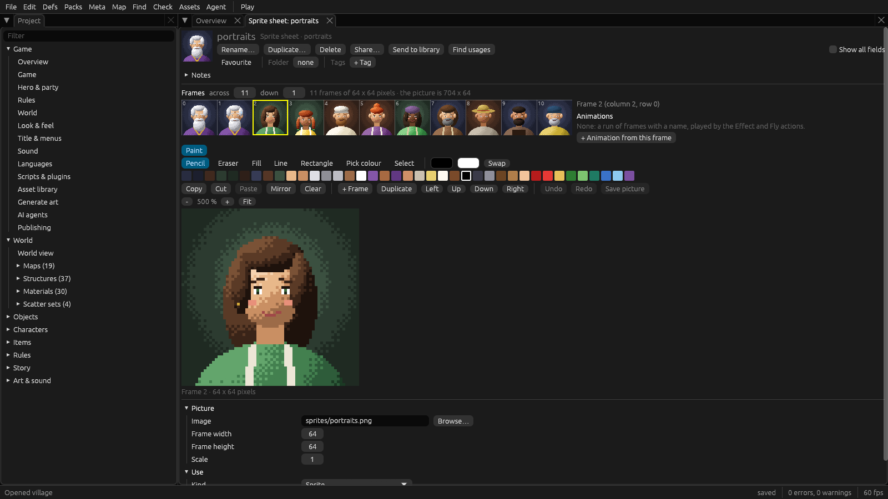

# 10. Art and sound

## Sizes and layouts

- **Tiles** are always 32 × 32 pixels: the grid of collision, zones and positions. The game shows
  them isometrically, as 64 × 32 diamonds seen from the south-east and 30° from above: the
  ground's materials and flat props (rugs, mats, the black filler around rooms) lie on the
  diamonds, everything else (characters, props, trees) stands upright where its feet are, at
  √2 × its pixel size. A prop's *Hitbox* is also its footprint: props wider than a tile (houses,
  counters, beds) are drawn in front of or behind characters by that box.
- **Material textures** are seamless pictures up to 256 × 256 pixels in steps of 8, repeated over
  the painted ground (draw them with *New asset… › Ground material* in the pixel editor).
- **Characters** are 3D models, not sprite sheets ([Characters](06-characters.md#how-characters-look)).
- **Item icons** are 32 × 32. **Props** use one frame, or a block of several frames for big props.
- **Portraits** can be any size (64 × 64 works well).
- Keep images at most 2048 pixels wide and high; the editor shrinks bigger ones for display.

### High-resolution sprites

A sprite sheet can carry more detail than its place in the world: its **Scale** (*Database ›
Sprite sheets*) says how many image pixels make one world pixel. At **2×** a character frame is
drawn 64 × 64 pixels in the image and fills the same 32 × 32 place as a 1× sprite, with twice
the detail; item icons are 64 × 64, and so on (3× and 4× work the same way). Positions, hitboxes
and tiles stay in world pixels, and material textures are always 1×.

The game draws the world magnified (the project's *Scale* times the player's *Zoom*), so a 2× sheet
shows all its detail at a magnification of 2 or more; at less it is sampled down. The frame size
on the form is in image pixels; the form shows the size in the world below it. The pixel editor
works on the image's own pixels, and the sheet and frame pickers show 2× frames at the same size
as 1× ones.

Positions of entities are their **feet** (bottom centre), which is how characters stand on tiles
and sort in front of and behind each other.

## The pixel editor

The **Pixel editor** tab, *Edit pixels* on a sprite sheet or material, and *Edit art* in the item,
prop and character forms open it.

| Tool | Key |
|---|---|
| **Select frame** (the default; clicks only select the frame under the cursor) | S |
| Pencil, eraser, fill, line, rectangle, colour picker | B, E, G, L, R, I |

- The left and right mouse buttons draw with two colours (X swaps them). The palette shows a default
  set and the colours used in the image.
- Mouse wheel zooms, middle-drag pans; the pixel grid and the frame grid can be shown.
- **Frames**: click one to select it, **Ctrl+C** copies it, **Ctrl+X** cuts it (copies and clears),
  **Ctrl+V** replaces the selected frame with the copy. Buttons do the same, plus *Paste mirrored*,
  *Flip* and *Clear*. **+ Frame** adds an empty frame after the last and **Duplicate** a copy of
  the frame being painted, which is painted in next (a sheet of one row grows to the right, one of
  several rows by a row); each is a step of the picture's undo, and the sheet shows the new frames
  once the picture is saved.
- A live preview shows the selected frame and its row as an animation.
- A **material's texture** opens as one seamless picture (and with the pencil): copies are shown
  around it and drawing wraps across its edges; *Size* resizes it in steps of 8 px. An animated
  one holds its frames side by side: the canvas shows the selected frame (pick it in the frame
  strip; Copy / Paste, a tiled preview of them playing), and each frame wraps on its own. The material
  form has it under its settings, beside a live preview of the material on a map
  ([Database › Materials](05-database.md#materials)).

Characters are 3D models, so the sprite editor has no four-facing character layout any more. AI
agents (`edit_frames`) and editor scripts (`pxdup`, `pxnudge`, `pxreplace`) still duplicate,
move and recolour frames.

Every operation is one undo step.
- **Ctrl+S** saves the PNG and updates it everywhere; Ctrl+Z / Ctrl+Y undo and redo.

## New assets

**New asset…** (*Assets* menu, the Database, or the Asset Library window) is a wizard for a **prop**
(size in tiles), an **item**, a **ground material** (its texture), a **sprite sheet** or a **structure**. Draw a new image,
start from a copy of an existing one, or reuse a frame of an existing sheet. New images open in the
pixel editor, and the definitions get sensible hitboxes and speeds. Characters are made with **New
character…**: from an existing 3D model, an imported one or AI generation ([Characters › New
characters](06-characters.md#new-characters)).

In the forms, **+ New blank icon** (items) and **+ New blank frame for this state** (props) find an
empty frame on the sheet, or add a row when it's full, and open it for drawing.

## Generate art with Meshy

*Assets › Generate art…* draws new art with your own [Meshy](https://www.meshy.ai) account. Enter
your API key once in *Edit › Settings… › Meshy* (it is kept for your user only, apart from
projects, and never shown to AI agents); *Test key* shows your credits. The settings also pick
the model (the cheapest, *Nano Banana 2 Lite*, costs 3 credits a picture), a **budget per
session** (Generate art stops when the session has spent it) and *Ask before spending*.

In the window, choose what to make, give it an id and describe it. The first row makes **3D art**
(characters are 3D models; see [Characters › How characters look](06-characters.md#how-characters-look)):

- **Item icon**: 32 × 32, in the style of your *items* sheet's icons.
- **Portrait**: head and shoulders for dialogs, 128 × 128 at 2×; *For character* makes it that
  character's dialog portrait when added.
- **Painted image**: a picture for *Show image* (up to 1024 pixels).

The second row makes pictures: the item icons, portraits and painted images above.

The 3D kinds:

- **3D character**: a person, modelled, rigged and animated. Meshy first draws a turnaround picture
  (front, side and back in an A-pose with empty hands, no weapons; 3 credits), or, with **From
  figure** set to a sheet in the four-facing layout (an old figure), uses its standing frames
  instead. Then it builds a 3D model from the
  three views (30), gives it a skeleton (5) and animations from its library (3 each): walking,
  standing, the chosen attack (sword slash, overhead blow, spear thrust, bow shot, club smash,
  spell cast), a hit reaction and sitting on a chair (*a woman* picks the women's sitting clip).
  **Extra animations** add clips for work (3 credits each): *craft* (hammering at an anvil),
  *farm* (bending to pick crops), *chop* and *sleep*; fishing, sweeping and reading have no clip in
  Meshy's library and play idle with the tool in hand. About 50 credits; each step takes one to three minutes. *Add to project* writes `models/<id>.glb`
  and `models/<id>_clips.glb`, adds the 3D model with its clips mapped to the animations and a
  character using it. Pick its colour features in *Database › 3D models* afterwards.
- **3D creature**: an animal or monster: a picture and an unrigged model of it (33 credits), or
  from a figure's three views (*From figure*, 30). Meshy rigs only people, so it is added as a 3D
  model without a character; a rig template animates it.
- **Item 3D model**: the **Id** is an existing item. With a **description** Meshy first draws a
  clean picture of it (the icon as the reference: same colours and parts, in proper proportions;
  long things upright, handle at the bottom) and models that (33 credits); without one it models
  the icon itself (30 credits; a 32 px icon gives a bulky model). *Add to project* gives the item the model,
  held as its kind says (hold style, length, hold point estimated): check it in the preview of the
  item's *3D model* section.
- **Prop / building 3D model** (since 0.35): the **Id** is an existing prop (make it first: its
  hitbox's width is the model's). Meshy draws a concept from the prop's picture (and the
  **description**, if any: needed when the prop has no picture) the way the library's props were
  made, then models it (34 credits). *Add to project* stands the model on the ground in the middle of
  its footprint, writes `models/<prop>_3d.glb`, adds the 3D model as wide as the hitbox (the hitbox
  grows as deep as the model, so collision and the drawing order fit), gives the prop the model and
  renders its pictures from it. Placed copies turn with **R** and cast a shadow.
- **3D model clips**: more animations for a rigged 3D model of the project (the **Id**; no
  description): tick the **weapon animations** (`attack_1h` … `block_weapon`, mapped to those names
  with their hit points) or `sneak`, `craft`, `farm`, `chop`, `sleep`. Meshy rigs the model's file
  again (5 credits: its old rig expires after three days) and makes the clips (3 each); *Add to
  project* writes `models/<id>_clips.glb` as one of the model's *shared clips*, fitted to its own
  skeleton when it loads. Other models can then share them (*Copy clips*, [Characters › Weapon
  animations](06-characters.md#weapon-animations)).

*Draw* shows the cost first; a picture then takes about a minute, a 3D step one to three. The result
is previewed; **Redo …** draws a picture again if Meshy got something wrong (a missing staff, a wrong
colour; in 3D jobs it makes that step again with the steps after it, e.g. a new rig needs new
clips), and **Add to project** writes the image and its sprite sheet, plus an item (icons) or a prop
(props) with that id when there is none yet; 3D jobs write their model files (made smaller: textures
as the game uses them, clip files without the mesh). **Edit in sprite editor** then
opens the new sheet to touch it up. The status bar tells when a
job is ready and what it cost. Agents can do all of this from a chat ([AI agents](13-ai-agents.md#drawing-art)).

The rig templates are made by `scripts/art/rigs/templates.py` (Blender). The scripts the 2D art of
earlier versions was drawn with are in `scripts/art/meshy/`.

## Importing

*File › Import…* brings existing art in without redrawing it. A report says what was imported and
what was left out; nothing existing is overwritten (files and ids get a free name).

**Tiled maps** (`.tmx` / `.tmj`, orthogonal, not infinite; embedded or external tilesets; CSV,
base64 or compressed tile data):

- every tileset is repacked into plain 32 px tiles (other sizes are scaled) under `tilesets/`, and
  the tiles are converted like an old project's ([Maps › Maps from older versions](03-maps.md#maps-from-older-versions)):
  the first tile layer becomes painted ground (a material per kind of tile; Wang sets tell which
  tiles are a terrain's edges: *mixed* sets like 47-tile terrains, *edge* sets like 16-tile ones),
  the other layers decorations of props made for the tiles (names containing "over" or "above", or
  a boolean property `above`, draw above characters); tiles with a `solid` property block, tile
  animations become animated props; a layer named `collision` marks solid cells;
- rectangles of object layers become trigger zones named like the object, and points named
  `spawn:NAME` spawn points.

Flips, rotations, image layers and tile objects are dropped and counted.

**Aseprite sprite sheets** (the JSON of *File › Export Sprite Sheet*, next to its PNG): the frames
are packed into a grid and the tags become the sheet's **animations**, which the *Effect*
and *Fly* actions offer and scripts play with `effect(sheet, x, y, #{ tag: "explode" })`.

For Aseprite imports the dialog also asks for the **Scale** of the new sheet (2× for art
drawn at twice the resolution; see [High-resolution sprites](#high-resolution-sprites)).

## Sounds and music

*Database › Sounds* lists the sound files with a volume and *Play* / *Stop* buttons; *Browse…* copies
a file into `sounds/`.

- **Formats**: WAV and **Ogg Vorbis** (`.ogg`; keeps music small). Opus, FLAC and MP3 aren't
  supported; a file in another format is reported by name when the project loads.
- Sounds are mixed at **44.1 kHz**, so that rate plays best.
- **Music loops without a gap.** Each map can have its music (map settings), and the *Play music*
  action switches it. The engine prepares music so the loop point is seamless; a track whose length
  is a multiple of 4096 samples at 44.1 kHz plays exactly as it is.
- **Game sounds** (*Database › Project*) are the sounds the game plays by itself: pickups, attacks,
  hits, dialogs, doors, and the **battle music** while enemies engage the player (crossfaded in and
  out over 0.8 s; a map may choose another or none). The rain has its own built-in sound. Two of
  them are **music effects** (fanfares): *Level up* plays when the player reaches a new level,
  *Victory* when a fight ends in which the player defeated enemies (left empty, there is none).
  The music ducks under a music effect and comes back after it. The example has both fanfares
  (`fanfare_level_up`, `fanfare_victory`, also in the starter library); it plays the level-up one
  by itself and the victory one when Grumbold the cave troll falls, not after every rat.
- **Sound control in events**: *Play sound* has a **volume** (times the sound's own), a
  **pitch** (1 = as it is, 2 = an octave higher and faster, 0.5 = an octave lower) and a **pan**
  (-1 left, 1 right); a pitched or panned sound is made once and kept (the web game plays it as
  it is). *Play music* has a **crossfade** time: the old track fades out while the new one fades
  in. *Play music effect* plays a fanfare once while the music ducks.
- **The music of the starter library**, eight looping tracks composed in a note notation and
  rendered by a small synthesizer (`scripts/sounds/music/`: `cargo run --release -- OUT_DIR [ID…]`
  in that folder):

  | Sound | Title | For |
  |---|---|---|
  | `music_village` | *Market Day* | a town by day |
  | `music_night` | *Lanterns at Night* | a town at night |
  | `music_tavern` | *The Copper Kettle* | inns and taverns |
  | `music_forest` | *Whisperwood* | forests |
  | `music_travel` | *The Open Road* | the road, the wilds |
  | `music_dungeon` | *The Old Mine* | mines, caves, dungeons |
  | `music_battle` | *Steel in the Woods* | fights |
  | `music_boss` | *Grumbold's Wrath* | a boss fight |

  The fanfares `fanfare_level_up` and `fanfare_victory` go with them. **In the example** the village
  plays *Lanterns at Night* from nine in the evening to half past five (the common event *Night
  music*, parallel while `calendar_on`, runs `town_music()`), the mine and the Deep Caves play *The
  Old Mine* (the mine without battle music: its fights stay in the dark, except Grumbold's, whose
  *Combat start* trigger plays *Grumbold's Wrath* and whose defeat brings *The Old Mine* back), and
  the Wilds *The Open Road*.
- **Effects of the starter library**: menu and window sounds (`ui_move`, `ui_confirm`, `ui_back`,
  `ui_error`, `coin`, `page`, `quest_done`: the example's *Quest reward* common event plays
  `quest_done`) and spell sounds by kind of magic (`magic_frost`, `magic_thunder`, `magic_heal`,
  `magic_dark`, `magic_force`, `magic_charm`, `magic_acid`, `magic_ward`, `magic_summon`, beside
  `fireball` and `explosion`): every spell of the library has the one that fits its damage, its
  healing or its school (*Database › Spells › Sound*). They are made by
  `scripts/sounds/make_sounds.py` (`python3 make_sounds.py OUT_DIR [NAME…]`).
- **Licences:** `sounds/CREDITS.txt` in the starter library and the example lists every sound and
  where it comes from: all were made for R(ust)PG2D and come under its MIT License.
- Players set the volume of music, effects and ambience in *Options*.
- **Captions**: a sound's *Caption* (Database › Sounds) is written on screen when it plays for
  players who turned on *Captions* (Options › Accessibility), with the side it came from for sounds
  of characters and props in the world (hits, swings, doors, locks, gathering, a *Play sound* action
  of a character or prop); a new music track shows *Music: <its caption>*. The example's and the
  starter library's sounds have captions (*Door opens*, *Dog barks*, *Market Day*…); footsteps, the
  pickup and the dialog blip have none.

## Soundscapes and footsteps

How a place sounds comes from two things, both without events or scripts:

- **Ambience zones** (*Map › Zone › Ambience*, [Objects and zones](04-objects-and-zones.md)): a
  looping sound, full inside the zone and fading out around it. A zone over the whole map gives
  it a constant background (birds outdoors, a tavern's murmur indoors); a narrow zone with a few
  tiles of fade follows a river. Loops play without a gap, like music.
- **Footsteps**: a material's **Footsteps** sound (*Database › Materials*) plays on its painted
  ground. A step falls where a foot lands in the walk animation (two per walk
  cycle, quicker when running); characters within six tiles step too, quieter the farther away
  they are, and every step's loudness varies a little.

The starter library has ambience loops (`amb_birds`, `amb_river`, `amb_tavern`, `amb_wind`,
`amb_drips`) and footsteps (`step_grass`, `step_dirt`, `step_stone`, `step_wood`, `step_snow`,
`step_sand`, `step_gravel`, `step_water`, `step_mud`, `step_ice`), already set on the starter
materials (sand, gravel paths and rubble, puddles and shallow water, mud, frozen lakes too). In the example, birds sing
over the village, the forest and the Wilds, the stream rushes along its banks, the wind blows in the
Wilds, water drips in the mine and the tavern murmurs.

## Emotion icons

Emotions are animations of a sprite sheet of the kind **Emotions** (*Database › Sprite sheets ›
Kind*). The starter library's `emotions` sheet has 32 × 32 frames, three per emotion in one row
(a speech bubble with a symbol), and an animation per emotion under *Animations* (name, first and
last frame, speed). To add your own, draw frames on that sheet or on a new *Emotions* sheet and add
an animation named after the emotion: *Show emotion* and `emote()` find it by that name.

## Parallax images

Sky, abyss, mist and cloud-shadow layers are sprite sheets drawn whole, set in a map's settings
([Maps › Parallax layers](03-maps.md#parallax-layers)). Images that tile seamlessly look best.
