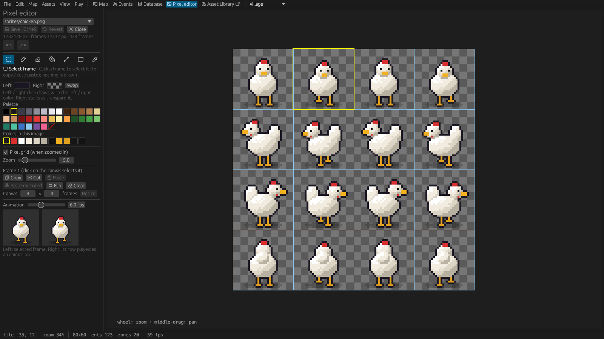

# 10. Art and sound

## Sizes and layouts

- **Tiles** are always 32 × 32 pixels. Tilesets are images of tiles in a grid.
- **Characters** are 3D models, not sprite sheets ([Characters](06-characters.md#how-characters-look)).
- **Item icons** are 32 × 32. **Props** use one frame, or a block of several frames for big props.
- **Portraits** can be any size (64 × 64 works well).
- Keep images at most 2048 pixels wide and high; the editor shrinks bigger ones for display.

### High-resolution sprites

A sprite sheet can carry more detail than its place in the world: its **Scale** (*Database ›
Sprite sheets*) says how many image pixels make one world pixel. At **2×** a character frame is
drawn 64 × 64 pixels in the image and fills the same 32 × 32 place as a 1× sprite, with twice
the detail; item icons are 64 × 64, and so on (3× and 4× work the same way). Positions, hitboxes
and tiles stay in world pixels, and tilesets are always 1×.

The game draws the world magnified (the project's *Scale* times the player's *Zoom*), so a 2× sheet
shows all its detail at a magnification of 2 or more; at less it is sampled down. The frame size
on the form is in image pixels; the form shows the size in the world below it. The pixel editor
works on the image's own pixels, and the sheet and frame pickers show 2× frames at the same size
as 1× ones.

Positions of entities are their **feet** (bottom centre), which is how characters stand on tiles
and sort in front of and behind each other.

## The pixel editor

The **Pixel editor** tab, *Edit pixels* on a sprite sheet or tileset, and *Edit art* in the item,
prop and character forms open it.

| Tool | Key |
|---|---|
| **Select frame** (the default; clicks only select the frame under the cursor) | S |
| Pencil, eraser, fill, line, rectangle, colour picker | B, E, G, L, R, I |

- The left and right mouse buttons draw with two colours (X swaps them). The palette shows a default
  set and the colours used in the image.
- Mouse wheel zooms, middle-drag pans; the pixel grid and the frame grid can be shown.
- **Frames**: click one to select it, **Ctrl+C** copies it, **Ctrl+X** cuts it (copies and clears),
  **Ctrl+V** replaces the selected frame with the copy. Buttons do the same, plus *Paste mirrored*,
  *Flip* and *Clear*. *Canvas … Resize* adds frames.
- A live preview shows the selected frame and its row as an animation.

**Four-facing sheets**: with **Four-facing rows** on, the rows are labelled (blocks of walk, idle,
attack and hurt, each facing down, left, right and up: 4 columns, 16 rows) and an **animation
panel** replaces the row preview:

- pick the **animation** (*Walk* 4 frames, *Idle* 2, *Attack* 4, *Hurt* 1) and the **facing**; it
  plays at the chosen speed, *Pause* / *Next frame* step through it, and the **frame strip** below
  selects a frame of it;
- **Onion skin** shows the animation's previous frame (red) and, with *and the next*, the next
  frame (green) faintly over the selected one, to draw the next pose in line;
- **Duplicate →** copies the frame into the next column; the arrows (or **Shift+arrow keys**) move
  the frame's pixels by one, e.g. to line up the feet;
- **Copy row** / **Paste row** / **Clear row** work on the selected frame's row;
- **Mirror Left → Right** makes the animation's Right row the mirrored Left row (*all animations*
  for every animation);
- **Fill idle & hurt** gives empty idle and hurt frames the standing walk frame of their facing;
- **Replace colour** turns the right colour (pick it with the picker's right click) into the left
  colour in the frame, its row or the sheet.

Every operation is one undo step.
- **Ctrl+S** saves the PNG and updates it everywhere; Ctrl+Z / Ctrl+Y undo and redo.

## New assets

**New asset…** (*Assets* menu, the Database, or the Asset Library window) is a wizard for a **prop**
(size in tiles), an **item**, a **tileset**, a **sprite sheet** or a **structure**. Draw a new image,
start from a copy of an existing one, or reuse a frame of an existing sheet. New images open in the
pixel editor, and the definitions get sensible hitboxes and speeds. Characters are made with **New
character…**: from an existing 3D model, an imported one or AI generation ([Characters › New
characters](06-characters.md#new-characters)).

In the forms, **+ New blank icon** (items) and **+ New blank frame for this state** (props) find an
empty frame on the sheet, or add a row when it's full, and open it for drawing.

## Generate art with Meshy

*Assets › Generate art…* draws new art with your own [Meshy](https://www.meshy.ai) account. Enter
your API key once in *Edit › Settings… › Meshy* (it is kept for your user only, apart from
projects, and never shown to AI agents); *Test key* shows your credits. The settings also pick
the model (the cheapest, *Nano Banana 2 Lite*, costs 3 credits a picture), a **budget per
session** (Generate art stops when the session has spent it) and *Ask before spending*.

In the window, choose what to make, give it an id and describe it. The first row makes **3D art**
(characters are 3D models; see [Characters › How characters look](06-characters.md#how-characters-look)):

- **Item icon**: 32 × 32, in the style of your *items* sheet's icons.
- **Prop**: 1 to 4 tiles wide and high, standing on its bottom edge.
- **Portrait**: head and shoulders for dialogs, 128 × 128 at 2×; *For character* makes it that
  character's dialog portrait when added.
- **Painted image**: a picture for *Show image* (up to 1024 pixels).

The second row makes pictures: the item icons, props, portraits and painted images above.

The 3D kinds:

- **3D character**: a person, modelled, rigged and animated. Meshy first draws a turnaround picture
  (front, side and back in an A-pose with empty hands, no weapons; 3 credits), or, with **From
  figure** set to a sheet in the four-facing layout (an old figure), uses its standing frames
  instead. Then it builds a 3D model from the
  three views (30), gives it a skeleton (5) and animations from its library (3 each): walking,
  standing, the chosen attack (sword slash, overhead blow, spear thrust, bow shot, club smash,
  spell cast), a hit reaction and sitting on a chair (*a woman* picks the women's sitting clip).
  **Extra animations** add clips for work (3 credits each): *craft* (hammering at an anvil),
  *farm* (bending to pick crops), *chop* and *sleep*; fishing, sweeping and reading have no clip in
  Meshy's library and play idle with the tool in hand. About 50 credits; each step takes one to three minutes. *Add to project* writes `models/<id>.glb`
  and `models/<id>_clips.glb`, adds the 3D model with its clips mapped to the animations and a
  character using it. Pick its colour features in *Database › 3D models* afterwards.
- **3D creature**: an animal or monster: a picture and an unrigged model of it (33 credits), or
  from a figure's three views (*From figure*, 30). Meshy rigs only people, so it is added as a 3D
  model without a character; a rig template animates it.
- **Item 3D model**: the **Id** is an existing item; Meshy models it from the item's icon (the
  description, if any, guides the colours; 30 credits). *Add to project* gives the item the model,
  held as its kind says (hold style, length, hold point estimated): check it in the preview of the
  item's *3D model* section.

*Draw* shows the cost first; a picture then takes about a minute, a 3D step one to three. The result
is previewed; **Redo …** draws a picture again if Meshy got something wrong (a missing staff, a wrong
colour; in 3D jobs it makes that step again with the steps after it, e.g. a new rig needs new
clips), and **Add to project** writes the image and its sprite sheet, plus an item (icons) or a prop
(props) with that id when there is none yet; 3D jobs write their model files (made smaller: textures
as the game uses them, clip files without the mesh). **Edit in sprite editor** then
opens the new sheet to touch it up. The status bar tells when a
job is ready and what it cost. Agents can do all of this from a chat ([AI agents](13-ai-agents.md#drawing-art)).

The rig templates are made by `scripts/art/rigs/templates.py` (Blender). The scripts the 2D art of
earlier versions was drawn with are in `scripts/art/meshy/`.

## Importing

*File › Import…* brings existing art in without redrawing it. A report says what was imported and
what was left out; nothing existing is overwritten (files and ids get a free name).

**Tiled maps** (`.tmx` / `.tmj`, orthogonal, not infinite; embedded or external tilesets; CSV,
base64 or compressed tile data):

- every tileset becomes a tileset of the project, repacked into plain 32 px tiles (other sizes are
  scaled); tiles with a `solid` property block, tile animations become animated tiles, and Wang sets
  become terrains;
- tile layers become layers (names containing "over" or "above", or a boolean property `above`, draw
  above characters); a layer named `collision` marks solid cells;
- rectangles of object layers become trigger zones named like the object, and points named
  `spawn:NAME` spawn points.

Flips, rotations, image layers and tile objects are dropped and counted.

**Aseprite sprite sheets** (the JSON of *File › Export Sprite Sheet*, next to its PNG): the frames
are packed into a grid and the tags become the sheet's **animations**, which the *Effect*
and *Fly* actions offer and scripts play with `effect(sheet, x, y, #{ tag: "explode" })`.

For Aseprite imports the dialog also asks for the **Scale** of the new sheet (2× for art
drawn at twice the resolution; see [High-resolution sprites](#high-resolution-sprites)).

## Sounds and music

*Database › Sounds* lists the sound files with a volume and *Play* / *Stop* buttons; *Browse…* copies
a file into `sounds/`.

- **Formats**: WAV and **Ogg Vorbis** (`.ogg`; keeps music small). Opus, FLAC and MP3 aren't
  supported; a file in another format is reported by name when the project loads.
- Sounds are mixed at **44.1 kHz**, so that rate plays best.
- **Music loops without a gap.** Each map can have its music (map settings), and the *Play music*
  action switches it. The engine prepares music so the loop point is seamless; a track whose length
  is a multiple of 4096 samples at 44.1 kHz plays exactly as it is.
- **Game sounds** (*Database › Project*) are the sounds the game plays by itself: pickups, attacks,
  hits, dialogs, doors. The rain has its own built-in sound.
- Players set the volume of music, effects and ambience in *Options*.

## Emotion icons

Emotions are animations of a sprite sheet of the kind **Emotions** (*Database › Sprite sheets ›
Kind*). The starter library's `emotions` sheet has 32 × 32 frames, three per emotion in one row
(a speech bubble with a symbol), and an animation per emotion under *Animations* (name, first and
last frame, speed). To add your own, draw frames on that sheet or on a new *Emotions* sheet and add
an animation named after the emotion: *Show emotion* and `emote()` find it by that name.

## Parallax images

Sky, abyss, mist and cloud-shadow layers are sprite sheets drawn whole, set in a map's settings
([Maps › Parallax layers](03-maps.md#parallax-layers)). Images that tile seamlessly look best.
