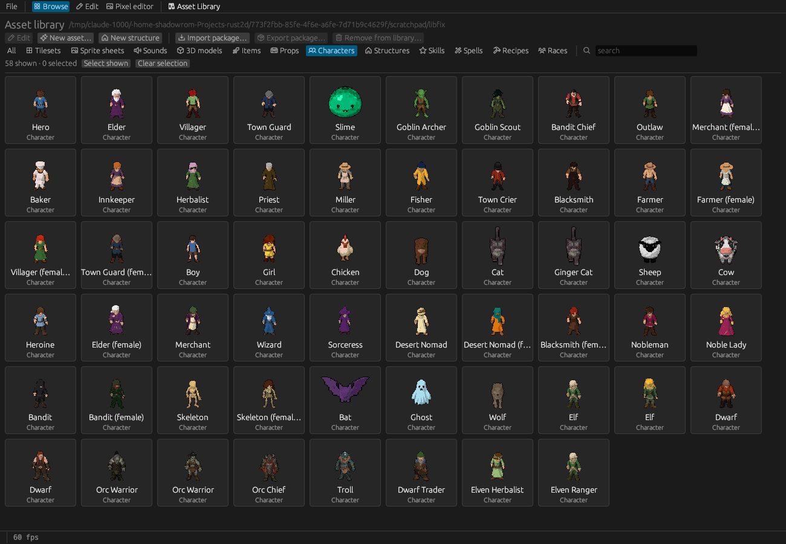

# 11. The asset library

The **asset library** is your own collection of tilesets, sprite sheets, sounds, items, props,
characters, structures, skills, spells and recipes, shared by all your projects. Build something
once, use it in every game.

## What's in it

The first time the editor opens the library, it fills it with the **starter set**: all of the example
game's art (the village's buildings and some 60 props, its villagers, children and animals in both
sexes, outfits, goods, recipes, sounds and music, 17 structures) plus **desert, mountain, city and
dungeon tilesets** (with animated water, waterfalls and lava), more characters (hero, elder, wizard
and sorceress, nomads, nobles, bandits, skeletons, a bat and a ghost, every humanoid in a male and a
female version) and more structures (town houses, city walls, dungeon rooms). The starter library
also includes the scripted Fireball spell and Scavenging skill with their script functions.

When a newer editor brings more starter assets, the library adds the ones it doesn't have yet the
next time it's opened. Existing assets, including your edits, are never changed. To get the newest
version of something you never edited, back up and delete the library folder; the editor recreates
it from the starter set.

The library lives in `~/.local/share/rustpg2d/library` (Windows: `%LOCALAPPDATA%\rustpg2d\library`;
macOS: `~/Library/Application Support/rustpg2d`). `RUSTPG2D_LIBRARY` moves it.

## Taking assets into a project

**Add from library…** is everywhere you need it: in every Database asset tab, next to the map's
tileset palette, the structures palette and the entities palette, and in *Assets › Add from
library…* (all kinds). The dialog shows the library's assets as cards with thumbnails:

- Click cards to pick one or more (*Pick all shown*, search). Assets the project already has are
  marked *in project*, and a line lists what the picks bring along.
- **Add N to project** (or a double-click) copies them in, **with everything they need**: their
  sprite sheets, ammunition, keys, overlay sheets, sounds used by their triggers, and script
  functions.
- Assets already in the project with identical content are reused. An id or file name taken by
  something different gets a `_2` suffix, and all references follow.

## Putting assets into the library

In a project, the Database's **Add to library** sends the selected definition (with everything it
needs) to the library; **Export…** writes it into a package file instead. Library assets are always
used as last saved.

## The Asset Library window

The **Asset Library** tab (or *Assets › Asset Library window…*) opens the library in **its own
window**, a second editor working on the library. It has three views:

- **Browse**: every asset as a card (filter by kind, search, click to select). *Edit* or a
  double-click opens it in the Edit view; *New character…* and *New asset…* create assets in the
  library; *Import package…* adds a `.r2dpack`; *Export package…* writes the selection to share;
  *Remove from library…* asks first and refuses to remove things other library assets still use.
- **Edit**: the Database forms (Items, Props, Characters, Tilesets, Sprite sheets, Sounds,
  Structures) on the library's own definitions, with *Edit pixels*, *Rename…* and *Delete…*. Save
  with Ctrl+S.
- **Pixel editor**: draw and fix library images in place.

When the main editor puts something into the library while the window is open, the window reloads by
itself; if it has unsaved edits, a banner offers *Reload* or *Keep mine*.

## Packages

A **`.r2dpack`** file is a zip with a manifest and the files of some assets: the way to share assets
with other creators. *Export package…* (library) or *Export…* (Database) writes one; *Import
package…* (library) or *Assets › Import asset package into project…* reads one. Packages made for
16-pixel tiles are enlarged to 32 pixels on import.

## Scripted assets

Spells and skills with a *Script* effect, and items, props and characters whose triggers run scripts,
need their script functions. *Add to library* and *Export…* then open a **Script functions** dialog:

- the functions the assets need are ticked: the spell's function and everything it calls or passes on
  (`aim("…")`, `fly(…, "…")`, `then_call("…")`), each with what needs it; hovering shows the code;
- other functions of the project are unticked and only copied if you tick them;
- unticking a needed function shows a warning; a call to a function no script defines is listed in
  red;
- sprite sheets, sounds and items the functions use by id come along.

In the library the functions live in `scripts/library.rhai`. Adding such an asset to a project
appends its functions to the project's `scripts/library.rhai`; functions the project already has are
kept as they are. Keep a feature's functions self-contained (helpers they call, no flags of one
particular story) so they work in every game. Story logic, such as quest steps and dialogs, belongs on
placed characters, zones and map triggers, so the definitions themselves stay reusable.
