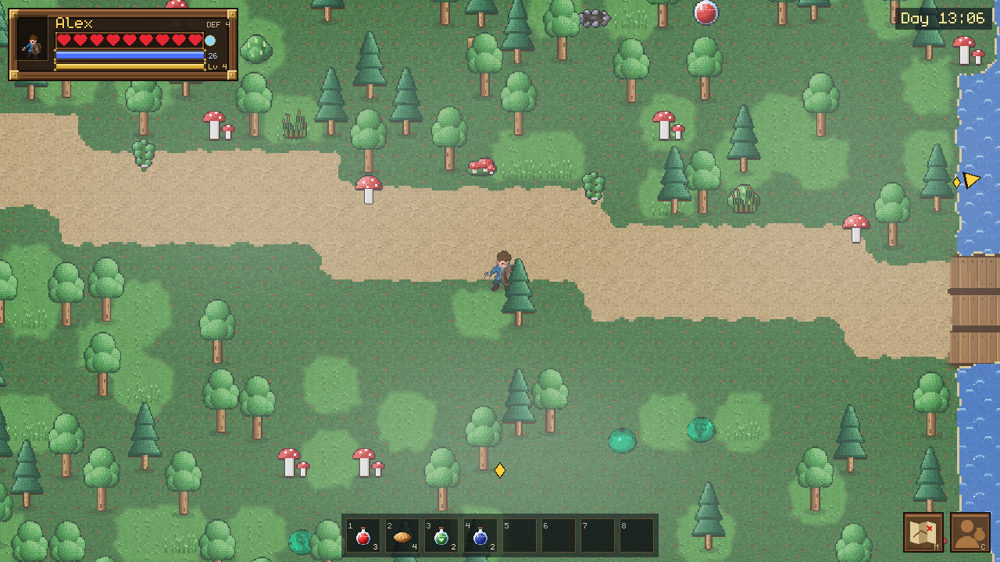

# 15. The player's guide

How a game made with R(ust)PG2D is played. Use it to write your game's own instructions, or point your
players here.

## Keyboard and mouse

These are the default keys; players change them in *Options › Gameplay › Controls*.

| Key | Action |
|---|---|
| Arrows / WASD (Shift = run) | Move |
| E / Enter | Interact, talk, advance a dialog |
| X | Attack: starts a fight with an enemy in sight; outside fights a swing at a tree or a vein |
| Left Ctrl / V | Sneak on / off (see below) |
| Q | Switch weapon (bare hands, then the weapons you own) |
| 1–8 | In a fight: the turn's actions on the bar |
| F (gamepad RB) | The action bar: Left / Right choose an entry, E opens it, Esc leaves |
| Space | End the turn (in a fight) |
| C / I | The character window: character sheet and inventory |
| K / L | The character window's *Sheet* tab (your character sheet: scores, saving throws, skills, armor class, hit points, conditions, languages, features and traits; R there: short rest) and *Spells* tab (your spellbook: slots, prepare with P, cast with Enter; for casters) |
| Tab | Next tab of the open window |
| J | Journal: *Quests*, *Bestiary*, *Dialogs*, *People* (the villagers you made friends with, in hearts), *Rolls* (your last checks and dice rolls) |
| M | The map screen |
| G | Companion orders (with companions along; also the action bar's *Party*) |
| H | Hide or show the interface |
| P | Photo mode (see below) |
| F5 / F9 | Quick save / quick load |
| Esc | Pause menu; closes windows |
| Left click | Walk to the tile, attack (start a fight with) the enemy under the cursor, advance a dialog |
| Right click | Walk to the character, item or prop under the cursor and interact with it |

Characters behind a counter (one solid tile between, in a straight line) are talked to across it,
with E or a right-click.

**Climbing, jumping and falling:** walk onto a ladder, rope or rough wall to climb it (up and
down only, slower); a rough wall needs an Athletics check, and when you find no hold, try again a
moment later. Walking into a pit or over a ledge is a fall (damage by its height, a moment prone).
Run at a narrow crack (Shift, or a few steps up to it) to jump it: you clear your Strength score
in feet, half from standing.

### In the windows

- **Character window**: arrows or a click select (on the character sheet the arrows move between
  the slots around the figure, right from the right column into the inventory); Enter, a
  double-click or a right-click uses or equips; drag items onto or off the equipment slots, or out of the window to
  drop them; G drops the selected stack (Shift+G one item). A **backpack** in the *Backpack* slot
  gives you more inventory slots; to take it off, first make room for what lies in its slots.
  The row of small slots under the figure takes **rings, an amulet, a cloak, a belt, boots and
  gloves or bracers**. The **Ammo** slot under the left hand holds a whole stack of ammunition:
  bows, crossbows, slings and blowguns shoot it first when it is their kind (+1 Arrows into it to
  shoot them); without it they take plain ammunition of their kind from the bag. **T** attunes you to the selected magic item (an hour passes; at most three,
  not in a fight) or ends it; attuned items show a gold dot. In a companion's window T attunes the
  companion to an item it wears.
  **Furniture** (in a home of yours) is placed in front of you when used; E at it later asks
  whether to use it or pick it up again.
- **Shop**: click *Buy* or *Sell* (or double-click a row, or Enter / E) to trade one, Shift for ten;
  Tab switches between the merchant's goods and your items. Prices read in coins (`1 gp 5 sp`) and
  are paid from your purse. **Money** isn't carried as coins in your bag: it is a value on the
  character sheet (*Money* on the Character and the Sheet tab), and coins you pick up or are given
  go straight into it. The shop's bottom right shows it too.
- **Loot window**: click a stack to take it (right-click: one), click your own to store it; T takes
  everything; Tab switches side.
- **Crafting window**: *Make* (or Enter / E) makes one, Shift up to ten.
- **Map screen**: arrows, dragging or the wheel scroll; + / − zoom; Space centres on you.
- **Journal**: Tab or Left / Right switch tabs; the *Dialogs* and *Rolls* tabs scroll with Up / Down,
  PgUp / PgDn, Home / End.
- **Level-up window** (opens by itself when a level brings choices or new features, for the hero and
  then each party member with a class, once no fight, dialog or cut-scene is going on): Up / Down
  select a row, Left / Right (or a click on a row's left or right half) change its choice, Enter /
  E goes to the next row and on *Done* confirms. The selected choice's rules text shows above the
  rows. An ability score improvement is two rows of +1 (the same ability twice = +2), or the feat
  *Grappler* in the first row.

## Checks and locks

Games made with R(ust)PG2D follow the SRD 5.1 rules: when something is uncertain (persuading a
merchant, reading old carvings, picking a lock), the game rolls a d20, adds your ability modifier
and, if you are proficient in the skill or tool, your proficiency bonus, and compares the total
with a difficulty (DC). A line at the top of the screen says how it went ("Persuasion: 14 vs DC 13
- success"), and the journal's *Rolls* tab keeps the last fifty. Your character sheet is the
*Sheet* tab (K): scores, saving throws and skills (a dot marks the ones you are proficient in),
armor class, hit points and hit dice, languages and proficiencies; Up / Down picks one of your
race's and background's features and traits and shows what it does.

Your **hit points** are the red bar at the top left (`34 / 44`). Every level adds a d10's worth plus
your Constitution modifier (6 + CON in most games).

**Conditions** show as badges under your hit points (`PSN 9` = poisoned for 9 more seconds,
`PRN` prone, `EXH2` exhaustion level 2) and on the sheet; characters carry theirs over their heads.
Poison and fear give disadvantage on your checks, prone makes you crawl, stunned and paralyzed hold
you still, blindness narrows what you see; a saving throw can keep one off when it shows up.

**Resting**: press R on the sheet (gamepad X) for a **short rest** when no enemy is near: spend hit
dice (each heals d10 + CON) and an hour passes. Sleeping in a bed is a **long rest**: full hit
points, half your hit dice back and one level of exhaustion less.

**The action bar** at the bottom of the screen is how you do things outside fights: **Use** (potions,
food, scrolls), **Cast** (your spells), **Class** (Second Wind, Lay on Hands…), **Search** (look around for hidden things: a Perception
roll), **Rest** (a short rest,
or **Make camp** for a night's rest anywhere: you need a **bedroll** and no enemies near), **Sneak**
and **Party** (your companions' orders). Click an entry, or press F (gamepad RB) and choose with the
arrows. In a fight the bar becomes the turn's actions.

**What you carry** weighs: the sheet shows *Carried* (`42 / 240 lb`; your capacity is STR × 15).
Above the capacity you drag the load at a crawl, above twice it you can't move at all: drop
something. Some games are stricter (a heavy load slows you down sooner and makes you clumsy) and
some need **food and water**: eat a day's food and drink a day's water every day (*Food / water today*
on the sheet), or you grow exhausted. A full waterskin is half a day of water; a well fills the empty
ones. Running fast makes you less watchful (passive Perception −5), and walking more than eight
hours between nights' sleep can tire you out.

**Seeing**: at night you notice less (Perception at disadvantage), and in a dark cave without a light
you see nothing at all: carry a torch. Elves and dwarves see in the dark. A companion who knows a
skill helps with your checks of it. One night's sleep a day refreshes you; a second right after
doesn't.

Crates, chests and doors can be **smashed**: Attack (X) next to one (a sturdy door shrugs off weak blows). A locked door or chest you can't pick can be **forced** with E (a Strength check). A **padlock** over a chest or door means it is locked. Without its key, press E to try to pick it
(a Dexterity check with Thieves' Tools): you need **thieves' tools** in your bag. If it holds, give
it ten minutes before you try again.

**Weapons and armor**: the item's line in the character window tells its dice and properties
(`1d8 (1d10) · Versatile`: more damage with the left hand free) or its armor class (`Heavy armor ·
AC 16 · STR 13`). Armor you aren't trained in makes you clumsy (disadvantage on Strength and
Dexterity rolls and attacks) and stops your spells; heavy armor without the Strength it needs
slows you. A caster needs a component pouch or a focus for spells with material components.

**Magic items**: the item's line tells its rarity, whether it needs attunement and its charges
(`Uncommon · 5/7 charges`). Worn magic items work while you wear them (and are attuned to them, when
they need it). Drink a potion with Use; use a wand outside a fight to cast its spell, or pick its
spell in the *Cast* window in a fight (it spends charges, not spell slots). Charges come back at
dawn.

## Fighting

A fight starts when an enemy notices you, or when you attack one (X, or a click on it). Everyone
near rolls **initiative**; the **turn order** bar at the top shows who acts when, with everyone's
hit points (green: your side, red: your enemies). Then everyone acts **in turns**, on the tiles of
the map (a tile is 5 feet).

**Your turn** (and each companion's, unless you handed it to the AI):

- **Move** up to your speed (30 ft = 6 tiles; the blue tiles show where you reach): move the
  **cursor** with the arrows (or point with the mouse) and press E / Enter (or click). The line
  shows the way. Walking away from an enemy next to you lets it strike at you (an **opportunity
  attack**), even a single step, unless you *Disengage* first; stepping around it (staying next to
  it) is safe. Tiles that would provoke it are tinted red, and so is the line.
- **Attack**: E / Enter (or a click) on an enemy attacks it, walking next to it first when it isn't
  in reach. The box at the cursor shows its hit points and armor class, your **chance to hit** and
  its **cover**.
- **The action bar** at the bottom: 1–8 or a click picks an action, Tab / Shift+Tab select one and
  X uses the selected one. One **action** a turn: *Attack* (with a spear, dagger or javelin it asks
  **Strike** or **Throw**; a thrown weapon lands next to the target and you fight bare-handed until
  you walk onto it again or draw another one: C opens the character window in a fight; one weapon
  change a turn is free, the next takes your action, a shield takes the action, armor can't be changed), *Cast* (a window lists the spells you can cast now,
  each slot level a row; ↑/↓ or the mouse choose, E / Enter takes it, Esc closes; the line above
  the bar then tells the slot, the area and the save; an area spell is drawn on the tiles under the
  cursor), *Class* (a window with your class's actions: *Rage*, *Second Wind*, *Action Surge*,
  *Flurry of Blows*, *Lay on Hands*…, those you can't use now greyed; E / Enter or a click then uses
  it on you or on whoever the cursor is on), *Dash* (move twice as far), *Disengage* (leave without opportunity attacks),
  *Dodge* (attacks against you get disadvantage until your next turn), *Help* (a companion's next
  attack against an enemy next to you gets advantage; on a fallen companion next to you it is first
  aid: your healer's kit or a Medicine check makes them stable), *Hide* (a Stealth check: hidden enemies can't
  find you to attack), *Ready* (a window: strike the first enemy that comes within reach, or hold a
  spell for the first enemy that comes within its range; the spell's slot is spent now), *Search* (find hidden
  enemies), *Grapple* and *Shove* (wrestle an enemy next to you, at most one size larger: grappled
  can't move and is dragged along when you walk, at half speed; *Grapple* on it again lets go;
  shoved is knocked down or pushed away). When a monster's bite or tentacle holds you, *Grapple* turns into
  **Escape** (Athletics or Acrobatics against its escape DC). Using an item from the inventory (a potion) takes the action too;
  you can give a potion to a companion right next to you (a fallen one gets back up). Items on
  the ground (loot, a thrown spear): right-click them, or E with the cursor on them, to pick them up
  (free; you walk up first when they lie farther away), or walk over them.
  One **bonus action**: *Off-hand* attacks with a weapon in your left hand after you attacked (and
  the class actions that are bonus actions). The
  line above the bar shows the movement left and whether the action, the bonus action and your
  **reaction** (an opportunity attack) are still free.
- **End the turn** with Space or *End turn* (gamepad: select it with RB / LB and press X). B or a
  right-click cancels an aimed action.

The **fight log** at the bottom left tells every roll (`Alex > Goblin: d20 (14) +5 = 19 vs AC 15:
hit`); the journal's *Rolls* tab keeps them. A natural 20 is a **critical hit** (the damage dice
twice).

**Companions handed to the AI** (orders menu, G: *AI fights*) fight on their own: they heal a
badly hurt friend, cast their spells, step away from enemies to shoot and attack. Enemies do the
same: casters cast, archers step back, goblins hide, and a bandit may shove you down for its friends.

**Seeing:** enemies you can't see (in darkness without darkvision, deep in fog, invisible) are
drawn faded with a "?" over them: your attacks at them have disadvantage, theirs at you advantage.
*Hide* needs a bush, dim light, darkness or good cover.

**Kill or knock out?** When your melee hit would drop an enemy to 0 hit points, a window asks:
*Kill*, or *Knock out* (it lies unconscious and stays alive; you still get its experience and
loot). ↑/↓ and E / Enter or a click choose; the window waits for your answer.

**At 0 hit points** you fall unconscious and roll a **death saving throw** at the start of each of
your turns: 10 or more is a success. Three successes and you are stable, three failures and you
die; a 20 gets you back up. A companion's healing gets you up too, first aid (*Help*) makes you
stable. A hit that leaves as much damage as your hit point maximum after you drop to 0 kills you at
once (massive damage). If nobody of your side is left
standing, the fight is lost. When the fight is won, those still down get up.

You can't save during a fight; the game autosaves when it is over.

**Sneak**: Left Ctrl or V (gamepad: left stick click) switches sneaking on and off; *Sneaking*
shows under your HP bar. You walk at half speed and quietly, and enemies notice you only within half
their sight, less still in the dark (at night, in dark places, away from torches and lamps; your own
lantern or light spell gives you away). One you bump into notices you anyway. Attack while
sneaking and your party rolls Stealth: enemies whose passive Perception is below every roll are
**surprised** and lose the first round of the fight. Monsters you can't see can surprise you too.

## Gamepad

Any controller the system knows works next to the keyboard and mouse (Xbox, PlayStation, Switch Pro,
generic ones); the left stick and the d-pad move and navigate. In the browser version too: there
the first button press makes the pad known to the page.

| Button (Xbox names) | Action |
|---|---|
| Left stick / d-pad | Move; navigate menus, windows, the map |
| A | Interact, talk, advance, choose, use, buy / sell |
| B | Close a window, go back |
| X | Attack (while aiming a spell: cast straight ahead); in a fight: use the selected action |
| Y | Character window |
| RB / LB | Next / previous tab of an open window; on the map: zoom; in a fight: select an action of the bar; while exploring LB opens companion orders |
| B (while playing) | Cancel aiming a spell or an action |
| LT (hold) | Run; buy / sell ten |
| RT | Switch weapon |
| Start | Pause menu |
| Select | Map |
| Right stick click | Journal |
| Left stick click | Sneak on / off (Hide interface has no button; H on the keyboard) |

Photo mode has no button of its own: choose *Photo mode* in the pause menu (Start).

**Hints follow your hands.** The help lines at the bottom of windows and menus (drawn a little
smaller, or in two lines, when a long translation doesn't fit the window) name the keys while
you play with the keyboard and mouse, and show your controller's buttons as soon as you press one
(and back when you press a key or click). The pictures match the controller: coloured A B X Y for
Xbox pads and the Steam Deck, ✕ ○ □ △ for PlayStation, the Nintendo letters for Switch pads. If the
game guesses wrong, choose it in *Options › Gameplay › Button style* (Auto, Xbox, PlayStation, Nintendo).

**Rebinding buttons.** In *Options › Gameplay › Controls* every action shows its button next to its keys. Select
an action, press A (Enter on the keyboard) and then the button you want for it; X clears the
action's button, *Reset to defaults* brings back all keys and buttons. B and Start keep the old
buttons; moving stays on the stick and the d-pad. A button that does something else in the same
place is named under the list (*R2 is also Switch weapon*).

## Menus

- **Character creator** (after *New game*, when the game has one): type a name, then Up / Down
  choose a row and Left / Right change it: race (its ability increases, speed and traits show
  under the picture), sex, body and colours (skin, hair, clothing…). Enter goes on to the second
  page: your ability scores (the standard array, point buy with 27 points, or 4d6 rolls; Left /
  Right swap or raise a score), what your race lets you choose (skills, a language, a dragon
  ancestor…) and your background. Enter starts the adventure, Esc goes back a page.
- **Title screen**: *New game*, *Continue* (the latest save), *Load game*, *Options*, *Achievements*
  (if the game has them), *Exit*. A game may order them differently, leave some out, add a
  *Credits* page (Up / Down or the wheel scroll it) and entries of its own.
- **Pause menu** (Esc): *Resume*, *Photo mode*, *Save game* (a new named save or overwrite one), *Load game* (every
  save with a small picture of the world, the map, the play time and its age; Del deletes), *Options*,
  *Save and quit*, *Quit* (after a confirmation); here too a game may change the entries.
- Closing the window while playing asks *Save and exit*, *Exit without saving* or *Cancel*.

## Options

The Options page has four tabs: Tab (or LB / RB on a gamepad) moves to the next one, a click picks
one. *Reset tab to defaults* at the bottom of each tab resets only that tab's options.

| Tab | Option | Choices |
|---|---|---|
| Graphics | Fullscreen | On / off |
| | Zoom | 75–250 % on top of the game's own pixel scale |
| | Shake & flash | The screen shake and red flash when hurt, shakes from explosions, and the short pause when a blow lands |
| | Show FPS | On / off |
| Sound | Master, Music, Effects, Ambience volume | In 10 % steps (ambience = the rain and the sounds of places: birds, rivers, a tavern's murmur) |
| Gameplay | Text speed | Slow, Normal, Fast, Instant |
| | Damage numbers | On / off: the numbers that rise from hits |
| | Quest markers | On / off: markers over quest targets, arrows at the screen's edge and pins on the map |
| | Language | The game's languages |
| | Button style | How gamepad buttons are shown: Auto, Xbox, PlayStation, Nintendo |
| | Controls… | Every action with its keys: Enter, then a key, adds one (up to three per action); Del clears; *Reset to defaults* |
| Accessibility | Text size, Captions, High contrast, Hold to repeat | **Text size** *Normal* / *Large* / *Larger* (125 %, 150 %: dialogs and choices, messages, speech bubbles, captions, the item details); **Captions** (what sounds and music are heard, written at the bottom left with `<` / `>` for the side a sound came from; at the top right while a window is open); **High contrast** (black panels with bright borders, plain white text, outlined damage numbers); **Hold to repeat** (holding Attack keeps attacking at the weapon's speed, holding E, or the right mouse button on a tree or a rock, keeps chopping or mining) |

Options are saved per game and kept between sessions and save games: in `~/.config/rustpg2d/<game>/settings.ron` on Linux, `%APPDATA%\rustpg2d\<game>` on Windows, `~/Library/Application Support/rustpg2d/<game>` on macOS, and in the browser for web games. Achievements are kept there too, not in save games.

## Photo mode

P, or *Photo mode* in the pause menu, stops the world (characters, weather, the clock) and hides
the interface; the camera is yours. A bar at the bottom names the controls (it isn't in the
pictures):

| Keys | Gamepad | |
|---|---|---|
| Arrows / WASD (Shift: faster), drag with the mouse | Left stick / d-pad | Move the camera over the map |
| Wheel, + / − | LB / RB | Zoom (0.5× to 3×) |
| [ / ] | LT / RT | Another hour's light (only for the pictures: the clock is back when you leave) |
| H | Y | Hide yourself |
| E / Enter / Space | A | Take a picture |
| Esc / P | B | Leave photo mode |

Pictures are PNG files at the window's size, named after the game and the moment
(`Emberbrook-2026-11-15_10-05-18.png`), in your Pictures folder: `~/Pictures/<game name>` on
Linux (or wherever `XDG_PICTURES_DIR` points, e.g. `~/Bilder`), `Pictures\<game name>` on Windows,
`~/Pictures/<game name>` on macOS; when that can't be written, a `photos` folder next to the save
games. The browser version offers each picture as a download.

## Where saves are kept

| System | Save games |
|---|---|
| Linux | `~/.local/share/<game-name>/saves` (Flatpak: `~/.var/app/<app id>/data/<game-name>/saves`) |
| Windows | `%APPDATA%\<game-name>\saves` |
| macOS | `~/Library/Application Support/<game-name>/saves` |
| Web | The browser's storage for the site |
