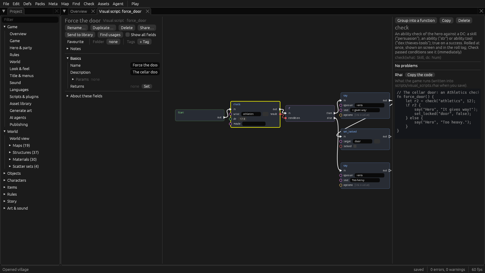

# 20. Visual scripts

A **visual script** is a script function built from nodes instead of typed. Each node does one
thing: give an item, check a skill, compare two numbers. You wire them together on a canvas, and
R(ust)PG2D writes the [Rhai](08-scripting.md) code for you. Everything a script can do, a visual
script can do, and the game runs both the same way. *Since 0.35.*



## A visual script's tab

Visual scripts are definitions (*Story › Visual scripts* in the Project browser; *New…* › Visual
script makes one with a *Start* node). A visual script's tab has:

- **At the top:** the canvas with the nodes. Drag the background to move around and use
  Ctrl+wheel to zoom. Beside it, what the selected node does (with *Group into a function*, *Copy*
  and *Delete* for what is selected), the script's **problems**, and the **Rhai** it turns into
  (*Copy the code* puts it on the clipboard).
- **Below:** its form: the **name** (what the editor shows), its **function name** (what triggers
  and scripts call: small letters, digits and `_`), a **description**, its **parameters** (values
  the caller passes in) and its **result** (what it gives back, if anything). *Duplicate…* and
  *Delete* are in its header, as for every definition (Ctrl+Z brings a deleted one back).

## Nodes and links

**Adding nodes.** Right-click the canvas, or press Space, to open the palette. Type to search, or
browse the groups: *Flow*, *Values*, *Maths and logic*, the other visual scripts, the project's
script functions, and every script function grouped like the [scripting
chapter](08-scripting.md#api-reference) (*Inventory*, *Player*, *Dialogs and flow*, *Quests*…).
Enter takes the first match.

**Pins.** A node's inputs are on its left, its outputs on its right.

- **Flow pins** (white triangles) say what happens next. *Start*'s flow output leads to the first
  step; each step's *out* leads to the next. A flow output leads to one node; several flows may
  lead into the same node.
- **Value pins** (circles) carry values, coloured by kind: **number** (green), **yes / no** (red),
  **text** (pink), **list** (blue), **options** (orange), **any** (grey). A value output can feed
  any number of inputs; an input takes one link.

**Linking.** Drag from a pin to a pin of another node. A link only connects pins that fit (a
yes / no can't go into a number). Dropping a link on empty space opens the palette with only the
nodes that can take it, and the new node is linked at once.

**Values typed in.** An input with nothing linked to it shows a field: a number, a tick box, or a
text. Inputs that name something (an item, a sound, a map, a quest, a character…) offer the
project's ids as you type, like the script editor does.

**Moving and deleting.** Drag a node by its title. Ctrl+click selects more nodes, and dragging one
of them moves them all. Delete removes the selected nodes and their links (*Start* stays).

**Copy and paste.** Ctrl+C copies the selected nodes with the links between them, Ctrl+V pastes
them at the mouse (also into another visual script), Ctrl+D duplicates them.

## Groups: new functions from nodes

When part of a visual script does one job (works out a reward, checks a few things), turn it into
a function of its own: select its nodes and press **Group into a function** (beside the canvas, or
Ctrl+G). The nodes move into a new visual script, and a single node calling it takes their place:

- values linked into the group from outside become its **parameters**: the call node gets an input
  for each, still linked as before;
- the flow that ran into the group starts it, and the flow that left it goes on after the call;
- one value used outside the group becomes its **result** (a *Return* gives it back).

A group has one flow in and one flow out, and at most one value going out; otherwise the editor
says why it can't group them. Rename the new script (*Name*, *Function*) and use it like any
other: it is in the palette under *Visual scripts*, in every script, triggers and hooks.
**Open** on a call node (or a double-click on its title) shows the visual script it calls.

## Kinds of nodes

- **Script functions.** A function that *does* something (`say`, `give_item`, `set_flag`) is a
  **step**: it has flow pins and runs where the flow reaches it. A function that only *tells*
  something (`has_item`, `flag`, `player_hp`, `quest_stage`) is a **value node** without flow
  pins: link its *result* where the value is needed. A few do both: `check` and `save` roll dice,
  `give_item` and `take_money` change the bag, `roll` and `random` give a new number each time.
  They are steps whose *result* can be used by the nodes after them.
- **Flow:** *If* runs *then* or *else* by a yes / no. *Sequence* runs its outputs one after the
  other. *Repeat* runs *body* a number of times (its *index* counts 0, 1, 2…), then *done*. *For
  each* runs *body* for every *item* of a list. *Return* ends the function, with its result when
  the script has one.
- **Values:** a fixed *number*, *text* or *yes / no*; *Join text* (two values into one text, such
  as "Potions: " and a count); *Set* and *Get local variable* (a value kept under a name while the
  function runs).
- **Maths and logic:** *Math* (+, -, *, /, remainder, smaller, larger), *Compare* (=, ≠, <, ≤, >,
  ≥), *And*, *Or*, *Not*.
- **Calls:** other visual scripts, and the functions of the project's text scripts (set how many
  values a text function takes on its node).
- **Comment:** a note on the canvas; it isn't part of the code.

## Using a visual script

A visual script is an ordinary script function. Call it by its function name wherever a function
is asked for: the *Run script* action of a trigger, a [script hook](08-scripting.md#script-hooks),
a menu entry, a spell's *Script* effect, a plugin, or another script.

Saving (Ctrl+S, or *File › Save all*) writes every visual script into
`scripts/visual_scripts.rhai`. The game only reads that file. Don't edit it, because it is written
again whenever the definitions are saved.

## Problems

A visual script that can't work is listed with its problems beside its canvas and in the
project check (Problems):

- a function that doesn't exist;
- a value of the wrong kind;
- a flow running in a circle (use *Repeat* or *For each* for loops);
- a step's *result* used where that step hasn't run yet, for example after the *If* it sits in.

Click a problem to go to its node. Until it is fixed the function is written as one that does
nothing and prints why in the game's log.

## Undo and text scripts

Ctrl+Z and Ctrl+Y undo and redo changes to visual scripts like any definition change.

**Convert to text script…** moves a visual script into a text script for good
(`scripts/<function name>.rhai`) and removes its nodes, for when you want to go on in code. Visual
scripts turn into code, never the other way round.

## In the example

Two of Emberbrook's functions are visual scripts (*Story › Visual scripts*): **Brother Ansel's blessing**
(`ansel_blessing`: once a day the priest heals a hurt hero with *Cure Wounds*) and **A giant rat
defeated** (`rat_defeated`: counts the rats, and for Tilda's quest once it was accepted). The
first shows *If* with *Return*, comparisons and a variable kept per day; the second a *Sequence*
running three steps, *And*, and a quest's stage.

## An example: a door that opens with a strength check

1. *New*, then name it *Force the door* with the function name `force_door`.
2. Add `check` (palette: *Rules (SRD 5.1)*), link *Start*'s *out* to its *in*, type `athletics`
   into *what* and 12 into *dc*.
3. Add *If*, link `check`'s *out* to its *in* and `check`'s *result* to its *condition*.
4. From *then*: `say` (speaker *Hero*, text *It gives way!*), then `set_locked` (target `door`,
   locked unticked). From *else*: `say` (*Too heavy.*).
5. Save. A trigger on the door with the action *Run script* `force_door` runs it.

The Rhai on the right shows what was made:

```rhai
fn force_door() {
    let r2 = check("athletics", 12);
    if r2 {
        say("Hero", "It gives way!");
        set_locked("door", false);
    } else {
        say("Hero", "Too heavy.");
    }
}
```
