<p align="center">
  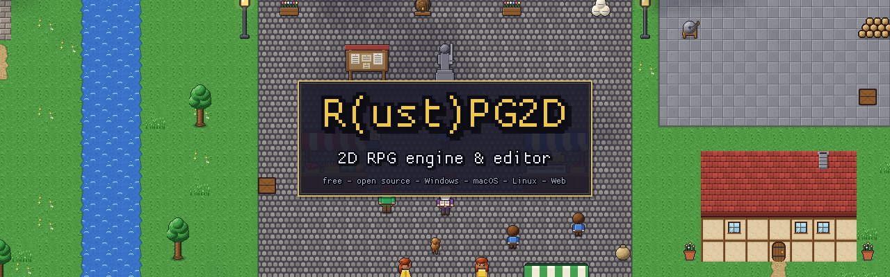
</p>

<p align="center">
  <a href="https://github.com/Shadowrom2020/rustpg2d/releases/latest"></a>
  <a href="https://github.com/Shadowrom2020/rustpg2d/actions/workflows/ci.yml"></a>
  <a href="LICENSE"></a>
</p>

# R(ust)PG2D

**Make the top-down RPG you always wanted to play.** R(ust)PG2D is a complete toolkit for classic
2D role-playing games: a map and content editor and a fast game engine written in Rust. Paint your
world, fill it with villagers, monsters and quests, and export a finished game for Windows, macOS,
Linux and the browser with one click. Free and open source under the MIT license; the games you
make are yours.

Current version: **0.18.2** — see the [CHANGELOG](CHANGELOG.md) for what changed, the
[ROADMAP](ROADMAP.md) for what's planned, and the **[Creator's Manual](Documentation/manual/README.md)**
for how to use it all.

<table>
  <tr>
    <td>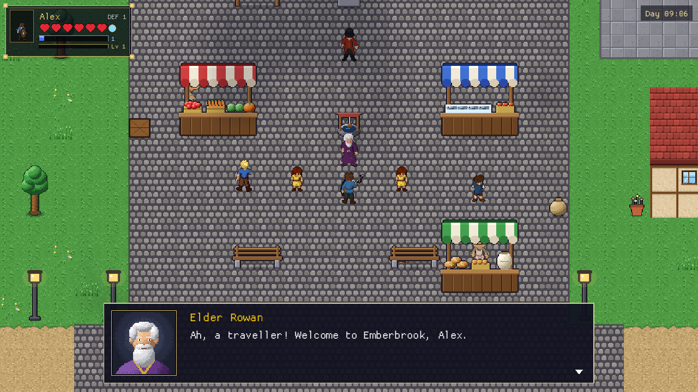</td>
    <td>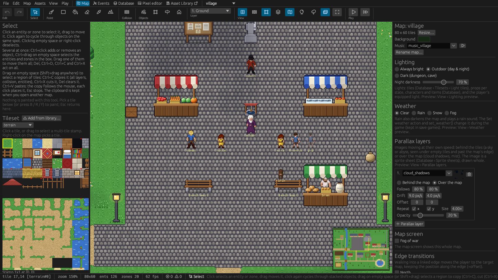</td>
  </tr>
  <tr>
    <td align="center"><em>A living village: about twenty villagers follow their own daily routines</em></td>
    <td align="center"><em>The editor: paint maps, place characters, set up the world</em></td>
  </tr>
  <tr>
    <td>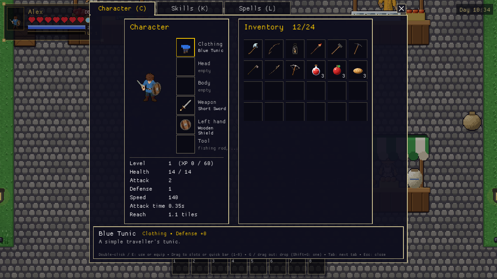</td>
    <td>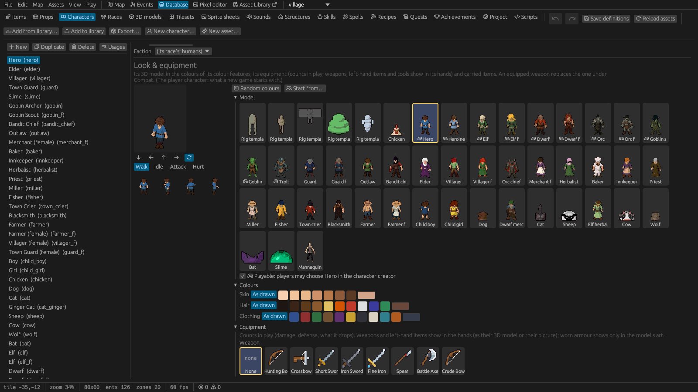</td>
  </tr>
  <tr>
    <td align="center"><em>Equipment, stats, inventory and quick bar</em></td>
    <td align="center"><em>3D characters in the pixel look, in the colours you pick</em></td>
  </tr>
  <tr>
    <td>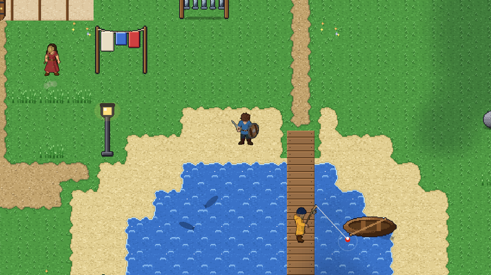</td>
    <td>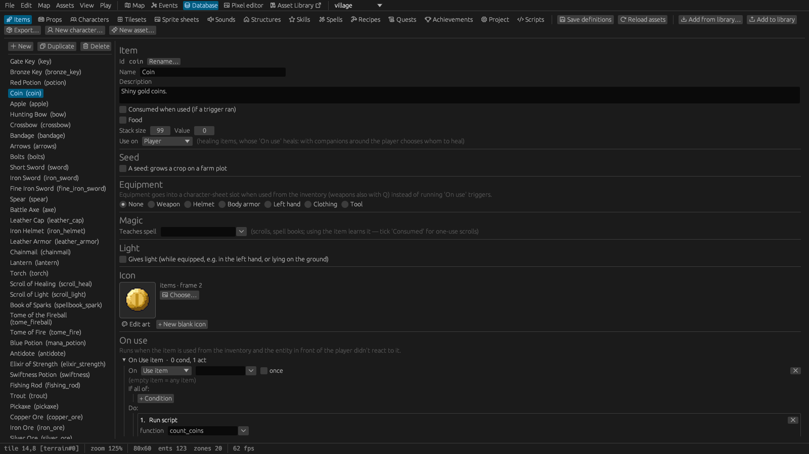</td>
  </tr>
  <tr>
    <td align="center"><em>Villagers at work, with the tools in their hands</em></td>
    <td align="center"><em>Items held in the hands: pick how, check it in the preview</em></td>
  </tr>
  <tr>
    <td>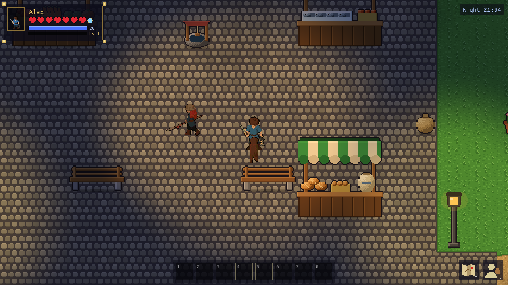</td>
    <td>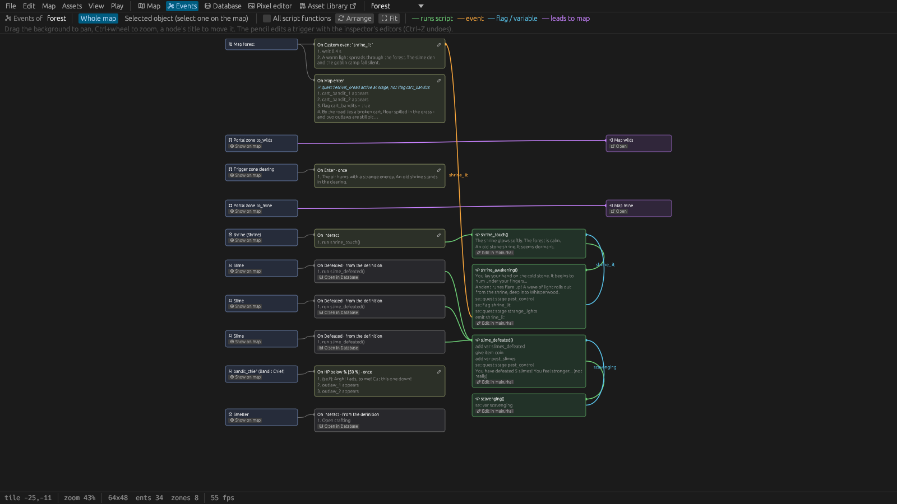</td>
  </tr>
  <tr>
    <td align="center"><em>Day and night, dynamic lights, weather</em></td>
    <td align="center"><em>See how your story hangs together in the Events graph</em></td>
  </tr>
</table>

## What you can make

**Worlds**
- Tile maps up to 1024 × 1024 tiles with any number of layers; roofs and treetops draw above the characters.
- Auto-tiling terrains: paint a path or a pond and its edges and corners fit by themselves.
- Structures: a house, a market row or a dungeon room placed with one click; capture your own from any map.
- Day and night with dynamic lights, rain, snow and fog, parallax skies and cloud shadows, ladders and watchtowers, fog of war.

**Stories**
- Events without code: triggers, conditions and actions clicked together in the editor.
- Rhai scripting when you need more, with completion, error checks, live reload and a developer console.
- Cut-scenes, dialogs with drawn portraits and moods, choices, quests with stages, a journal and achievements.
- Show pictures from events and scripts: a full-body painting when you meet someone, a letter, a map; scaled to fit, scrolling when tall.
- Translations built in: export a template, translate it, players pick their language.
- A Problems list of everything broken in the project (unknown ids, missing files, broken portals, script errors, untranslated texts), each a click away.

**Characters**
- Characters are 3D models drawn in the pixel look: they walk, strike, flinch, sit, sleep and work, and hold what they carry in their hands.
- New characters imported (Meshy, Blender, Mixamo) or generated with AI from a description; animals and monsters animated with rig templates; colour features (skin, hair, clothing) that NPCs and the player's character creator recolour.
- Villagers with daily schedules who sit on benches, sleep in their beds, visit other maps and work at their spot.
- Enemies that notice you, hunt, flee when hurt and give up when lured too far.
- Companions who follow you, fight, carry and use their own gear, and take orders.

**Gameplay**
- Real-time melee and ranged combat, experience and levels, skills and spells, status effects.
- Inventory, shops, chests, keys and a lockpicking minigame.
- Crafting, cooking and blacksmithing, gathering and mining, farming, fishing.
- Keyboard, mouse and gamepad, named save games with pictures, autosave.

**Shipping**
- Export a standalone game for **Windows, macOS, Linux and the web** from the editor on any of these systems.
- The web export writes a zip ready to upload to **itch.io** as an HTML game; Linux games also as AppImage and Flatpak.

**Building with AI, if you like**
- The editor's built-in [AI agent server](Documentation/manual/13-ai-agents.md) lets Claude Code, Cursor and other assistants read your project, build maps, quests and scripts with you, and play-test the result. Every change shows up in the editor at once and can be undone.
- Generate art with your own [Meshy](https://www.meshy.ai) account: characters with walk and attack animations, item icons, props and portraits in your project's style, from the editor or from your assistant's chat.

## Meet Emberbrook

The download includes a complete example game to play, take apart and build on. **Emberbrook** is
a village that lives by the clock: the baker kneads at dawn and has an ale in the tavern at night,
the smith hammers at his anvil, the night watch walks her rounds, and everyone goes home to bed.
Six quests lead through the village, the haunted Whisperwood with its shrine and an old mine, and
a cave opens onto the vast Wilds. Its art, sounds and three music tracks were made for R(ust)PG2D, and every asset is
also in the editor's asset library for your own games.

<table>
  <tr>
    <td>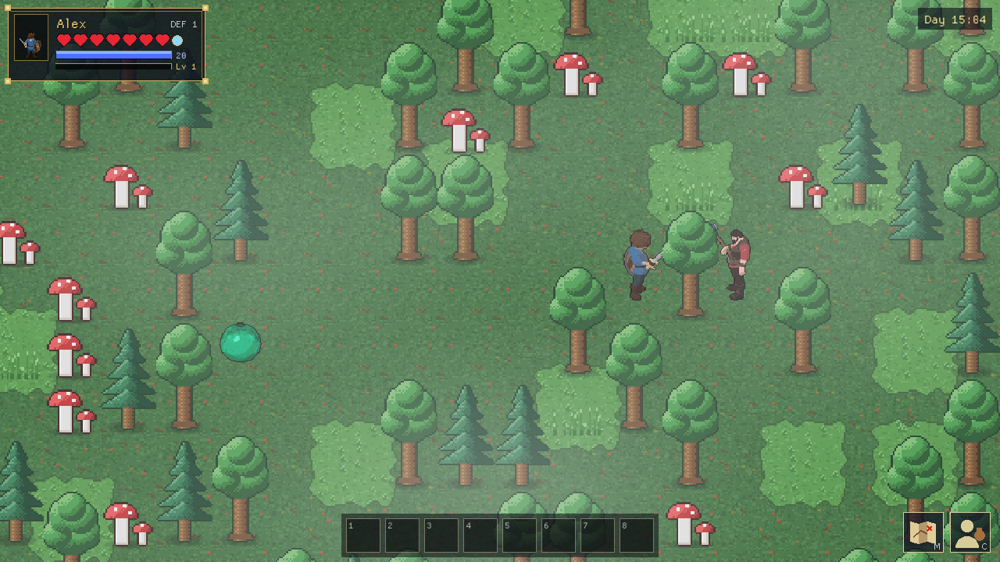</td>
    <td>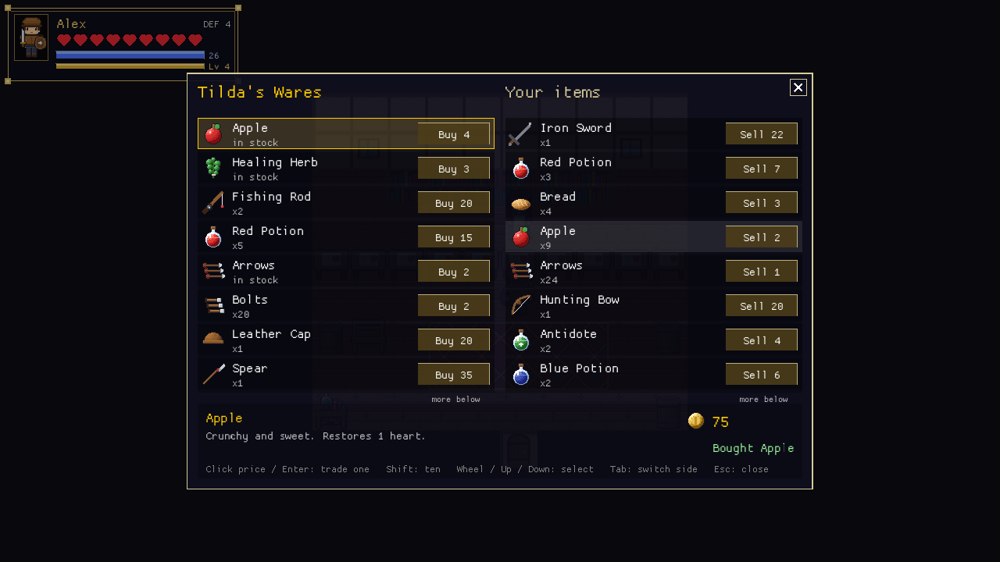</td>
    <td>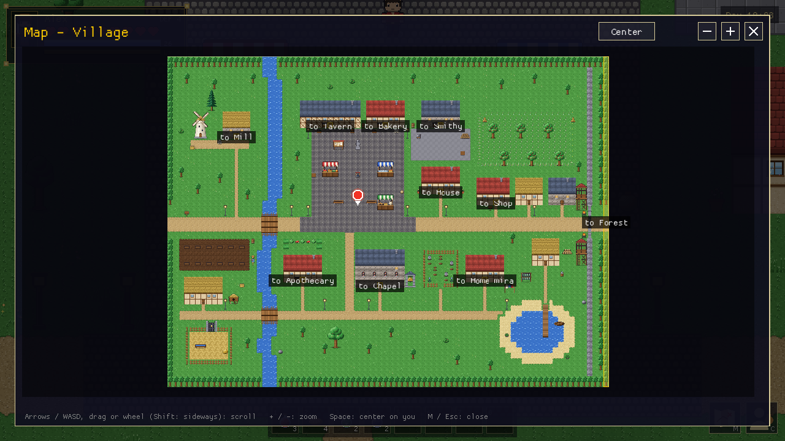</td>
  </tr>
</table>

## Download

Every [release](https://github.com/Shadowrom2020/rustpg2d/releases) has the editor, with the game
runners for every platform and the example project, for:

| System | Download | Start |
|---|---|---|
| **Windows** 10 / 11, 64-bit | `rustpg2d-X.Y.Z-windows-x86_64.zip` | Unzip, start `rustpg2d-editor.exe`. Not code-signed: SmartScreen needs *More info › Run anyway* once. |
| **macOS** 11 or newer, Apple Silicon and Intel | `rustpg2d-X.Y.Z-macos.zip` | Unzip, drag *R(ust)PG2D* into *Applications*. Not notarized: the first start needs *System Settings › Privacy & Security › Open Anyway*. |
| **Linux** x86_64, glibc 2.34+ (Debian 12, Ubuntu 22.04, Fedora 35, RHEL 9 and later) | `rustpg2d-X.Y.Z-x86_64.AppImage` or `rustpg2d-X.Y.Z.flatpak` | `chmod +x` the AppImage and start it, or `flatpak install --user rustpg2d-X.Y.Z.flatpak`. |

All of them need a graphics driver with OpenGL 3 (a virtual machine needs 3D acceleration).

## Your first game in five minutes

1. Start the editor and choose **Example project** on the welcome screen to look around, or
   **New project…** to start your own.
2. The wizard asks for a name, a folder and a few settings, and opens a first map with a start
   point. Press **F5** to play it right away.
3. Paint ground with the **Brush** or a **Terrain**, place a house with the **Structures** tool,
   and put a character on the map with the **Entities** tool.
4. Select the character and give it a trigger: *On Interact* → *Dialog* "Welcome, {player}!".
   Press **F5** and talk to it.
5. When you're happy, **File › Export game** writes a game your players can run.

The [Creator's Manual](Documentation/manual/README.md) takes it from there, from the first map to
publishing on itch.io.

## Documentation

| | |
|---|---|
| [Creator's Manual](Documentation/manual/README.md) | Everything for making games: the editor, maps, characters, events, scripting, gameplay systems, art and sound, the asset library, translations, AI agents, publishing, testing |
| [Scripting](Documentation/manual/08-scripting.md) | Every script function with examples (chapter 8 of the manual) |
| [AI agents](Documentation/manual/13-ai-agents.md) | Connecting AI assistants to the editor, and every tool they get (chapter 13) |
| [Architecture](Documentation/architecture.md) | How the engine, the game runner and the editor work inside (for developers of R(ust)PG2D) |

## Building from source

R(ust)PG2D builds with the Rust version named in `rust-toolchain.toml` (rustup installs it on first
use). On Linux it also needs the ALSA and udev headers (Debian / Ubuntu: `sudo apt install
libasound2-dev libudev-dev`; Fedora: `alsa-lib-devel systemd-devel`); on Windows the MSVC
toolchain (Visual Studio Build Tools); on macOS the Xcode command line tools
(`xcode-select --install`).

```sh
cargo build --workspace                           # the game runner and the editor
cargo run -p rustpg2d-editor                      # the editor (welcome screen)
cargo run -p rustpg2d-editor -- example_project   # the editor on the example
cargo run -p rustpg2d-game                        # play the example
cargo build --release --workspace                 # release builds, used by exports
```

The editor's exports use the game runner of the machine it runs on and look for the others next to
themselves or in `target/`. Build the ones you need:

- **Web:** `rustup target add wasm32-unknown-unknown`, then
  `cargo build --release --target wasm32-unknown-unknown -p rustpg2d-game`.
- **Windows** (from Linux): `rustup target add x86_64-pc-windows-gnu`, the MinGW-w64 cross compiler
  (`gcc-mingw-w64-x86-64` on Debian / Ubuntu, `mingw-w64-gcc` on Arch), then
  `cargo build --release --target x86_64-pc-windows-gnu -p rustpg2d-game`.

### Building on macOS

The macOS runner and editor are universal binaries (Apple Silicon and Intel) and can only be built on
a Mac: `rustup target add aarch64-apple-darwin x86_64-apple-darwin`, build
`cargo build --release -p rustpg2d-editor -p rustpg2d-game --target aarch64-apple-darwin` and the
same for `x86_64-apple-darwin`, then join each pair with
`lipo -create -output OUT target/aarch64-apple-darwin/release/NAME target/x86_64-apple-darwin/release/NAME`.
`cargo xtask-dist` packages the downloads (see [AGENTS.md](AGENTS.md)).

### Exporting for macOS

Every editor exports macOS games, also without a Mac, from the universal runner. The release
downloads ship it; in a source build on Linux or Windows, copy the universal `rustpg2d-game` from a
Mac to `target/release/rustpg2d-game-macos`. Exported apps are signed ad hoc but not notarized: the
[publishing chapter](Documentation/manual/14-publishing.md#macos) explains what players see.

## Contributing

Branches, versions, CI and releases are described in [AGENTS.md](AGENTS.md); [CLAUDE.md](CLAUDE.md)
holds the working rules for coding agents. New features are built as content first: with the
engine's events, scripts and assets, into the starter library and the example project, and the
Rust code changes only when the engine can't do it. Bug reports and ideas are welcome as
[issues](https://github.com/Shadowrom2020/rustpg2d/issues).

## License

R(ust)PG2D is released under the [MIT License](LICENSE), Copyright (c) 2026 Jürgen Herrmann: the
engine, the game runner, the editor and the example project with its art and music.

**Games made with R(ust)PG2D** are licensed however their creators decide; R(ust)PG2D sets no terms
for your maps, art, scripts or story. An exported game's executable is the R(ust)PG2D game runner,
so every export includes the engine's license as `rustpg2d-LICENSE.txt`, which is all the MIT
License asks for.
